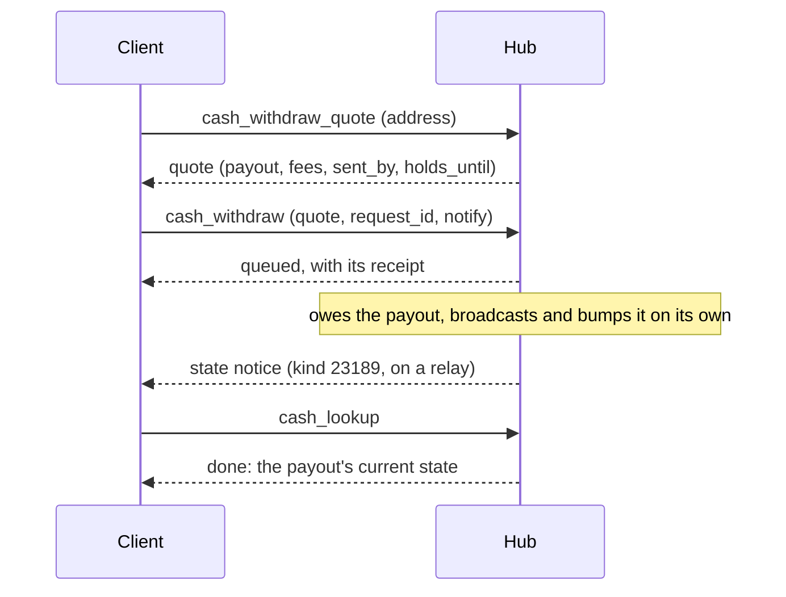
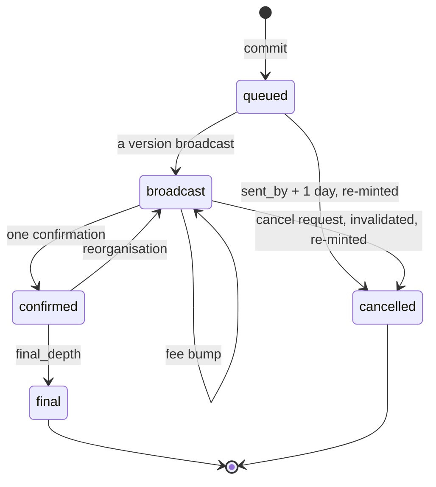
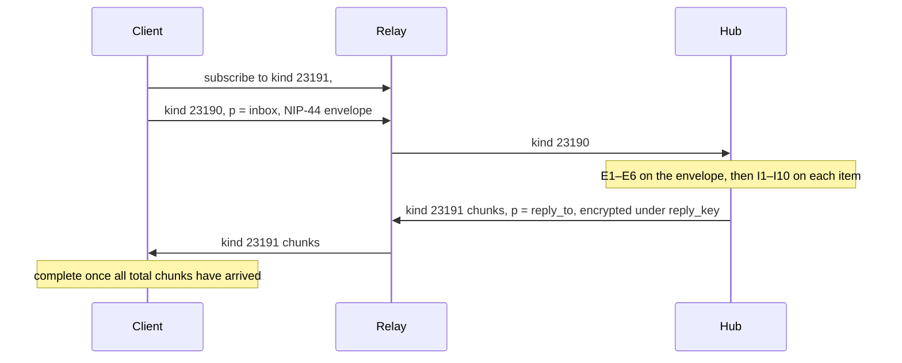
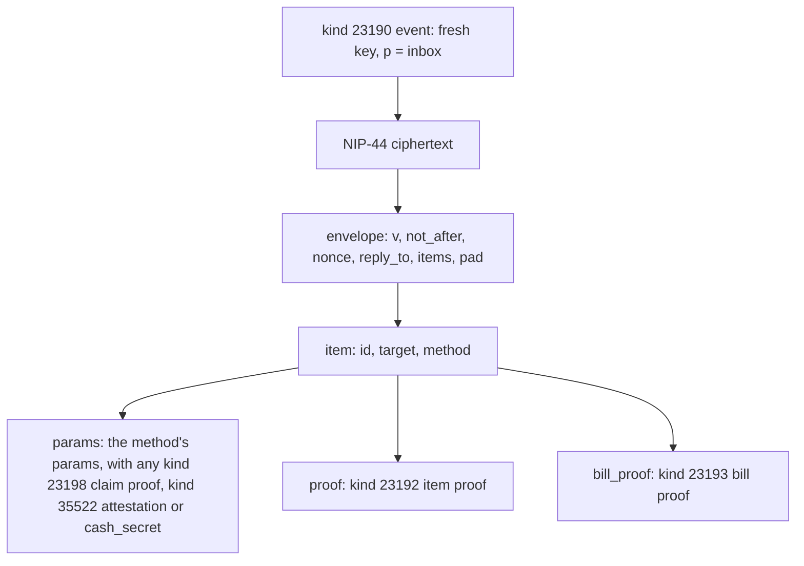
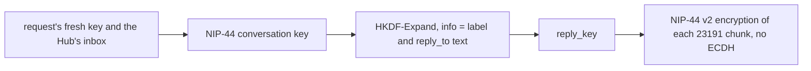
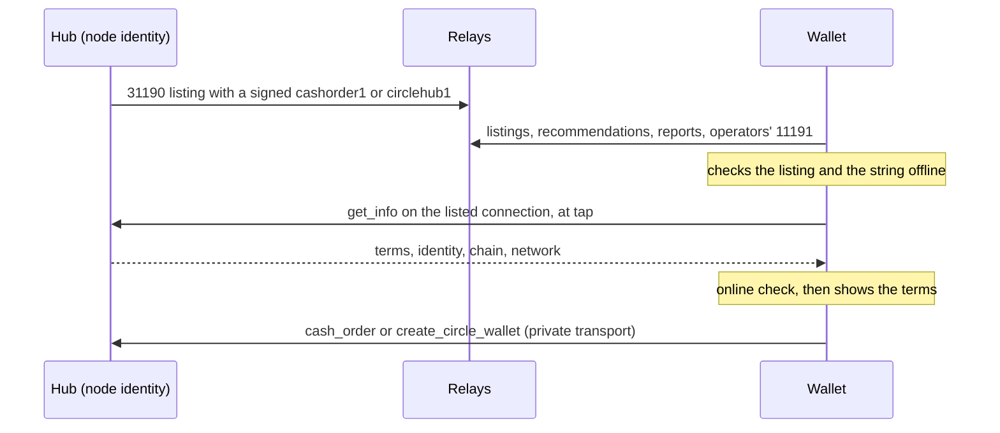
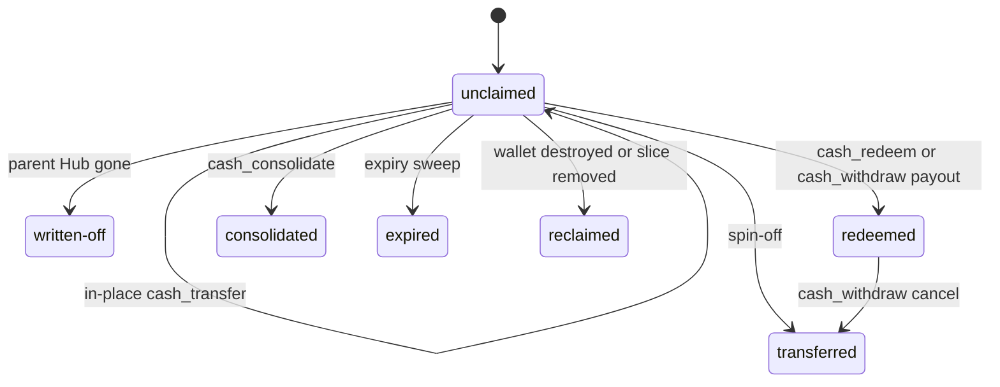

NIP-CASH
========

Cash Hub
--------

`draft` `optional` `nwc`

**Depends on**: [NIP-44](https://github.com/nostr-protocol/nips/blob/master/44.md) (Encrypted Payloads), [NIP-47](https://github.com/nostr-protocol/nips/blob/master/47.md) (Nostr Wallet Connect); for proof of work, [NIP-11](https://github.com/nostr-protocol/nips/blob/master/11.md) (Relay Information Document), [NIP-13](https://github.com/nostr-protocol/nips/blob/master/13.md) (Proof of Work) and [NIP-40](https://github.com/nostr-protocol/nips/blob/master/40.md) (Expiration Timestamp)
**For listings**: [NIP-09](https://github.com/nostr-protocol/nips/blob/master/09.md) (Event Deletion Request), [NIP-31](https://github.com/nostr-protocol/nips/blob/master/31.md) (Unknown Events), [NIP-32](https://github.com/nostr-protocol/nips/blob/master/32.md) (Labeling), [NIP-51](https://github.com/nostr-protocol/nips/blob/master/51.md) (Lists), [NIP-56](https://github.com/nostr-protocol/nips/blob/master/56.md) (Reporting) and [NIP-65](https://github.com/nostr-protocol/nips/blob/master/65.md) (Relay List Metadata); optionally [NIP-50](https://github.com/nostr-protocol/nips/blob/master/50.md) (Search)
**Related**: [NIP-CO](./NIP-CO.md) (Cash Order), [NIP-CW](./NIP-CW.md) (Circle Wallet), [NIP-CZ](./NIP-CZ.md) (Cash Zaps), [NIP-IC](./NIP-IC.md) (Identity Connection)

## Abstract

Cash Hub is an ecash system for energy-backed Lightning coins — Bitcoin, and any other
coin this format extends to. It mints **cash tokens**: bech32 strings (`satscash1...` for Bitcoin,
another prefix for each other coin) that carry real, spendable value the moment they're minted, as a
specially-scoped NWC connection.

A token is passed around like a banknote (in a zap ([NIP-CZ](./NIP-CZ.md)), a chat message, or offline),
redeemed to a Lightning invoice or an on-chain address, or transferred whole or in part with no Lightning
hop. One `mint_cash` can fund many recipients on one shared connection; each share is either bound to an
identity — a Nostr pubkey, or a Web Identity's ConnectionKey vouched for by an Identity Authority — or
bound only to a secret the caller holds: ordinary ecash, `cash` mode.

**Contents**

| Part | Sections |
|---|---|
| Basics | [Terminology](#terminology) · [Methods](#methods) · [Errors](#errors) · [Claim Proofs](#claim-proofs-kind-23198) · [Data Model](#data-model) |
| Bill methods | [Minting Cash](#minting-cash) · [Redeeming](#redeeming-a-slice-cash_redeem) · [On-chain](#redeeming-on-chain-cash_withdraw) · [Redeem Fee](#the-redeem-fee) · [Cash Status](#cash-status-cash_status) · [Transferring](#transferring-and-splitting-a-slice-cash_transfer) · [Spin-offs](#spinning-a-slice-off-into-a-dedicated-wallet) · [Consolidating](#consolidating-tokens-cash_consolidate) |
| Reliability | [Lost Replies](#lost-replies) · [Cash-Mode Slices](#cash-mode-slices) |
| Private transport | [The Private Transport](#the-private-transport) · [Announcement](#the-hub-announcement-kind-11190) · [Proof of Work](#proof-of-work) · [Envelopes](#envelopes) · [Item Proofs](#item-proofs-kind-23192) · [Bill Proofs](#bill-proofs-kind-23193) · [Responses](#responses-kind-23191) · [Serving an Envelope](#serving-an-envelope) |
| Credentials | [The Cash Token](#the-cash-token-satscash1-) · [Mint Provenance](#mint-provenance) · [Cash Hub Connection](#the-cash-hub-connection-cashhub1) · [Connection Signatures](#connection-signatures) · [Network and Chain](#network-and-chain) |
| Discovery | [Listing Offers](#listing-offers) · [Offer Listing](#offer-listing-kind-31190) · [Hub Rules](#hub-rules) · [Wallet Rules](#wallet-rules) · [Fetching](#fetching-listings) |
| Scope | [Scope Surface](#scope-surface) |
| Lifecycle | [Lifecycle and Deletion](#lifecycle-and-deletion) · [Security](#security-considerations) · [Privacy](#privacy-considerations) |

## Non-Goals

This document doesn't define membership or eligibility policy: the `mint_cash` caller decides, per call,
whether each recipient's share goes to a named identity (`pubkey` or `connection_key`) or to no one in
particular (`cash` mode). Naming a recipient is never mandatory.

## Terminology

- **cash token**: a bech32 string like `satscash1...` (Bitcoin) — the
  NIP-19-style credential for one Cash Wallet, which its recipients hold and redeem from. This document
  calls a Cash Wallet, as its token's holders see it, a **bill**: a single-recipient bill is handed on
  much like physical cash, while a multi-recipient bill is shared access to a pool of several
  recipients' independent shares (see the next entries).
- **Cash Wallet**: the NWC connection a cash token names by its wallet pubkey, relays and secret — one token,
  shared by every recipient it was created for; a wallet a split or other spin-off creates has exactly one
  recipient, as §Transferring and Splitting a Slice describes. This is the custody/transport mechanism a cash
  token rides on, not a separate end-user-facing concept.
- **Cash Hub**: the wallet owner's own connection for minting cash tokens. It spends from its own
  balance to fund each one.
- **recipient / slice**: one `(identity, amount)` pair inside a Cash Wallet. A wallet's total funding MUST
  equal the sum of its slices. A slice's identity MAY be reassigned pre-redemption via `cash_transfer`; its
  amount is immutable — a split consumes the slice whole and re-mints fresh wallets rather than rewriting it.
- **identity**: an OPTIONAL binding on a slice, checked on every claim (redeem, withdraw, transfer, consolidate) instead
  of trusting mere possession of the connection — a raw Nostr `pubkey`, or, for a recipient not on Nostr yet,
  a `connection_key` (an identifier an Identity Authority vouches for, standing in for a Web Identity — a
  Discord account, an email, a domain).
  - A slice left unbound is `cash` mode: ordinary ecash, redeemable by whoever holds its secret.
  - A `connection_key`'s `identity_value` is NIP-IC's `ConnectionKey`:
    `hex(SHA256("<platform>:<platform-user-id>"))`, in lowercase hex, and it always travels with the
    `ia_pubkey` that attests it. A Nostr pubkey is never hashed into one.
  - A sender MAY derive it from typed input only for a platform NIP-IC gives a canonical form, with the
    identifier in that form and under NIP-IC's strict input rules: input those rules would change is refused,
    never mapped.
  - For any other platform the sender MUST NOT derive it from typed input: it takes the ConnectionKey itself,
    byte for byte, from the recipient's `35522` attestation or `nconnection`.
- **cash mode**: the mode a slice is in when it carries no identity binding at all — `identity_type: "cash"`
  on the wire, with its secret carried as `cash_secret`; its `identity_value` is the SHA-256 commitment of
  that secret. Implementations MUST send and accept only `cash`, and MUST reject `bearer` as an unknown
  identity type. On the private transport an item for a cash-mode slice carries no item proof, its secret
  standing in where the method needs one, and is called a **bearer item**.
- **Identity Authority (IA)**: NIP-IC's third party that verifies a Web Identity and attests, via a
  kind-35522 event (NIP-IC's own Attestation kind — this document verifies it, it doesn't define it), which
  Nostr pubkey controls the account a `connection_key` names. A Hub accepts only the IAs on its wallet
  owner's allowlist.
- **min_transfer_millis**: a floor, in millis, on how small a piece a split may carve off or leave behind
  (zero = no floor).
- **redeem_fee_base / redeem_fee_ppm**: a flat amount in millis plus a parts-per-million rate: the fee on a
  `cash_redeem` that resolves to an external Lightning payment, and the floor of a `cash_withdraw` fee (zero =
  free). See §The Redeem Fee.
- **millis**: this document's amount unit — one-thousandth of whatever base unit the connection's own coin
  uses for Lightning-payable amounts (milli-satoshi for a Bitcoin-backed Cash Hub, and for any other
  energy-backed coin the milli-unit its implementation defines). Fixed per Cash Hub by which coin it mints
  for; never mixed within one wallet or one call.
- **node identity**: the key of the Lightning node a Cash Hub runs on. It signs the Hub's bills, its
  announcement, its connection strings and its listings.
- **listing**: a kind-31190 event in which a Hub's node identity advertises one Order connection or circle;
  it never sets terms.
- **operator**: the Nostr account that runs a listed offer, when it is not the node's own; one node can host
  several operators' Hubs.
- **curator**: an account whose signals a user trusts beyond their follows (§Curators).

`min_transfer_millis`, `redeem_fee_base` and `redeem_fee_ppm` are Hub-level defaults, stamped onto each
slice at creation and thereafter fixed on that slice and inherited unchanged across splits.

Wherever this document carries an expiry timestamp (`expires_at`, or a payload's `<expires_at>`), a reader
MUST read an omitted field, `null` and `0` alike as "never expires". Each writer still follows its own
field's rule. A request's `expiry` duration is not a timestamp, and keeps its own rule.

## Methods

| Method | Caller | Scope | Purpose |
|---|---|---|---|
| `mint_cash` | wallet owner, over the Cash Hub connection | `cash_hub` | Fund and mint cash tokens for one or more recipients |
| `cash_redeem` | a recipient, over the Cash Wallet connection | `cash_redeem` | Collect one recipient's exact slice — identity-bound or `cash` |
| `cash_withdraw_quote` | a recipient, over the Cash Wallet connection | `cash_redeem` | Quote an on-chain payout of one slice — see §Redeeming On-chain |
| `cash_withdraw` | a recipient, over the Cash Wallet connection | `cash_redeem` | Collect one slice on-chain at a quoted payout |
| `cash_transfer` | a recipient, proof-gated against their current registered identity | `cash_transfer` | Reassign an unredeemed slice's identity, or split part of its value off into a new cash token — see §Transferring and Splitting a Slice |
| `cash_consolidate` | a recipient controlling every source slice, proof-gated against each | `cash_consolidate` | Combine several same-hub slices this node custodies into one new cash token — see §Consolidating Tokens |
| `cash_status` | any holder of the Cash Wallet connection | `cash_redeem` | The bill's state: the read-only roster of every recipient, including each slice's redeem fee quote, or a tombstone for a destroyed bill — see §Cash Status |
| `cash_lookup` | whoever authorized the original call | none | Read the outcome of a `mint_cash`, `cash_transfer` or `cash_consolidate` whose reply was lost, the state of a `cash_withdraw` payout, or the state of a NIP-CO order — see §Lost Replies |

Every refusal below uses a code from §Errors.

`cash_redeem`, `cash_withdraw`, `cash_transfer`, and `cash_consolidate` each take an `identity_event` (or, for a `cash` slice,
`cash_secret`) authenticating the caller against the slice they're acting on.

- That `identity_event`, the **claim proof**, MUST be a **kind-23198** event — this document's own event kind,
  defined nowhere else.
- It is single-use, freshly signed for each call, and never independently published to a relay (it only ever
  travels embedded inside an already end-to-end-encrypted request) — §Claim Proofs (kind 23198) gives its tags
  and checks. It is not NIP-IC's kind 35521.
- In this document `proof` names only an item's kind-23192 item proof on the private transport, never the
  claim proof.

### Event Kinds

| Kind | Range | Signed by | Purpose |
|---|---|---|---|
| `23198` | ephemeral | the slice's registered pubkey, or for a `connection_key` slice its attestation's `p` | Claim proof for `cash_redeem`, `cash_withdraw`, `cash_transfer` and `cash_consolidate`; never published |
| `11190` | replaceable | the Hub's node identity | Hub announcement: how to reach the private transport |
| `23190` | ephemeral | a fresh ephemeral key, used once | Private request envelope |
| `23191` | ephemeral | a fresh key used once, for the Hub; authenticated by the reply key | Private response |
| `23192` | ephemeral | the slice's registered identity (none for a bearer item) | Item proof, one per item |
| `23193` | ephemeral | the bill's connection secret | Bill proof, one per item |
| `23187` | ephemeral | the Hub's node identity | Withdraw quote; never published |
| `23188` | ephemeral | the Hub's node identity | Withdraw receipt; never published |
| `31190` | addressable | the Hub's node identity | Offer listing |
| `11191` | replaceable | the operator | The operator's offers, a NIP-51 standard list |
| `31191` | addressable | any user | Recommendation of an offer |

This document also verifies NIP-IC's kind `35522` attestations; it does not define them.

### Errors

A Hub MUST refuse with these NIP-47 error codes, on either transport. `BAD_REQUEST` and `REQUEST_REUSED` are
this document's own; the rest are NIP-47's:

| code | meaning | retry? |
|---|---|---|
| `BAD_REQUEST` | a malformed request: a field missing, malformed, forbidden or out of range; or a call that reached its commit after its deadline | no; a corrected call is a new call |
| `REQUEST_REUSED` | the call's `request_id` is already used on this node | no; look the call up |
| `RESTRICTED` | Hub policy refuses it: an untrusted IA, an expiry over the ceiling, a slice already claimed or past its expiry, dust, consolidate terms that differ, a zero payout, an invoice outside the Hub's payment policy, an address or quote the Hub will not pay | no |
| `UNAUTHORIZED` | a slice proof, attestation or cash secret that does not verify, a proof already used, or a consolidate source the caller has not proved it controls | yes, with a valid proof |
| `INSUFFICIENT_BALANCE` | the Hub's balance, or a source wallet's, does not cover the call | yes, later |
| `QUOTA_EXCEEDED` | a ceiling or cap: the per-wallet funding ceiling, a recipient or source cap, an envelope limit, the verification budget | yes, with less |
| `RATE_LIMITED` | the caller has asked too often, too many redemptions are in flight, or a `mint_cash` could not be serialized | yes, later |
| `NOT_FOUND` | the sender holds the bill but no slice of it | no |
| `NOT_IMPLEMENTED` | the method is not served on this transport or connection | no |
| `PAYMENT_FAILED` | `cash_redeem`'s payment failed, or could not be routed within the Hub's fee bound, and the slice stays claimable | yes |
| `INTERNAL` | anything else that failed on the Hub's side | yes, later |

A client acts on the code; the message is for people. `error` is always this NIP-47 object: a destroyed
bill is answered with a `result`, never with an error. On the private transport a refusal is an error only
once the item's bill proof has verified, and an omission otherwise.

When §Redeeming On-chain gives a refusal a `detail`, a Hub SHOULD add it to `error` as a `detail` field: one
of `network`, `script_type`, `below_min`, `too_slow`, `quote_invalid`, `quote_expired`, `unfinal` and
`own_address`. A client reads any other value, or none, as no detail.

**A client MUST NOT read an error other than `BAD_REQUEST` on a call carrying a `request_id` as a
failure.** The call's outcome is open: the client keeps it pending and looks it up with `cash_lookup`,
and tries again only as §Lost Replies allows, never by resending the same `request_id`.

### Freshness

A Hub MUST accept a kind-23192, 23193 or 23198 event only if its `created_at` lies from 5 minutes before
to 1 minute after the Hub's own clock, both bounds inclusive: `now − 300 ≤ created_at ≤ now + 60`, in
seconds.

### Claim Proofs (kind 23198)

A claim proof binds its signer to one slice and to one specific call. Its tags:

| tag | value | carried by |
|---|---|---|
| `d` | the slice's wallet pubkey (for `cash_consolidate`, that source's `wallet_pubkey`) | every claim proof |
| `m` | the method: `cash_redeem`, `cash_withdraw`, `cash_transfer` or `cash_consolidate` | every claim proof |
| `bolt11_hash` | the invoice's payment hash | `cash_redeem` |
| `q` | the id of the withdraw quote | `cash_withdraw` |
| `new_identity_hash` | the hash of `new_identity` | `cash_transfer`, `cash_consolidate` |
| `amount_millis` | the amount the call moves | `cash_transfer`, `cash_consolidate` |
| `s` | the hash of the call's source list (below) | `cash_consolidate` |
| `connection_key` | the slice's `identity_value` | a `connection_key` slice |
| `e` | the id of the accompanying `attestation_event` | a `connection_key` slice |

Each tag appears exactly once and its value is a string: `d`, `bolt11_hash`, `q`, `new_identity_hash`, `s`,
`connection_key` and `e` as 64 lowercase hex; `m` the method name; `amount_millis` unsigned decimal with no
leading zeros. `content` is empty, and tag order is free. A Hub MUST treat a claim proof as one that does not
verify when it lacks a tag its method and slice need, repeats one, carries one of these tags its method or
slice does not use, or departs from these encodings.

`s` is the lowercase hex `sha256` of the ASCII concatenation of every `sources[*].wallet_pubkey` of the
call, in `sources` order, each as 64 lowercase hex.

A Hub MUST verify a claim proof as follows, and MUST refuse with `UNAUTHORIZED` a proof that fails any
check, except where this list names another code:

1. It parses to an event of kind 23198, its `id` equals the id recomputed from its content (NIP-01), and its
   signature verifies against its `pubkey` over that id.
2. Its `created_at` is fresh.
3. Its tags match the call as the method's Request section requires, with the encodings above.
4. Its recomputed id is not one the Hub has already consumed (below).
5. Its signer is the slice's registered identity: the registered pubkey for a `pubkey` slice. For a
   `connection_key` slice, the Hub MUST verify every one of the following:
   - `attestation_event` parses to an event of kind 35522 whose `id` equals its recomputed id and whose
     signature verifies;
   - its `pubkey` equals the `ia_pubkey` recorded on the slice, not merely any trusted Identity Authority;
   - its `d` tag equals the slice's `identity_value`;
   - its `p` tag equals the kind-23198 signer;
   - it carries a `platform` tag, an `evidence` tag and an `expiration` tag that has not passed;
   - the kind-23198 proof's `connection_key` tag equals the slice's `identity_value`, and its `e` tag equals
     the attestation's recomputed id.

   Once all of these hold, an `ia_pubkey` that is not on the wallet owner's allowlist at that moment is
   refused with `RESTRICTED`.

On the private transport, a client MUST sign the kind-23192 item proof of an item carrying a claim proof
with the same key that signed the claim proof (`sources[0]`'s, for `cash_consolidate`), and a Hub MUST treat
an item proof by any other key as one that does not verify. The claim proof covers the call's
binding fields, and the item proof covers every other param, such as `zap_target`, `request_id`,
`remainder_commitment` and `amount`.

**A claim proof is single-use.** A Hub consumes a claim proof when the call it authorized commits, tracking
it by its recomputed event id, independent of the call's parameters, and MUST keep each consumed id at least
until its `created_at` plus 6 minutes. A proof that failed verification, or whose call was refused or
never committed, is not consumed, so a legitimate caller can retry with the identical proof.

For example, claim proofs by the pubkey `79be667ef9dcbbac55a06295ce870b07029bfcdb2dce28d959f2815b16f81798`,
with `created_at` `1720000000` and `content` empty, the tags in the order listed:

| proof | tags | NIP-01 event id |
|---|---|---|
| the `cash_redeem` claim proof | `["d", <64 1s>]`, `["m", "cash_redeem"]` and `["bolt11_hash", <64 4s>]` | `ad995b77237f369c79c5df82729d465eb9b5b4ddafb815995dee99db8d6b07c8` |
| the `cash_transfer` claim proof by the same key at the same time | `["d", <64 1s>]`, `["m", "cash_transfer"]`, `["new_identity_hash", "90aad9efdfc1980322c6248a266df6bca9d766bb360654f5e2bfecccc941bed0"]` (a `pubkey` `new_identity` of that same key) and `["amount_millis", "5000"]` | `c466018a22842f8b79c7447cebf3a023add78ff7d053d8b715205343ae4ad8df` |

A consolidate of the two sources <64 1s> and <64 2s>, in that order, has `s`
`ca9034371c79ec26ec0496b53420a1117d4f765800dfdce138138b139d591f13`.

## Data Model

This section describes what a Cash Hub, and the wallets it creates to hold minted cash, MUST be able to
represent; storage is out of scope.

A Cash Hub MUST maintain, for itself:

- a ceiling on the total cash a single Cash Wallet created from it may carry;
- a ceiling on, and default value for, how long a Cash Wallet's cash may remain unredeemed. This ceiling
  MAY instead be "never" (no ceiling at all) — a Hub configured this way imposes no expiry on any cash it
  mints unless the `mint_cash` caller requests one of their own;
- a default value for `min_transfer_millis`, applied to every slice a
  freshly-minted wallet carries. Zero (no floor) is a valid default, though implementations SHOULD ship a
  default above zero;
- a default value for `redeem_fee_base` and `redeem_fee_ppm`, applied to every slice a
  freshly-minted wallet carries. Zero (free) is a valid default for either. `redeem_fee_ppm` is a
  parts-per-million rate, so it MUST be bounded at 1,000,000 — the whole slice. A Hub MUST reject a
  configured value above that bound rather than clamp it;
- if it offers on-chain withdrawals: its current `withdraw_fee_base` and `withdraw_fee_ppm`, the ppm bounded
  as `redeem_fee_ppm` is; its withdrawal minimum and maximum; the script types it pays; and its
  `final_depth`, a number of confirmations;
- the retention window for answering about a destroyed bill, in seconds.
  Zero disables tombstones. It MUST be bounded by the same absolute bound the expiry ceiling uses (`expiry`), with the same reject-rather-than-clamp requirement;

For each Cash Wallet it creates, an implementation MUST be able to determine which Hub minted its cash —
§Lifecycle and Deletion needs this for its reclaim behavior.

For each recipient slice, an implementation MUST track:

- the identity type and value currently registered for this slice;
- the attesting Identity Authority's pubkey, for `connection_key`-mode registered identities;
- the committed amount, fixed for the slice's whole life — a redemption, a split, or a consolidate
  consumes the slice entirely; nothing ever rewrites it to a smaller value in place;
- whether, and when, the slice has been redeemed;
- this slice's own `min_transfer_millis` floor, `redeem_fee_base` and `redeem_fee_ppm` — fixed when the slice was created,
  from the Hub's default or inherited from the source slice it was split from;
- whether the slice's value was moved into a brand-new dedicated Cash Wallet, either in full or as part of a
  split, and if so, which one — informational only (an implementation MAY surface this for an operator's own
  bookkeeping); it changes no guard. A wallet created this way SHOULD, symmetrically, record which slice it
  was split from;
- whether the slice is **ordered**: minted for a [NIP-CO](./NIP-CO.md) order, or made from ordered slices
  only. An ordered slice never expires, and its owner can neither delete its wallet nor remove it;
- whether the slice was re-minted by a `cash_withdraw` cancel; its owner can neither delete its wallet nor
  remove it.

An implementation MUST treat a slice's registered identity as mutable pre-redemption (via an in-place
reassignment), but its committed amount as immutable, exactly as §Transferring and Splitting a Slice
describes.

For a `cash`-mode slice, the above degenerates: there's no registered identity, only a
secret to verify a redemption against. An implementation MUST be able to verify a presented cash secret
without persisting it in any form that discloses it — a one-way commitment, not the secret itself.

A Cash Wallet MUST be created, funded, and made usable in one step. Implementations MUST NOT introduce an
intermediate state where the wallet exists but isn't yet funded, or isn't yet reachable by its
recipients. Once created, a Cash Wallet's budget, expiry, and any system-assigned label MUST NOT be
alterable through whatever general-purpose connection-management interface the implementation offers for
other connection types. These values are fixed when the wallet is created.

## Minting Cash

### Request

```jsonc
{
  "recipients": [
    {"identity_type": "pubkey", "identity_value": "<hex pubkey>", "amount_millis": 21000},
    {"identity_type": "connection_key", "identity_value": "abc123", "ia_pubkey": "<hex IA pubkey>", "amount_millis": 5000}
  ],
  "expiry": 86400, // seconds
  "request_id": "<32–64 lowercase hex chars>" // REQUIRED — §Lost Replies
}
```

A `cash` recipient MUST instead be the request's only recipient — a cash-mode slice's wallet is always
single-recipient, never mixed with a `pubkey`/`connection_key` entry or a second `cash` entry:

```jsonc
{
  "recipients": [
    {"identity_type": "cash", "identity_value": "<hex sha256 commitment the caller generated>", "amount_millis": 3000}
  ],
  "request_id": "<32–64 lowercase hex chars>"
}
```

- `recipients` — MUST contain at least one entry, and an implementation MAY cap how many (e.g. at 100; an
  implementation that caps both SHOULD use the same limit for `cash_consolidate`'s `sources` — §Consolidating
  Tokens). A Hub MUST refuse a request over the cap whole with `QUOTA_EXCEEDED`, never partially fulfil it.
  - Each entry's `identity_type` MUST be `pubkey`, `connection_key`, or `cash`. A `connection_key` entry MUST
    also carry `ia_pubkey`.
  - A `cash` entry MUST carry `identity_value`, the `sha256` commitment of a secret the caller generated, and
    MUST NOT carry `ia_pubkey` or `cash_secret`.
  - A `cash` entry MUST be the request's only entry; a Hub MUST refuse a request mixing a `cash` entry with
    any other entry in its entirety with `BAD_REQUEST`, not just that one recipient.
  - A Hub MUST refuse with `BAD_REQUEST` a request naming the same (`identity_type`, `identity_value`,
    `ia_pubkey`) twice.

  | `identity_type` | the entry also carries | never carries | alongside other entries? |
  |---|---|---|---|
  | `pubkey` | `identity_value`, `amount_millis` | `cash_secret` | yes |
  | `connection_key` | `identity_value`, `ia_pubkey`, `amount_millis` | `cash_secret` | yes |
  | `cash` | `identity_value` (the commitment), `amount_millis` | `ia_pubkey`, `cash_secret` | no, the only entry |
- `expiry` — OPTIONAL.
  - If omitted or zero, it MUST default to the Hub's own expiry ceiling — which itself MAY be "never," in
    which case an omitted/zero `expiry` here produces a Cash Wallet that never expires, not an already-expired
    one.
  - A caller MAY still request its own, finite `expiry` even when the Hub's own ceiling is "never"; it MUST
    then be honored exactly up to whatever absolute bound the implementation's own time representation
    imposes.
  - Such a bound is a representational limit, not a policy: it MUST be far beyond any lifetime a caller would
    legitimately request, and a Hub MUST refuse a request exceeding it with `BAD_REQUEST` rather than silently
    clamp it.
  - For example, a bound of 100 years stays clear of a nanosecond-resolution timestamp's wraparound.

  Step 5 below resolves it:

  | the Hub's expiry ceiling | `expiry` omitted or zero | `expiry` given |
  |---|---|---|
  | "never" | a Cash Wallet with no expiry at all | honored exactly, up to the representational bound; beyond it, `BAD_REQUEST` |
  | a real, positive value | the ceiling | honored up to the ceiling; a longer one, `RESTRICTED` |
- `request_id` — REQUIRED, and a Hub MUST refuse a request without one with `BAD_REQUEST`.
  The caller MUST also put a NIP-47 `expiration` tag on the request, no more than the Hub's
  `max_request_age` ahead, and the Hub MUST NOT commit it after that instant, checked at commit time. A Hub MUST refuse a request carrying `idempotency_key` with `BAD_REQUEST` (step 4
  below).

`min_transfer_millis` is NOT a request field here, and a Hub MUST refuse a request carrying it with
`BAD_REQUEST` rather than ignore it — it's a Hub-level setting.

### Response

```json
{
  "wallet_pubkey": "<hex>",
  "cash_token": "satscash1...",
  "expires_at": 1720000000,
  "recipients": [
    {"identity_type": "pubkey", "identity_value": "...", "amount_millis": 21000},
    {"identity_type": "connection_key", "identity_value": "abc123", "ia_pubkey": "<hex IA pubkey>", "amount_millis": 5000}
  ]
}
```

`expires_at` is omitted entirely if this wallet never expires — see §Data Model and this section's own
Processing Algorithm, step 5.

`cash_token` alone is the new bill's connection credential.

**A Hub MUST NOT return an empty `cash_token`.** A Hub that cannot produce the token (an unobtainable mint
signature, a TLV over its length limit) MUST fail the mint with `INTERNAL`, and MUST build the token, mint
signature included, before committing any funds.

For the single-`cash`-recipient request shape above, the response's `recipients` entry echoes the caller's
commitment. It never carries a secret: the caller generated it and already holds it.

```jsonc
{"identity_type": "cash", "identity_value": "<the caller's commitment>", "amount_millis": 3000}
```

### Processing Algorithm

On receiving `mint_cash`, the Hub MUST, in order:

1. Serialize against any other concurrent `mint_cash` attempt for this same Hub, however many
   interfaces the implementation exposes for issuing this request. Two concurrent requests must never
   both proceed past a stale balance read. A request that can't be serialized MUST be refused with
   `RATE_LIMITED`, not queued.
2. Verify that the request carries a `request_id` and that it is well formed, refusing with `BAD_REQUEST`
   otherwise, and that it is unused, before any other check (`request_id`).
   - **A used `request_id` MUST be refused with `REQUEST_REUSED` rather than mint again**, whatever else is
     wrong with the request. This check also marks the id used, in the same atomic step.
   - Then verify that the request carries a NIP-47 `expiration` that has not passed and lies within
     `max_request_age`, refusing with `BAD_REQUEST` otherwise.
3. Validate every recipient.
   - `amount_millis` MUST be strictly positive.
   - The running sum of all recipients' amounts MUST be computed with an explicit overflow check, refusing
     with `BAD_REQUEST` before an unsigned wraparound can occur, and MUST NOT exceed the Hub's own per-wallet
     funding ceiling, which is refused with `QUOTA_EXCEEDED`.
   - If any recipient is `cash`-mode, `recipients` MUST contain exactly that one entry and no other — refuse
     the entire request with `BAD_REQUEST` otherwise. Two entries naming the same identity are refused with
     `BAD_REQUEST`.
4. For each `connection_key`-mode recipient, verify its `ia_pubkey` is on the wallet owner's trusted Identity
   Authority allowlist right now.
   - An untrusted or unknown IA MUST refuse the entire request with `RESTRICTED`, not just that recipient.
   - For each `cash`-mode recipient, verify `identity_value` is a well-formed commitment, refusing with
     `BAD_REQUEST` otherwise.
   - A request carrying a `cash_secret` on any recipient, an `idempotency_key` or a `min_transfer_millis` MUST
     be refused whole with `BAD_REQUEST`, not have the field ignored.
5. Resolve `expiry`.
   - If the Hub's own expiry ceiling is "never," an omitted/zero `expiry` here MUST produce a Cash Wallet with
     no expiry at all — never a zero-duration, already-expired one — and any explicit, positive `expiry` the
     caller does supply MUST be honored exactly, subject only to the implementation's own representational
     bound (`expiry`).
   - Otherwise (the Hub's own ceiling is a real, positive value): if omitted or zero, set it to the Hub's own
     expiry ceiling; otherwise it MUST NOT exceed that ceiling, and a longer one is refused with `RESTRICTED`.
6. Verify the Hub's own available balance is at least the sum of all recipients' amounts, refusing with
   `INSUFFICIENT_BALANCE` otherwise.
7. Create the Cash Wallet connection, record one slice per recipient — stamping each with the Hub's current
   `min_transfer_millis`, `redeem_fee_base` and `redeem_fee_ppm` defaults and a one-way commitment of the
   secret for `cash`-mode slices, never the secret itself — and perform a single internal transfer from the
   Hub to the new connection for the full sum.
   - This MUST be atomic: a failure at any point after this step MUST leave no partial state. Write the
     `request_id` record now, in the same atomic step, checking `expiration` again as it commits; a request
     that reaches this commit after its `expiration` is refused with `BAD_REQUEST`.
8. Return the cash token and the resolved recipient list.

A request that fails any check above MUST be rejected before step 7. No partial wallet, slice, or
transfer is ever observable from a rejected request.

## Redeeming a Slice (`cash_redeem`)

A recipient collects their exact slice by presenting a fresh Lightning invoice over the Cash Wallet
connection, together with proof binding them to the slice they're redeeming.

### Request

```json
{
  "invoice": "lnbc...",
  "amount": 5000,
  "identity_type": "pubkey",
  "identity_value": "<hex pubkey>",
  "identity_event": "{...}"
}
```

| field | note |
|---|---|
| `amount` | OPTIONAL — see below |
| `identity_type`, `identity_value` | the registered identity the caller is claiming |
| `identity_event` | a kind-23198 event, JSON-ENCODED AS A STRING |
| `attestation_event`: `"{...}"` | connection_key mode only, likewise a JSON string |
| `cash_secret`: `"<64 lowercase hex>"` | cash mode instead of the three identity_* fields |

**The proof travels as sibling fields, not as a nested `proof` object.** `identity_event` and
`attestation_event` each carry a complete Nostr event **serialized to a JSON string**, not an embedded JSON
object — a decoder must parse the string's contents as a second step.

- `invoice` — REQUIRED. A fresh Lightning invoice, generated by the recipient at redemption time, for
  exactly the slice's committed amount minus its own redeem fee — or for the full
  committed amount, fee-free, whenever the payment resolves to one the Hub's own node is both sending and
  receiving. A slice pays exactly once, in full — there's no partial or repeated redemption (to move part of
  a slice's value, use a `cash_transfer` split instead).
- `amount` — OPTIONAL. Overrides the amount of an **amountless** invoice. It MUST NOT be used to alter an
  invoice that already carries one, and it never changes what the slice is worth: the resolved amount is
  still checked against the slice's committed amount and its redeem fee exactly as if the invoice
  had named it.
- `identity_type`, `identity_value`, `identity_event` — REQUIRED for an identity-bound slice, and REQUIRED
  together. The kind-23198 `identity_event` MUST bind the caller to that slice's *current* registered
  identity and to this specific invoice. Concretely, it is signed by that identity (for a `connection_key`
  slice, by the pubkey in its attestation's `p` tag), its `created_at` is fresh, and it carries
  the tags §Claim Proofs gives for `cash_redeem`:
  - `d`, the wallet's `WalletPubkey`, and `m`, `cash_redeem`;
  - `bolt11_hash`, the invoice's **payment hash**, 64 lowercase hex characters, as decoded from `invoice`.
    Despite the tag's name it is not a hash of the invoice string;
  - for `connection_key` mode only, `connection_key` and an `e` tag naming the accompanying
    `attestation_event`.
- `attestation_event` — REQUIRED additionally when the slice's identity is `connection_key`: the attestation
  of the Identity Authority recorded on the slice, checked as §Claim Proofs requires.
- `cash_secret` — REQUIRED instead of all of the above when the slice's identity is `cash`. It is the whole proof.

### Processing Algorithm

On receiving `cash_redeem`, the wallet MUST, in order:

1. Locate the slice this request is redeeming: for an identity-bound call, the unclaimed slice registered
   to `identity_type`/`identity_value`; for a `cash_secret`, the wallet's cash-mode slice. A slice the wallet
   owner removed counts as no slice. If the wallet holds no slice for that identity, refuse with
   `NOT_FOUND`; if it holds only a claimed or terminal one, or the slice is past its expiry, refuse with `RESTRICTED`.
2. Verify the caller is authorized to redeem it: for an identity-bound slice, verify `identity_event` as
   §Claim Proofs requires, including, for `connection_key` mode, that the slice's Identity Authority is
   still trusted right now — not just at wallet-creation time. For a `cash`
   slice, verify the presented `cash_secret`. A proof or secret that fails is refused
   with `UNAUTHORIZED`, an IA no longer trusted with `RESTRICTED`.
3. Determine whether this redemption will resolve to a payment the Hub's own node is both sending and
   receiving — this determination MUST use the same predicate the wallet's own payment
   path uses internally, not a separate, potentially-divergent check. If so, the required invoice amount is
   the slice's full committed amount and the fee is zero; otherwise it's the slice's committed amount minus
   its own redeem fee. Then, in this order:
   - an `amount` on an invoice that carries one is refused with `BAD_REQUEST`;
   - an amountless invoice without `amount` resolves to 0;
   - a required amount of 0 is refused with `RESTRICTED`, before any comparison;
   - and a resolved amount other than the required one is refused with `BAD_REQUEST`.

   A Hub MAY also refuse with `RESTRICTED` an invoice whose expiry or final CLTV delta exceeds its own
   policy. The amount is resolved and paid within the same atomic claim below.
4. Pay `invoice` and mark the slice redeemed, atomically — the claim MUST be first-wins, so a slice a
   concurrent `cash_transfer`/`cash_consolidate`, an expiry sweep, an owner delete or a removal already
   claimed is refused here with `RESTRICTED` rather than paid twice.
   - A failure after payment begins MUST NOT leave the slice redeemable a second time while the payment may
     still settle. Once the Hub knows that payment definitely failed, the slice is claimable again, and the
     Hub MAY refuse further redemptions of it with `RATE_LIMITED` for a while.
   - A payment that fails before it can have settled is refused with `PAYMENT_FAILED` and leaves the slice
     claimable. That includes a same-node payment the receiving wallet refuses, for example a Circle Wallet
     whose own caps, holdings ceiling or state refuse the credit ([NIP-CW](./NIP-CW.md)).
   - A Hub MUST bound the routing fee it pays for an external redemption by its own policy (for example the
     slice's quoted fee plus a margin), and MUST answer a payment it cannot route within that bound with
     `PAYMENT_FAILED`, leaving the slice claimable.
   - A Hub SHOULD bound how many `cash_redeem` payments it has in flight, per Cash Hub and node-wide, and
     refuse one over that bound with `RATE_LIMITED` before claiming the slice.
   - If a nonzero fee applies, settle it against the Hub as part of the same payout's settlement.
5. Return `{preimage, fees_paid}` — `fees_paid` is the recipient's own borne redeem fee in millis (zero
   for a same-node redemption), not the real Lightning routing cost, which is never
   charged to the recipient.

```jsonc
{"preimage": "<64 lowercase hex>", "fees_paid": 150}
```

A request that fails step 1, 2, or 3 MUST be rejected before any payment is attempted, leaving the slice
claimable. Where step 3 runs inside step 4's atomic claim, a failure there MUST release the claim.

Step 4's cases:

| what happens | answer | the slice afterwards |
|---|---|---|
| already claimed by a concurrent call, a sweep, an owner delete or a removal | `RESTRICTED` | not paid twice |
| over the Hub's bound on payments in flight | `RATE_LIMITED`, before the claim | claimable |
| the payment fails before it can have settled, a refused same-node credit included | `PAYMENT_FAILED` | claimable |
| it cannot be routed within the Hub's routing-fee bound | `PAYMENT_FAILED` | claimable |
| it fails after payment began and may still settle | — | not redeemable a second time |
| it is then known to have definitely failed | — | claimable again, with further redemptions possibly refused `RATE_LIMITED` for a while |
| it succeeds | `{preimage, fees_paid}` | redeemed |

## Redeeming On-chain (`cash_withdraw`)

A recipient collects their exact slice on-chain, to an address they give, instead of to a Lightning invoice.
It takes two calls over the Cash Wallet connection: `cash_withdraw_quote` asks what the payout would be and
moves nothing; `cash_withdraw` accepts the quote and ends the slice at once.

From then on the Hub owes the payout and pays it on its own; the client follows it with `cash_lookup`. If the
Hub cannot get it confirmed, it cancels it and re-mints the whole amount as a new bill for the same holder.



A Hub that does not offer on-chain withdrawals refuses both methods with `NOT_IMPLEMENTED`. A client reads a
Hub's current terms from the `withdraw` object of `cash_status`.

Terms used below:

- A **version** of a payout is a transaction the Hub signs that pays it.
- To **broadcast** a version is to offer it to the network.
- The **about-to-sign record** is the Hub's durable note, written before it asks for any signature, of the
  inputs it is about to sign.
- To **set aside** coins is to reserve an amount over some of the node's own coins, durably and without
  expiry, so that no other payout or spend may use them.
- `final_depth` is the number of confirmations at which the Hub treats a payout as final. A Hub SHOULD set
  it to at least 6, and to at least NIP-CO's highest `confirmations` tier.
- A quote is **valid** while the Hub's best chain tip is at a height no greater than its `holds_until`.

### Quoting a Withdrawal (`cash_withdraw_quote`)

A quote moves nothing and needs no claim proof. Its item carries the item proof of the slice it quotes. On a
cash-mode bill it carries neither `proof` nor `cash_secret`, and the Hub answers it on the bill proof alone,
as for `cash_status`.

```jsonc
{"address": "bc1q...", "send_before": 1720007200}
```

| field | note |
|---|---|
| `address` | REQUIRED. A bech32 or bech32m address of the Hub's network, in lowercase |
| `send_before` | OPTIONAL. The latest time, in unix seconds, by which the caller needs the payout broadcast |
| `identity_value`, `ia_pubkey`, `attestation_event` | REQUIRED for a `connection_key` slice, and only for one: the slice quoted, and its attestation, checked as §Claim Proofs requires, whose `p` signs the item proof |

A Hub MUST refuse, in this order:

| case | refusal | `detail` |
|---|---|---|
| no slice for the item proof's signer, or for the attestation it presents | `NOT_FOUND` | — |
| a malformed `address` | `BAD_REQUEST` | — |
| an address of another network | `RESTRICTED` | `network` |
| a script type the Hub does not pay, or an address with no witness program | `RESTRICTED` | `script_type` |
| a slice claimed, terminal or past its expiry | `RESTRICTED` | — |
| a slice above the Hub's withdrawal maximum | `QUOTA_EXCEEDED` | — |
| a slice below the Hub's withdrawal minimum, or a payout below the network's dust limit | `RESTRICTED` | `below_min` |
| a `send_before` the Hub cannot broadcast by | `RESTRICTED` | `too_slow` |

A script type is the exact pair of witness version and program length, decoded under the coin's address
rules (BIP-173 and BIP-350 for Bitcoin). A quote never says whether the address is the Hub's own.

The Hub answers:

```jsonc
{
  "quote": "{...}",
  "address": "bc1q...",
  "amount_millis": 21000000,
  "network_fee_millis": 1200000,
  "hub_fee_millis": 542000,
  "fee_millis": 1742000,
  "payout_millis": 19258000,
  "sent_by": 1720003600,
  "holds_until": 870413
}
```

| field | meaning |
|---|---|
| `quote` | the quote event below, JSON-encoded as a string |
| `address` | as requested |
| `amount_millis` | the slice's committed amount |
| `network_fee_millis`, `hub_fee_millis`, `fee_millis` | the fee, as §The Withdraw Fee computes it |
| `payout_millis` | what the address receives, in millis, always a whole number of base units |
| `sent_by` | unix seconds the Hub broadcasts by, no later than `send_before` when one was given |
| `holds_until` | the last block height at which the quote is valid, chosen by the Hub |

The quote event is a kind-23187 event, never published, `content` empty, signed by the Hub's node identity,
the key that signs its kind-11190 announcement. Its tags, each once, in any order:

| tag | value |
|---|---|
| `d` | the bill's wallet pubkey, 64 lowercase hex |
| `i` | the slice's `identity_value`, with its `ia_pubkey` as a third element for a `connection_key` slice |
| `address` | the address, exactly as requested |
| `amount_millis`, `network_fee_millis`, `hub_fee_millis`, `payout_millis` | as above |
| `sent_by`, `holds_until` | as above |

- Numbers are unsigned decimal with no leading zeros; `created_at` carries no rule.
- A client MUST check the quote's kind, 23187, its id, recomputed under NIP-01, its signature, and that its
  tags equal the answer's fields, its `d` and `i` name the slice it asked about, its `address` the one it
  sent, and its `sent_by` is no later than any `send_before`.
- A quote fixes the price, not the Hub's funds: a `cash_withdraw` may still be refused with `RATE_LIMITED` or
  `INSUFFICIENT_BALANCE`.

### The Withdraw Fee

```
hub_fee_millis     = withdraw_fee_base + floor(withdraw_fee_ppm × amount_millis / 1,000,000)
fee_millis         = max(network_fee_millis + hub_fee_millis, the slice's redeem fee), capped at amount_millis,
                     raised so that payout_millis is a whole number of base units
payout_millis      = amount_millis − fee_millis
```

- `network_fee_millis` is the Hub's own estimate, at quoting time, of what the payout's share of a
  transaction costs for the address's script type. It is never a fixed setting.
- `withdraw_fee_base`, in millis, and `withdraw_fee_ppm` are the Hub's current terms.
- The slice's redeem fee is the one §The Redeem Fee computes from the slice's own terms.
- The payout is fixed by the quote. The real miner fee, and every fee bump, is the Hub's.

With a network fee of 1200000 millis, `withdraw_fee_base` 500000 and `withdraw_fee_ppm` 2000, a
21000000-millis slice whose `redeem_fee_ppm` of 5000 gives a redeem fee of 105000 has `hub_fee_millis`
500000 + 42000 = 542000, `fee_millis` max(1742000, 105000) = 1742000, and a payout of 19258000.

### Request

```jsonc
{
  "quote": "{...}",
  "request_id": "<32-64 lowercase hex>",
  "notify": "<64 lowercase hex>",
  "identity_type": "pubkey",
  "identity_value": "<hex pubkey>",
  "identity_event": "{...}"
}
```

| field | note |
|---|---|
| `quote` | REQUIRED. The kind-23187 quote event, JSON-encoded as a string |
| `request_id` | REQUIRED, under §Lost Replies |
| `notify` | REQUIRED. A fresh random value, 64 lowercase hex, that tags the payout's state notices |
| `remint_commitment` | REQUIRED for a cash-mode slice, forbidden for any other: the commitment, encoded as `identity_value`, of a fresh cash secret, for the bill re-minted if the payout is cancelled |
| proof fields | as `cash_redeem`: `identity_type`, `identity_value`, `identity_event` and, for a `connection_key` slice, `attestation_event`; or `cash_secret` |

The claim proof carries `m` = `cash_withdraw` and a `q` tag, the quote event's id, which binds the address
and the payout.

Before step 1, a Hub MUST refuse with `BAD_REQUEST`:

- a missing or malformed `quote`, `notify` or `remint_commitment`;
- a `remint_commitment` on a slice that is not cash-mode, or equal to the slice's own commitment;
- a request carrying `invoice`, `amount` or `idempotency_key`.

### Processing Algorithm

On receiving `cash_withdraw`, the wallet MUST, in order:

1. Locate the slice, exactly as `cash_redeem` step 1.
2. Verify the caller is authorized, exactly as `cash_redeem` step 2. The `request_id` becomes used here.
3. Check the payout, in this order. A refusal here leaves the slice claimable.

   | case | refusal | `detail` |
   |---|---|---|
   | a quote not signed by this Hub's node identity, or not for this bill and slice | `RESTRICTED` | `quote_invalid` |
   | a quote no longer valid | `RESTRICTED` | `quote_expired` |
   | the Hub's unconfirmed payouts already at its bound | `RATE_LIMITED` | — |
   | coins the Hub cannot set aside for the payout | `INSUFFICIENT_BALANCE` | — |
   | an ordered slice made from a payment not yet at `final_depth`, at the Hub's choice | `RESTRICTED` | `unfinal` |
   | an address the Hub's own node wallet controls, a NIP-CO order address included | `RESTRICTED` | `own_address` |

   A Hub SHOULD bound the total value of its unconfirmed payouts.
4. Commit atomically, first-wins as `cash_redeem` step 4, rechecking the call's deadline, that the quote is
   still valid, the slice's expiry and the Identity Authority's trust:
   - mark the slice `redeemed`;
   - move its `amount_millis` out of the bill and hold it for this payout until it is final or cancelled;
   - set aside coins for the payout;
   - consume the claim proof;
   - write the record of §Lost Replies.

   A slice already claimed is refused with `RESTRICTED`, and a commit past the deadline with `BAD_REQUEST`.
5. Return the payout, `queued`, with its receipt.

From the commit on, the Hub owes the payout until it is cancelled: it MUST pay it on its own, without waiting
for any request, at exactly the quote's `payout_millis`, and MUST let at most one version confirm.

### Response

```jsonc
{
  "state": "queued",
  "address": "bc1q...",
  "amount_millis": 21000000,
  "fee_millis": 1742000,
  "payout_millis": 19258000,
  "sent_by": 1720003600,
  "final_depth": 6,
  "signed": false,
  "receipt": "{...}"
}
```

| field | meaning |
|---|---|
| `state` | as §Payout States |
| `address`, `amount_millis`, `fee_millis`, `payout_millis`, `sent_by` | as in the quote |
| `final_depth` | fixed for this payout at the commit |
| `signed` | `true` once the Hub holds an about-to-sign record, and never `false` again: a cancellation then needs the payout invalidated first |
| `receipt` | the receipt event below, JSON-encoded as a string |
| `tx` | from the first signature on: the current version's raw transaction, lowercase hex |
| `txid`, `vout` | from the first broadcast on: the id of the confirmed version, or else of the version last broadcast, and the index of the payout's output in it |
| `depth` | from the first broadcast on: that output's confirmations, 0 until the first, counted up to `final_depth` |
| `new_wallet_pubkey`, `new_wallet_token` | `cancelled` only: the re-minted bill, delivered as §Delivery — Nested Encryption, Not a New Channel delivers a spin-off's |

Under `cancelled` the answer carries no `tx`, `txid`, `vout` or `depth`. A lookup's `done` carries this
object as its `result`. The reply, every lookup `done` and every cancel-request answer carry `receipt`.

The receipt is a kind-23188 event, never published, `content` empty, signed by the Hub's node identity, with
these tags, each once and encoded as the quote's:

| tag | value |
|---|---|
| `d` | the bill's wallet pubkey |
| `q` | the quote's id |
| `request_hash` | the lowercase hex `sha256` of the ASCII bytes of `request_id` as sent |
| `address`, `payout_millis`, `sent_by` | as in the quote |

A client MUST check that its kind is 23188, and its id and signature as for a quote. The receipt proves what
the Hub owes, never that it paid. A client that relies on `tx` checks that its id is `txid` and that output
`vout` pays exactly `payout_millis` to `address`.

### Payout States

| `state` | meaning |
|---|---|
| `queued` | committed; the slice is ended; no version broadcast yet |
| `broadcast` | a version paying `payout_millis` to `address` has been broadcast |
| `confirmed` | that output has at least one confirmation |
| `final` | it has `final_depth` confirmations |
| `cancelled` | no version can confirm any more; the value was re-minted as a new bill |



A payout not broadcast by `sent_by` plus 1 day is cancelled, as §Cancelling a Payout describes.

### Cancelling a Payout

A Hub cancels a payout only once no version of it can still confirm:

| the payout | from | the Hub |
|---|---|---|
| has no about-to-sign record | 1 day after `sent_by` | MUST cancel it |
| has an about-to-sign record but no version broadcast | 1 day after `sent_by` | MUST invalidate it, then cancel it |
| has a version broadcast, still unconfirmed | 7 days after `sent_by` | on the caller's cancel request, MUST invalidate it, then cancel it |

**Invalidating** a payout means confirming, to `final_depth`, a transaction of the Hub's own that pays none
of its versions and spends at least one input of every version that may have been signed, the inputs in the
about-to-sign record included. It MAY be a new version of the other payouts in a batch. If a version
confirms instead, the payout is paid, not cancelled.

The caller asks with a **cancel request**, a `cash_withdraw` item naming the bill:

```jsonc
{"cancel": true, "request_id": "<the original call's>"}
```

| field | note |
|---|---|
| `cancel` | REQUIRED, `true` |
| `request_id` | REQUIRED. The original `cash_withdraw`'s |
| `cash_secret` | only for a call authorized by a cash commitment |

- Nothing else is allowed. It is authorized exactly as a `cash_lookup` of that call, and served while the Hub
  keeps the call's record, whether or not the bill still exists; with no record the Hub refuses it with
  `NOT_FOUND`.
- It is not a call: it marks no `request_id` used, and sending it again is harmless.
- The Hub answers with the payout's current state, or `RESTRICTED` before 7 days after `sent_by`. The payout
  stays `broadcast` until the invalidating transaction reaches `final_depth`.

The cancellation re-mints, in one commit, a new Cash Wallet holding the whole `amount_millis`:

- bound to the slice's registered identity or, for a cash-mode slice, to `remint_commitment`, never to the
  old commitment;
- with the slice's fee terms and its ordered mark;
- expiring no earlier than the slice did, and no earlier than the cancel time plus the Hub's default expiry;
  a slice that never expired gives a bill that never expires;
- whose slice its owner can neither delete nor remove, as for an ordered slice;
- funded from the `amount_millis` the commit held, never from the source bill.

The cancellation also rewrites the source slice's terminal state from `redeemed` to `transferred`, the only
change a terminal state allows, and a tombstone answered after it says `transferred`.

### State Notice

When a payout is first broadcast, and when it is cancelled, a Hub SHOULD publish NIP-CO's order notice
(kind 23189) with `p` = the call's `notify`, on the relay the call arrived on.

- It first waits a random delay of at least 10 minutes, not aligned to block arrivals.
- No notice marks `confirmed` or `final`: a client reads the payout with `cash_lookup` on each notice, and
  polls it until `final`. It MUST NOT rely on notices.

### Paying a Payout

A Hub MUST make sure at most one version of a payout can confirm:

- it writes the about-to-sign record before it asks for any signature;
- it stores each signed version durably before broadcasting it;
- every new version spends at least one input of every earlier signed version;
- a payout in a signed version keeps an output of the same script and value in every later version, until
  it is cancelled;
- after a reorganisation it rebroadcasts the identical transaction while that transaction is valid, and
  bumps a version that has confirmed once only through a child of it.

Broadcasting:

- A Hub MUST broadcast a version by `sent_by`, at a fee rate the network's nodes accept to relay at the
  time, and MUST bump or rebroadcast a version they no longer relay.
- It SHOULD bump the fee of a version still unconfirmed past its own target.
- A payout has no confirmation deadline.
- A Hub MAY batch payouts. It SHOULD build batch versions that the network's relay policy lets it replace
  and fee-bump with few descendants, such as version 3 transactions for Bitcoin.
- It SHOULD keep a change output of its own in each batch version, and bound the outputs per version.

Coins:

- Until a version is first signed, the coins set aside for a payout MAY change, and a coin that vanishes is
  replaced.
- A Hub SHOULD set aside only coins at its `final_depth`.
- It SHOULD keep enough confirmed coins apart for its other on-chain obligations.
- It SHOULD NOT pay withdrawals directly from NIP-CO order deposits.

## The Redeem Fee

A `cash_redeem` MAY carry a fee; `cash_transfer` MUST NOT.

- **When it applies.** Only when a `cash_redeem` resolves to a real external Lightning payment. A
  redemption the Hub's own node both sends and receives — paid to a Circle Wallet, another Cash
  Wallet, or any other connection on the same node — is always fee-free, and no
  fee ever applies to `cash_transfer`.
- **On-chain.** It is also the floor of a `cash_withdraw` fee, as §The Withdraw Fee describes.
- **How much.** A flat base plus a proportional cut: `redeem_fee_base + floor(redeem_fee_ppm × amount /
  1,000,000)`, in integer arithmetic on the slice's own committed amount, capped at that amount. Either
  part MAY be zero.
- **Who pays.** The redeeming recipient, deducted from their own payout — never charged against another,
  not-yet-redeemed slice. `cash_status` quotes the exact fee and net amount up front.

**The fee MUST NOT exceed the amount it is charged on, and a Hub MUST refuse a `cash_redeem` whose payout
would be zero** with `RESTRICTED` rather than performing it. The refusal MUST leave the slice claimable, and
SHOULD say that the slice can still be consolidated with another or redeemed same-node. This is a
redeem-time rule, not a minting rule.

An implementation MUST decide same-node-ness with the exact same predicate its own payment path uses to
decide whether to skip real Lightning routing.

A slice's `redeem_fee_base`, `redeem_fee_ppm` and `min_transfer_millis` are all fixed the moment the slice is created — from the Hub's current default for a
freshly-minted wallet, or inherited unchanged from the source slice for one produced by a split — and never
change afterward, even if the Hub's default later changes or the slice changes hands via `cash_transfer`. A
recipient's economics MUST NOT shift underneath them because the operator adjusted a setting after the value
was committed.

A `cash_withdraw` fee is the exception: it follows the Hub's current withdrawal terms, fixed by the accepted
quote, with the slice's own redeem fee as its floor.

**The fairness invariant.** The redeeming recipient's payout, plus the Hub's settlement-time reconciliation,
always debits the shared wallet by exactly the redeemed slice's committed amount — never more, whatever the
real routing cost turned out to be — leaving every other recipient's not-yet-redeemed slice untouched.

- The Hub nets the difference between the quoted fee and the real routing cost on each external redemption:
  revenue when the rate covers cost, an absorbed loss (recorded either way) when it doesn't — never at any
  recipient's expense. The routing-fee bound of §Redeeming a Slice, step 4, caps that loss.

## Cash Status (`cash_status`)

Any holder of a Cash Wallet connection MAY call `cash_status` to ask what state the bill is in. It is the
one bill method that only reads, and it answers one of two ways: the roster of recipients the bill was created
for — scoped per §Scoping the Roster — or, for a bill the Hub has already destroyed, a tombstone saying so.

`cash_status` is served over the private transport only. Asked with `scope: all`,
every recipient sees every other recipient's row. Asked with `scope: mine`, or with no
scope at all, it returns only the calling recipient's own row — a Hub MUST honour that and MUST NOT widen it.

### Scoping the Roster

Every item carries a kind-23193 bill proof and, except on a cash-mode bill, a kind-23192 item proof
signed by one recipient's identity key.

`cash_status` therefore takes an OPTIONAL `scope`:

| value | answer |
|---|---|
| `all` | every recipient's row — the shared roster above |
| `mine` | only the calling recipient's own row |

**Absent means `mine`.**

A Hub MUST determine "mine" from the item proof's own signer, never from anything the item asserts about
itself.

- A cash-mode bill has exactly one slice, so its bill proof already names the row: a `cash_status` item for it
  carries no `proof`, a client MUST NOT put the `cash_secret` in it, a Hub MUST refuse one that carries it
  with `BAD_REQUEST`, and a Hub MUST answer it from the bill proof alone, with that single row as "mine".
- `mine` is a *view*, not an authorization boundary: it changes what is returned, never what a caller may do,
  so a Hub MUST NOT treat having asked for `mine` as narrowing any later call's permissions.

A caller whose item proof verifies but who holds no slice of this bill receives no rows, but an error.
A Hub MUST NOT widen to the full roster on no match. Since the caller has also proved
possession of the bill — as every item must — the Hub MUST answer `NOT_FOUND`, which says "this bill is not addressed
to you" without describing it.

### Request

```json
{
  "scope": "mine"
}
```

- `scope` — OPTIONAL: `"all"` | `"mine"`. Absent means "mine" — see §Scoping the Roster.

An empty params object is valid and equivalent to omitting `scope`. A Hub MUST
refuse a value that is neither `all` nor `mine` with `BAD_REQUEST`.

### Response

```jsonc
{
  "recipients": [
    {
      "identity_type": "pubkey",
      "identity_value": "<hex pubkey>",
      "amount_millis": 21000,
      "claimed": false,
      "redeem_fee_millis": 210,
      "net_redeemable_millis": 20790,
      "min_transfer_millis": 1000,
      "expires_at": 1720003600
    },
    {
      "identity_type": "connection_key",
      "identity_value": "abc123",
      "ia_pubkey": "<hex IA pubkey>",
      "amount_millis": 5000,
      "claimed": true,
      "claimed_at": 1720000000,
      "redeem_fee_millis": 50,
      "net_redeemable_millis": 4950,
      "min_transfer_millis": 1000,
      "expires_at": 1720003600
    }
  ]
}
```

- `recipients` — every slice this wallet was ever created or split into, in no particular guaranteed
  order, including already-claimed ones (`claimed_at`, in unix seconds, distinguishes them). The one
  exception is a slice the wallet owner removed, which no longer appears. A
  `connection_key` row also carries the slice's `ia_pubkey`.
- `redeem_fee_millis` / `net_redeemable_millis` — this slice's own redeem fee: its `redeem_fee_base` plus its
  `redeem_fee_ppm` share of `amount_millis`, capped at `amount_millis` — and what's left after it.
  - This is the worst-case quote for `cash_redeem`: a same-node `cash_redeem` stays fee-free. A slice's eventual `cash_redeem`
    MAY pay out more than `net_redeemable_millis` here (the full `amount_millis`, if same-node); it will never
    pay out less.
  - `redeem_fee_millis` is `0` for a slice whose `redeem_fee_base` and `redeem_fee_ppm` are both `0`, for
    every recipient, same-node or not.
- `min_transfer_millis` — this slice's own split floor, fixed at
  creation. A recipient MUST be able to learn this value here, before attempting a `cash_transfer` split.
- `expires_at` — the wallet's own redemption deadline. Every recipient shares one wallet-level
  deadline, so this value is identical on every row above, not a per-slice figure. Omitted entirely, never a
  null/zero timestamp, on a row belonging to a wallet that never expires, matching `mint_cash`'s own
  response convention.
- `withdraw` — beside `recipients`, only when the Hub offers on-chain withdrawals: its current
  `withdraw_fee_base` (millis), `withdraw_fee_ppm`, `min_millis` and `max_millis` (bounds on the slice's
  amount), `script_types` and `final_depth`. It is for display; only a quote fixes a payout.
  - `script_types` is an array of `[witness_version, program_length]` pairs, e.g. `[[0,20],[0,32],[1,32]]`.
  - `min_millis` or `max_millis` is omitted when the Hub sets none.
- `withdraw_request_id` — on the row of a slice a `cash_withdraw` ended, while the Hub keeps that call's
  record and only for an item proof signed by its authorizer: the call's `request_id`. A tombstone
  answered to that caller carries it too.

### Processing Algorithm

On receiving `cash_status` for a bill that still exists, the wallet MUST, in order:

1. Load every slice ever recorded for this wallet, claimed or not, except any the wallet owner removed.
2. Resolve the wallet's own `expires_at` once — omitted if the wallet never expires.
3. For each slice, compute `redeem_fee_millis` as that slice's own `redeem_fee_base` plus its own
   `redeem_fee_ppm` share of `amount_millis`, rounded down and capped at `amount_millis` as §The Redeem Fee
   specifies (never the Hub's current defaults —
   a slice's fee is fixed at creation), and `net_redeemable_millis` as the difference; include that slice's own `min_transfer_millis` floor unchanged;
   include the wallet's `expires_at` from step 2, identical on every row.
4. Apply `scope`. Absent means `mine`: only the calling recipient's own row. `all`
   returns every recipient's row, identity and amount included — available on
   request, but not the default.

### Answering About a Destroyed Bill

A Hub deletes a bill once nothing is left on it, and outside a retention window it then answers
nothing about it. A Hub MAY keep answering about a bill it destroyed, for a **retention window** of its own
choosing, with a tombstone in place of the roster:

```json
{
  "status": "spent",
  "reason": "redeemed",
  "retained_until": 1758800000
}
```

| field | meaning |
|---|---|
| `status` | this bill existed, was spent, and is gone |
| `reason` | redeemed \| transferred \| consolidated \| expired \| reclaimed |
| `retained_until` | unix seconds; past this the Hub returns to silence |
| `withdraw_request_id` | the same field as on a `cash_status` row, only for that `cash_withdraw`'s authorizer |

The tombstone is the item's `result`, never an error, whichever bill method the item named.
`reason` is the terminal state
of the slice whose ending destroyed the bill — its last live slice — so the
expiry sweep answers `expired`, and an owner delete or a removal answers `reclaimed`. A Hub MUST send one
of those five values, except for a bill whose last slice was `written-off`, whose tombstone omits
`reason`; a client MUST read any other value, or none, as `spent` with no reason.

Outcomes:

| response | meaning |
|---|---|
| roster | the bill is live |
| `status: spent` + `reason` + `retained_until` | definitive — the bill is gone |
| no answer | indeterminate — retry; MUST NOT be reported as spent |

- The window is measured **from the spend, not from the bill's expiry**, so a bill that never expires is
  covered too. Its length is the Hub's choice. A Hub MAY set it to zero, which opts out of tombstones
  entirely: silence from the moment the bill is destroyed. Implementations SHOULD default to a non-zero
  window; 15 days is a reasonable default. Past `retained_until` the Hub returns to silence.
- **The window is inclusive of `retained_until` itself.** A request landing at exactly that instant MUST
  still be answered; only strictly after it does the Hub fall silent. An implementation that evaluates this
  boundary in more than one place MUST make those places agree.
- A Hub answering a tombstone MUST verify that the requester holds the bill's own connection. On the private
  transport that is the item's **bill proof**, whose signer MUST equal the pubkey derived
  from the bill's pairing key. **Decryption is not authentication**, and neither is naming a wallet pubkey.
  For a destroyed bill the check MUST be performed explicitly: the archive keeps the bill's identifier, from
  which the pairing key is derived.
- A request naming a pubkey the Hub never served, or one past its retention window, MUST still be met with
  silence.
- A valid bill proof always gets an answer.
  - Inside the retention window, a Hub MUST answer a `cash_status`, `cash_redeem`, `cash_withdraw_quote`,
    `cash_withdraw`, `cash_transfer` or `cash_consolidate` that names a destroyed bill and whose bill proof verifies with the same tombstone as
    its `result`, and moves nothing; `cash_lookup` gets its own answer.
  - The tombstone tells a holder of the bill only what a `cash_status` would. Past the window, or with a
    window of zero, the Hub no longer holds the bill, so no bill proof for it verifies and the item is
    omitted, as for a bill the Hub never held.

| the item names | its bill proof | the answer |
|---|---|---|
| a live bill | verifies | the method's own result or error |
| a destroyed bill, inside the retention window | verifies | the tombstone as `result`; `cash_lookup` gets its own answer |
| a destroyed bill, past the window or with a window of zero | — | omitted |
| a pubkey the Hub never served | — | silence |
| any bill | missing, or does not verify | omitted |

**A client MUST NOT report a bill as spent or expired on the strength of a timeout alone**, whether or not
the Hub it is talking to implements this.

The same applies to an **omission** on the private transport. A client MUST NOT resend an
omitted `cash_redeem`, `cash_withdraw`, `cash_transfer` or `cash_consolidate` blind: it may have been applied. A client asks
for the outcome of a `cash_withdraw`, `cash_transfer` or `cash_consolidate` with `cash_lookup` instead, and
reads a `cash_redeem`'s from `cash_status`. `cash_status` and `cash_lookup` are safe to retry, since they
move nothing.

## Transferring and Splitting a Slice (`cash_transfer`)

A recipient who hasn't redeemed their slice MAY ask to move some or all of its value on, without ever
touching a Lightning wallet themselves. Two shapes of this exist, unified under one method:

- **Transfer it all** — hand the whole slice to another identity (which MAY be the caller under a
  different mode, e.g. converting into `cash`). No funds move in the Lightning sense, and no value is
  created. Usually only one thing changes: which identity is authorized to redeem, or transfer/split
  again, that one slice, for the amount it was already funded with; the spin-off cases below move it
  into a new wallet instead.
- **Split off a piece** — carve `amount_millis` (less than the slice's current total) off for a target
  identity. The source slice is consumed whole, and its value re-emerges as **two brand-new, dedicated Cash
  Wallets** — one holding the carved-off `amount_millis` for the target, one holding the remainder for the
  caller's own, unchanged identity. The source slice keeps NO residual amount — it becomes terminal exactly
  like a redemption.

`new_identity` MAY be `cash` as well as `pubkey`/`connection_key`, for either shape.

A **zap transfer** is either shape carrying `zap_target`, the event being zapped ([NIP-CZ](./NIP-CZ.md)).
Its new bill is signed under the zap scheme.

### Which outcome a request produces

An implementation MUST determine the outcome as follows, in this order:

0. **`zap_target` is present** → this is a **zap transfer**, always a spin-off, never in place. The source
   slice is consumed whole. A full transfer produces one new wallet holding the whole amount for
   `new_identity`; a partial split produces two, as in item 1. The wallet for `new_identity` is the zap
   bill, signed under the zap scheme; a remainder wallet is an ordinary bill.
1. **`amount_millis` is present and less than the slice's current committed amount** → this is a **split**.
   - The source slice is consumed whole and its value re-emerges as two brand-new, dedicated wallets,
     regardless of `new_identity`'s type or this wallet's recipient history: one holds `amount_millis` for
     `new_identity`, one holds the remainder for the caller's own unchanged identity — or, for a `cash`
     source, for the fresh `remainder_commitment` the caller supplies.
   - There is no in-place outcome for a split, and no residual amount left on the source slice.
2. **`amount_millis` is omitted, or equals the slice's current committed amount** → this is a **full
   transfer**. Its outcome depends on `new_identity`'s type:
   - `pubkey` or `connection_key` → reassigned **in place**: same wallet, same connection, only the
     registered identity changes. This is unconditional on the wallet's recipient history. The one
     exception: when `new_identity` already holds an unclaimed slice on this wallet, the value lands in one
     brand-new dedicated wallet instead, so one wallet never
     holds two live slices for one identity.
   - `cash` → reassigned in place **only if** this wallet has, and has always had, exactly one recipient —
     counting every slice the wallet was ever created or has ever held, not only currently-unclaimed ones.
     Otherwise, this outcome also lands in a brand-new dedicated wallet.

A **spin-off** is any outcome that lands value in brand-new dedicated wallets rather than reassigning in
place: a partial split (two wallets), a full transfer to `cash` on a multi-recipient-history wallet (one
wallet), a full transfer to an identity that already holds an unclaimed slice on the wallet (one wallet), or
a zap transfer (one wallet, or two for a partial one). "Split" on its own always means the
partial split.

The same rules, by request:

| request | outcome | new wallets | new wallets signed under |
|---|---|---|---|
| `zap_target`, full | spin-off | 1 | the zap scheme |
| `zap_target`, partial | spin-off | 2 | the zap scheme for `new_identity`'s, the ordinary one for the remainder |
| `amount_millis` below the slice's amount | split, a spin-off | 2 | the ordinary scheme |
| full, to a `pubkey` or `connection_key` holding no unclaimed slice here | in place | 0 | — |
| full, to a `pubkey` or `connection_key` already holding an unclaimed slice here | spin-off | 1 | the ordinary scheme |
| full, to `cash`, the wallet has only ever had one recipient | in place | 0 | — |
| full, to `cash`, any other wallet | spin-off | 1 | the ordinary scheme |

### Request

```json
{
  "identity_type": "pubkey",
  "identity_value": "<hex pubkey>",
  "identity_event": "{...}",
  "new_identity": {"identity_type": "pubkey", "identity_value": "<hex pubkey>"},
  "amount_millis": 5000,
  "zap_target": "<event id hex, or kind:pubkey:d coordinate>",
  "request_id": "<32–64 lowercase hex chars>"
}
```

The proof travels as sibling fields, not a nested "proof" object — identical in shape to cash_redeem's
(§Redeeming a Slice), and identity_event/attestation_event are likewise complete events JSON-ENCODED AS
STRINGS. The example's fields, and the ones it leaves out:

| field | note |
|---|---|
| `identity_type`, `identity_value` | the slice's *current* registered identity |
| `identity_event` | kind-23198, bound to new_identity AND amount_millis |
| `attestation_event`: `"{...}"` | connection_key mode only |
| `cash_secret`: `"<64 lowercase hex>"` | cash mode instead of the three identity_* fields |
| `new_identity` | new_identity MUST carry "ia_pubkey" when identity_type is connection_key. new_identity MAY instead be `{"identity_type": "cash", "identity_value": "<hex sha256 commitment the caller generated>"}` — see §Cash-Mode Slices for why identity_value is required, not server-minted, here |
| `amount_millis` | OPTIONAL — omit, or equal the slice's current amount, to transfer it all; a smaller value splits off exactly that much (§Which outcome a request produces above). A split consumes the source slice WHOLE: the remainder is not left behind on it, but re-emerges as its own brand-new dedicated wallet alongside the carved-off one — see this section's own "Split off a piece" description above |
| `zap_target` | OPTIONAL — makes this a zap transfer |
| `remainder_commitment`: `"<hex sha256 commitment>"` | a partial split of a cash source only |
| `request_id` | REQUIRED — §Lost Replies |

- `identity_type`, `identity_value`, `identity_event` — REQUIRED together unless the slice's current identity
  is `cash`, in which case `cash_secret` replaces all three.
  - The kind-23198 `identity_event` MUST authenticate the caller as the slice's *current* registered identity,
    and bind the proof to this specific `new_identity` and this specific `amount_millis`.
  - A proof captured for one `new_identity` MUST NOT be replayable against a different one, MUST NOT be
    replayable to authorize a different `amount_millis` than the one it was signed for, and MUST NOT be reused
    a second time for the identical `new_identity`/`amount_millis`.
  - Concretely, the event is signed by the slice's registered identity and carries the tags §Claim Proofs
    gives for `cash_transfer`:
    - `d`, the wallet's `WalletPubkey`, and `m`, `cash_transfer`;
    - a `new_identity_hash` tag:
      `sha256(new_identity.identity_type + ":" + new_identity.identity_value + ":" + new_identity.ia_pubkey)`,
      hex-encoded (`identity_value` is the caller's own commitment for a `cash` target, the same value sent
      in `new_identity`; `ia_pubkey` is `""` for every target type except `connection_key`). `ia_pubkey` MUST
      be folded into the hash, not just `identity_type`/`identity_value`;
    - an `amount_millis` tag: the decimal string of the exact amount this request resolves to — an omitted
      request `amount_millis` (a full transfer) MUST still be bound to a concrete number: the slice's live
      full amount at signing time, never a wildcard/unbound value;
    - for `connection_key` mode only, `connection_key` and an `e` tag naming the accompanying
      `attestation_event`, same as elsewhere. The proof is consumed as §Claim Proofs specifies.
- `cash_secret` — REQUIRED in place of `identity_type`, `identity_value` and `identity_event`, if and only
  if the slice's current identity is `cash`. Presenting its secret is the entire proof, as for `cash_redeem`.
- `new_identity` — REQUIRED. `identity_type` of `pubkey`, `connection_key`, or `cash`. For `pubkey`/
  `connection_key`, same shape as one `recipients[]` entry in `mint_cash`, with
  `ia_pubkey` required for `connection_key`. For `cash`, `identity_value` is REQUIRED
  (a caller-generated `sha256` commitment — see §Cash-Mode Slices) and `ia_pubkey` MUST NOT be present.
- `amount_millis` — OPTIONAL. Omit it, or set it equal to the slice's current committed amount, for a full
  transfer; a smaller value splits off exactly that much. When present,
  it MUST be strictly positive and MUST NOT exceed the slice's current committed amount.
- `zap_target` — OPTIONAL.
  - The zapped event's `e` id or its `a` coordinate (`<kind>:<pubkey>:<d>`), as a non-empty string.
  - The Hub MUST NOT look the event up or otherwise interpret the string: it checks only that it is non-empty,
    refusing an empty one with `BAD_REQUEST`, that the source is `pubkey`-bound and that `new_identity` is a
    `pubkey`, and signs its `sha256`.
  - When present, the source slice MUST be bound to a `pubkey`, never a `connection_key` or `cash`.
    `new_identity` MUST be `pubkey`. A holder of a `connection_key`-bound bill zaps by first moving it to a
    pubkey. Like every param, it is bound by the item proof's `ph`.
- `remainder_commitment` — REQUIRED for a partial split of a `cash` source, and MUST NOT be present
  otherwise: a fresh commitment the caller generated, which the remainder
  wallet's cash-mode slice takes in place of the source's, so the source's secret opens nothing once the
  split commits. A Hub MUST refuse a missing, malformed or misplaced one, or one equal to the source's own
  commitment, with `BAD_REQUEST`.
- `request_id` — REQUIRED; a Hub MUST refuse a request without one with `BAD_REQUEST`, and a used one with
  `REQUEST_REUSED`.

### Response

```json
{
  "amount_millis": 5000,
  "identity_type": "pubkey",
  "identity_value": "..."
}
```

`amount_millis` is the amount moved: for a partial split, the carved amount. What the outcome adds:

| outcome | additionally |
|---|---|
| in place | nothing further — the response above is complete |
| a full transfer that spins off ONE new wallet (cash mode on a multi-recipient-history wallet, or an identity that already holds a slice here) | `new_wallet_pubkey`: the new wallet's WalletPubkey, in the clear; `new_wallet_token`: the satscash1... token, NIP-44 encrypted — see below |
| a PARTIAL split, which spins off TWO new wallets | `remaining_amount_millis`: what the caller keeps, now in its own new wallet; `new_wallet_pubkey` and `new_wallet_token`: the carved piece -> new_identity (same field names as the single-wallet spin-off above); `remainder_wallet_pubkey` and `remainder_wallet_token`: the remainder -> caller |
| a ZAP transfer | the spin-off fields above (one wallet, or two if partial), and `issued_at`: the zap bill's signed issued_at; `expires_at`: the zap bill's signed expires_at; 0 if it never expires |

A partial split of 5000 off a 20000 slice, for example:

```json
{
  "amount_millis": 5000,
  "identity_type": "pubkey",
  "identity_value": "...",
  "remaining_amount_millis": 15000,
  "new_wallet_pubkey": "<clear>",
  "new_wallet_token": "<encrypted>",
  "remainder_wallet_pubkey": "<clear>",
  "remainder_wallet_token": "<encrypted>"
}
```

and a zap transfer adds, for example, `"issued_at": 1720000000` and `"expires_at": 1722592000`.

A zap transfer's response MUST carry the zap bill's `issued_at` and `expires_at`, in unix seconds, exactly as
signed. The sender copies them into the Cash Zap, from which readers rebuild the payload.
Unlike `mint_cash`'s `expires_at`, this one is `0`, not omitted, for a bill that never expires.

This response MUST NOT ever carry a cash secret, nor any other secret capable of moving funds, in a form
decryptable by every holder of this connection — `identity_value` here is always either a public identity or
a one-way commitment the caller already supplied, never a value the wallet itself generated. The
`*_wallet_token` fields, present only for a spin-off, are delivered as §Spinning a Slice Off Into a
Dedicated Wallet, Delivery, specifies.

### Processing Algorithm

On receiving `cash_transfer` for a given slice, the wallet MUST, in order:

1. Refuse a `zap_target` that is present and empty with `BAD_REQUEST`. Then:
   - Locate the slice: the unclaimed slice registered to `identity_type`/`identity_value`, or for a
     `cash_secret` the wallet's cash-mode slice, a removed slice counting as none. If the wallet holds no
     slice for that identity, refuse with `NOT_FOUND`; if it holds only a claimed or terminal one, or the
     slice is past its expiry, refuse with `RESTRICTED`.
   - Then verify the caller is authorized to act on the slice: for an identity-bound current identity,
     verify `identity_event` as §Claim Proofs requires, against this specific `new_identity` and this
     specific `amount_millis` (treating an omitted `amount_millis` as bound to "the slice's full current
     amount," not as unbound); for a `cash` current identity, verify the presented `cash_secret`. A proof or
     secret that fails is refused with `UNAUTHORIZED`, an IA no longer trusted with `RESTRICTED`.
   - Once authorization passes, the Hub marks the call's `request_id` used. A request carrying `zap_target`
     on a source not bound to a `pubkey` MUST then be refused with `RESTRICTED`.
2. Validate `new_identity`: for `pubkey`/`connection_key`, the same rules `mint_cash` applies to a recipient
   entry — identity shape, and, for `connection_key` mode, that `ia_pubkey` is on the wallet owner's trusted
   Identity Authority allowlist right now.
   - For `cash`, verify `identity_value` is present and is a well-formed commitment — the implementation
     MUST NOT generate a secret on the wallet's behalf here. A malformed `new_identity` is refused with
     `BAD_REQUEST`, an untrusted IA with `RESTRICTED`.
   - With `zap_target`, any `new_identity` other than `pubkey` MUST be refused with `BAD_REQUEST`.
3. Resolve `amount_millis` against the slice's current committed amount (read fresh, not from an earlier
   lookup) and determine the outcome per §Which outcome a request produces above. If `amount_millis` is
   present and is zero or exceeds the slice's current amount, refuse with `BAD_REQUEST`.
4. If the outcome is a partial split, additionally verify `amount_millis` is at least the slice's own
   `min_transfer_millis` (0 = no floor), and that the remainder it would leave behind (current amount minus
   `amount_millis`) is either exactly zero or itself at least `min_transfer_millis` — a split that would leave
   unmovable dust behind MUST be refused with `RESTRICTED` rather than silently allowed.
   - For a `cash` source, verify `remainder_commitment` as that field requires.
5. For an in-place reassignment: atomically transfer the slice. The old registered identity MUST stop
   authorizing `cash_redeem`, `cash_withdraw` or `cash_transfer` on this slice from the moment this step
   completes. The new
   identity becomes the slice's sole registered identity, for the same committed amount, unchanged.
6. For a spin-off: follow §Spinning a Slice Off Into a Dedicated Wallet's own algorithm instead.
   - The source slice is claimed **terminal** (exactly like a redemption — its committed amount is never
     rewritten to a smaller value), and its value re-emerges as new dedicated wallets: one wallet of
     `amount_millis` for a full transfer to `cash`, a full transfer to an identity that already holds an
     unclaimed slice on this wallet, or a full zap transfer; two wallets (carved `amount_millis` + remainder)
     for a partial split.
   - The claim and every new wallet are one atomic commit.
   - For a zap transfer, the Hub sets `issued_at` from its clock and signs the bill for `new_identity` under
     the zap scheme, with the source slice's registered identity as `<sender>`; it signs a remainder wallet
     under the ordinary scheme. Every signature is made before the commit.
7. Return the slice's resulting amount together with its new registered identity (in-place), or the new
   wallet connection(s) — one for a full-transfer spin-off, two for a partial split — see the Response
   format above and §Spinning a Slice Off Into a Dedicated Wallet.

Before step 1, the Hub refuses a missing or malformed `request_id` with `BAD_REQUEST` and a used one with
`REQUEST_REUSED`. It marks the id used once step 1's authorization passes, and writes its record in the same atomic step as step 5's reassignment or step 6's commit, checking the deadline again as
it commits: a call that reaches that commit after its deadline is refused with `BAD_REQUEST`.

A request that fails step 1, 2, 3, or 4 MUST be rejected before step 5 or 6. A rejected `cash_transfer`
never leaves a slice partially transferred, partially split, or claimed.

## Spinning a Slice Off Into a Dedicated Wallet

Whenever §Transferring and Splitting a Slice's Processing Algorithm (step 3) determines the outcome is a
spin-off, the source slice is claimed terminal and its value re-emerges as one or two brand-new, dedicated,
single-recipient Cash Wallets, whose connections are delivered to the caller alone:

- a **full transfer to `cash`** on a wallet whose recipient history rules out an in-place reassignment, or
  a full transfer to an identity that already holds an unclaimed slice on the wallet, produces **one** new
  wallet holding the whole amount, for `new_identity`;
- a **partial split** produces **two** new wallets — one holding the carved `amount_millis` for
  `new_identity`, one holding the remainder for the caller's own identity;
- a **zap transfer** produces one new wallet (full) or two (partial) the same way, the one for
  `new_identity` signed under the zap scheme.

### Funding

Each new wallet MUST be created as a child of the same Cash Hub the old wallet is already a child of — not a
child of the old wallet — and funded via a single internal transfer of exactly its own amount, moved out of
the old wallet's own balance (not the Hub's). A partial split performs two such transfers (carved +
remainder), which together drain the source slice's whole amount.

### Atomicity — One Commit

The Hub MUST make the source claim, the creation and funding of every new wallet, and the call's `request_id`
record one atomic commit, and MUST produce every new wallet's token, mint signature included, before that
commit.

- A failure at any point before it leaves no state but the used `request_id` mark — no claim, no wallet, no
  transfer, no record, no consumed proof.
- From the commit on, the old identity can no longer redeem or transfer this slice, and every new wallet holds
  its value: a partial split never yields the carved piece without the remainder, or the reverse, and a lookup
  never sees a partly applied call.

Once it has committed, the Hub MUST NOT roll the claim back. An implementation MAY record which new wallet(s)
the value moved to, for its own bookkeeping, but this is informational only.

### Delivery — Nested Encryption, Not a New Channel

The new wallet's connection MUST NOT be placed in this response in a form decryptable by every holder of the
old wallet's shared connection. Instead, the response carries, for **each** new wallet (one for a
full-transfer spin-off, both the carved and the remainder wallet for a partial split), a matched pair of
fields:

- `*_wallet_pubkey` — that new wallet's own `WalletPubkey`, in the clear, for the recipient to derive the
  decryption key against.
- `*_wallet_token` — that new wallet's cash token (`satscash1...`), NIP-44 encrypted
  using a **second, inner** encryption layer keyed to two values:
  - the pubkey that authenticated this `cash_transfer` call (the signer of `identity_event`, i.e. the
    caller's own real identity — not the shared connection's client keypair), and
  - that new wallet's own keypair (the private counterpart of its `*_wallet_pubkey`) — not a fresh one-off
    keypair.

  This inner layer sits nested inside the response's own ordinary outer encryption; only the caller's own
  privkey, paired with that `*_wallet_pubkey`, derives the inner conversation key. Both tokens of a partial
  split are delivered to the caller this way — the caller keeps the remainder and hands the carved token to
  its target out of band.

For a `cash`-current caller (a cash-mode slice being split), there is no signed `identity_event` to draw a
delivery pubkey from. An implementation MUST NOT deliver any `*_wallet_token` over the shared connection in
this case using any key derivable by another co-holder of that connection; this case arises only on a wallet
that can only ever have had one recipient, so the token(s) MAY be delivered in the clear
the same way a freshly-`mint_cash`-minted token is.

An implementation MUST NOT use a cash-mode redemption's secret-in-body pattern, or any wallet-generated
one-off key, for this delivery step.

### Eligibility and Limits

Every new wallet a spin-off produces — the carved piece and, for a partial split, the remainder alike —
inherits its `min_transfer_millis`, `redeem_fee_base`, `redeem_fee_ppm`, and expiry from the source slice's
own configuration, not from the Hub's current config (which only supplies the default for a wallet minted
directly by `mint_cash`).

- A split relocates an existing entitlement; it does not grant a fresh one, shorten it, or lengthen it. This
  holds even when the old wallet never expires: each new wallet inherits that same "never" status rather than
  an arbitrary fallback duration. The inheritance holds across any number of splits.
- A new wallet made from an ordered slice is ordered, and an in-place reassignment keeps the mark.

## Consolidating Tokens (`cash_consolidate`)

The inverse of a split: combine several unredeemed slices of the same Cash Hub on this node into **one**
new cash token. No value is created (the result is exactly the sum of its inputs) and no Lightning hop is involved
(funding is internal transfers between wallets this node already holds).

### What Can Be Consolidated Together

Every source MUST be:

- **custodied by this node** — a Cash Wallet this node itself issued, decided from the node's own records,
  not from a mint signature; a token another node minted is rejected;
- **a child of the same Cash Hub**;
- **controlled by the caller**, proven per source with a signed proof against each source slice's current
  registered `pubkey` or `connection_key` identity, bound to `new_identity`, to the method
  and to this call's exact source list — `connection_key` additionally requires a live IA trust check and an
  `attestation_event`, same as elsewhere. A cash-mode source is not accepted — see the `sources` field
  below.

Authorization is per-source: each source's own proof authorizes moving it.

- The call itself names one bill: a `cash_consolidate` item's `target` MUST be its first source, `sources[0]`,
  so its bill proof is signed with that source's connection secret and its item proof by that source's
  registered identity. A Hub MUST refuse an item naming any other target with `BAD_REQUEST`.
- The first source is therefore also the call's lookup target, and a retry with a different first source is a
  new call with a new `request_id`.

### Request

Each source's proof travels as sibling fields, not a nested "proof" object — identical in shape to
cash_redeem's and cash_transfer's, and identity_event / attestation_event are complete events JSON-ENCODED
AS STRINGS.

```jsonc
{
  "sources": [
    {"wallet_pubkey": "<hex>",
     "identity_type": "pubkey",
     "identity_value": "<hex pubkey>",
     "identity_event": "{...}"},           // kind-23198, bound to new_identity
    {"wallet_pubkey": "<hex>",
     "identity_type": "connection_key",
     "identity_value": "<hex>",
     "identity_event": "{...}",
     "attestation_event": "{...}"}         // connection_key source only, kind-35522
  ],
  "new_identity": {"identity_type": "pubkey", "identity_value": "<hex pubkey>"},
  "request_id": "<32–64 lowercase hex chars>" // REQUIRED — §Lost Replies
}
```

- `sources` — MUST contain at least two distinct, unredeemed source slices; the same slice MUST NOT appear
  twice, and an implementation MAY cap the total count (e.g. at 100, matching `mint_cash`'s recipient-batch
  limit).
  - Each carries a kind-23198 proof as that entry's own sibling fields, carrying the tags §Claim Proofs gives
    for `cash_consolidate`: `d`, that source's `wallet_pubkey`; `m`, `cash_consolidate`; `new_identity_hash`,
    computed from `new_identity` exactly as for `cash_transfer`; `amount_millis`, that source's committed
    amount; and `s`, the hash of this call's source list; a `connection_key` source additionally carries an
    `attestation_event`, validated identically (live IA trust).
  - `cash` sources are rejected.
- `new_identity` — REQUIRED. `identity_type` of `pubkey`, `connection_key`, or `cash` — the same shape
  set `cash_transfer` accepts, validated identically: live IA trust
  for `connection_key`; a caller-supplied, never wallet-minted, commitment for `cash`.
  The merged wallet is owned by this identity; its token is delivered to the caller, who hands it on —
  see Response below for how delivery differs by type.
- `request_id` — REQUIRED; a Hub MUST refuse a request without one with `BAD_REQUEST`, and a used one with
  `REQUEST_REUSED`.

### Response

```jsonc
{
  "amount_millis": 25000,                       // the sum of every source
  "new_wallet_pubkey": "<clear>",
  "new_wallet_token": "<satscash1... — encoding depends on new_identity's type, see below>",
  "expires_at": 1720000000
}
```

- `expires_at` — earliest expiry among the sources; omitted if all never expire.

For a `pubkey` `new_identity`, `new_wallet_token` is NIP-44 encrypted to the **caller's** proof pubkey — the
signer of the first source's `identity_event` — using the merged wallet's own keypair: the same caller-keyed
nested delivery as a spin-off. The caller then hands the
token to `new_identity` out of band. For `connection_key`/`cash`, the token travels in the clear inside the
response's own ordinary outer encryption, the same way a freshly-`mint_cash`-minted token does.

### Processing Algorithm

On receiving `cash_consolidate`, the node MUST, in order:

1. Verify that the item's `target` is `sources[0]`'s `wallet_pubkey`, refusing with `BAD_REQUEST` otherwise.
   Refuse fewer than two sources, a repeated one, or a source carrying a `cash_secret` (see the `sources`
   field above) with `BAD_REQUEST`, and more sources than the Hub's cap with `QUOTA_EXCEEDED`.
2. Verify the caller controls every source, before any other check on any source: for each, locate the slice
   registered to that source's `identity_type`/`identity_value` on the Cash Wallet this node holds under its
   `wallet_pubkey`, and verify its `identity_event` against that slice as §Claim Proofs requires (bound to
   `new_identity`, to that slice's committed amount and to this call's source list), with its
   `attestation_event` for `connection_key`.
   - A source this node does not hold, or holds no slice of for that identity, or whose proof or attestation
     fails, MUST refuse the whole request with `UNAUTHORIZED`, with the same code and message whichever of
     these it is. Once every source's proof verifies, the Hub marks the call's `request_id` used.
3. Only then check each source's state: one already claimed or terminal, or past its expiry, a source not a
   child of the **same** Cash Hub as the others, or one whose Identity Authority is no longer trusted MUST
   refuse the whole request with `RESTRICTED`. Sources that are ordered and sources that are not MUST NOT
   be consolidated together, refused with `RESTRICTED`; a merge of ordered sources is ordered.
4. Validate `new_identity` exactly as `mint_cash`/`cash_transfer` do: identity shape and live IA trust for
   `connection_key`, a well-formed caller-supplied commitment for `cash`. A malformed `new_identity` is
   refused with `BAD_REQUEST`, an untrusted IA with `RESTRICTED`.
5. Sum every source's committed amount with an explicit overflow check, and refuse with `QUOTA_EXCEEDED` if
   the sum exceeds the shared Hub's own per-wallet ceiling.
6. Resolve the merged terms: expiry is the **earliest** among the sources (never later);
   `min_transfer_millis`, `redeem_fee_base` and `redeem_fee_ppm` MUST be identical across all sources —
   refuse with `RESTRICTED` on any disagreement.
7. In one atomic commit: claim **every** source slice terminal, create one new Cash Wallet for
   `new_identity` as a child of the shared Hub, and fund it via internal transfers summing the sources, with
   the token built before it. A failure before
   the commit leaves every source unclaimed. The commit consumes every source's claim proof.
8. Deliver the consolidated wallet's connection: nested-encrypted to the caller's proof pubkey (the first
   source's signer) for a `pubkey` `new_identity`, in the
   clear for `connection_key`/`cash` (see Response above).

Before step 1, the node refuses a missing or malformed `request_id` with `BAD_REQUEST` and a used one with
`REQUEST_REUSED`. It marks the id used once step 2 passes, and writes its record in step 7's
atomic commit, checking the deadline again as it commits: a call that reaches the commit after its deadline
is refused with `BAD_REQUEST`.

A request that fails steps 1–6 MUST be rejected before step 7. A rejected `cash_consolidate` never leaves
any source consumed or partially merged.

## Lost Replies

A call that creates a bill — `mint_cash`, a spin-off `cash_transfer`, a `cash_consolidate` — returns the new
bill's token only in its reply. Every such call, every in-place `cash_transfer` and every `cash_withdraw`
carries a `request_id`,
and a `cash_lookup` by it afterwards recovers a lost reply.

### `request_id`

`mint_cash`, `cash_withdraw`, `cash_transfer` and `cash_consolidate` take a REQUIRED `request_id`: an even number of lowercase
hex characters, 32 to 64 inclusive (16 to 32 bytes), from a CSPRNG, fresh for every call.

- A Hub MUST refuse a call without one, or with one of any other length or form, with `BAD_REQUEST`. A caller
  SHOULD first save it durably, with the call, its exact deadline and any cash secret it generated for it, so
  the record survives a crash between sending and the reply.

**A repeat MUST be refused, never applied twice.** A Hub MUST refuse with `REQUEST_REUSED` a call carrying a
`request_id` already used on this node, by any call to any of its Cash Hubs, whether or not the parameters
match. The Hub makes this check before any other check on the call except the `request_id`'s own form, and
except that on the private transport it verifies the item's bill proof first.

A `request_id` becomes used once the call carrying it passes **authorization**, whatever happens to that call
afterwards: for `mint_cash` at the reuse check itself, since the Cash Hub connection has already authorized
the call, and for `cash_withdraw`, `cash_transfer` and `cash_consolidate` once the item proof and every
claim proof or cash secret of the call has verified.

- A call refused before that point leaves its id unused.
- At that point the Hub MUST test the id again and mark it used in one atomic step, so two calls carrying the
  same `request_id` — whatever their methods, targets or envelopes, including two items of one envelope —
  never both pass; whichever is second is refused with `REQUEST_REUSED`.
- A `cash_lookup` item carries a `request_id` but is not a call, and never marks one used.

| item | its `request_id` is marked used |
|---|---|
| `mint_cash` | at the reuse check itself |
| `cash_withdraw`, `cash_transfer`, `cash_consolidate` | once the item proof and every claim proof or cash secret has verified |
| `cash_lookup` | never |

**The Hub MUST keep a used mark for good.** The mark is the `request_id` alone, kept after the full record
is dropped, so a reuse is refused for the life of the node, not only while the record lasts.

A `REQUEST_REUSED` refusal carries only `code` and `message`: never the original call's result or the bills
it created. A client receiving it keeps the call pending and looks it up with `cash_lookup`; it never treats
the call as failed. A client that resends a call with the same `request_id` MUST NOT read any answer to the
resend other than success as the outcome of the original.

### Deadlines

Every call carrying a `request_id` has a **deadline**: the envelope's `not_after` on the private transport, or
the NIP-47 `expiration` that `mint_cash` then requires.

- A Hub announces a horizon `H`, `max_request_age` in seconds, as a `limit` tag of its announcement. `H` is the
  Hub's own setting: a Hub MUST announce an integer of at least 60 (1 minute), SHOULD keep it at most 86400
  (1 day), and is RECOMMENDED to default to 300 (5 minutes).
- A Hub MUST NOT announce a smaller `H` than it has announced before, so its current `H` is also the largest
  it has ever announced, and every rule in this section uses that one value.

A Hub MUST refuse with `BAD_REQUEST` a call whose deadline is missing, has already passed, or lies more than
its current `H` past the moment it arrives; a deadline exactly `H` ahead is accepted.

- On the private transport both checks fall on the envelope's `not_after`: an envelope past it is not run and
  gets no reply, and one too far ahead gets an envelope-level `BAD_REQUEST`.
- A caller MUST NOT set a deadline more than the `H` it last read past the moment it sends.
- A caller SHOULD set its deadline well inside `H`, leaving room for clock skew between itself and the Hub and
  for relay delay, and SHOULD NOT send a call whose deadline is too close for the Hub to reach in time.

**A Hub MUST NOT commit a call after its deadline.** This is checked when the call commits, not only when it
arrives. A Hub MUST refuse a call that reaches its commit after its deadline with `BAD_REQUEST`; the refusal
is final.

| the deadline | standard transport | private transport (`not_after`) |
|---|---|---|
| missing | `BAD_REQUEST` | envelope-level `BAD_REQUEST` |
| already passed on arrival | `BAD_REQUEST` | not run, no reply |
| more than `H` ahead | `BAD_REQUEST` | envelope-level `BAD_REQUEST` |
| at most `H` ahead | accepted | accepted |
| passed when the call commits | `BAD_REQUEST`, final | `BAD_REQUEST`, final |

### The Record

In the same atomic step that commits the call, the Hub records against its `request_id`:

- the call's target: the bill its item named (`sources[0]` for `cash_consolidate`), or for `mint_cash` the
  Cash Hub connection;
- its authorizer: the pubkey that signed the call's kind-23198 claim proof, which is also its item proof's
  signer (the first source's, for `cash_consolidate`), the cash commitment for a cash-mode
  source, or for `mint_cash` the Cash Hub connection's client pubkey;
- the bills it created;
- whatever it needs to rebuild their tokens exactly as issued and cannot re-derive — at least the relay
  hints used, which every signature covers, and each zap bill's `issued_at`.

Connection secrets are re-derived, so the Hub stores no secret. It MAY also store
the signature bytes. A signer using deterministic nonces (RFC 6979) reproduces them; a Hub whose signer does
not MUST store them.

**Retention.**

- The Hub MUST keep a `request_id` record at least while now is no later than the call's deadline plus
  `H`, and MAY drop it only once now is later than that and the rule on created bills below allows. An
  implementation that evaluates this boundary in more than one place MUST make those places agree with the
  `unknown` rule.
- The Hub keeps the full record while any bill the call created is live, plus that bill's tombstone window.
  After both, it MAY drop the record, and a lookup is then answered `expired`.
- A client SHOULD look up a lost reply promptly, and well before any bill it might have created could
  expire.

### Looking Up a Call (`cash_lookup`)

`cash_lookup` is served on the private transport only.

- Its item names the original call's target — the bill a `cash_transfer` or `cash_withdraw` item named, a
  `cash_consolidate`'s first source, the Cash Hub connection for `mint_cash`, the Circle Wallet Hub connection for a NIP-CW join,
  or the Order connection for a NIP-CO order — which the Hub MUST serve even if it has since destroyed that
  bill.
- Its bill proof is signed with that target's connection secret, as for any item.
- For a `mint_cash` lookup the target is the Cash Hub connection's wallet pubkey (its TLV `0`), and the item
  and bill proofs are both signed with that connection's client key.
- A client learns that Hub's identity, whose announcement carries the inbox, from the Cash Hub connection's
  TLV `4`, which `get_info`'s `pubkey` MUST equal as §Connection Signatures compares them — the node identity
  that signs the Hub's bills and its announcement — and fetches the announcement from that connection's
  relays.

```jsonc
{"request_id": "<hex>", "deadline": 1720000060}
```

- `request_id` — the original call's. REQUIRED unless the lookup carries NIP-CW's `connection_pubkey`;
  exactly one of the two MUST be present, and a Hub MUST refuse a lookup with
  both or neither with `BAD_REQUEST`.
- `deadline` — REQUIRED. The original call's deadline as the client sent it: `mint_cash`'s
  NIP-47 `expiration`, the envelope's `not_after` for a private item, or, for a NIP-CW join, its kind-23199
  proof's `created_at` plus the freshness window.

A lookup item whose bill proof does not verify is omitted, as any item is.

- Once it verifies, the item is always answered, with a status or an error, never omitted. A Hub that has
  destroyed the target and kept no archive of it, but can still derive its pairing key, SHOULD verify the bill
  proof against that key and answer the lookup as below.
- A target the Hub can no longer verify at all leaves every lookup of it omitted, so a client that has seen
  only omissions for a lookup after `deadline` plus `H` SHOULD surface the call to its user rather than keep
  it pending forever.

When the Hub holds a record for the item's `request_id`, the item proof MUST be signed by the recorded
authorizer. When the authorizer is a cash commitment, the item omits `proof` and carries the matching
`cash_secret` in `params`, as a bearer item does. Anything else — another signer, another
target, a missing secret or one that does not match — MUST be refused with `UNAUTHORIZED`.

When the Hub holds no record, there is nothing to check the signer against.

- A Hub MUST still verify an item proof that is present, with its usual bindings.
- A bearer item (one with no `proof`) is answered by `deadline` alone, and a Hub MUST NOT require its
  `cash_secret`; when one is present it verifies only if it matches the commitment the Hub holds for the
  target's slice, and is otherwise refused with `UNAUTHORIZED`.
- A client SHOULD look a cash-authorized call up first without the secret, and send it only once that lookup
  is refused with `UNAUTHORIZED`. A verifying item is then answered `pending`, `unknown` or `expired`.

| record held? | the item carries | checked against | fails with |
|---|---|---|---|
| yes | a `proof` | the recorded authorizer, and the recorded target | `UNAUTHORIZED` |
| yes, authorized by a cash commitment | no `proof`, a `cash_secret` | the recorded commitment | `UNAUTHORIZED` |
| no | a `proof` | its usual bindings | `UNAUTHORIZED` |
| no | no `proof` | `deadline` alone; a `cash_secret`, if present, the commitment the Hub holds for the target's slice | `UNAUTHORIZED` |

For a join lookup, a record is matched on (signer, `connection_pubkey`): a
record under another signer is no match, and with no match the answer is by `deadline` as below, with 6
minutes in place of `H`.

The answer is one of:

```jsonc
{"status": "done", "result": { /* the original response */ }}
{"status": "pending", "retry_after": 1720000060}
{"status": "unknown"}
{"status": "expired"}
```

The Hub decides the status on its own clock, and `deadline` has passed when now > `deadline`.

| on the Hub's clock | no record | a record |
|---|---|---|
| now ≤ `deadline` | `pending`, `retry_after` = `deadline` + 1 | `done` |
| `deadline` < now ≤ `deadline` + `H` | `unknown` | `done` |
| now > `deadline` + `H` | `expired` | `done`, while the record is kept |

- **`done`** — the call committed.
  - `result` is the original response, rebuilt: the same fields and the same tokens byte for byte, each
    encrypted to the same keys as originally. Only the NIP-44 nonce differs.
  - A created bill already destroyed appears as its tombstone object, in the clear, in place of its token
    string (`cash_token`, `new_wallet_token` or `remainder_wallet_token`), never as a token; its
    `*_wallet_pubkey` stays.
  - Past that bill's `retained_until`, while the record is still held, the object carries `status` and
    `reason` only.
- **`pending`** — the call may still commit: the Hub has no record, and `deadline` has not passed. A
  committed call is never `pending`, because its record is written in the commit itself. `retry_after` is the deadline plus 1, in absolute unix seconds:
  the lookup's `deadline`, which the Hub treats as at most `H` from now — or, for a join lookup by
  `connection_pubkey`, at most 6 minutes from now (the 5-minute kind-23199 freshness window plus its
  1-minute future allowance).
- **`unknown`** — the call was not applied and never will be: the Hub has no record, `deadline` has passed,
  and now is no later than `deadline` plus `H` (6 minutes in place of `H` for a join lookup by
  `connection_pubkey`). A copy of the original arriving later is refused.
- **`expired`** — the outcome can no longer be known: the Hub has no record, and now is later than
  `deadline` plus `H` (6 minutes in place of `H` for a join lookup by `connection_pubkey`). This lookup
  status is not the slice state `expired`.

A Hub serving a lookup MUST NOT change any record, slice, balance or `request_id` state, so `cash_lookup`
moves nothing and is always safe to retry; logs and rate-limit counters are not state for this rule. A
client that misstates `deadline` only misleads itself.

**Finality.** `done`, `unknown` and `expired` are final for that `request_id`. A client MUST NOT resend the
original after any of them.

- Only the client that placed the call MAY place it again (NIP-CP binds this to one device), and only after
  `unknown`.
- A re-placed call always uses the derived id of the call it replaces, never a fresh one: the lowercase hex of
  `sha256("retry:" ‖ <replaced request_id>)`, over the ASCII bytes of `retry:` followed by the replaced call's
  `request_id` as sent.
- Two attempts to re-place the same call send the same `request_id`; the Hub refuses the second once the first
  has passed its reuse check, so a client also relies on the rule below and on its own record of the ids it
  has placed. A client MUST NOT place a call again if it has already placed that call's derived id, or holds a
  written-ahead record of it; it only closes the older call.
- A client MUST NOT place a `mint_cash` call again without its user's explicit confirmation. A `cash_transfer`
  or `cash_consolidate` is re-placed automatically by the device that placed it, and a `cash_withdraw` as
  §Withdrawals allows.
- A client SHOULD bound how many times it re-places one call, and surface the call to its user once that bound
  is reached.
- After `expired` a client MUST NOT place the call again automatically, and surfaces it to its user instead.
- A client MUST NOT read an omitted `cash_lookup` as `unknown`.

```
derived request_id = hex(sha256("retry:" ‖ <replaced request_id>))
```

| answer | what the client does |
|---|---|
| `done` | takes the result; never resends |
| `pending` | keeps the call pending; `retry_after` is the deadline plus 1 |
| `unknown` | only the client that placed the call may place it again, under the derived id: a `cash_transfer` or `cash_consolidate` automatically, a `mint_cash` only with its user's explicit confirmation, a `cash_withdraw` only as §Withdrawals allows |
| `expired` | never places it again automatically; surfaces it to its user |
| omitted | never reads it as `unknown`; after only omissions past `deadline` plus `H`, surfaces the call to its user, as above |

A client SHOULD keep every `request_id` as private as the call it names.

### Orders

NIP-CO's `cash_order` carries a `request_id` under the rules above, and differs in three ways.

- Its `request_id` becomes used once its item proof verifies, and its record names the Order connection as
  target and the buyer key, the item proof's signer, as authorizer.
- The Hub keeps the record as NIP-CO requires, not under the retention rule above, and MAY drop the used
  mark of an order dropped unpaid once its deadline plus `H` has passed.
- A `cash_lookup` of an order names the Order connection, and its `done` carries the order's current state, as
  NIP-CO describes, instead of the original response.

### Withdrawals

`cash_withdraw` carries a `request_id` under the rules above, and differs in these ways.

- Its record names the bill as target and the claim-proof signer, or the cash commitment, as authorizer,
  and also keeps the slice's registered identity, any `remint_commitment`, the quote and every signed
  version.
- The Hub keeps the record for the longest of: its deadline plus `H`; the time the payout became `final` or
  `cancelled`, plus the bill's tombstone window; and the life of any bill its cancellation re-minted.
- While it keeps the record it MUST keep the bill's pairing key derivable and verify bill proofs against it,
  serve lookups and cancel requests that name the bill, whether or not the bill still exists, and answer a
  lookup `done` whatever `deadline` it carries.
- A `cash_lookup` of a withdrawal names the bill, and its `done` carries the payout's current state, as
  §Redeeming On-chain describes, instead of the original response.
- Only the client that placed a `cash_withdraw` MAY place it again. It does so automatically only when it
  got no answer and a lookup then answered `unknown`, while its quote is still valid; after an error answer
  it surfaces the call to its user. A re-placed call MAY carry a new quote, and keeps its `notify` and
  `remint_commitment`.

### Support

Every Hub MUST record `request_id` and refuse a repeat as above, MUST announce `max_request_age`, and MUST serve `cash_lookup` and list it in `private_methods`.

A client MUST send a `request_id`, and a deadline, on every call that creates a bill and on every
`cash_withdraw`. A client MUST NOT send
a bill-creating call to a Hub whose announcement carries no `max_request_age`, or one below 60 (1 minute).

## Cash-Mode Slices

A `cash` slice is ordinary ecash: `identity_type: "cash"`, no registered identity at all. Whoever presents
its `cash_secret` over the Cash Wallet connection first MAY redeem it — no Nostr pubkey, no
`connection_key`, no Identity Authority involved. Knowing the secret is both necessary and sufficient to
redeem it. Handing a cash-mode slice to someone else is telling them its secret, out of band; that is not a
protocol operation.

A slice MAY still move into or out of cash-mode status via `cash_transfer` — either wholly (a full transfer)
or partially (a split).

- The remainder of a split of a cash source takes the fresh `remainder_commitment` the giver supplies, never
  the giver's old one. Moving *out* of cash-mode status presents the current secret as `cash_transfer`'s
  proof, the same way `cash_redeem` does.
- Moving *into* cash-mode status in place — reassigning the current wallet's connection to serve a cash-mode
  slice — is restricted to a full transfer on a wallet that has **ever** had only one recipient, not merely
  one still-unclaimed one; otherwise the value moves to a new wallet.

No entry point generates a cash secret for the caller. `mint_cash`, `cash_transfer` and `cash_consolidate`
all take a commitment the caller supplies — an implementation MUST NOT mint a secret and return it in any
response.

### Creating a Cash-Mode Slice

A `cash`-mode entry in `mint_cash`'s `recipients[]` carries an amount and an `identity_value`: the `sha256`
commitment of a secret the caller generated, exactly as a `cash_transfer` cash-mode target does.

- It carries no `ia_pubkey`. It MUST also be the request's only entry: a cash-mode slice's wallet is always
  single-recipient, never mixed with an identity-bound slice or a second cash-mode slice. A request carrying a
  raw `cash_secret` MUST be refused, not have the field ignored.

A cash secret is 32 bytes from a CSPRNG, carried on the wire as 64 lowercase hex characters.

- Its commitment, the `identity_value` of a cash-mode slice, is the 64-character lowercase hex SHA-256 of
  those 32 bytes, not of their hex text. A Hub MUST refuse a `cash_secret` or a commitment in any other form
  with `BAD_REQUEST`, and MUST compare commitments in constant time.
- For example, the secret `000102…1f` (the bytes `0x00`–`0x1f`) commits to
  `630dcd2966c4336691125448bbb25b4ff412a49c732db2c8abc1b8581bd710dd`. A recipient can re-key the slice to a
  secret of their own with `cash_transfer`, and SHOULD do so promptly on receiving one.
- The Hub never learns the secret: losing it loses the funds.

### Redeeming a Cash-Mode Slice

`cash_redeem` on a cash-mode slice replaces `identity_type`, `identity_value` and
`identity_event` with the secret itself:

```jsonc
{"invoice": "lnbc...", "cash_secret": "<64 lowercase hex>"}
```

No Identity Authority check, no signature to verify — presenting the correct secret is the entire proof. The
processing algorithm in §Redeeming a Slice applies unchanged; step 2 becomes a direct secret comparison.
This `cash_secret` is the secret behind the slice's commitment — never the
token's own type-`2` connection secret.

### Presenting a Cash-Mode Slice as One String

A cash-mode slice's token and its `cash_secret` are two
independently-generated values, conveyed out of band together — never one alone. An
implementation MAY still present them to the recipient as a single copy/QR action, for a cash-mode slice
specifically, by concatenating the two into one string:

```
<token>#<cash_secret>
```

joined with a literal `#`, a character that never appears in a bech32-encoded token. This is a display-layer
convenience only, not a new wire format: decoding this combined string means splitting on the first `#`
before doing anything else, then handling each half exactly as it would be handled alone — the left side as
an ordinary token, the right side as `cash_secret`. A client
MUST NOT attempt to decode the combined string itself as a token, nor submit it whole as `cash_secret`.

This convention applies only to a cash-mode slice's own token, and is optional: a token with no `#` suffix
decodes as usual. An implementation MAY instead present the two values separately.

### The Private Transport

The **private transport** carries the bill methods, and `cash_lookup`, encrypted to the Hub's announced
inbox rather than addressed to the bill's pubkey. It changes nothing about what they do, what they authorize, or what they
return.

One round trip, as the sections below define it:



What a request carries, from the outside in:



#### It is the ONLY transport for the bill methods

A Hub MUST serve `cash_status`, `cash_redeem`, `cash_withdraw_quote`, `cash_withdraw`, `cash_transfer` and
`cash_consolidate` over the private transport, and MUST NOT serve them over kind 23194. A request for one of them on the
standard transport MUST be refused with `NOT_IMPLEMENTED`. A request for `cash_lookup`, NIP-CO's `cash_order` or
NIP-CW's `create_circle_wallet` on the standard transport is refused the same way.

Transport per method:

| method | transport |
|---|---|
| `cash_status`, `cash_redeem`, `cash_withdraw_quote`, `cash_withdraw`, `cash_transfer`, `cash_consolidate`, `cash_lookup` | private ONLY |
| `mint_cash` | standard ONLY (see below) |
| `cash_order` | private ONLY |
| `create_circle_wallet` | private ONLY |
| `get_balance`, `pay_invoice`, `get_info`, … | standard, unchanged |

`mint_cash` stays on the standard transport and MUST NOT be offered on the private one; its `cash_lookup`
travels on the private transport like the others.

There is **no fallback**. A bill whose items cannot be built or served is an error, not a reroute to the
standard transport.

Consequently every bill MUST carry mint provenance, whose signature identifies the node whose
announcement is verified against it, and every item MUST carry a bill proof.

### Kinds

The kinds are listed in §Event Kinds. The transport kinds are **ephemeral** (20000–29999): a relay MUST NOT
be relied on to persist them, and SHOULD NOT persist them. The announcement is **replaceable**
(10000–19999). It is addressed by author, so a filter of `{"kinds":[11190],"authors":["<hub identity>"]}`
returns exactly one event and no `d` tag is needed.

### The Hub Announcement (kind 11190)

```jsonc
{
  "kind": 11190,
  "pubkey": "<the Hub's own identity pubkey — what a client already trusts>",
  "content": "",
  "tags": [
    ["inbox", "<64 lowercase hex x-only>"],
    ["limit", "max_bytes", "16384"],          // illustrative values, not defaults
    ["limit", "max_items", "16"],
    ["limit", "max_consolidate_sources", "8"],
    ["limit", "pad_bucket_bytes", "2048"],
    ["limit", "max_verify_budget", "64"],
    ["limit", "max_request_age", "300"],
    ["r", "wss://relay.example.com"],
    ["addr", "<56 base32 characters>.onion:9735"]
  ],
  "sig": "<schnorr>"
}
```

| tag | count | value |
|---|---|---|
| `inbox` | exactly 1 | an x-only pubkey, 64 lowercase hex |
| `limit` | 1 per name | a limit name, then its value |
| `r` | 0 or more | a relay URL, in the Hub's order |
| `addr` | 0 or more | `host:port`, the host an IPv4 address, a bracketed IPv6 address or an onion address |

- `content` is the empty string. There is no version tag: the kind is the version.
- Numbers are unsigned decimal with no leading zeros.
- A client ignores a tag this section does not define, and a `limit` of a name it does not know.
- A client MUST reject an announcement with no `inbox` or more than one, two `limit` tags of one name, or a
  malformed `inbox`, `limit` or `r` value.
- A client ignores a malformed `addr`; it never makes the announcement unusable.
- A client MUST NOT fall back to an older announcement when the newest one is rejected: the Hub is unusable
  until a valid newer announcement is seen.

- **`inbox`** — the x-only pubkey clients NIP-44 encrypt envelopes to and `p`-tag. It MUST NOT be assumed
  equal to the announcing identity; a client MUST use whatever it says.
- **`limit`** — the envelope limits a Hub will actually accept: `max_bytes`, `max_items`,
  `max_consolidate_sources`, `pad_bucket_bytes`, `max_verify_budget`, and
  `max_request_age`, which every Hub MUST announce. A Hub MUST refuse
  an envelope over `max_bytes`, `max_items` or `max_verify_budget` whole, with an envelope-level
  `QUOTA_EXCEEDED`, and an item over `max_consolidate_sources` with `QUOTA_EXCEEDED`.
- **`r`** — OPTIONAL. Where the Hub reads its inbox, overriding a token's relay hints
  for reaching it. When present a client SHOULD try these first, in their order, then the token's hints in
  encoded order, skipping any already tried; it fetches the announcement itself from the token's hints.
  Absent, the token's hints apply.
- **`addr`** — OPTIONAL. Where the Hub's Lightning node listens, as display and connect hints only.
  - A client MUST NOT use an `addr` to verify anything.
  - A Hub SHOULD prefer an onion address.
  - A Hub MAY omit the tag.

**Limits are advertised, never assumed.** A client MUST fetch the announcement and MUST size envelopes
against the announced values. This document specifies **no default for any limit**.

A client MUST verify the announcement's signature against the identity it already trusts for that Hub, and
MUST reject one signed by anyone else. That identity also signs the Hub's connection strings and listings,
as §Connection Signatures and §Listing Offers define.

**A client MUST prefer the newest announcement it can see, and MUST NOT adopt one older than
the one it already holds.**

A client MUST compare `created_at` across every candidate it gathers, adopt only the newest, and never move
backwards.

**A Hub MUST NOT announce a `pad_bucket_bytes` below 2048 bytes, and a client MUST reject one that does.**
This constrains an ANNOUNCED policy: a locally-chosen bucket is the operator's own business, but a client
adopting a policy from somewhere else MUST bound what that policy is allowed to do to it.

### The Request Event

A private request is a **kind-23190 event carrying one NIP-44 ciphertext**:

```
kind        23190
pubkey      a FRESH ephemeral key, used once and discarded
tags         [["p", "<the announced inbox>"]], plus "nonce" and "expiration" under proof of work
created_at  randomised into the past (see below)
content     NIP-44( envelope JSON ) under the conversation key
            between that ephemeral key and the announced inbox
```

**This is *not* a NIP-59 seal-and-gift-wrap stack**: a Hub subscribes to kind `23190` and MUST ignore
anything else. Authorization travels per item.

A request's `created_at` is randomised up to two days into the past, as in NIP-59; freshness lives inside
the ciphertext, in `not_after` below.

### Proof of Work

A Hub MAY require [NIP-13](https://github.com/nostr-protocol/nips/blob/master/13.md) proof of work on
kind-23190 events. The relays it reads its inbox from enforce it:

- each advertises its minimum difficulty for kind 23190 as `limitation.min_pow_difficulty` in its
  [NIP-11](https://github.com/nostr-protocol/nips/blob/master/11.md) document, and rejects an event below it
  with an `OK` false message beginning `pow:`, for example `pow: difficulty 20 required`. The minimum MAY
  change with load;
- each rejects a kind-23190 event that carries no NIP-40 `expiration` tag, one already past, or one more than
  1 day ahead, and drops any event whose id it has already accepted, until that event's expiration.

A Hub that requires proof of work MUST read its inbox only on relays that enforce it, and MUST list them in
its announcement's `r` tags. It SHOULD NOT announce a `max_request_age` above 1 day, and a client sending to
it SHOULD set its deadline at most 1 day ahead, whatever `max_request_age` allows.

A client sending to such a Hub reads the relay's minimum before sending, and puts on the request event a
`nonce` tag as NIP-13 defines it and an `expiration` tag equal to the envelope's `not_after`. On a `pow:`
rejection it mines the event to the difficulty stated and publishes it again, with the same envelope, so that
a request the Hub already ran is not run twice. A Hub ignores both tags; the envelope's `not_after` still
decides freshness.

The proof of work protects every item this transport carries, whatever its method. It does not cover the
standard transport (kind 23194), which a Hub rate-limits instead.

### Envelopes

The plaintext inside that ciphertext is an **envelope** carrying one or more **items**. Each item is one
call to one of the methods below, against one target, usually a wallet — and different items MAY name
**different wallets**.

```json
{
  "not_after": 1720000060,
  "nonce": "<64 lowercase hex>",
  "reply_to": "<64 lowercase hex>",
  "items": [
    {
      "id": "1",
      "target": "<wallet pubkey>",
      "method": "cash_status",
      "params": { },
      "proof": { },
      "bill_proof": { }
    }
  ],
  "pad": "000…"
}
```

| field | in short |
|---|---|
| `not_after` | unix seconds; this envelope's own expiry |
| `nonce` | the per-envelope value a Hub stores for replay detection |
| `reply_to` | an opaque routing tag, NOT a pubkey |
| `id` | unique within this envelope only |
| `proof` | this item's kind-23192 SLICE proof, nested |
| `bill_proof` | its kind-23193 BILL proof — REQUIRED on every item |
| `pad` | ASCII 0s to a bucket boundary; never read |

- **`params`** — exactly the method's own request params, including their kind-23198 sibling proof fields or
  `cash_secret`. The kind-23192 item proof is carried in addition to them, never instead: it
  binds the item to this envelope, while the kind-23198 proof binds the call.
- **`proof`** — the item's kind-23192 item proof. Absent only for a bearer
  item, whose `cash_secret` in `params` is that authorization instead.
- **`bill_proof`** — REQUIRED on every item, with no exemption for any identity mode. It
  proves the sender holds this bill's token, which `proof` does not.

  Both travel as nested objects, not JSON strings.

  An implementation MUST treat an absent, empty, or literal-`null` `bill_proof` as absent.

- **`not_after`** — REQUIRED. A Hub MUST NOT run an envelope whose `not_after` has passed (now >
  `not_after`). It MUST accept a `not_after` up to its current `max_request_age` ahead, inclusive, MUST refuse one further ahead with an envelope-level `BAD_REQUEST`, and MUST remember
  each nonce it has served until that envelope's `not_after` has passed. A nonce counts as served once its
  envelope has decrypted and passed validation, whatever then happens to its
  items.
- **`nonce`** — REQUIRED, and the only per-envelope replay state a Hub keeps; `request_id`
  records are separate. A Hub MUST NOT run or answer an envelope whose nonce it
  has already served.
- **`reply_to`** — REQUIRED, and **not a pubkey**, though it is shaped like one (32 bytes, as 64 lowercase
  hex characters, the same form as `nonce`). It is how the response is **addressed** and keyed.
- **`pad`** — filler. A client MUST pad every envelope as follows:
  1. serialize it with `"pad": ""`, take that length L in bytes;
  2. set `pad` to (T − L) ASCII `0` characters, where T is the smallest multiple of the announced
     `pad_bucket_bytes` that is at least L, or `max_bytes` if that multiple is larger.

  Since each `0` adds exactly one byte, the padded envelope is exactly T bytes. For example, with
  `pad_bucket_bytes` 2048 and `max_bytes` 16384, an envelope of 900 bytes gets 1148 `0`s and becomes 2048
  bytes; one of 2100 bytes becomes 4096. A Hub pads each kind-23191 chunk the same way, against its own
  `pad_bucket_bytes` and 65535. A Hub never reads `pad`. `max_bytes` and the 65535-byte ceiling measure this
  padded plaintext.

An envelope MUST carry at least one item, and item `id`s MUST be unique within it; a Hub MUST
refuse an envelope that breaks either rule with an envelope-level `BAD_REQUEST`.

### Batching Across Bills

**Items in one envelope MAY name different wallets, and generally will.**

**Every item is authorized independently.** An envelope is not a unit of authorization.

- Each item carries its own authorization: a kind-23193 bill proof always, signed with *that bill's own*
  connection secret, plus a kind-23192 proof signed by *that bill's own* registered identity, the same key as
  its claim proof for a value method, or, for a cash-mode slice, the secret itself.
- So one envelope routinely carries proofs from several different keys, alongside items with no item proof at
  all, and a Hub MUST evaluate each on its own. An envelope's assembler need not hold any of the bills.

**Every item MUST bind to the same Hub.** An item's proof commits to the Hub's own identity (the `h` tag),
so an item bound to a different Hub cannot be served and MUST be omitted. A client SHOULD reject such an
envelope locally before sending it.

An implementation SHOULD validate an envelope's internal coherence before sending — that a proof binds to
its own item's target, method and params hash, that every proof carries this envelope's nonce, and that
every item names one Hub — since an omission does not say why.

### Bearer Items

A cash-mode slice has no keypair, only a secret. **A cash-mode item therefore MUST omit
`proof`, and, except for `cash_status` and `cash_withdraw_quote`, carries its `cash_secret` in `params`
instead.** An item MUST NOT carry both.

**This exemption covers `proof` only.** A cash-mode item still MUST carry a `bill_proof`,
signed with the bill's connection secret, which every token has regardless of identity mode.

**A Hub MUST decide whether a slice is cash-mode from its own records, never from the item.**

A Hub presented with a proofless item MUST look the target up, and serve it only if that slice is genuinely
cash-mode and, for any method but `cash_status` and `cash_withdraw_quote`, the supplied secret matches.
For any other slice the Hub MUST refuse the item with
`UNAUTHORIZED` once its bill proof has verified, and omit it otherwise, exactly as an unverifiable proof is.
Possession decides between the two outcomes, never the item's own claims.

`max_verify_budget` is the number of signature verifications a Hub will perform for one envelope.

- Every signature the envelope carries counts one: each kind-23193 bill proof, each kind-23192 item proof, and
  each signed event inside an item's `params` — a kind-23198 proof, a kind-35522 attestation or a kind-23187
  quote, one per source for a `cash_consolidate`.
- A cash secret is checked without a signature and counts nothing, so a bearer item counts its bill proof
  alone. A Hub MUST refuse an envelope over its budget whole, with an envelope-level `QUOTA_EXCEEDED`, before
  it runs any item, and a client MUST pack an envelope against this same count.

### Item Proofs (kind 23192)

Each item carries its own signed proof, binding:

| tag | binds | attack it closes |
|---|---|---|
| `d` | the target wallet | re-pointing an item at a different bill |
| `h` | the Hub's x-only identity | replaying the item at another Hub |
| `m` | the method | turning a `cash_status` read into a `cash_transfer` |
| `ph` | `sha256` of canonical `params` | re-pointing a `cash_redeem` at the assembler's own invoice |
| `en` | the envelope `nonce` | banking a proof and replaying it in a later envelope |
| `expiration` | the envelope's `not_after` | using it indefinitely |

Each tag appears exactly once and its value is a string: `d` the target wallet pubkey and `h` the Hub's
identity pubkey (the announcement's author, not its inbox), each as 64 lowercase hex; `m` the method name;
`ph` 64 lowercase hex; `en` the envelope `nonce` exactly as sent; `expiration` the envelope's `not_after` in
decimal.

- `content` is empty, and tag order is free. A Hub MUST refuse a proof that departs from these encodings as
  one that does not verify, and MUST verify that a proof's `id` equals the id it recomputes from the event
  (NIP-01) before it checks the signature over it; the same holds for kind 23193.

For example, an item proof by the pubkey
`79be667ef9dcbbac55a06295ce870b07029bfcdb2dce28d959f2815b16f81798`, with `created_at`
`1720000000`, its tags in the table's order, `d` 64 `1`s, `h` 64 `2`s, `m` `cash_status`, empty
`params` (so `ph` is `44136fa355b3678a1146ad16f7e8649e94fb4fc21fe77e8310c060f61caaff8a`, the
`sha256` of `{}`), `en` 64 `3`s and `expiration` `1720000060`, has the NIP-01 event id
`a121c54b100a68efbda151d0fe01c4290b7a9ea41c22409e916a0e9cb7aabb0b`. The same event as kind
23193 has the id `7e4908cda700cd019f244c5c4dafc43c321a23cbc023daec37c6011bfa802c53`.

`ph` MUST be computed over a **canonical** form of `params`: object keys sorted, insignificant whitespace
removed, and numbers preserved exactly as written.

- Keys are sorted and strings are serialized as RFC 8785 (JCS) does: a string escapes only `"`, `\` and
  control characters below U+0020 (as `\b`, `\t`, `\n`, `\f`, `\r`, or else lowercase `\u00XX`), and every
  other character is written as literal UTF-8.
- In particular `<`, `>`, `&`, U+2028 and U+2029 are written unescaped, although some JSON encoders escape
  them by default; an encoder that does produces a different hash, and the Hub omits the item.
- Numbers are the one departure from RFC 8785: they are kept verbatim, never round-tripped through a float.
- Absent or empty `params` are hashed as `{}`.

For example, the params

```json
{ "invoice": "lnbc1<x>", "amount": 5000.0 }
```

hash in the canonical form `{"amount":5000.0,"invoice":"lnbc1<x>"}`.

A Hub MUST hold a proof's `created_at` to the window of §Freshness, and refuse one outside it as
one that does not verify.

An item proof establishes **which slice** the sender claims, and nothing more.

For `cash_status`, `cash_withdraw_quote`, `cash_lookup` and a `cash_withdraw` cancel request its key is the
signer's own identity. For `cash_redeem`, `cash_withdraw`, `cash_transfer`
and `cash_consolidate` a client MUST sign the item proof with the key that signed the item's kind-23198 claim
proof (`sources[0]`'s for `cash_consolidate`), and a Hub MUST treat an item proof by any other key as one
that does not verify. A bearer item has neither. Possession of the bill is proved separately.

### Bill Proofs (kind 23193)

Every item MUST also carry a **bill proof**, signed with the bill's own **connection secret** (the `secret`
inside its token). It answers a different question from the item proof:

| proof | question | signed with |
|---|---|---|
| kind 23192 | which slice is mine? | the recipient's identity key, or none for a bearer item |
| kind 23193 | do I hold this bill at all? | the bill's connection secret |

For an item whose target is a Circle Wallet Hub connection, that secret is the secret of any live connection
the Hub issued with that pubkey (NIP-CW); a revoked one verifies no bill proof.

It binds exactly the same six tags as kind 23192, with the same encodings, so each MUST be unusable anywhere
else. A Hub MUST hold its `created_at` to the window of §Freshness.

**A bill proof is REQUIRED on every item, whatever the bill's identity mode.** A bearer item carries no
kind-23192 proof — its `cash_secret` is that authorization — and is NOT exempt from this
one.

Both proofs bind the same six tags, so a verifier MUST check the kind.

#### Answer or Omit

Once possession is proved, a Hub MUST answer every item, with a result or an error from §Errors, never with
an omission:

- a sender who holds the bill but no slice of it MUST receive `NOT_FOUND` rather than silence;
- a slice proof, attestation or cash secret that fails gets `UNAUTHORIZED`, and a method the
  Hub does not serve on this transport gets `NOT_IMPLEMENTED`;
- an item naming a bill the Hub destroyed is answered with its tombstone while the retention
  window lasts; past it the Hub no longer holds the bill, no
  bill proof for it verifies, and the item is omitted.

Without possession the Hub MUST omit.

A bill proof is not a spending credential and not an entitlement: it proves only that the bill was given to
the sender, never that any slice is theirs.

### Responses (kind 23191)

```jsonc
{
  "req_nonce": "<the request envelope's nonce>",
  "seq": 1,
  "total": 1,
  "results": [
    {"id": "1", "result_type": "cash_status", "result": { }},
    {"id": "2", "error": {"code": "NOT_FOUND", "message": "…"}}
  ],
  "pad": "…"
}
```

Per-item errors use NIP-47's own error shape. An envelope-level error is carried instead of `results`, and
means no item ran:

```jsonc
{"req_nonce": "…", "seq": 1, "total": 1, "error": {"code": "QUOTA_EXCEEDED", "message": "…"}}
```

Except as below, a Hub MUST reply to every envelope it decrypts and parses, with `"results": []` when it
omits every item, so a client can tell a complete reply of omissions from a lost one. A Hub MUST NOT reply
to a copy of an envelope whose nonce it has already served, nor to one whose `not_after` has passed. Nor can
it reply to an envelope whose `reply_to` is missing or malformed, which names nowhere to reply to.

Each item's `result_type` equals the item's `method`.

**Results need not cover every item, and omission is meaningful.** An item whose target the Hub does not
hold, or whose bill proof is missing or did not verify, MUST be **omitted** rather than answered with an
error. Every other item MUST be answered, with a result or an error. A client MUST read an
omission as "not served" and MUST NOT infer anything further.

A client MUST check that `req_nonce` matches the request it sent, and MUST reject results whose `id` it
never sent.

### Addressing the Response

**A Hub MUST `p`-tag its kind-23191 response with the request envelope's `reply_to` value**, and
a client finds its response by subscribing to `{"kinds":[23191],"#p":["<reply_to>"]}`.

A client MUST treat `reply_to` as single-use, generating a fresh one per envelope.

The tag addresses the response; it does not authenticate it, so the `req_nonce` and `id`
checks of §Responses still apply.

**The reply goes back to the relay the request came in on.** A Hub MUST publish every chunk of its reply
on the relay the request event arrived on, and MAY additionally publish it on its other
inbox relays. A client MUST listen for the reply on the relay it sent the request
to, subscribing there before it publishes. A client SHOULD wait for the relay's EOSE on
the reply subscription before publishing, for a bounded time, after which it publishes anyway.

If the same request event reaches the Hub over several relays, only the first copy is served — the others
are replays (`nonce`) — and the reply goes to the relay that copy arrived on, so a client that
publishes one request to several relays MUST listen on all of them. If the arrival relay refuses the reply,
the Hub SHOULD publish it on its other inbox relays rather than drop it.

#### The Reply Key

**A kind-23191 response MUST be encrypted under a key derived from the request's own NIP-44
conversation key and its `reply_to`:**

```
reply_key = HKDF-Expand(
    hash = SHA-256,
    prk  = <the request's NIP-44 conversation key, 32 bytes>,
    info = "nipcash-reply-v1" || <reply_to, as its 64 lowercase hex characters>,
    L    = 32
)
```



Each kind-23191 chunk is an event of this shape:

```
kind        23191
pubkey      a FRESH key, used once and discarded
tags         [["p", "<the envelope's reply_to>"]]
created_at  randomised into the past, as for kind 23190
content     NIP-44 v2 encryption of the chunk's response JSON,
            using reply_key directly as the conversation key
```

A Hub MUST sign each chunk with a fresh key used once, MUST randomise its `created_at` as §The Request Event
does, and MUST set `content` to the NIP-44 version 2 encryption of the response JSON with `reply_key` as the
conversation key, with no ECDH step. A client MUST NOT check a reply's author: it authenticates the reply by
decrypting it, since only the Hub and the client can derive `reply_key`.

HKDF-Expand only (RFC 5869), with no extract step. `info` is the ASCII label concatenated with the hex
`reply_to` **as text**, not as decoded bytes.

##### Test vectors

All values are lowercase hex; `conversation_key` is the 32-byte PRK, `reply_to` is the 64-character text
that is concatenated to the label.

| # | `conversation_key` | `reply_to` | `reply_key` |
|---|---|---|---|
| 1 | `000102030405060708090a0b0c0d0e0f101112131415161718191a1b1c1d1e1f` | `0000…0000` (64 zeros) | `aede656a94d03cfa382dcc742ec44cec9248ed2be2b71bf0fa92ed48298705da` |
| 2 | `ffff…ffff` (64 f's) | `deadbeef` × 8 | `a0953747794eb0fc06b187bf8a1449f60716b788b850b7adfe82e11753d03a7b` |
| 3 | `0e11ac12d17df2ba09c49b400df9aa1cba33288b42a099068bbcf05f6c910741` | `0123456789abcdef` × 4 | `d80410259b62e3676c3a95a9b1ccdd639c8a8c6cbc48ec1d7bc375774f2e16b1` |

Vector 3's `conversation_key` is `SHA-256("nipcash-reply-v1")`.

A wrong vector-1 result with RFC 5869's own vectors passing points to the label's spelling, `reply_to`
concatenated as decoded bytes rather than text, or an Extract step run first.

### Chunked Replies

**A Hub MAY answer one request with several kind-23191 events**, all carrying the same `reply_to` tag,
and every response MUST carry:

- **`seq`** — this reply's position, counting from 1;
- **`total`** — how many replies this request produced.

A single-event reply carries `seq: 1, total: 1`. `seq` and `total` travel inside the encrypted response,
never as event tags. A chunk whose `seq` is below 1 or above its `total` makes the reply incomplete.

A reply is complete when all `total` chunks have arrived; since **omission is a valid final answer**,
a client cannot instead wait for every item id. Relay end-of-stored-events does not signal
completeness either. A client MUST subscribe before publishing, since kind 23191 is ephemeral and a
subscription opened afterwards can miss the reply entirely.

**A client MUST NOT treat a timeout as completeness.** A client SHOULD distinguish an incomplete reply from
a complete one containing omissions: the first is "ask again", the second is final.

A Hub SHOULD keep `total` as low as the limits allow. A client MUST accept chunks in any order. The same
event (same event id) received twice, for example from two relays, is one chunk, not a repeat.

**A malformed set is incomplete, not void.** If chunks disagree about `total`, or two different events carry
the same `seq`, the client MUST treat the reply as incomplete. It MUST still keep every item outcome a
validly decrypted chunk decided, exactly as for any other incomplete reply (below).

**A client MUST NOT accept an item id answered more than once**, whether within one chunk or
across chunks, and MUST NOT resolve the
conflict by arrival order or by `seq`. That item has no decided outcome and MUST be surfaced as
indeterminate; the other items keep theirs.

**A client MUST bound `total` by the number of items it requested.**

**A client MUST NOT discard a decided outcome because the reply was incomplete.** Incompleteness and a
decided item outcome are independent facts, and a client MUST surface both.

**A client MUST bound its wait for a reply by the request envelope's own `not_after`.**

**An envelope-level error means no item ran, and a client MUST surface it for every item in the envelope.**
Every bill method carries its own replay guard.
**A Hub method added without such a guard MUST NOT be served over this transport.**

The rules above, by what a client sees:

| what the client sees | verdict |
|---|---|
| all `total` chunks, some items omitted | complete; each omission is final |
| fewer than `total` chunks, or only a timeout | incomplete: ask again, keeping every decided outcome |
| chunks disagreeing about `total`, two events with one `seq`, or a `seq` outside 1 to `total` | incomplete |
| one item id answered twice | that item indeterminate; the others keep theirs |
| the same event id twice | one chunk |
| an envelope-level error | no item ran, for every item |

### Which Methods a Hub Serves

A Hub MUST serve over this transport only the methods that operate on a **bill** — `cash_status`,
`cash_redeem`, `cash_withdraw_quote`, `cash_withdraw`, `cash_transfer` and `cash_consolidate` — plus `cash_lookup`, which reads the outcome of one,
NIP-CW's `create_circle_wallet`, which a Circle Wallet Hub serves here only, and NIP-CO's `cash_order`, which a
Hub that sells cash serves here only.

- `cash_lookup` and `cash_order` are the methods whose target need not be a live bill: `cash_order` names an
  Order connection, and `cash_lookup` names the original call's target, which may be a bill the Hub has
  destroyed, its Cash Hub connection, a Circle Wallet Hub connection, or an Order connection.

**This MUST be an explicit allowlist, not a reuse of the Hub's ordinary method dispatch**, so that no other
NIP-47 method is reachable from a bill's connection key.

`mint_cash` MUST NOT be served here. A Hub MUST refuse an item naming a method it does not serve with
`NOT_IMPLEMENTED` once the item's bill proof has verified, and omit it otherwise, exactly like an
unverifiable one.

### Serving an Envelope

A Hub MUST serve each kind-23190 event in the order below. "Drop" means the Hub runs nothing and sends no
reply; an envelope-level error is a reply carrying `error` instead of `results`. Before E1 a
Hub MAY rate-limit, per relay connection, the envelopes it decrypts, and MAY drop events under load without
decrypting them.

- **E1.** Decrypt `content` with the NIP-44 conversation key between the event's author and the inbox, and
  parse it as a JSON object. Drop it if either fails, or if `reply_to` is missing or is not 64 lowercase hex
  characters.
- **E2.** Drop it if `not_after` is an integer that has passed (now > `not_after`).
- **E3.** Drop it if its `nonce` has already been served.
- **E4.** Refuse it with an envelope-level `BAD_REQUEST` if `nonce` is not 64 lowercase hex characters,
  `not_after` is missing, not an integer, or more than `max_request_age` ahead, `items` is not
  a non-empty array, or two items share an `id`. An envelope refused here leaves its nonce unserved. Once an
  envelope passes E4 its nonce counts as served.
- **E5.** Refuse it with an envelope-level `QUOTA_EXCEEDED` if its padded plaintext exceeds `max_bytes` or
  it carries more than `max_items` items.
- **E6.** Refuse it with an envelope-level `QUOTA_EXCEEDED` if it would need more signature verifications
  than `max_verify_budget`.

Then the Hub runs each item in array order, each as if it had arrived alone, so first-wins claims decide between two items that act on one slice:

- **I1.** Omit an item that is not an object with string `id`, `target` and `method`, and with `params`,
  when present, an object.
- **I2.** Omit an item whose `target` the Hub does not hold: neither a live bill, nor a bill it destroyed
  whose retention window is still open, nor, for `cash_lookup`, one of the targets §Looking Up a Call names,
  nor, for `cash_order`, one of its Order connections, nor, for `create_circle_wallet`, one of its Circle
  Wallet Hub connections, nor, for a `cash_withdraw` cancel request, a bill
  whose `cash_withdraw` record the Hub keeps.
- **I3.** Omit an item whose `bill_proof` is absent or does not verify.
- **I4.** Answer a `cash_status`, `cash_redeem`, `cash_withdraw_quote`, `cash_withdraw` (other than a cancel
  request), `cash_transfer` or `cash_consolidate` naming a destroyed bill with its tombstone, and run nothing
  further for it.
- **I5.** Refuse a method this transport does not serve with `NOT_IMPLEMENTED`.
- **I6.** For `cash_withdraw` (other than a cancel request), `cash_transfer`, `cash_consolidate` and
  `cash_order`, refuse a missing or malformed `request_id` with `BAD_REQUEST`.
- **I7.** For a call, not a `cash_lookup` or a `cash_withdraw` cancel request, refuse a `request_id` already
  used on this node with `REQUEST_REUSED`.
- **I8.** Refuse an item carrying both `proof` and a `cash_secret` in `params` with `BAD_REQUEST`, a
  `cash_redeem`, `cash_withdraw`, `cash_transfer` or `cash_consolidate` carrying neither with `BAD_REQUEST`, a
  `cash_order` carrying no `proof` with `BAD_REQUEST`, and a `cash_status` or `cash_withdraw_quote` carrying a
  `cash_secret` with `BAD_REQUEST`; a `cash_withdraw` cancel request is checked as a `cash_lookup` is.
- **I9.** Refuse with `UNAUTHORIZED` an item whose `proof` does not verify, and a proofless
  item whose slice is not cash-mode by the Hub's own records, except as §Looking Up a Call
  provides for a lookup.
- **I10.** Run the method's own Processing Algorithm, which verifies the claim proof or cash secret, marks
  the `request_id` used once the call is authorized, and checks the deadline again at commit.

A `cash_status` or `cash_withdraw_quote` item on a cash-mode bill carries neither `proof` nor `cash_secret`
and passes I8 and I9 on its bill proof alone.

### Ceilings

One envelope's plaintext MUST fit inside what NIP-44 can encrypt: **65535 bytes**. Every announced limit
sits under it.

A `cash_consolidate` item grows with its source count (100 sources **cannot fit** in one envelope), so a
Hub's `max_consolidate_sources` MUST be low enough that its largest permitted item still fits within its own
`max_bytes`, and a Hub MUST NOT announce a combination where it does not. A client that needs more sources
than one envelope holds MUST split the work across envelopes.

## Security Considerations for Cash-Mode Slices

**The secret MUST NOT be stored in a form that discloses it.** An implementation MUST persist only something
a presented secret can be checked against — a one-way commitment, never the secret itself.

**A caller that generates a cash-mode secret MUST persist it before placing the call that commits it.** This
applies to every cash-mode target — `mint_cash`, `cash_transfer` (a split's `remainder_commitment`
included), `cash_consolidate`. A caller MUST write the secret to durable storage *before* the request goes
out, not after the response comes back, and MUST NOT treat a successful response as the moment the secret
becomes worth keeping.

A caller SHOULD persist the secret together with the call's `request_id`, so `cash_lookup`
can recover a lost reply. A written-ahead secret whose `request_id` was lost is **not** a complete recovery
path, and an implementation MUST NOT present it as one. Either way, an implementation SHOULD surface any
unreconciled secret to its user.

**A cash-mode redemption MUST still be atomic and race-safe**, exactly like an identity-bound one
(step 4). The first redemption wins; two concurrent redemptions against the same secret
MUST NOT both succeed.

**Guessing MUST be made infeasible, not just unlikely.** Entropy at generation — at least 256 bits from a
CSPRNG — makes guessing infeasible; a Hub SHOULD NOT apply a failure backoff
to a 256-bit secret.

**A rate limit MUST NOT lock out a caller who can authorize the call.** A Hub MUST NOT refuse with
`RATE_LIMITED` a call whose claim proof or cash secret verifies because of failures by other callers on the
same bill or connection: it counts failed attempts per envelope, per source of the traffic, or per presented
proof, never per bill.

**Rate limits are caller-visible and belong in both directions.** A Hub SHOULD bound `mint_cash` per calling
connection.

- It SHOULD bound the spin-offs made from one bill's lineage over time, and MAY cap the live Cash Wallets of
  one Cash Hub, refusing a call over that cap with `QUOTA_EXCEEDED`. A Hub MUST answer a throttled call with
  `RATE_LIMITED`, not a generic failure.
- This document does not prescribe the rates; it requires only that exceeding them is reported as such, and
  that they respect the rule above.

## The Cash Token (`satscash1...`, ...)

A cash token is a bill's connection credential: a NIP-19-style bech32 string carrying the bill's wallet
pubkey, relays and connection secret, and its mint provenance, as §Wire Format defines. Its prefix is
`satscash1...` for a Bitcoin-backed Cash Wallet, and a prefix of its own for any other coin this format is
extended to.

**The token doesn't need to be kept secret.** `cash_redeem` and `cash_transfer` both check the caller
against the slice's registered identity, or for a cash-mode slice against its cash secret, which the token
does not carry. Neither trusts mere possession of the string.

### Wire Format

A cash-token-family string is a NIP-19-style bech32 string: a human-readable prefix (`satscash`, ...), the
digit `1`, then TLV-encoded entries converted from 8-bit to 5-bit groups exactly as NIP-19 does for
`nprofile`/`nevent`/`naddr`. Implementations MUST NOT enforce BIP-173's 90-character total-length limit.

Each TLV entry is `<type: 1 byte><length: 1 byte><value: length bytes>`, length capped at 255 by the
one-byte length field. The entries:

| Type | Name | Value | Cardinality |
|---|---|---|---|
| `0` | wallet pubkey | 32 raw bytes | exactly one, REQUIRED |
| `1` | relay | a relay URL, ASCII | **one or more**, order preserved; an encoder MUST NOT emit an empty one |
| `2` | secret | 32 raw bytes — the NWC connection secret | exactly one, REQUIRED |
| `3` | identity required | 1 byte, `0` or `1` | zero or one, OPTIONAL |
| `5` | mint signature | 65 raw bytes — a compact recoverable ECDSA signature: 1 header byte, 32-byte R, 32-byte S | exactly one, REQUIRED of an encoder; a decoder tolerates it missing or malformed (below) |
| `6` | attested amount | 8 bytes, big-endian millis — the value the mint signature commits to | exactly one, REQUIRED of an encoder; a decoder tolerates it missing or malformed (below) |
| `7` | hub group | 4 raw bytes — the issuing Cash Hub's fingerprint | zero or one, OPTIONAL |
| `8` | signature scheme | 1 byte: `1` = `cash-mint:v1`, `2` = `cash-zap:v1` — what the mint signature signs | exactly one, REQUIRED of an encoder; a decoder tolerates it missing or malformed (below) |

An encoder MUST emit TLV entries in ascending type order, the type-`1` entries in the order of the relay
hints they carry, so a token rebuilt later is byte-identical to the one first issued; a
decoder accepts entries in any order.

Type numbers `0` and `1` carry the same meaning NIP-19 already gives them for `nprofile`/`nevent`/`naddr`
(`0` is the token's primary identifier, `1` is a relay hint); types `2`–`3` and `5`–`8` are specific to this
token family. A decoder MUST ignore any TLV entry of an unrecognized type rather than rejecting the token.
Type `4` is reserved and MUST NOT be assigned a new meaning — a decoder ignores it as an unrecognized type
on any token that carries it.

Types `5` and `6` are a matched pair: a token carrying one MUST carry the other. A decoder that finds one
without the other MUST treat the token as carrying no valid provenance — never as a hard
decode failure.

Type `8` belongs to the same provenance: it says which payload the signature covers. A token without it,
or with a wrong-length, repeated or unknown-valued one, MUST be treated as carrying no valid provenance,
exactly like a malformed `5`/`6`.

A decoder MUST reject a token missing either required field (`0` or `2`), carrying a wrong-length value for
any fixed-length field above **except the provenance fields `5`, `6` and `8` and the hub group `7`**, or
repeating a field the table allows at most once, except those. Type `1` repeats by design.

A decoder meeting a wrong-length or repeated hub group (type `7`) MUST drop it and leave the token otherwise
intact, never fail the decode. An ENCODER, by contrast, MUST refuse to produce a wrong-length one. Truncated
or malformed TLV data MUST also be rejected rather than read out of bounds.

A decoder MUST treat a wrong-length, duplicated or unpaired `5`/`6`, or a missing or malformed `8`, as **no
valid provenance** and decode the rest normally, exactly as §Mint Provenance requires.

What a decoder does with each fault, by the rules above:

| fault | decoder |
|---|---|
| `0` or `2` missing | rejects the token |
| a wrong-length value in a fixed-length field other than `5`, `6`, `7`, `8` | rejects the token |
| a repeated field the table allows at most once, other than those | rejects the token |
| truncated or malformed TLV data | rejects the token |
| `5`/`6` wrong-length, duplicated or unpaired | no valid provenance; decodes the rest |
| `8` absent, wrong-length, repeated or unknown-valued | no valid provenance; decodes the rest |
| `7` wrong-length or repeated | drops it; the token stays intact |
| an unrecognized type | ignores the entry |

A client SHOULD render every bech32 credential this document, NIP-CO and NIP-CW define in uppercase in a QR
code, which then fits the code's alphanumeric mode. A decoder accepts such a string all in lowercase or all in
uppercase, lowercases it, and MUST refuse one that mixes the two, as BIP-173 requires.

### Relay Hints Are Mandatory

**Every credential this document defines MUST carry at least one non-empty relay hint, and an encoder MUST
NOT emit an empty one.** That holds for a cash token (`satscash1...`, ...) exactly as it holds for a
Hub connection (`cashhub1...`), and NIP-CW imposes the same rule on `circlehub1...`.

**Both ends MUST enforce this**, and a decoder MUST NOT defer the check to whatever dials the connection:

- An encoder MUST refuse to produce a credential with no usable relay, and MUST NOT encode an empty or
  non-ASCII relay hint.
- A decoder MUST reject one with no non-empty hint, rather than returning a credential with an empty relay
  set, and MUST skip — not reject the credential for — an empty or unparseable hint when another hint is
  non-empty.

Implementations MUST count only non-empty hints (an unset relay configuration typically yields one empty
URL, not zero), and SHOULD treat a whitespace-only hint as empty.

### Multiple Relay Hints

**A credential MAY carry more than one relay hint, and several hints mean failover.** A client MUST attempt
them **in the order encoded**, and MUST continue to the next on failure, until one succeeds or all are
exhausted. Order is *preference*, not priority: the first relay that answers serves the request, and the
rest are not contacted.

**Individually broken hints MUST NOT be fatal.** A client MUST skip an entry that is empty or that it cannot
parse, and continue with the rest. Only when *every* entry has been tried and none succeeded does the
attempt fail, and an implementation SHOULD then report what it tried rather than only the last failure.

A client MAY additionally subscribe to several relays at once rather than falling back one at a time. A
client MUST NOT give up while a listed relay is still untried.

### Redemption Metadata

Type `3` (identity required) is an OPTIONAL hint, not part of the connection credential itself (only types
`0`–`2` make up the connection — §Wire Format):

**Identity required** (`0` = false, `1` = true) reports whether the wallet currently requires a proof at
all: `false` means the wallet is a single cash-mode slice (`cash_redeem`/`cash_transfer` need only its
`cash_secret` — no Nostr identity, no signed proof); `true` means every slice the wallet serves is
identity-bound (a signed proof is required). It is per wallet, since a cash-mode slice's wallet is always
single-recipient.

**This `cash_secret` is NOT the same value as this token's own type-`2` secret above.** Type `2` is only the
NWC connection secret, not a spending credential.

- The cash secret is a separate, independently-generated value that only its caller ever held — it is never
  encoded in this token and cannot be derived from it.
- A client presenting this token's type-`2` secret as `cash_secret` in a `cash_redeem`/`cash_transfer` call
  MUST expect `UNAUTHORIZED`, as for any cash secret that does not verify, not success. Both values are handed
  over together.

**This field is a best-effort hint, snapshotted at whatever moment the token was minted or last re-derived —
NOT a live guarantee.** An implementation that re-derives a token on demand SHOULD
recompute it from the wallet's current claim state each time, rather than caching the value from creation. A
client MUST NOT treat this field as a substitute for a call actually succeeding or failing — only as a hint
for deciding how to construct the attempt in the first place.

### The Hub Group Fingerprint

A token MAY carry a **hub group** (TLV type `7`): four bytes, the first four of `sha256` over an input the
issuing Cash Hub chooses — one stable for the Hub's whole life and distinct from its sibling Hubs on the
same node. A Hub SHOULD stamp the same value on every bill it mints, including the ones it creates by
splitting or consolidating existing bills, and MUST NOT change its input once it has minted a bill.

Clients never compute a fingerprint; they only compare two of them byte for byte. A Hub deriving it from one
of its own pubkeys SHOULD hash that pubkey as its 64-character lowercase hex text, not its 32 raw bytes. For
example, the pubkey `79be667ef9dcbbac55a06295ce870b07029bfcdb2dce28d959f2815b16f81798` hashed as that text
gives the hub group `3bbf9943`; its 32 raw bytes would give `132f39a9`.

It tells a client whether two bills share an issuing Hub, and so may be consolidated together; mint provenance identifies only the node, which may run several Hubs.

**It is NOT an authorization input and MUST NOT be treated as one.** A holder MUST NOT rely on the
fingerprint to keep a bill's issuing Hub secret.

A bill carrying no fingerprint is **ungrouped**, which is not the same as matching other ungrouped bills.
Clients MUST NOT treat absent fingerprints as equal.

### Mint Provenance

A token MUST carry a **mint signature** (TLV type `5`, paired with the **attested amount**, type `6`): a
signature by the minting node's own Lightning identity key, proving offline which node minted the wallet
and for how much. It lets a holder verify a token's origin and denomination, and refuse one from a minter
they don't trust, without contacting anyone.

The signature identifies the minting Hub's node, whose identity signs the transport announcement a client
verifies.

A Hub that cannot obtain the signature MUST fail the operation rather than issue an unsigned token, and MUST
do so before committing any funds. No request parameter opts in or out.

- **What is signed.** A canonical ASCII payload, chosen by the token's signature scheme (TLV type `8`):

  | TLV `8` | payload |
  |---|---|
  | `1` | `cash-mint:v1:<hrp>:<wallet_pubkey_hex>:<amount_millis>:<relay_hash>` |
  | `2` | `cash-zap:v1:<hrp>:<wallet_pubkey_hex>:<amount_millis>:<relay_hash>:<recipient>:<sender>:<target_hash>:<issued_at>:<expires_at>` |

  `<hrp>` is the token's HRP in lowercase, also for a token read in uppercase; `<wallet_pubkey_hex>` its TLV `0`
  in lowercase hex; and `<amount_millis>` its committed amount (TLV `6`) in decimal.

  - Every integer in a payload is unsigned decimal ASCII with no leading zeros (`0` for zero); every hex value
    is lowercase.
  - The scheme labels `cash-mint:v1` and `cash-zap:v1` are fixed ASCII constants, the same for every HRP: the
    token's own HRP appears only as `<hrp>`, and a signer or verifier MUST NOT substitute it into the label.

  Each wallet — freshly minted, split-off, or consolidated — carries its own signature over its own pubkey
  and its own fixed amount, independent of whether the wallet it split from or was merged out of had one.

  `<relay_hash>` is the lowercase hex `sha256` of every relay hint (TLV `1`) in encoded order, each written
  as a 1-byte length followed by its ASCII bytes, then the 32-byte connection secret (TLV `2`):

  ```
  relay_hash = hex(SHA256(len(relay_1) ‖ relay_1 ‖ … ‖ len(relay_n) ‖ relay_n ‖ secret))
  ```

  An encoder MUST sign over exactly the TLV `1` entries it encodes. A verifier hashes every TLV `1` entry
  exactly as encoded, including one a client would skip when dialing. A client choosing among copies of one
  bill SHOULD use only a copy whose provenance verifies.

  A Hub that issues a bill's token again with different relay hints signs it afresh; a token issued earlier
  keeps verifying.

  Scheme `2` is used only for a bill created by a zap transfer (`zap_target`); every other bill is signed under scheme `1`. Its extra fields:
  - `<recipient>` — the bill's registered identity, the transfer's `new_identity`, always a pubkey and
    written `pubkey/<hex>`;
  - `<sender>` — the source slice's registered pubkey, whose proof authorized the transfer, written
    `pubkey/<hex>`;
  - `<target_hash>` — the lowercase hex `sha256` of the UTF-8 `zap_target` string, hashed exactly as sent,
    so the colons of an `a` coordinate cannot make the payload ambiguous. NIP-CZ requires `zap_target` to
    equal the Cash Zap's target tag byte for byte;
  - `<issued_at>` — the Hub's clock, in unix seconds, when it created the bill;
  - `<expires_at>` — the bill's expiry in unix seconds, inherited from the source, or `0` if it never expires.

  The Hub keeps a zap bill's `issued_at` for the bill's life, so the payload can be rebuilt.

  - A token does not carry the scheme-`2` extra fields. A verifier rebuilds them from the Cash Zap that
    carries the token, as [NIP-CZ](./NIP-CZ.md) specifies, and a holder with only the token finds that Cash
    Zap by its `w` tag.
  - Until it does, the bill has no verifiable provenance, and so no route to its Hub. A wallet that verified a
    zap bill SHOULD keep the Cash Zap's fields with the token for as long as it holds the bill; a split or
    consolidate reissues the value as a scheme-`1` bill that needs them no longer.

  Example, scheme `1`: a `satscash` bill of 21000 millis with relay hints `wss://relay.example.com` and
  `wss://backup.example.net`, and the connection secret `000102…1f` (the 32 bytes `0x00`–`0x1f`), has
  `relay_hash` `487f70e79899e5f04dabdeaa62db4654d0d005db40496df0930c5e12e8d2775c`, and signs
  `cash-mint:v1:satscash:<wallet_pubkey_hex>:21000:487f70e79899e5f04dabdeaa62db4654d0d005db40496df0930c5e12e8d2775c`.
- **What is actually hashed.** The signature does not cover the payload bytes directly. A minting node
  signs through its Lightning implementation's own signed-message convention, which wraps the payload
  before hashing:

  ```
  digest = SHA256(SHA256(<implementation's signed-message prefix> ‖ payload))
  ```

  **A verifier that hashes the bare payload will fail to recover any signer.**

  The prefix is chain-qualified:

  | HRP | chain | signed-message prefix |
  |---|---|---|
  | `satscash` | `bitcoin` | `Lightning Signed Message:` |

  Every other energy-backed coin uses its own HRP, chain name, signed-message prefix and milli-unit, which
  that coin's implementation defines, not this document. A verifier MUST select the prefix from the token's
  own lowercase HRP. An implementation encountering an HRP it has no prefix for MUST treat
  the token as carrying no valid provenance rather than guessing, and MUST NOT refuse to decode it.

  Both hashes are required: the convention is double-SHA256.
- **The signature is recoverable.** It's a recoverable ECDSA signature over that digest; a verifier
  reconstructs the signer's pubkey from the signature itself, so the minter's pubkey need NOT be carried
  separately in the token.
  - It is a 65-byte compact signature — one header byte, `31 + recid` for the compressed key a signed-message
    signer uses, then 32-byte R and 32-byte S — and TLV type `5` MUST be exactly that length. An encoder MUST
    emit that header.
  - A verifier MUST accept a header from 27 to 34, reading recid as `(header − 27) mod 4`, and a raw recid
    from 0 to 3; any other value is no valid provenance.
  - Verification is purely local: recompute the payload for the token's scheme (`8`) from its own HRP, pubkey
    (`0`), attested amount (`6`), relay hints (`1`) and secret (`2`) — plus, for a zap bill, the Cash Zap's
    tags — wrap it in the prefix above, hash twice, recover the signer, and compare it to whichever minter
    pubkey the holder expects or trusts.
  - A type-`5`/`6` pair that doesn't recover to a valid pubkey over its own payload MUST be treated as
    carrying no valid provenance — never as a hard decode failure.

  The same verification, step by step:

  1. rebuild the payload for scheme `8` from the HRP, `0`, `6`, `1` and `2`, plus a zap bill's Cash Zap tags;
  2. prepend the HRP's signed-message prefix;
  3. hash the result twice with SHA-256;
  4. recover the signer from TLV `5`, its header read as above;
  5. compare the recovered key with the minter the holder expects or trusts, by its x-only part where that
     minter is an x-only key, as below.

  The recovered minter is a 33-byte compressed key. Wherever a verifier compares it with a Nostr pubkey —
  an announcement's author, the `pubkey` that `get_info` returns, or any other
  x-only key — it MUST compare the recovered key's x-only part, the 32 bytes after its prefix byte, as 64
  lowercase hex, and MUST NOT compare the prefix byte, which a Nostr pubkey does not carry.
- **Required, but never a spending credential.** Every minter MUST include it. It authorizes nothing: its
  presence changes nothing about how `cash_redeem`/`cash_transfer` authorize a call, and a token whose
  provenance a decoder cannot verify still decodes.

**A Hub MUST NOT reuse its node identity across networks**, since no payload names the network.

**Provenance is not custody.** Only the node currently custodying a wallet can redeem or consolidate it, and
that node checks its own ledger, not a signature. A client MUST treat the mint
signature as a portable origin claim, never as a substitute for a call succeeding.

This wire format is the same for every prefix in this cash-token family: `satscash1...` names Bitcoin, and a
Cash Wallet backed by another energy-backed (proof-of-work) coin uses the HRP that coin's implementation
defines. A decoder MUST NOT assume a fixed prefix; it should accept whichever one a token actually carries
and use it to determine which base asset backs the wallet.

### Token Test Vectors

A complete scheme-`1` token, so an encoder and a decoder can check themselves end to end. Its inputs:

| input | value |
|---|---|
| wallet pubkey | `c6047f9441ed7d6d3045406e95c07cd85c778e4b8cef3ca7abac09b95c709ee5` (the x-only pubkey of the private key 2) |
| relay hints | `wss://relay.example.com` and `wss://backup.example.net`, in that order |
| connection secret | `000102…1f` |
| identity required | `1` |
| amount | 21000 millis |
| hub group | `ed79e8ff`: the first four bytes of the `sha256` of the 64-character hex text of `f9308a019258c31049344f85f89d5229b531c845836f99b08601f113bce036f9`, the x-only pubkey of the private key 3 |
| minter's private key | 32 bytes of `0x01`, whose compressed pubkey is `031b84c5567b126440995d3ed5aaba0565d71e1834604819ff9c17f5e9d5dd078f` |

The signed payload is the scheme-`1` example above with this wallet pubkey, its signed-message digest is
`278d47f6702494ccb7127d9ff80ed049ac324ac6bb30287a20a11c54520cdf23`, and a signer using RFC 6979 nonces and a
low S produces recid 1, so the TLV `5` header is 32. The TLV stream, in ascending type order, and the token:

```
0020c6047f9441ed7d6d3045406e95c07cd85c778e4b8cef3ca7abac09b95c709ee5
01177773733a2f2f72656c61792e6578616d706c652e636f6d
01187773733a2f2f6261636b75702e6578616d706c652e6e6574
0220000102030405060708090a0b0c0d0e0f101112131415161718191a1b1c1d1e1f
030101
054120f2193bb16f948c87d4bd2d90594ff17eae4064d734f487472f2a8e95ed661fa7
    41ab3b154d119c1af8cdaba25710c96748ae5cf179dfc7bcb0254423d4d4b4fa
06080000000000005208
0704ed79e8ff
080101

satscash1qqsvvprlj3q76ltdxpz5qm54cp7dshrh3e9cemeu5746czdet3cfaegpzamhxue69uhhyetvv9ujuetcv9khqmr99e3
k7mgprpmhxue69uhkyctrdd6hqtn90psk6urvv5hxuet5qgsqqqgzqvzq2ps8pqys5zcvp58q7yq3zgf3g9gkzuvpjxsmrsw3u8c
rqyqs2sfq7gvnhvt0jjxg049a9kg9jnl306hyqexhxn6gw3e0928ftmtxr7n5r2emz4x3r8q6lrx6hgjhzrykwj9wtnchnh78hjc
z23pr6n2tf7sxpqqqqqqqqqq9yzq8qnkhn68lpqqszp39gk7
```

The token is one 348-character string, broken here only to fit the page. A verifier recovers the minter's
compressed key above from it; a signer whose nonces differ produces a different, equally valid TLV `5`, and
so a different token, which still verifies.

A scheme-`2` payload for a zap of an `a` coordinate:

| input | value |
|---|---|
| wallet pubkey, relay hash | the same as above |
| amount | 5000 millis |
| `<recipient>` | the x-only pubkey of the private key 5 |
| `<sender>` | that of the private key 6 |
| `zap_target` | `30023:e493dbf1c10d80f3581e4904930b1404cc6c13900ee0758474fa94abe8c4cd13:my-article` |
| `<target_hash>` | its `sha256`, `79c69fd2170904248edc898066fce02a7fefa36235f4fb863f4329c99f891b8f` |
| `<issued_at>` | 1720000000 |
| expiry | a bill that never expires |

With these, the signed payload is:

```
cash-zap:v1:satscash:c6047f9441ed7d6d3045406e95c07cd85c778e4b8cef3ca7abac09b95c709ee5:5000:
487f70e79899e5f04dabdeaa62db4654d0d005db40496df0930c5e12e8d2775c:
pubkey/2f8bde4d1a07209355b4a7250a5c5128e88b84bddc619ab7cba8d569b240efe4:
pubkey/fff97bd5755eeea420453a14355235d382f6472f8568a18b2f057a1460297556:
79c69fd2170904248edc898066fce02a7fefa36235f4fb863f4329c99f891b8f:1720000000:0
```

again one string with no line breaks.

## The Cash Hub Connection (`cashhub1...`)

A Cash Hub's own connection — the one its owner calls `mint_cash` over — is encoded as `cashhub1...`, a
NIP-19-style bech32 string carrying the Hub's pubkey, relays, connection secret, label and signature. Wire
format: the same TLV encoding as §The Cash Token's Wire Format (8-bit to 5-bit grouping,
`<type: 1 byte><length: 1 byte><value: length bytes>` entries, unrecognized types ignored, entries emitted
in the same order), with these entries:

| Type | Name | Value | Cardinality |
|---|---|---|---|
| `0` | wallet pubkey | 32 raw bytes — the Hub's own pubkey | exactly one, REQUIRED |
| `1` | relay | a relay URL, ASCII | one or more, order preserved; an encoder MUST NOT emit an empty one |
| `2` | secret | 32 raw bytes — the NWC connection secret | exactly one, REQUIRED |
| `3` | label | a human-readable name, UTF-8 | zero or one, OPTIONAL |
| `4` | Hub identity | 32 raw bytes, the x-only node identity that signs the Hub's announcement and bills | exactly one, REQUIRED |
| `5` | connection signature | 65 raw bytes, the connection signature §Connection Signatures defines | exactly one, REQUIRED |
| `6` | chain | the chain's name, as §Connection Signatures defines it, e.g. `bitcoin` | exactly one, REQUIRED |

Types `0`–`2` carry the identical meaning §The Cash Token's own table gives them, including its relay
cardinality: at least one non-empty hint, and none empty from an encoder. Types `3`–`6` here are not a cash
token's types `3`–`6`, though type `5` uses the same signature format. A decoder MUST ignore any TLV entry of
an unrecognized type rather than rejecting the string, per the same forward-compatibility rule §The Cash
Token's Wire Format establishes.

`label` (type `3`) is a display name for the human on the other end of a share, e.g. "Alice's Cash Hub".

A decoder MUST reject a `cashhub1...` string missing a required field (`0`, `2`, `4`, `5` or `6`), carrying a
wrong-length or malformed value, or repeating a field its table allows at most once — the same class of
malformed-input rule §The Cash Token's Wire Format applies to `satscash1...`.

For example, take the Hub pubkey `f9308a019258c31049344f85f89d5229b531c845836f99b08601f113bce036f9`, the one
relay hint `wss://relay.example.com`, the secret `202122…3f` (the bytes `0x20`–`0x3f`), the label
`Alice's Cash Hub`, the Hub identity `79be667ef9dcbbac55a06295ce870b07029bfcdb2dce28d959f2815b16f81798` (the
x-only pubkey of the private key 1) and the chain `bitcoin`. The node signs:

```
cash-hub:v1:bitcoin:f9308a019258c31049344f85f89d5229b531c845836f99b08601f113bce036f9:
79be667ef9dcbbac55a06295ce870b07029bfcdb2dce28d959f2815b16f81798:
16c4c4164c27d448128dabf8052dddd5b30c61904b7b7c1b85e1486c37b7a500:
b5d2b9a2a7f9519d7367521d3a125f882cc34bbcc6f2844aed18533f5f724294
```

one string with no line breaks, whose signed-message digest is
`c4976825128c4be05a7c553d29852f9611667832eb6d2c096417cd7a6c8817dd`. Signed with the private key 1, RFC 6979
nonces and a low S, it gives recid 0, so the TLV `5` header is 31, and the TLV `5` value:

```
1f7a091bf7eb8691eed90b0c53803747fdb5606c66ee2d6fcf45620297ae385488
57d262e8b1e88ffa82f68ef26d335e674f0ee680564300deb48e4842b6b41301
```

The entries, in ascending type order, encode as one 368-character string, broken here only to fit the page.
The examples in this document, NIP-CO and NIP-CW reuse keys only for brevity; each connection has its own
pubkey.

```
cashhub1qqs0jvy2qxf93scsfy6ylp0cn4fzndf3epzcxmuekzrqrugnhnsrd7gpzamhxue69uhhyetvv9ujuetcv9khqmr99e3k7mgzyqsz
zg3rysjjvfeg9y4zktpd9chnqvfjxv6r2d3h8qun5weu85lr7qcsg9kxjcm9yaejqsmpwd5zqjr4vgzzq7d7vel0nh9m4326qc54e6rskpcz
n07dktww9rv4nu5ptvt0s9ucq4q377sfr0m7hp53amvskrznsqm50ld4vpkxdm3ddl852cszj7hrs4yg2lfx9693az8l4qhk3mex6v67va8s
ae5q2epsph453eyy9d45zvqsvpmzd96xxmmfdcvlu0w2
```

This wire format is not a new authorization mechanism: everything §Security Considerations and §Scope
Surface say about the Cash Hub connection applies to it unchanged. Decoding one and dialing it grants exactly
the access the connection's own scope already carries — nothing more, nothing less.

**Presentation.** An implementation SHOULD present a Cash Hub connection to its owner only as `cashhub1...`,
including in any QR code offered for scanning.

### Connection Signatures

A Hub signs every connection string it issues with its node identity, so a client checks the string
offline, when it is scanned or pasted. This section defines the signature once for `cashhub1...`, NIP-CO's
`cashorder1...` and NIP-CW's `circlehub1...`, which all carry these entries:

| Type | Name | Value |
|---|---|---|
| `4` | Hub identity | 32 raw bytes, the x-only node identity |
| `5` | connection signature | 65 raw bytes, a compact recoverable signature in the format §Mint Provenance defines for a bill's TLV `5` |
| `6` | chain | 1 to 32 bytes of lowercase ASCII letters, digits and `-`: the chain's name as `get_info` reports it, e.g. `bitcoin` |

All three are REQUIRED, of an encoder and of a decoder. A decoder MUST reject a string that is missing one of
them, repeats one, or carries a malformed one: a `4` or `5` of the wrong length, or a `6` that is empty or
not of the form above.

**What is signed.** An ASCII text, its label fixed by the string's HRP:

| HRP | signed text |
|---|---|
| `cashhub` | `cash-hub:v1:<chain>:<connection_pubkey>:<hub_identity>:<relay_hash>:<label_hash>` |
| `cashorder` | `cash-order:v1:<chain>:<connection_pubkey>:<hub_identity>:<relay_hash>:<label_hash>` |
| `circlehub` | `circle-hub:v1:<chain>:<connection_pubkey>:<hub_identity>:<relay_hash>:<label_hash>` |

- `<chain>` is TLV `6`, byte for byte.
- `<connection_pubkey>` is TLV `0` and `<hub_identity>` TLV `4`, each as 64 lowercase hex characters.
- `<relay_hash>` is computed from TLV `1` and `2` exactly as §Mint Provenance computes a bill's.
- `<label_hash>` is the lowercase hex `sha256` of TLV `3`'s bytes as encoded. With no TLV `3` it is the empty
  string, so the text ends with `:`.
- An encoder MUST NOT emit an empty TLV `3`; a decoder treats an empty one as a label of zero bytes, hashed as
  `sha256("")`.
- The labels are fixed ASCII constants. TLV `6` is bound twice: as `<chain>`, and through the prefix below.
- The text covers exactly these fields. A type above `6` is outside the signature, and a client MUST NOT let
  one change where it connects or whom it trusts. A future type that must be signed needs a new label version.

**How it is signed.** Exactly as a bill's mint signature: through the node's signed-message convention,
`digest = SHA256(SHA256(<prefix> ‖ text))`, with the prefix that §Mint Provenance's table gives for the chain
TLV `6` names, and a header byte of `31 + recid`.

- An encoder MUST sign exactly the TLV `0`–`4` and `6` entries it encodes. A Hub that cannot sign MUST NOT
  issue the string.
- No signed text names the network: §Mint Provenance's rule that a Hub MUST NOT reuse its node identity across
  networks applies to these strings too.

A client verifies the string when it decodes it:

1. rebuild the text for the string's HRP from TLV `6` as `<chain>` and TLV `0`–`4`;
2. pick the signed-message prefix for the chain in TLV `6`;
3. hash the prefix and the text twice with SHA-256;
4. recover the signer from TLV `5`, its header read as for a bill;
5. compare the recovered key's x-only part with TLV `4`.

| what the client finds | the string is |
|---|---|
| every step passes | signed by TLV `4` |
| a chain with no known prefix | unverified |
| a signature that does not recover to TLV `4` over the rebuilt text, as when TLV `6` was changed | unverified |

- An unverified string still decodes, and a client SHOULD tell its user that the Hub is not confirmed.
- For an unverified string, the online check below shows only what the TLV `0` key claims. A client MUST keep
  showing that the Hub is not confirmed, and MUST NOT show TLV `3` or TLV `4` as verified.
- An unverified string is never valid in a listing, and earns no badge or recommendation.

**Online check.** Before it mints, orders or joins over one of these connections, signed or not, a client
MUST call `get_info` on it and check that:

- the Hub identity it returns equals TLV `4`: `pubkey` on a Cash Hub or Order connection,
  `circle_wallet.identity` on a Circle Wallet Hub connection;
- its `chain` equals TLV `6`.

| rule | |
|---|---|
| the Hub's form | 64 lowercase hex, the x-only key, is RECOMMENDED; a Hub MAY return the 66-hex compressed key |
| the comparison | lowercase the value; of a 66-hex value starting `02` or `03`, drop those two characters; compare the 64 left with TLV `4` as hex |
| which answer counts | only a `get_info` reply authored by TLV `0` that references the client's request; any other is no answer |
| how often | at least once per connection, and again on any `get_info` the client reads; it MAY cache a pass for the session |

A client MUST NOT use a connection that fails either check. The signature proves who issued the string; with
it, the online check proves that TLV `0`–`2` reach that Hub.

### Network and Chain

Every connection a Cash Hub serves MUST answer `get_info` with `network` and `chain`: its Cash Hub connection,
each bill's connection, NIP-CO's Order connections, and NIP-CW's Circle Wallet Hub connections and Circle
Wallets.

| field | value |
|---|---|
| `network` | NIP-47's field, mandatory here: `mainnet`, `testnet`, `signet` or `regtest` |
| `chain` | the chain's name, e.g. `bitcoin`, as NIP-CP and NIP-CZ name it |

A client SHOULD tell its user when `network` is not `mainnet`.

## Listing Offers

A Hub MAY list its Order connections (NIP-CO) and its circles (NIP-CW) on relays, so that wallets can show
them to people who have no link. A listing advertises; it never decides. The terms always come from
`get_info` on the listed connection, read when the user picks the offer.

| Kind | Range | Signed by | Purpose |
|---|---|---|---|
| `31190` | addressable | the Hub's node identity | Offer listing |
| `11191` | replaceable | the operator | The operator's offers, a NIP-51 standard list |
| `31191` | addressable | any user | Recommendation of an offer |
| `1984` | regular | any user | Report, as NIP-56 defines it |



### Offer Listing (kind 31190)

A listing for NIP-CO's example Order connection:

```jsonc
{
  "kind": 31190,
  "pubkey": "79be667ef9dcbbac55a06295ce870b07029bfcdb2dce28d959f2815b16f81798",
  "created_at": 1792713600,
  "content": "Cash for the Lisbon meetup. Lightning or on-chain, paid out within the hour.",
  "tags": [
    ["d", "f9308a019258c31049344f85f89d5229b531c845836f99b08601f113bce036f9"],
    ["t", "cash_order"],
    ["t", "lightning"],
    ["t", "onchain"],
    ["n", "bitcoin"],
    ["network", "mainnet"],
    ["connection", "cashorder1..."],   // NIP-CO's signed example
    ["title", "Alice's cash counter"],
    ["image", "https://example.com/counter.png"],
    ["p", "<operator pubkey>", "wss://relay.example.com"],
    ["status", "open"],
    ["expiration", "1795305600"],
    ["hint", "lightning", "1000000", "1000000000", "1000", "1000"],
    ["L", "ISO-639-1"],
    ["l", "pt", "ISO-639-1"],
    ["l", "en", "ISO-639-1"],
    ["g", "eyc"],
    ["location", "Lisbon, Baixa"],
    ["alt", "Cash offer: Alice's cash counter"]
  ]
}
```

| tag | count | value |
|---|---|---|
| `d` | exactly 1 | the connection's TLV `0`, as 64 lowercase hex: one listing per Order connection or per circle |
| `t`, type | exactly 1 | `cash_order` or `circle_wallet` |
| `t`, summary | 0 or more | `lightning`, `onchain` for `cash_order`; `allowlist`, `follow_set` for `circle_wallet`; for display and filtering only, never terms |
| `n` | exactly 1 | the chain, as `get_info` names it |
| `network` | exactly 1 | as `get_info` names it |
| `connection` | exactly 1 | the signed `cashorder1...` (`cash_order`) or `circlehub1...` (`circle_wallet`) |
| `title` | 0 or 1 | a display name, plain text |
| `image` | 0 or 1 | an `https` URL |
| `p` | 0 or 1 | the operator's pubkey, with a relay hint |
| `status` | exactly 1 | `open`, `paused` or `closed` |
| `expiration` | exactly 1 | NIP-40, an unsigned decimal integer |
| `hint` | 0 or 1 per payment kind | `cash_order` only: the payment kind, then `min_millis`, `max_millis`, `fee_base` and `fee_ppm` as NIP-CO's terms name them |
| `a` | 0 or 1 | `follow_set` circles only: the follow set's address, `30000:<provider pubkey>:<d>` |
| `L`, `l` | 0 or more | NIP-32 language labels, ISO-639-1 |
| `g` | 0 or more | coarse geohash prefixes, none longer than 5 characters |
| `location` | 0 or 1 | a display label for the place, plain text |
| `alt` | 0 or 1 | NIP-31 |

- `content` is the description, plain text.
- A listing breaking a count above, or with an `expiration` that is not an integer, is invalid as a whole.
- A wallet ignores a listing whose type `t` is neither or both values, and ignores other summary values.
- A wallet ignores a `hint` or `a` tag the listing's type does not take, a `hint` of an unknown payment kind
  and a `g` longer than 5 characters.
- A lister SHOULD give a `g` of 3 or 4 characters. A wallet MUST NOT show a place more precisely than the
  `g` it reads.
- `hint` is shown as listed, never as terms.
- A listing without `p` names no operator, and a wallet shows none.

### The Operator's Offers (kind 11191)

The person who runs an offer, when it is not the node's own account, names each offer they run:

```jsonc
{
  "kind": 11191,
  "pubkey": "<operator pubkey>",
  "content": "",
  "tags": [
    ["a", "31190:79be667ef9dcbbac55a06295ce870b07029bfcdb2dce28d959f2815b16f81798:f9308a019258c31049344f85f89d5229b531c845836f99b08601f113bce036f9", "wss://relay.example.com"],
    ["p", "79be667ef9dcbbac55a06295ce870b07029bfcdb2dce28d959f2815b16f81798", "wss://relay.example.com"],
    ["alt", "Cash offers run by this account"]
  ]
}
```

| tag | value |
|---|---|
| `a` | one per offer the operator runs, `31190:<node identity>:<d>`, with a relay hint |
| `p` | OPTIONAL: a node the operator runs, with a relay hint; never verifies an offer |
| `alt` | NIP-31 |

- It is a NIP-51 standard list: only the newest version counts. Its `content` is empty, and a wallet ignores
  private items.
- An offer's operator is **verified** only when the listing's `p` names this author and the author's newest
  11191 carries an `a` equal to the listing's address. Either side alone proves nothing.
- A wallet SHOULD fetch an operator's 11191 from several relays, the operator's NIP-65 write relays among
  them, and keeps only the newest.
- A node can host several operators' Hubs, so naming a node verifies none of its offers.
- A rotated Order connection is a new address, which the operator names again.
- An operator's client SHOULD merge the newest 11191 before republishing it.
- It SHOULD warn before the first publish that the list links the operator's account to the node.

### Recommendations (kind 31191)

A recommendation vouches for one or more offers of one node:

```jsonc
{
  "kind": 31191,
  "content": "fast payouts, used it for months",
  "tags": [
    ["d", "79be667ef9dcbbac55a06295ce870b07029bfcdb2dce28d959f2815b16f81798"],
    ["k", "31190"],
    ["p", "79be667ef9dcbbac55a06295ce870b07029bfcdb2dce28d959f2815b16f81798", "wss://relay.example.com"],
    ["a", "31190:79be667ef9dcbbac55a06295ce870b07029bfcdb2dce28d959f2815b16f81798:f9308a019258c31049344f85f89d5229b531c845836f99b08601f113bce036f9", "wss://relay.example.com"],
    ["alt", "Recommendation of a cash offer"]
  ]
}
```

| tag | value |
|---|---|
| `d` | the node identity: one recommendation per user per node |
| `k` | `31190` |
| `p` | the node identity, with a relay hint |
| `a` | one or more offers vouched for, each with a relay hint |
| `alt` | NIP-31 |

- `content` is OPTIONAL, short plain text.
- A wallet ignores a recommendation whose `p` differs from `d`, and any `a` whose node identity differs from
  `d`.
- A wallet credits a recommendation to the offers its `a` tags name, and to any other offer of that node
  whose verified operator equals a named offer's verified operator. It credits no other offer of the node.
- A user edits a recommendation by replacing it, and withdraws it with a NIP-09 deletion of its address.

### Reports (kind 1984)

A report is a NIP-56 event about the node identity:

```jsonc
{
  "kind": 1984,
  "content": "took my payment, never minted",
  "tags": [
    ["p", "79be667ef9dcbbac55a06295ce870b07029bfcdb2dce28d959f2815b16f81798", "other"],
    ["a", "31190:79be667ef9dcbbac55a06295ce870b07029bfcdb2dce28d959f2815b16f81798:f9308a019258c31049344f85f89d5229b531c845836f99b08601f113bce036f9"],
    ["e", "<listing event id>", "other"],
    ["L", "cash.report"],
    ["l", "no_payout", "cash.report"]
  ]
}
```

| reason | NIP-56 type, on `p` and `e` | NIP-32 label, in `cash.report` |
|---|---|---|
| took a payment and minted nothing | `other` | `no_payout` |
| pretends to be someone else | `impersonation` | — |
| spam or a fake listing | `spam` | — |
| terms differ from the listing | `other` | `terms_mismatch` |

- `p` is REQUIRED; `a`, `e` and the label are OPTIONAL.
- A report applies to every listing its node identity signs, so rotating a connection does not shed it.
- When its `a` names another offer than the one shown, a wallet says so with the report.

### Curators

A user's **curators** are the accounts whose signals the user trusts beyond their follows: a NIP-51 follow
set (kind `30000`) with `d` `cash-discover`, kept by the user's wallet.

- A wallet MAY ship default curators. It MUST show the user where its ranking comes from, and MUST let the
  user change or remove them.
- A wallet SHOULD keep curators as private items, and SHOULD give the set no `title`.

### Hub Rules

A Hub that lists an offer:

- MUST list only an Order connection or a circle's `circlehub1...`, never a `cashhub1...` string, a bill or
  any other string.
- MUST build `connection` from its own records, never from pasted text.
- MUST revoke at once any `cashhub1...` connection whose string was ever published.
- MUST list only a string that carries TLV `4`, a valid TLV `5` and TLV `6`.
- MUST sign the listing with that TLV `4`, and set `d` to TLV `0`, `n` to TLV `6` and `network` to what its
  `get_info` reports.
- MUST NOT post-date a listing: `created_at` is never in the future.
- MAY list a `circlehub1...` other than the one it shared with members: the same TLV `0`, its own secret.
- SHOULD set `expiration` at most 30 days ahead.
- SHOULD republish the listing every 7 days while it serves the offer, and never after.
- SHOULD set `status` to `paused` while it is briefly taking no orders or joins.
- SHOULD require proof of work on its inbox, as §Proof of Work allows, high enough that filling its
  open-order ceiling within one payment window costs more than the window is worth.
- SHOULD keep its listed payment windows short and bound its open on-chain orders, as NIP-CO §Limits allows.
- SHOULD NOT rate-limit `get_info` on a listed connection per client key, which every tapper shares, and MAY
  answer it from a cached result.
- SHOULD publish a NIP-65 kind `10002` for its node identity, and publish its listings to those write relays
  and, when the listing has a `p`, to the operator's write relays. It MAY also publish them to the TLV `1`
  relays.

For a `follow_set` circle, the Hub:

- SHOULD warn the host that the set is public, and suggest NIP-CW's `hidden_p` entries.
- SHOULD NOT default the listing's `title` to the set's `title`.
- SHOULD warn the host before adding the `a` tag.

To retire a listed Order connection or close a listed circle, a Hub, in this order:

1. answers `get_info` with its closed signal at once: `"cash_order": {}` for an Order connection (NIP-CO), or
   `circle_wallet.accepting` false for a circle (NIP-CW);
2. publishes the listing with `status` `closed`, and keeps it published until at least the effective expiry
   of the last `open` version;
3. MAY then publish a NIP-09 deletion with `["a", "31190:<node identity>:<d>"]` and `["k", "31190"]`.

### Wallet Rules

**Before showing a listing**, a wallet checks, in order:

1. the event's signature, and every count in §Offer Listing;
2. that its type `t` is known and `connection` has that type's HRP. A wallet decodes or dials no other string
   from a listing;
3. that §Connection Signatures finds the string signed by TLV `4`, and that TLV `4` equals the listing's
   `pubkey`, TLV `0` equals `d`, and TLV `6` equals `n`;
4. that `n` is a chain the wallet holds, and `network` is `mainnet` unless the user enabled test networks;
5. that `status` is `open` or `paused`, and the listing has not expired (below).

**Versions and expiry.** A listing's address is its `pubkey` and `d`.

- A wallet SHOULD query several relays, and keeps only the newest `created_at` per address, the lowest `id` on
  a tie.
- It remembers the newest `created_at` it has seen per address, even after that version expires, and never
  takes an older version again.
- It ignores a version whose `created_at` is more than 15 minutes ahead of its clock.
- A listing expires at `min(expiration, created_at + 30 days)`: a wallet MUST apply that cap, whatever the
  listing says, and drops expired versions itself.
- A NIP-09 deletion of the address by the node identity hides every version up to the deletion's
  `created_at`.
- A `paused` listing is shown as paused; a tap still reads `get_info`, whose terms decide.

**Signals.**

- A wallet MUST take recommendations, reports and who follows an operator only from the user's follows and
  curators, never from global counts.
- It shows an offer's operator, and who follows them, only when §The Operator's Offers finds the operator
  verified.
- It credits recommendations as §Recommendations says, and shows each with its date, never as current terms.
- It shows a report on every listing of the reported node, naming the reporter, never as an anonymous count.
- It SHOULD rank a listing older than 10 days lower, and a listing with no signal below every listing with
  one.
- A wallet MUST NOT merge listings of different `pubkey`. When several pubkeys list one `d`, it shows only a
  listing whose signer passed the check at tap, or none.

**Untrusted text and images.** `title`, `location`, `content`, `image` and the string's TLV `3` are the lister's
claims.

- A wallet MUST draw its own marks, such as verified or warning, outside the lister's text.
- It SHOULD strip check-mark look-alikes, bidirectional controls (U+202A–U+202E, U+2066–U+2069) and
  zero-width characters from `title`, `location`, `content` and TLV `3`.
- It SHOULD cap `title`, `location` and TLV `3` at 40 user-perceived characters (grapheme clusters) on one
  line, and `content` at 280.
- It MUST NOT render or open links in `title`, `location`, `content` or TLV `3`.
- It SHOULD load `image` only through a privacy proxy, or directly only after a tap or with the user's opt-in.
  Otherwise it shows an identicon of the node identity.
- On the terms screen it SHOULD show TLV `3`, the label, beside the listing's `title`.

**At tap.** When the user picks an offer, the wallet:

1. calls `get_info` on the listed connection;
2. runs §Connection Signatures' online check, and checks that the identity also equals the listing's
   `pubkey`;
3. checks that `network` equals the listing's `network`;
4. reads the terms: a `cash_order` object with no payment kind, or `circle_wallet.accepting` false, means
   closed;
5. shows the terms from `get_info`, never the `hint`, and SHOULD say when a `hint` differs from them.

It caches the outcome per `pubkey`, `d` and `created_at`:

| outcome | wallet |
|---|---|
| a mismatch in a reply the listed connection signed: step 2 or 3 fails | hides that version for good; MAY offer to report it |
| the Hub's own closed signal: step 4, a `closed` status or a NIP-09 deletion | hides it until a newer version |
| anything else: no answer, a silent relay, `available_millis` 0, or any error, `RESTRICTED`, `RATE_LIMITED`, `QUOTA_EXCEEDED`, `INSUFFICIENT_CAPACITY`, `NOT_READY` and `INTERNAL` included | keeps it, shown as unavailable for now, and MAY try again |

A wallet MUST NOT hide a listing for anything else: the connection's secret is public, so anyone can flood
it or fill its Hub's ceilings, and a relay can drop a request.

**Recommending and reporting.**

- A wallet offers to recommend only an offer the user has used.
- It never offers it in the same session as an order or a join, nor within 1 day of the user's last order or
  join there.
- It SHOULD publish after a random delay, and MUST NOT pre-fill the text.
- Before publishing either, it MUST tell the user who will see it, and for a circle that a recommendation
  shows they are a member.
- To publish either, it MUST NOT create a Nostr key for the user without asking.

### Fetching Listings

This part is informative. A wallet reads from the user's read relays, the write relays of follows and
curators, and a list of discovery relays the user can edit. It first fetches by the authors the user trusts,
so a flood of listings cannot push signalled offers out:

```jsonc
// trusted: follows, curators, and what they name
{"kinds": [31191], "authors": ["<follows and curators>"], "#k": ["31190"]}
{"kinds": [1984],  "authors": ["<follows and curators>"], "#p": ["<node identities>"]}
{"kinds": [31190], "authors": ["<node identities named by those, and by verified operators' 11191>"]}
{"kinds": [5],     "authors": ["<node identities>"], "#k": ["31190"]}
// operators, once listings name them
{"kinds": [0, 11191], "authors": ["<operators>"]}
{"kinds": [3], "authors": ["<follows>"], "#p": ["<operators>"]}
// unreviewed: global browsing, shown apart
{"kinds": [31190], "#t": ["cash_order", "circle_wallet"], "#n": ["bitcoin"], "limit": 500}
```

- It shows what the global request adds apart from the trusted results, labelled as unreviewed.
- It filters by language with `#l` and by place with `#g`, and MAY use NIP-50 `search` where a relay
  supports it.
- It chunks `authors`, caches every event, and refreshes with `since`.

## The Pairing Connection

A Cash Wallet's connection secret (TLV `2`) MUST be deterministically derived from its own connection
identifier. That lets an implementation expose an endpoint that re-derives and re-displays the cash token on
demand, without ever persisting it.

## Scope Surface

A Cash Wallet connection MUST be granted only:

- `cash_redeem` — the payout methods, identity-bound or cash: `cash_redeem` and, where the Hub offers them,
  `cash_withdraw_quote` and `cash_withdraw`
- `cash_transfer` — the proof-gated transfer/split method
- `cash_consolidate` — the proof-gated combine method
- `cash_status` — the bill's state: the caller's own row, the shared roster on request, or a destroyed-bill
  tombstone, granted alongside `cash_redeem`
- `get_balance`
- `get_info` (an always-granted handshake method under NIP-47)

A client SHOULD NOT call `get_balance` on a bill: it travels on kind 23194, tagged with the bill's own
pubkey, and `cash_status` over the private transport gives the same answer.

**`get_info` MUST NOT advertise the bill methods, nor `cash_lookup`**, and a Circle Wallet Hub connection MUST
NOT advertise `create_circle_wallet` in `methods` (NIP-CW).

**They MUST instead appear in `private_methods`**, a sibling field naming the granted methods this
connection does not itself serve:

```jsonc
{
  "methods": ["get_balance", "get_info"],
  "private_methods": ["cash_consolidate", "cash_lookup", "cash_redeem", "cash_status", "cash_transfer"],
  "network": "mainnet",
  "chain": "bitcoin"
}
```

A Hub offering on-chain withdrawals also lists `cash_withdraw` and `cash_withdraw_quote`. A Hub SHOULD
derive `private_methods` from what that connection was actually granted. The two lists MUST NOT
overlap.

`private_methods` is **informational**. A Hub still checks the same scopes per item on the private
transport, and a client MUST NOT read a method's presence here as permission to call it.

`cash_lookup` has no scope: it is authorized by the original call's authorizer, and returns
only what that call's reply carried. Every Hub MUST list it in `private_methods` on every Cash Wallet
connection and on its Cash Hub connection, and on a Circle Wallet Hub connection whose join lookups it serves
(NIP-CW).

This concerns advertising only: the scopes above still GRANT these methods.

A Cash Wallet connection MUST NOT be granted `pay_invoice`, `lookup_invoice`, or `list_transactions`.
`get_budget` MUST be blocked by an explicit connection-type-specific guard, not just left off the
granted-scope list. Under NIP-47, `get_budget` has no scope of its own.

## Lifecycle and Deletion

Display state at the WALLET level (Unredeemed / Active / Redeemed) MAY be computed from spend fraction
(`spent = total funded − current balance`).

- Reassigning a slice's identity in place via `cash_transfer` doesn't change its redemption state — an
  unredeemed, reassigned slice is still unredeemed.
- The wallet owner MAY delete a Cash Wallet in any redemption state, and any remaining balance MUST be swept
  back to the Cash Hub before the connection record is removed. A Hub MUST NOT delete a wallet holding an
  unclaimed ordered or re-minted slice: only its holder ends it.

**Hub teardown.** A Cash Hub MUST NOT be deleted while any bill it minted is live, while a `cash_withdraw`
payout from one is not yet final or cancelled, or while any of its `request_id` records is still within
retention, not counting the time NIP-CO keeps a paid on-chain order only
to watch its address. Deleting such a Hub ends that watch: a payment to one of those addresses afterwards
becomes no bill, and an implementation SHOULD have the owner confirm this before deleting.

A SLICE is never partially spent. Its state is one of the following, derived while the slice is live and
stored once it becomes terminal:

| state | meaning |
|---|---|
| `unclaimed` | still redeemable |
| `redeemed` | paid out, over Lightning or on-chain |
| `transferred` | value moved into new bills by a spin-off |
| `consolidated` | value merged into a new bill by `cash_consolidate` |
| `expired` | the redeem window passed unclaimed; value returned to the Hub |
| `reclaimed` | the wallet was destroyed, or the owner removed the slice, before the window passed; value returned to the Hub |
| `written-off` | value could not be returned anywhere, because the parent Hub was gone |



**Expiry.** A slice is live while now ≤ its wallet's `expires_at`, the bound inclusive as for
`retained_until`; a wallet that never expires never reaches it. Once now is later than `expires_at`, a Hub
MUST refuse `cash_redeem`, `cash_withdraw_quote`, `cash_withdraw`, `cash_transfer` and `cash_consolidate` on
the slice with `RESTRICTED`, and its
expiry sweep ends the slice as `expired`. `cash_status` keeps answering the roster until the sweep has run.

**Sweeps claim like calls.** A Hub MUST make the expiry sweep, an owner delete, the removal of a slice and
an auto-delete take, on each unclaimed slice they end, the same atomic first-wins claim that `cash_redeem`,
`cash_withdraw`, `cash_transfer` and `cash_consolidate` take in their own processing, so a slice is never
both paid out and swept.

A Hub MUST NOT sweep a slice whose `cash_redeem` payment is in flight until that payment has
resolved, and MUST NOT delete a wallet while any `cash_redeem` payment from it is in flight.

A committed `cash_withdraw` payout is the Hub's to pay, and keeps no wallet open.

**Auto-delete on full drain.** An implementation SHOULD delete a Cash Wallet immediately,
without waiting for the expiry sweep, the moment all of the following hold: its last unredeemed slice has
just reached a terminal state by ANY mechanism — a `cash_redeem` or `cash_withdraw` payout, a
`cash_transfer` split, or a `cash_consolidate` — no other slice on that same wallet remains
unredeemed, and the wallet's own real balance is exactly zero.

The check MUST be conservative: a wallet MUST NOT be deleted while any sibling slice is still unclaimed,
even if the balance momentarily appears to allow it. An implementation MAY rely solely on the expiry sweep.

What an implementation MUST NOT do is apply this to some drain mechanisms and not others. Whichever policy a
Hub adopts, it MUST be the same for `cash_redeem`, `cash_withdraw`, `cash_transfer`, `cash_consolidate` and
`cash_status`.

### Removing a Recipient

The wallet owner MAY remove a single unclaimed slice from a live Cash Wallet, for example a recipient added by
mistake.

- The slice's committed amount MUST be swept back to the Cash Hub in the same atomic step that removes it, and
  the slice becomes terminal as `reclaimed`. A claimed, ordered or re-minted slice MUST NOT be removed.
- Removing the wallet's last unclaimed slice leaves nothing on it, and the wallet is then deleted like any
  other drained wallet.

A removed slice no longer appears in `cash_status`, under either scope. Its former holder
still holds the bill, so a `scope: mine` read from them is answered `NOT_FOUND`. A
removed slice still counts toward the wallet's recipient history, which decides whether a full transfer
to `cash` may reassign in place.

### Archival on Deletion

An implementation MAY retain a record of a Cash Wallet and its slices after deleting the wallet, so an
operator can still account for value that passed through the Hub. If it does:

- The archive MUST NOT be reachable from the NWC surface in any way.
  - A request naming an archived wallet's pubkey MUST be met with silence, identical to one naming a pubkey
    the Hub never served — with exactly two exceptions: the tombstone described in §Answering About a
    Destroyed Bill, which is answered to any bill method, only to a caller proving it holds that bill's own
    connection and only inside the Hub's retention window; and `cash_lookup`, which answers only an item whose
    bill proof verifies against the archived bill, and only with that call's own lookup answer.
  - Nothing else about an archived bill is readable over NWC, at any time, by anyone.
- A Hub MUST NOT mint a fresh connection token for a deleted wallet. A pairing key that remains
  deterministically derivable from the wallet's identifier is not licence to issue one.
- The archive MAY retain, and an operator-facing surface MAY display, the wallet's own token exactly as it was
  issued.
  - Reading it back is not minting one. This applies to operator surfaces only; the NWC rule above is absolute
    and unaffected. The token still carries the connection secret, which decrypts that bill's recorded traffic
    and, inside the retention window, can obtain the tombstone.
  - An implementation MUST NOT rely on the token being unguessable for any property it cares about. Operators
    SHOULD treat a displayed token as a live credential for the length of the retention window, and as an
    audit record thereafter.
- An archived slice SHOULD carry the terminal state from the table above, and MAY carry the payment facts of
  its payout (payment hash, preimage, fees; for a `cash_withdraw`, transaction id, output and miner fee).
  Those facts MUST be recorded at redeem time, and for a `cash_withdraw` at each change of its state.
- The identity stored is the same value the live slice held. For a cash-mode slice that is already a
  one-way commitment; the raw secret is never persisted, archived or otherwise.

### Info Events

A Cash Wallet MUST NOT publish a kind-13194 NIP-47 info event; publishing and later deleting one is not
sufficient. A Cash Hub's own info event is unaffected.

## Security Considerations

Unless otherwise noted, these assume an identity-bound slice; §Security Considerations for Cash-Mode Slices
covers cash mode.

- **Shared connection.** Every recipient, and anyone who later sees the connection or a token derived from
  it, can decrypt every request and every response on it. Holding the connection, or a `satscash1...` token,
  is necessary to attempt a call. It's never sufficient to succeed with one: `cash_redeem` and
  `cash_transfer` are gated against the slice's registered identity.
- **Responses are exactly as shared as requests — a server-generated secret MUST NOT be placed in one.** A
  cash-mode target's `identity_value` MUST be a commitment the caller already generated and kept, never a
  secret the implementation mints and hands back in that response; `mint_cash` takes a caller commitment too.
- **Redeeming doesn't revoke a recipient's hold on the shared connection.** `cash_transfer`'s
  cash-mode-eligibility check MUST be evaluated against every recipient the wallet has **ever** had, not
  just currently-unclaimed ones.
- **Nested delivery rests on ECDH, not on the outer layer**: only the caller's identity privkey and the new wallet's privkey derive the inner key. An
  implementation MUST NOT key this inner layer to the shared connection's own client keypair, nor to a
  freshly generated one-off key with no way to reach the caller.
- **`cash_transfer`'s proof requirement is load-bearing.** It authenticates the caller against the slice's
  *current* registered identity and the specific `amount_millis`.
- **A slice is consumed whole**, so a racing call can only find it already claimed, never shrunk. The claim
  itself MUST still be atomic and first-wins, exactly like a redemption (step 4) — two
  concurrent operations against the same slice MUST NOT both commit.
- **A many-source operation MUST take the conservative bound on every inherited term.** `cash_consolidate`
  takes the **earliest** expiry, and `min_transfer_millis`, `redeem_fee_base` and `redeem_fee_ppm` MUST
  match across sources. Every future many-source operation MUST follow the same
  rule: resolve to the most restrictive bound, never the most permissive.
- **A cash-mode source from another wallet leaks its secret to the calling connection.** Any future
  many-source operation that accepts a cash-mode source from a *different* wallet than the calling
  connection's own inherits the identical leak and MUST reject it for the same reason as `cash_consolidate`.
- **A Hub MUST commit a spin-off or consolidate whole or not at all**. A sequence of separate transfers that is undone on failure is not a
  substitute.
- **A destroyed bill's tombstone MUST be gated on the requester holding that bill's connection, not merely
  on the request decrypting**.
- **IA revocation MUST be checked live at redemption time, not only at wallet-creation time**, for every
  wallet the IA ever attested for. The same applies to `cash_transfer`'s `new_identity` validation.
- **An attestation is public, so it authorizes nothing on its own.** What binds a `connection_key` claim is
  the full set of checks in §Claim Proofs: the attestation's `p` is the claim proof's signer, its `d` is the
  slice's ConnectionKey, and its author is the IA recorded on the slice, not merely some IA the owner
  trusts.
- **A kind-35522 attestation's `expiration` tag is mandatory here**, unlike in NIP-IC, since this document
  defines no per-attestation revocation: an implementation MUST reject an attestation carrying no `expiration`
  tag, or one that has already passed.
  - That `expiration` is the only bound on an attestation's age. A conformant attestation MUST also carry
    `platform` and `evidence` tags per NIP-IC's own shape, even though this document's own verification only
    checks their presence, not their content.
- **A `cash_withdraw` payout is paid at most once.** The first-wins claim ends the slice in one commit, and
  every version of a payout conflicts with every other; a cancellation re-mints only once no version can
  confirm.
- **The quote binds the destination.** The claim proof's `q` covers the quote, and the quote the address
  and the payout. A bearer item has no claim proof, so whoever assembles its envelope can redirect it, as it
  can a `cash_redeem` invoice.
- **Refusing the Hub's own addresses** keeps a reorganisation from minting an order twice, and runs last so
  that a probe for them costs a real withdrawal.
- **Recipient-sum overflow MUST be guarded explicitly**, with a per-recipient upper bound plus an
  overflow-safe running sum.
- **Metadata spoofing.** Any internal flag that exempts a Cash payout, or a Cash-internal funding transfer,
  from the normal fee-reserve headroom check MUST be stripped from caller-supplied metadata on ordinary
  payment methods, before the wallet itself sets it.
- **A split's internal funding transfer is exempt only from the full-drain rule.** The Hub MUST still refuse
  it with `INSUFFICIENT_BALANCE` if the source wallet's real balance can't actually cover the requested
  `amount_millis`, exactly like any other payment.
- **The redeem fee reconciliation MUST run atomically with payout settlement, not as a later, separate
  step**, for both a synchronous and an asynchronously-settled payment, at the single point that marks a
  payment settled (fairness invariant).
- **A caller MUST NOT be able to influence which fee rate, or how much fee, applies to their own redemption**,
  beyond the immutable `redeem_fee_base` and `redeem_fee_ppm` already fixed on the slice they're redeeming.
  - The fee charged is always derived server-side from those stored terms and the slice's own committed amount
    at redemption time — never from a caller-supplied field in the `cash_redeem` request itself.
  - An implementation MUST NOT accept, in any form, a caller-provided override of the fee amount, the
    applicable rate, or the same-node determination that decides whether a fee applies at all.
  - A `cash_withdraw` caller only accepts or declines a quote the Hub computed; it supplies no fee.
- **Signed connection strings.** TLV `5` binds a string's chain, relays, secret, label and Hub identity to the
  node that signed it. It cannot show that TLV `0`–`2` reach that node: a string whose entries belong to
  another Hub, re-signed by an attacker's node, passes the offline check and fails only the online one.
- **A listing advertises, it never decides.** Only `get_info` at tap gives terms. A wallet hides a listing
  only on a mismatch the listed connection signed or on the Hub's own closed signal, so a flood, a filled
  ceiling or a dropped request cannot hide an honest one.
- **A `cashhub1...` string can mint.** A Hub never lists one, and a wallet dials only `cashorder1...` and
  `circlehub1...` strings from a listing.
- **Stale listings.** Newest-wins, the 30-day cap a wallet applies and the 15-minute skew bound what a
  replayed `open` version can do; a retired Order connection's `"cash_order": {}` ends it at tap.
- **Operators.** An operator is shown only when the listing and the operator's 11191 name each other, per
  offer, so one tenant of a node cannot claim another's offers. Whoever holds the operator's key can claim
  the node's offers for that operator.
- **Signing oracle.** A Hub MUST NOT pass externally supplied text to its node's signed-message convention
  when it begins with `cash-mint:`, `cash-zap:`, `cash-hub:`, `cash-order:` or `circle-hub:`: a text a
  service asks the node to sign could otherwise be a valid bill or connection string.
- **Spam.** A listed offer draws orders and joins to one inbox, and every bill of the node shares it. Proof
  of work on the inbox, short payment windows and bounded on-chain orders limit what spam costs.

## Privacy Considerations

- **Standard transport.** A kind-23194 request is `p`-tagged with the bill's own pubkey, giving a relay
  observer a linkable timeline per bill. A Hub or client that cares about this SHOULD prefer the private
  transport, which hides *which bill* and *how many*, but not that a given client
  talked to a given Hub at a given moment.
- **The private transport hides the caller.** A request's author is a fresh ephemeral key and its `reply_to`
  is single-use; the caller's Nostr identity never appears,
  and fetching an announcement carries no identifier.
- **It does not hide which Hub.** Every private-transport request MUST be `p`-tagged with the Hub's inbox key,
  which the Hub's signed announcement binds to it; that binding is what lets a client verify the inbox.
  - A client MUST NOT assume that avoiding the announcement fetch, fetching it from an unrelated relay, or
    caching it across sessions hides which Hub it uses, nor that an anonymizing network layer does.
  - A client that needs the pair (client address, Hub) concealed SHOULD reach relays over a network layer that
    hides its address. This document defines no addressing that removes the disclosure, and an implementation
    SHOULD document that it makes that trade rather than implying otherwise.
- **`cash_consolidate` discloses common ownership of its sources to the Hub** on either transport (a relay
  sees only one wrapped event). Holders SHOULD treat consolidation as an explicit disclosure of common
  ownership over the bills involved, and avoid consolidating bills whose recipients they do not want
  correlated. A Hub SHOULD NOT retain the source-to-target mapping for longer than its lookup records and its own audit policy require.
- **Recipient linkage.** A token doesn't reveal from its bytes which recipient it's meant for.
  - Sharing a slice's identity through `cash_transfer`'s `new_identity` parameter, or through a zap or chat
    message a token rides along with, MAY correlate an identity to a payout amount for anyone watching that
    channel.
  - Wallet owners who need recipients to stay unlinkable from each other, not just from third parties, SHOULD
    distribute the connection through channels that don't also reveal who else received it.
- **Zap bills.** A zap transfer tells the minting Hub which event is being zapped; the Cash Zap makes that
  public anyway. A zap bill's token is public in its Cash Zap, and its TLV `8` marks it as one; an in-place
  transfer keeps the same token. A holder who wants to pass the value on unlinked SHOULD split or
  consolidate it, which issues a fresh scheme-`1` bill.
- **`request_id`.** It links a call to its bills only for the Hub. For a call authorized by a cash secret,
  whoever holds the bill, the secret and the `request_id` can read that call's lookup result, the new tokens
  included. A client SHOULD keep every `request_id` as private as the secret behind the
  call.
- **Tombstones.** Every holder of a destroyed bill can read its tombstone until `retained_until`; its
  `reason` says how the bill ended and `retained_until` dates it. A
  shorter window discloses less, at the cost of more answers that cannot be told apart from an outage.
- **On-chain payouts.** A `cash_withdraw` links the bill, and an identity-bound slice's identity, to its
  address for the Hub. Anyone who knows a bill's amount and the Hub's terms can compute its payout and look
  for it on-chain, so a holder SHOULD withdraw only a bill whose amount others do not know, splitting first.
  A batch, and the Hub's own coins as its inputs, show on-chain that each output's owner withdrew from this
  Hub.
- **Provenance.** A token exposes in the clear its minter node pubkey (recoverable from the signature) and
  its denomination (TLV `6`). The signature is REQUIRED, so this cannot be opted out of.
- **Splits.** A spun-off wallet is isolated from the source wallet's co-recipients, but not from the Hub
  operator, which sees its amount and timing.
- **Browsing listings** is a relay query and contacts no Hub; an image loaded from the lister's URL tells its
  host who looked.
- **A tap is anonymous, not private.** Its `get_info` travels under the listed connection's public secret,
  but the TLV `1` relay, which the lister chose, sees the client's address and the time, and anyone holding
  the listed string can read when taps happen.
- **Listings make nodes enumerable.** An operator's 11191 links their account to a Lightning node, whose
  gossip shows its channels and often its addresses.
- **A listed circle's string is public**, and with it the circle's `circle_policy` and `available_millis`,
  which anyone can poll.
- **Recommendations and curators.** A recommendation tells the user's followers that they use a Hub, and for
  a circle that they are a member; a public curator set tells everyone that they browse cash offers.
