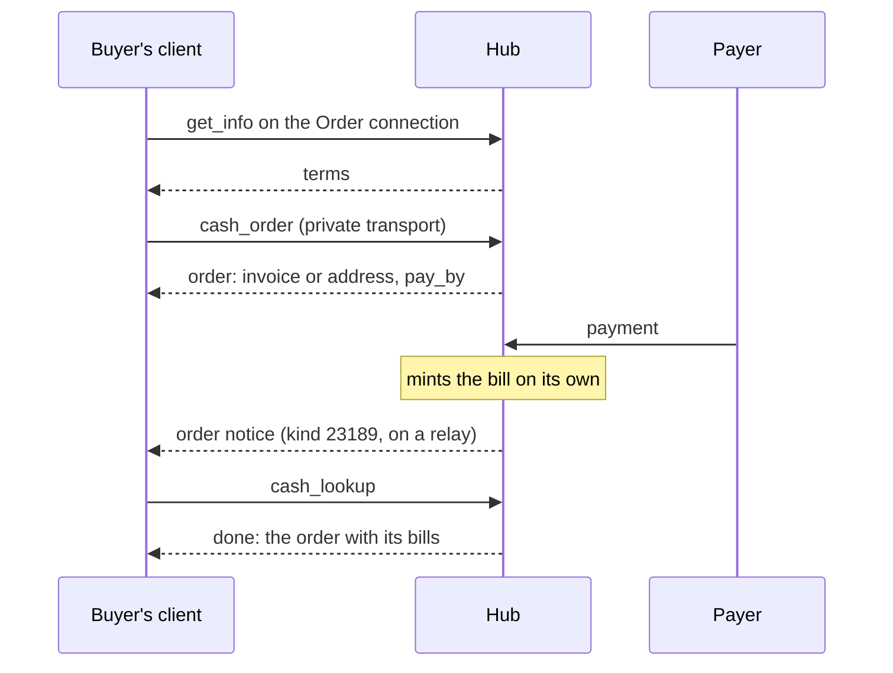
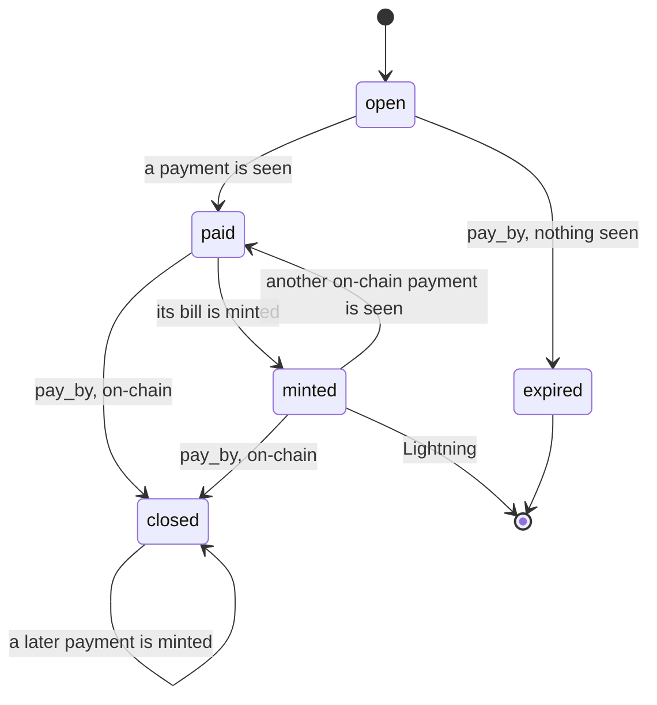

NIP-CO
======

Cash Order
----------

`draft` `optional` `nwc`

**Depends on**: [NIP-44](https://github.com/nostr-protocol/nips/blob/master/44.md) (Encrypted Payloads), [NIP-47](https://github.com/nostr-protocol/nips/blob/master/47.md) (Nostr Wallet Connect), [NIP-CASH](./NIP-CASH.md) (Cash Hub)
**Related**: [NIP-CP](./NIP-CP.md) (Cash Pocket), [NIP-CW](./NIP-CW.md) (Circle Wallet), [NIP-IC](./NIP-IC.md) (Identity Connection)

## Abstract

A Cash Hub that sells cash lets anyone order a bill and pay for it over Lightning or on-chain. The buyer needs
no bill, no Hub connection and no Nostr identity: an Order connection the Hub publishes, a key made for the
order, and the payment are enough. The Hub mints the bill when the payment arrives, and the buyer collects it
with `cash_lookup`.

A bill made this way is an ordinary NIP-CASH bill, except that it never expires and its Hub's owner cannot
delete it.



## Terminology

- **order**: one `cash_order` call and everything that follows from it: the payment it asks for, and every
  bill minted from the payments that arrive for it.
- **Order connection**: a public connection a Cash Hub's owner publishes so that others can order from that
  Hub, encoded as `cashorder1...`. It holds no funds and can spend nothing.
- **buyer key**: the key that signs an order's item proof. It authorizes reading the order, and nothing else.
- **ordered bill**: a bill minted for an order, or made by `cash_transfer` or `cash_consolidate` from ordered
  bills only. NIP-CASH calls its slice an **ordered slice**.
- **payment kind**: `lightning` or `onchain`.
- **payment window**: how long an order waits for its payment, ending at `pay_by`.
- **order fee**: what the Hub charges for an order, on top of the bill's amount.

`millis` and every other term NIP-CASH defines keep their meaning here.

## The Order Connection (`cashorder1...`)

An Order connection belongs to one Cash Hub. Its owner MAY create several for one Hub, and MAY retire any of
them. Its secret is public by design: it lets a Hub tell a request that found its shop from one that did not,
and authorizes nothing.

### Wire Format

The same bech32 TLV encoding as NIP-CASH's `cashhub1...`, with HRP `cashorder` and these entries:

| Type | Name | Value | Cardinality |
|---|---|---|---|
| `0` | connection pubkey | 32 raw bytes | exactly one, REQUIRED |
| `1` | relay | a relay URL, ASCII | one or more, order preserved; an encoder MUST NOT emit an empty one |
| `2` | secret | 32 raw bytes, the connection secret | exactly one, REQUIRED |
| `3` | label | a human-readable name, UTF-8 | zero or one, OPTIONAL |
| `4` | Hub identity | 32 raw bytes, the x-only node identity that signs the Hub's announcement and bills | exactly one, REQUIRED |

An encoder MUST emit entries in ascending type order. A decoder MUST reject a string missing type `0`, `2` or
`4`, carrying a wrong-length value for a fixed-length field, or repeating a field allowed at most once, and
MUST ignore an entry of an unrecognized type. Relay hints follow NIP-CASH's rules for every credential.

For example, the connection pubkey `f9308a019258c31049344f85f89d5229b531c845836f99b08601f113bce036f9`, the
relay `wss://relay.example.com`, the secret `404142…5f` (the bytes `0x40`–`0x5f`), the label
`Alice's cash counter` and the Hub identity
`79be667ef9dcbbac55a06295ce870b07029bfcdb2dce28d959f2815b16f81798` encode as one 255-character string,
broken here only to fit the page:

```
cashorder1qqs0jvy2qxf93scsfy6ylp0cn4fzndf3epzcxmuekzrqrugnhnsrd7gpzamhxue69uhhyetvv9ujuetcv9khqmr99e3k7mgzyp
qyzsjrg3z5v36gf99yknzdfe84q52j2d2924jhtpv45k6ut4097qc5g9kxjcm9yaejqcmpwd5zqcm0w4h8getjqss8n0nx0muaewav2ksx99
wwsu9swq5mlndjmn3gm9vl9q2mzmup0xq6f5hcn
```

### What It Allows

On the standard transport an Order connection is granted `get_info` only. A Hub MUST refuse every other
method on it with `NOT_IMPLEMENTED`.

On NIP-CASH's private transport it is the `target` of `cash_order` items and of their `cash_lookup` items, and
its secret signs their bill proofs. It is the target of nothing else.

A retired Order connection refuses new `cash_order` items with `RESTRICTED`. Its Hub MUST still serve
`cash_lookup` for the orders placed on it, and MUST still mint their payments.

### Terms (`get_info`)

`get_info` on an Order connection returns the Hub's selling terms in a `cash_order` object:

```json
{
  "methods": ["get_info"],
  "private_methods": ["cash_lookup", "cash_order"],
  "cash_order": {
    "lightning": {
      "min_millis": 1000000,
      "max_millis": 1000000000,
      "fee_base": 1000,
      "fee_ppm": 1000,
      "window": 3600
    },
    "onchain": {
      "min_millis": 10000000,
      "max_millis": 1000000000,
      "fee_base": 21000,
      "fee_ppm": 2000,
      "window": 86400,
      "confirmations": [
        {"up_to_millis": 100000000, "n": 1},
        {"up_to_millis": 1000000000, "n": 3},
        {"n": 6}
      ]
    },
    "bill": {"redeem_fee_base": 0, "redeem_fee_ppm": 5000, "min_transfer_millis": 1000}
  }
}
```

- A payment kind the Hub does not sell is absent. An object with neither kind means the Hub sells nothing on
  this connection.

| field | in | meaning |
|---|---|---|
| `min_millis`, `max_millis` | each kind | bound an order's `amount_millis`; `max_millis` MUST NOT exceed the Hub's per-wallet funding ceiling |
| `fee_base`, `fee_ppm` | each kind | set the order fee; `fee_base` is in millis |
| `window` | each kind | the payment window in seconds |
| `confirmations` | `onchain` | lists tiers in ascending `up_to_millis`, used as below |
| `bill` | — | the terms the Hub will stamp on an ordered bill |

`confirmations`: a payment uses the first tier whose `up_to_millis` is at least the payment's value, and the
last tier, which carries no `up_to_millis`, covers every larger value. Every `n` MUST be at least 1. With the
terms above:

| payment's value | tier used | confirmations |
|---|---|---|
| 21,063,000 millis | `up_to_millis` 100000000 | 1 |
| 500,000,000 millis | `up_to_millis` 1000000000 | 3 |
| 2,000,000,000 millis | the last tier | 6 |

A client MUST read the terms before ordering and MUST show the buyer the order fee, the bill's redeem fee and,
for on-chain, the confirmations that apply. Terms are fixed per order when the order is placed.

## Placing an Order (`cash_order`)

`cash_order` travels on NIP-CASH's private transport only, under its rules unchanged, and MUST NOT be served
on the standard transport: every holder of an Order connection can read what travels on it there.

### The Item

```json
{
  "id": "1",
  "target": "<Order connection pubkey>",
  "method": "cash_order",
  "params": {},
  "proof": {},
  "bill_proof": {}
}
```

| field | kind | signed with | shows |
|---|---|---|---|
| `proof` | 23192 | the buyer key | who placed the order, and so who may read it |
| `bill_proof` | 23193 | the Order connection's secret | that the request found this Hub's shop |

Both proofs carry the tags NIP-CASH gives every item: `d` the Order connection pubkey, `h` the Hub identity
from the connection's type `4`, `m` `cash_order`, `ph`, `en` and `expiration`.

### Request

```json
{
  "recipient": {"identity_type": "cash", "identity_value": "<sha256 commitment>"},
  "amount_millis": 21000000,
  "payment": "lightning",
  "notify": "<64 lowercase hex>",
  "request_id": "<32–64 lowercase hex chars>"
}
```

- `recipient` — REQUIRED, exactly one of the shapes below, each validated exactly as a `mint_cash`
  recipient.

  | recipient | shape |
  |---|---|
  | a Nostr pubkey | `{"identity_type": "pubkey", "identity_value": <hex>}` |
  | a Web Identity | `{"identity_type": "connection_key", "identity_value": <hex>, "ia_pubkey": <hex>}` |
  | nobody in particular | `{"identity_type": "cash", "identity_value": <commitment>}` |

- `amount_millis` — REQUIRED, the bill's amount, strictly positive. For `onchain` it MUST be a whole number of
  base units, a multiple of 1000.
- `payment` — REQUIRED, `lightning` or `onchain`.
- `notify` — REQUIRED, 64 lowercase hex characters from a CSPRNG, fresh for every order.
- `request_id` — REQUIRED, under NIP-CASH's rules.

A Hub MUST refuse with `BAD_REQUEST` a request carrying `recipients`, `expiry`, `cash_secret`,
`idempotency_key` or `min_transfer_millis`.

### The Buyer Key

For a `cash` recipient the buyer key MUST be derived from the cash secret, so that the secret alone recovers
the order:

```
buyer_secret_key = SHA256("cash-order-key:v1" ‖ cash_secret)
```

over the ASCII label followed by the secret's 32 raw bytes. A result that is zero or not below the secp256k1
group order is unusable, and the client generates a new cash secret. For the secret `000102…1f` (the bytes
`0x00`–`0x1f`), whose commitment is `630dcd2966c4336691125448bbb25b4ff412a49c732db2c8abc1b8581bd710dd`, the
buyer secret key is `c853759de7b777f3588569e48461ec8ad52dbea4c8829b759a05e352cf649dea` and its x-only
public key `a5a70781e66224a1a4e26614b36328c1a8913f1a2c80bca00fbb2e5af993c8a3`.

For a `pubkey` or `connection_key` recipient the buyer key is a fresh random key, kept by the client for as long as
it may read the order, for good for an on-chain order that is `closed`. A buyer key MUST NOT be the buyer's or the recipient's Nostr key.

### Response

```json
{
  "state": "open",
  "payment": "lightning",
  "amount_millis": 21000000,
  "fee_millis": 22000,
  "pay_millis": 21022000,
  "invoice": "lnbc210220n1...",
  "pay_by": 1720003600,
  "bills": []
}
```

| field | `lightning` | `onchain` |
|---|---|---|
| `fee_millis` | the order fee, `fee_base + floor(fee_ppm × amount_millis / 1,000,000)` | the same, rounded up so that `pay_millis` is a whole number of base units |
| `pay_millis` | `amount_millis + fee_millis`, what the buyer is asked to pay | the same |
| `invoice` / `address` | `invoice`: a fresh invoice for exactly `pay_millis`, expiring at `pay_by` | `address`, instead of `invoice`: a fresh address, with `confirmations`, the `n` of the tier `pay_millis` falls in |
| `pay_by` | the end of the payment window | the same |
| `bills` | the bills minted so far, below | the same |

With the terms above, an order of 21,000,000 millis:

| | Lightning | on-chain |
|---|---|---|
| `fee_millis` | 1000 + floor(1000 × 21000000 / 1000000) = 22000 | 21000 + floor(2000 × 21000000 / 1000000) = 63000 |
| `pay_millis` | 21022000 | 21063000, already whole base units |
| confirmations | — | 1 |

Each entry of `bills`:

```json
{
  "wallet_pubkey": "<hex>",
  "cash_token": "satscash1...",
  "amount_millis": 21000000,
  "paid_millis": 21063000,
  "outpoint": "<txid>:<vout>"
}
```

`paid_millis` is the payment the bill was minted from, and `outpoint` its on-chain output, absent for
Lightning. A destroyed bill appears as its tombstone in place of `cash_token`, as in a lookup `done`.

### Processing Algorithm

After NIP-CASH's envelope and item steps, a Hub MUST, in order:

1. Refuse a missing or malformed `request_id` with `BAD_REQUEST` and a used one with `REQUEST_REUSED`. Mark it
   used once the item proof verifies. Refuse an item without `proof` with `BAD_REQUEST`.
2. Refuse with `RESTRICTED` an order on a retired Order connection or for a payment kind the terms do not
   offer.
3. Validate the request as above, refusing with `BAD_REQUEST`. Validate `recipient` as `mint_cash` validates a
   recipient, refusing an untrusted IA with `RESTRICTED`.
4. Refuse with `RESTRICTED` an `amount_millis` outside the kind's `min_millis` and `max_millis`.
5. Refuse with `QUOTA_EXCEEDED` an order that would take the open orders of its payment kind past the Hub's
   open-order ceiling, or a Lightning order the Hub cannot expect to receive.
6. Create the invoice or the address.
7. In one atomic commit, checking the deadline again as it commits, record:
   - the order: target, buyer key, recipient, amount, payment kind, `notify`, the terms that apply, the
     invoice or address;
   - its reservation against the open-order ceiling;
   - the `request_id` record.
8. Return the order.

A request that fails any step before 7 leaves no order. Placing an order moves no funds.

## Paying and Minting

### Minting

Money that has arrived cannot be refused, so every check that could refuse a bill runs when the order is
placed. A Hub MUST then:

- mint a paid order on its own, without waiting for any request; `cash_lookup` only reads an order;
- mint each payment exactly once: a payment is identified by its invoice's payment hash or its on-chain
  outpoint;
- mint each payment as one commit that credits the Hub with the payment and creates and funds the bill, as
  `mint_cash` does, with the token and its mint signature built first; a payment whose bill cannot be built
  leaves the order `paid`, and the Hub MUST retry until it is minted;
- mint `received − fee_millis`, where `received` is what the payment brought in; a value above `max_millis`
  is minted as several bills, none above it, the first ones of exactly `max_millis`;
- stamp every bill with the recipient and the terms fixed when the order was placed, with no expiry, and mark
  its slice ordered.

For example, with `max_millis` 1000000000 and `fee_millis` 63000, a payment bringing in 2500063000 millis
mints 2500000000 millis as three bills: 1000000000, 1000000000 and 500000000.

A payment of `fee_millis` or less mints nothing and is kept by the Hub.

The Hub's own balance is never needed: each bill is funded by the payment it is minted from.

### Lightning

The invoice is for exactly `pay_millis`, and expires at `pay_by`. A Hub MUST NOT issue an invoice without an
amount. An invoice paid with more than `pay_millis` mints the larger amount, under the rule above. An
expired invoice cannot be paid, so a Lightning order ends `expired` at `pay_by` if it is unpaid.

A Hub SHOULD NOT issue an invoice it cannot expect to receive, and refuses such an order at step 5. A payment
that never arrives leaves the order to expire and costs nothing.

### On-chain

A Hub MUST give every on-chain order an address it has never given out before and never gives out again, and
SHOULD derive order addresses separately from its other addresses.

Every confirmed output paying an order's address is one payment. Each is minted once it has the
confirmations of the tier its own value falls in, whenever it arrives, before or after `pay_by`. A Hub MUST
NOT mint a payment with fewer than one confirmation. A reorganisation that removes a payment before it is
minted leaves it unminted; one that removes it after leaves the bill standing, at the Hub's loss.

At `pay_by` the Hub looks at what it has seen for the order, confirmed or not:

- a payment seen: the order is kept, and its address watched for as long as the Hub runs; later payments to
  it are minted the same way;
- nothing seen: the Hub MUST delete the order at once, or at its deadline plus `max_request_age` if that is
  later; a payment arriving afterwards is kept by the Hub.

For the on-chain order above (`pay_millis` 21063000, `fee_millis` 63000), these rules give:

| what arrives at the address | outcome |
|---|---|
| 21063000 millis, confirmed | one bill of 21000000 |
| 20000000 millis | one bill of 19937000 |
| 25000000 millis | one bill of 24937000 |
| two outputs of 10000000 millis | two bills of 9937000 |
| 10000000 millis after `pay_by`, a payment having been seen before it | one bill of 9937000 |
| 50000 millis | nothing: at most `fee_millis`, kept by the Hub |
| a payment a reorganisation removes before it is minted | nothing yet |
| a payment a reorganisation removes after it is minted | the bill stands, at the Hub's loss |
| a first payment after `pay_by`, nothing seen before | kept by the Hub |

A client MUST tell its user to pay before `pay_by`, and MUST NOT present a payment the Hub did not see by
then as one that will be minted.

### Limits

A Hub MUST bound the total `amount_millis` of its open orders per payment kind (the open-order ceiling). An
order counts against it from placement until it is minted, expires or is closed; a payment arriving later
needs no room. A Hub SHOULD also bound the number of open on-chain orders, and SHOULD size its on-chain limits
and fees to what it can pay out over Lightning.

Requests reach the Hub through NIP-CASH's private transport, so its proof of work applies to orders as to any
other item.

## Order State

| `state` | meaning |
|---|---|
| `open` | waiting for payment, until `pay_by` |
| `paid` | a payment is seen and its bill is not minted yet |
| `minted` | every payment seen is minted, and the window is still open or the order is Lightning |
| `expired` | the window ended and nothing was seen |
| `closed` | an on-chain order whose window ended after a payment was seen; later payments still mint |

A Lightning order is `minted` or `expired` for good once it reaches either. An on-chain order in `closed` may
gain bills later.



## Reading an Order

A client reads an order with NIP-CASH's `cash_lookup`, with the order's `request_id` and deadline:

- the item's `target` is the Order connection, its bill proof signed with that connection's secret, and its
  item proof signed by the buyer key, the order's recorded authorizer;
- `done` carries the order as it stands, in the shape of the Response above, every token rebuilt byte for
  byte, rather than a copy of the first reply;
- `pending`, `unknown` and `expired` keep NIP-CASH's meaning.

A Hub MUST keep an order:

- while it is open;
- at least until its deadline plus NIP-CASH's `max_request_age`, even unpaid;
- for an on-chain order with a payment, for as long as it keeps its address watched;
- for a Lightning order, while any bill it minted is live, plus that bill's tombstone window.

It MAY drop an unpaid Lightning order once both `pay_by` and that minimum have passed, and an order deleted
under the on-chain rule above.

## Order Notice (kind 23189)

When an order changes state or gains a bill, the Hub publishes an order notice, an ephemeral event:

```
kind        23189
pubkey      a fresh key, used once and discarded
tags        [["p", "<the order's notify>"]]
content     ""
```

on the relay the order arrived on, and MAY publish it on its other inbox relays. It carries nothing else.
A client listening for `{"kinds":[23189],"#p":["<notify>"]}` reads the order with `cash_lookup` when one
arrives. A notice proves nothing: a client acts only on what `cash_lookup` returns, and MUST NOT rely on
notices, since ephemeral events can be missed.

## Client Behavior

1. Decode the `cashorder1...` string, read the terms with `get_info`, and fetch and verify the Hub's
   announcement against the Hub identity in the string, under NIP-CASH's rules.
2. Generate the cash secret (for a `cash` recipient), the buyer key, `notify` and `request_id`, and store
   them durably before sending.
3. Send `cash_order`, show the invoice or the address with `pay_millis`, and tell the buyer that a different
   amount mints a different bill.
4. Listen for order notices on `notify`, and read the order with `cash_lookup`: while the buyer waits on a
   Lightning payment, and from time to time for an on-chain one.
5. Keep each bill as it appears. A client MUST NOT treat a Lightning order as finished before `minted` or
   `expired`, nor an on-chain one before `expired` or `closed`, and SHOULD let its user read a closed
   on-chain order again later.

   | payment kind | finished at |
   |---|---|
   | Lightning | `minted` or `expired` |
   | on-chain | `expired` or `closed`, and a `closed` order may still gain bills |

A client that holds an order's reply knows its `pay_by`: after `pay_by`, an order it never saw `paid`,
`minted` or `closed`, and that shows no bill, ended unpaid, whatever its lookup answers. A lost reply is read with `cash_lookup`. After `unknown` the order was
never placed, and a client places it
again only with its user's confirmation, since a new order asks for a new payment.

## Security Considerations

- **The Order connection's secret is public.** It proves only that a request found the Hub's shop. A Hub
  MUST grant it nothing else.
- **The buyer key decides who reads the order**, and so who receives its tokens. A client keeps it as
  carefully as a cash secret; for a `cash` order the secret is the key.
- **Every payment becomes value for the recipient.** A Hub cannot refuse money that arrives, and it never
  refunds: an under- or overpayment mints a smaller or larger bill.
- **Reorganisations.** A bill minted before a payment's confirmations are final is the Hub's risk; its
  confirmation tiers set it.
- **Custody.** An ordered bill is the Hub's liability like any bill. NIP-CASH forbids the Hub's owner to
  delete an ordered bill or let it expire; the Hub still decides when Lightning payouts can be made.
- **Spam.** Placing an order is free. The open-order ceiling, the private transport's proof of work and the
  deletion of unpaid on-chain orders bound what spam can cost a Hub.

## Privacy Considerations

- An order names no buyer: its keys are fresh, and a `cash` recipient is only a commitment.
- The Hub sees the recipient, the amount and the payment. On-chain, the paying outputs can be traced on the
  chain, and may link the buyer's coins to the order.
- `notify` is single-use and random, and a notice reveals only that something happened to it at that moment.
