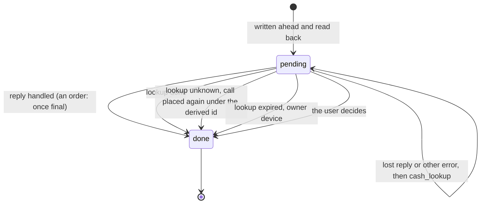

NIP-CP
======

Cash Pocket
-----------

`draft` `optional`

**Depends on**: [NIP-44](https://github.com/nostr-protocol/nips/blob/master/44.md) (Encrypted Payloads), [NIP-59](https://github.com/nostr-protocol/nips/blob/master/59.md) (Gift Wrap), [NIP-CASH](./NIP-CASH.md) (Cash Hub)
**Related**: [NIP-17](https://github.com/nostr-protocol/nips/blob/master/17.md) (Private Direct Messages), [NIP-40](https://github.com/nostr-protocol/nips/blob/master/40.md) (Expiration Timestamp), [NIP-CZ](./NIP-CZ.md) (Cash Zaps)

## Abstract

A Cash Pocket stores the cash tokens a wallet holds, and the bill-creating calls it has in flight. Each is a kind `9525` entry, gift-wrapped to the user's own pubkey: relays see only what looks like a DM, with no author, kind or amount.

## Terminology

- **Pocket**: a user's Pocket Entries.
- **Pocket Entry**: one token the wallet holds or held, or one bill-creating call it has placed (a `pending` entry), as a kind `9525` rumor.
- **wrap key**: the one-time key of an entry's gift wrap.

## Specification

### Event Kinds

| Kind | Name | Signed by | Published |
|------|------|-----------|-----------|
| `9525` | Pocket Entry | nobody (rumor) | only inside a seal and gift wrap |

### Kind 9525 — Pocket Entry

```json
{
  "kind": 9525,
  "pubkey": "<user-pubkey>",
  "created_at": 1760000000,
  "content": "",
  "tags": [
    ["w", "<token-wallet-pubkey>"],
    ["v", "1"],
    ["cash", "satscash1..."],
    ["amount", "21000"],
    ["chain", "bitcoin"],
    ["identity", "pubkey", "<user-pubkey>"],
    ["state", "live", "1760000000"],
    ["mint", "<minter-node-pubkey>"],
    ["expires_at", "1790000000"],
    ["source", "<9522-event-id>"],
    ["wrap_key", "<hex-secret-key-of-this-entry's-wrap>"]
  ]
}
```

Which tags each kind of entry carries, at a glance, but each tag's own rule below decides:

| tag | a held token | a `pending` entry | an entry written from a tombstone |
|---|---|---|---|
| `w`, `v`, `state`, `wrap_key` | yes | yes | yes |
| `amount`, `chain` | yes | yes | yes |
| `cash` | yes | no | no |
| `identity` | yes | no | yes |
| `expires_at` | if the bill expires | no | only when an answer gives it |
| `request_id`, `deadline`, `target`, `device` | no | yes | no |
| `secret` | optional, for a `cash` token | for each cash-mode bill the call makes | — |
| `order_key` | no | for some `cash_order` calls (below) | no |
| `notify` | no | for a `cash_order` or a `cash_withdraw` | no |
| `address`, `quote`, `receipt` | no | for a `cash_withdraw` | no |
| `mint`, `source` | optional | — | — |

**Required tags**:
- `w`: token wallet pubkey (TLV `0`), or the `request_id` for a `pending` entry and the `done` entry that closes it.
- `v`: version, +1 on every change.
- `cash`: the token.
  - An entry written from a tombstone (a lookup `done` whose `result` carries a tombstone in place of a bill's token) has no token: it leaves out `cash`, and leaves out `expires_at` when no answer gives it; it is always in a final state.
- `amount`: milli-units (`msats` for `bitcoin`).
- `chain`: e.g. `bitcoin`; any energy-backed coin works the same.
- `identity`: who can claim it — `pubkey <pubkey>`, `connection_key <ConnectionKey> <ia-pubkey>` or `cash`.
- `state`: `live`, `pending`, `spent`, `expired`, `reclaimed`, `done` or `unknown`, plus the last check time in unix seconds.
- `wrap_key`: secret key of this entry's gift wrap, in hex.
- `expires_at`: the last moment the bill can be spent, in unix seconds; once it has passed, the bill returns to its minting Hub.
  - It is required for a bill that expires, taken from the Hub's reply, `cash_status`, or a `9522` whose zap signature verifies (NIP-CZ rule 7), never from any other `9522`, whose `expires_at` the sender chose.
  - A bill that never expires has no `expires_at` tag; a `0` in a reply means never and is not stored.

A `pending` entry carries `w`, `v`, `state`, `wrap_key`, `request_id`, `deadline`, `target` and `device`, the call's `chain`, as `amount` the amount the call sends, a `secret` for each cash-mode bill the call makes, and for a `cash_order` to a `pubkey` or `connection_key` recipient an `order_key`, and for every `cash_order` its `notify`. It leaves out `cash`, `identity` and `expires_at`. Its `w` equals its `request_id`.

A `cash_withdraw` pending entry also carries its `notify`, `address` and `quote`, its `receipt` once received, and for a cash-mode slice the secret behind its `remint_commitment` as `secret`.

| call | `amount` |
|---|---|
| a split | `amount_millis` |
| a full transfer | the source's amount |
| `cash_consolidate` | the sum of the sources |
| `mint_cash` | the sum of the recipients |
| a [NIP-CO](./NIP-CO.md) `cash_order` | the ordered `amount_millis` |
| `cash_withdraw` | the slice's `amount_millis` |

- `request_id`: the call's NIP-CASH `request_id`.
- `deadline`: the call's deadline as sent (the envelope's `not_after`, or `mint_cash`'s NIP-47 `expiration`).
- `target`: the `w` of the bill the call named (`sources[0]` for `cash_consolidate`), or for `mint_cash` the Cash Hub connection's wallet pubkey (its TLV `0`), or for `cash_order` the Order connection's pubkey (its TLV `0`).
- `device`: a random id for the device that wrote the entry, generated on that device and not copied by backup or restore, in lowercase hex. A wallet that finds it is running from copied or restored state SHOULD generate a new `device` id; it then treats the old id's open entries as another device's.
- `secret`: the `cash_secret` the wallet generated for a cash-mode bill the call makes, stored before the call is sent. A `cash_order` to a `cash` recipient keeps its secret here too, and derives its buyer key from it.

  | tag | for |
  |---|---|
  | `["secret", "<cash-secret>"]` | the bill made for `new_identity` or for `mint_cash`'s `cash` recipient |
  | `["secret", "<cash-secret>", "remainder"]` | the remainder of a split of a cash-mode source, which the wallet always binds to a fresh commitment of its own |
  | `["secret", "<cash-secret>", "remint"]` | the bill a `cash_withdraw` cancel would re-mint |

- `order_key`: the secret key of a `cash_order`'s random buyer key, in lowercase hex, stored before the call is sent. It reads the order, and is as sensitive as a `secret`.
- `notify`: a `cash_order`'s or `cash_withdraw`'s `notify` value, in lowercase hex, so any device can listen for its notices.
- `address`, `quote`, `receipt`: a `cash_withdraw`'s address, and its quote and receipt events as JSON strings.

For example, a `pending` entry for a split that sends 5000 to a cash-mode identity:

```json
{
  "kind": 9525,
  "pubkey": "<user-pubkey>",
  "created_at": 1760000000,
  "content": "",
  "tags": [
    ["w", "00112233445566778899aabbccddeeff"],
    ["v", "1"],
    ["state", "pending", "1760000000"],
    ["request_id", "00112233445566778899aabbccddeeff"],
    ["deadline", "1760000300"],
    ["target", "<source-wallet-pubkey>"],
    ["device", "<device-id>"],
    ["chain", "bitcoin"],
    ["amount", "5000"],
    ["secret", "<cash-secret>"],
    ["wrap_key", "<hex-secret-key-of-this-entry's-wrap>"]
  ]
}
```

**Optional tags**: `mint` (Minter), `source` (its `9522`; a wallet SHOULD keep it on a zap bill's entry until it moves the bill, as only that `9522` recovers the bill's provenance: NIP-CASH §Mint Provenance), `secret` (`cash_secret` of a `cash`-mode token, or on a pending entry those generated for the call, as above).

**Encodings**: a wallet MUST write:

| what | as | fields |
|---|---|---|
| every integer | unsigned decimal ASCII with no leading zeros (`0` for zero) | `v`, `amount`, `deadline`, `expires_at` and the `state` check time |
| every hex value | lowercase | `w`, `request_id`, `target`, `device`, `wrap_key`, `secret`, `mint`, `source` and the keys in `identity` |

`mint` is a Minter as NIP-CZ defines it: a 33-byte compressed pubkey, 66 hex characters.

**Published**: only inside a seal and gift wrap. A `9525` MUST NOT be signed or published outside a seal. Relays SHOULD reject a signed `9525`.

### Wrapping

An entry is sealed (kind `13`, signed by the user) and gift-wrapped (kind `1059`, `p` = the user) per NIP-59. The wallet generates the wrap key first and records it in the entry's `wrap_key`.

Wraps go to the user's NIP-17 inbox relays (kind `10050`), else their NIP-65 write relays. Those relays SHOULD serve a `1059` only to its `p` (NIP-42 AUTH). The user MAY add their own relay (one they run or control) to their `10050` list.

A wallet SHOULD write each wrap to at least 2 relays, read it back before treating it as stored, and on each sync republish entries a relay no longer returns.

## Writing

- **Add** an entry when the wallet receives or mints a token it keeps.
- **Write ahead**: before any call that creates a bill (`mint_cash`, `cash_transfer`, `cash_consolidate`, `cash_order`), and before a `cash_withdraw`, the wallet:
  1. stores a `pending` entry holding the call's `request_id`, `deadline`, `target`, its own `device` and any cash secret it generated;
  2. reads it back before sending the call, which carries that `request_id` (NIP-CASH requires one on every call that creates a bill);
  3. on the reply, writes the entries below;
  4. reads these entries back, and only then marks the pending entry `done` and, in the same batch, every other source entry `spent`.

  On the reply the wallet adds an entry for each new bill it keeps, and none for a bill made for someone else:

  | new bill in the reply | entry |
  |---|---|
  | one made for the user's own identity, such as a remainder | added |
  | a cash-mode bill whose secret it holds and does not hand on | added, carrying its `secret` from the pending entry |
  | a bill made for someone else | none |
  | a bill transferred in place to the user | the wallet rewrites its entry at the next `v`, with its new `identity` and its new `secret` if any, since that bill keeps its `w` |

  Any other reply:

  | reply | what the wallet does |
  |---|---|
  | refused with `BAD_REQUEST` | the call was malformed and never committed, so the wallet marks its pending entry `done` |
  | answered with a tombstone in place of its result | the call named a source bill already destroyed and never ran, so the wallet marks its pending entry `done` and sets that source's entry per §Balance |
  | any other error, `REQUEST_REUSED` included | the wallet keeps the pending entry open and looks it up as below; it never closes it as failed |
  | the reply is lost | the wallet sends `cash_lookup` with `request_id` and `deadline` to that target, and MUST NOT resend the call |

  For a call authorized by a cash secret, the wallet first sends the lookup without the secret, and sends it only once that lookup is refused with `UNAUTHORIZED`, which shows the call committed and the secret no longer opens anything. The Hub answers on its own clock:

  | answer | what the wallet does |
  |---|---|
  | `done` | write the entries as for a reply, then mark the pending entry `done` (a tombstone in place of a token sets that entry's state per §Balance) |
  | `pending` | ask again at the `retry_after` the Hub returned |
  | `unknown` | place the call again, or not, as below |
  | `expired` | the outcome can no longer be known (this lookup answer is not the bill state `expired`); see below |

  - `unknown`: only the device whose `device` matches the entry MAY place the call again. Any other device SHOULD show the call to the user and leaves the entry `pending`.

    | call | the owner device |
    |---|---|
    | `cash_transfer`, `cash_consolidate` | MAY place the call again automatically |
    | `mint_cash`, `cash_order` | MUST NOT place the call again without its user's explicit confirmation; until the user confirms, it shows the call and leaves the entry `pending` |
    | `cash_withdraw` | MAY place the call again automatically only after a lost reply, while its quote holds (the Hub's chain tip at most its `holds_until`); otherwise as `mint_cash` |

    - **The derived id.** The re-placed call always uses `request_id` = lowercase hex of sha256("retry:" ‖ the replaced entry's `request_id`), never a fresh id, and is written ahead as a new pending entry. It names the same target, with the same amounts, identities and any `secret` of the old entry, under a new deadline; a call re-placed again derives its id from the id it replaces, so re-placements chain.

      | | `request_id` |
      |---|---|
      | the original call | `00112233445566778899aabbccddeeff` |
      | placed again | `1f0d61013abef39098ffb0a7c72008a17099c52aca3d5ee8d6ce8de065db5d37` |
      | placed again from that | `c4c6d6c4893cca6283c95ea32a0b6bef6be796804e62e21e30113b63c676457e` |

    - **Placing it again.** The Hub refuses a derived id only once a call carrying it has reached the Hub and passed authorization, which marks the id used, so the entry check and the local record below are what stop a call being placed twice.
      1. Just before placing a call again, the owner device syncs and confirms the old entry is still open.
      2. It MUST then check for an entry whose `w` is the derived id, counting every entry with that `w`, whatever its `state`, including one this wallet does not recognise; if one exists, it MUST NOT place the call again and only marks the old entry `done`.
      3. It places the call, written ahead as above.
      4. Then that device marks the old pending entry `done`.
    - **The local record.** The device also keeps a local record of every derived id it places, recorded before sending the call and kept across Resync until that id's `deadline` plus the largest `max_request_age` the Hub has announced since the original call, and never places the same id twice. The `device` id and this record are kept and lost together.
    - This lookup answer is not the bill state `unknown`, which a pending entry never takes. An omitted answer is not a lookup `unknown`.
  - `expired`: the wallet MUST NOT place the call again automatically and SHOULD show the call to the user. The device whose `device` matches the entry marks it `done`; any other device leaves it open.
  - A pending entry shown to the user MAY be marked `done` on the user's decision; the wallet MUST NOT place the call again when doing so.



- **Orders**: a `cash_order` pending entry stays open while its order is open, and the wallet reads the order with `cash_lookup` as NIP-CO describes, signed by the buyer key. On each answer it adds an entry for every bill it keeps and does not hold yet, a `cash` bill carrying the `secret`, and none for a bill made for someone else. It marks the pending entry `done` only once the order is `minted` or `expired` for Lightning, or `expired` or `closed` for on-chain; the `done` entry keeps `request_id`, `target` and `order_key` or `secret`, so a closed on-chain order can be read again for late payments.
- **Withdrawals**: a `cash_withdraw` pending entry stays open until its payout is `final` or `cancelled`.
  - On the reply or the first `done`, the wallet:
    1. verifies the receipt: its id and signature by the Hub's identity, `d` = `target`, `q` = the stored quote's id, `request_hash` = the sha256 of `request_id`, and `address`, `payout_millis` and `sent_by` equal to the quote's; an answer without a valid receipt counts as no answer;
    2. marks the source entry `spent`, keeping its token and any `secret` for the lookups;
    3. reads the payout with `cash_lookup`.
  - At `cancelled` it adds an entry for the re-minted bill, carrying the `secret`, then marks the pending entry `done`.
  - Once the payout is final it SHOULD rewrite the `done` entry without `address`, `quote` and `receipt`.
- **Unusable Hubs**: NIP-CASH requires every Hub to serve `cash_lookup` and announce `max_request_age`. A wallet MUST NOT send a bill-creating call to a Hub that announces no `max_request_age`, or one NIP-CASH does not allow.
- **Close** a pending entry by publishing it at the next `v` in state `done`, then deleting the old wrap as for any change; never by deletion alone. A wallet MUST NOT remove the entries of a call's source bill(s), with any `secret`, until the pending entry is `done`.
- **Versions**: every write for a `w` uses the highest `v` seen for that `w` plus 1.
- **Change** an entry by publishing a new wrap with the next `v`, then deleting the previous wrap with a NIP-09 kind `5` signed by that wrap's `wrap_key`. The deletion's `created_at` is randomized like the wraps'. A wallet MAY batch deletions at a random later time.
- **Remove** an entry by deleting its wrap. A wallet MAY first keep it for up to 30 days in a final state (`spent`, `expired`, `reclaimed`, `done`).
- **Expiration**: a wallet MAY set a NIP-40 `expiration` on the gift wrap: `expires_at` plus a grace period (e.g. 30 days), rounded up to the week plus a random number of days. It still deletes the wrap itself, since relays may ignore NIP-40.

## Reading

- **Full sync**: `{"kinds": [1059], "#p": ["<user-pubkey>"]}`, then unwrap and keep rumors of kind `9525` whose seal `pubkey` and rumor `pubkey` are both the user. Other wraps (DMs) are ignored. A wallet MUST discard any other `9525`.
- **Incremental sync**: the same filter with `since` set to the last sync minus 2 days, since gift wraps carry randomized timestamps. Wraps already seen are skipped.
- **Resolving**: per `w`, in this order:
  1. a final state (`spent`, `expired`, `reclaimed`, `done`) wins only over entries whose `v` is less than or equal to its own; an entry with a higher `v`, written after a definitive `cash_status` result, supersedes it (a bill returned by an in-place transfer keeps its `w`);
  2. otherwise the highest `v` wins;
  3. on a tie, the latest rumor `created_at`;
  4. then the lowest rumor `id` as lowercase hex, which a rewrapped copy of the same rumor cannot change.

  On any conflict the wallet re-checks the bill with `cash_status`.
- **Older entries**: a wallet SHOULD fill a missing `expires_at` from `cash_status` and rewrite the entry. A reader MUST ignore an entry whose `state` it does not recognise, except for the derived-id check in §Writing.
- **Resync**: drop the local copy and run a full sync.

## Balance

The balance, per `chain`, is the sum of `amount` over entries in state `live`. A wallet refreshes states with `cash_status`, batched per Hub, and updates entries whose state changed. A tombstone maps the same way whichever method it answers: `cash_status`, `cash_redeem`, `cash_transfer`, `cash_consolidate`, or a lookup `done` in place of a bill's token:

| Result | State |
|--------|-------|
| the wallet's own spend succeeded | `spent` |
| a tombstone (`{"status": "spent", "reason": …}`) whose `reason` is `expired` | `expired` |
| a tombstone whose `reason` is `reclaimed` | `reclaimed` |
| `NOT_FOUND` on a live bill, for an item proof signed by the entry's `identity` key or, for a `cash` entry, an item made with its `secret` | `reclaimed` |
| `NOT_FOUND` for any other proof | `unknown`, as no answer |
| any other tombstone (another `reason`, or none) | `spent` |
| no answer | `unknown`, never `spent` |

A tombstone's `reason` describes how the bill's last live slice ended, which is not necessarily the user's own slice: if the user's slice was removed and the bill ended later, when another recipient redeemed theirs, the tombstone says `redeemed` and the entry becomes `spent`, not `reclaimed`.

A device MUST write a final state only from a definitive result (its own spend, a tombstone, `NOT_FOUND` for a proof signed by the entry's `identity` key or, for a `cash` entry, an item made with its `secret`), never from a timeout or a cached view. Where the Hub quotes it, a wallet SHOULD show `net_redeemable_millis` rather than `amount`.

## Sweeping and Spending

- A wallet SHOULD claim received cash into the user's own Hub promptly.
  - A claim is fee-free only when the user's Hub runs on the minting node.
  - Otherwise the redeem fee applies, and a bill at or below the base fee has to be consolidated first.
  - The entry then becomes `spent`.
- A wallet MUST show `expires_at`, and SHOULD warn and claim or redeem before it.
- A wallet SHOULD promptly transfer a received cash-mode bill to the user's pubkey.
- To pay, a wallet SHOULD spend held tokens first (`cash_transfer`, whole or split), then mint from the user's Hub. A split leaves a new token for the remainder, which gets its own entry.
- If two devices spend the same token, the Hub accepts the first; the other device sees the token `spent` on its next refresh.

## Security Considerations

- **Custody**: a held token stays in its Minter's custody. Until claimed, the minting Hub's owner can revoke it.
- **Bearer secrets**: an entry with `secret` is spendable by anyone who reads it. A stored `secret` can be spent by any app allowed to decrypt the user's DMs.
- **Stale wraps**: a wallet that fails to delete an old wrap leaves a stale copy behind. Resolving still picks the current one.

## Privacy Considerations

Relays see gift wraps addressed to the user at randomized times, the same as DMs, and deletions signed by one-time keys at randomized times. The number of wraps still grows with activity; a wallet MAY batch changes to hide it. Refreshing states contacts each Hub, not relays.

A wrap carrying NIP-40 `expiration` is distinguishable from a DM and reveals roughly when its bill expires; a wallet that wants wraps indistinguishable omits it.
