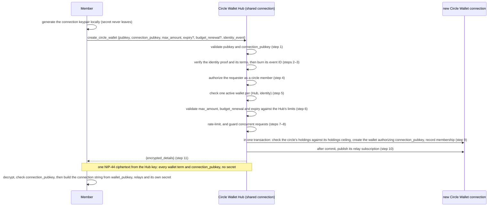
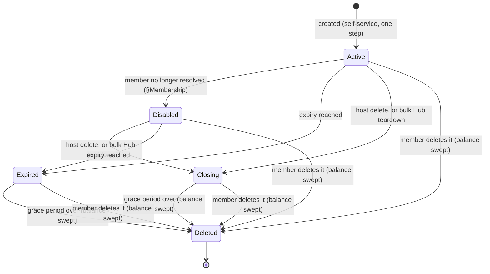

NIP-CW
======

Circle Wallet
-------------

`draft` `optional` `nwc`

**Depends on**: [NIP-44](https://github.com/nostr-protocol/nips/blob/master/44.md) (Encrypted Payloads), [NIP-47](https://github.com/nostr-protocol/nips/blob/master/47.md) (Nostr Wallet Connect), [NIP-51](https://github.com/nostr-protocol/nips/blob/master/51.md) (Lists)
**Related**: [NIP-CASH](./NIP-CASH.md) (Cash Hub), [NIP-IC](./NIP-IC.md) (Identity Connection)

## Abstract

Not everyone who wants a Lightning wallet wants to run a node. Channels, liquidity, uptime, backups —
that's real work most people never want to take on.

A game studio wants a way around it too. Its players have never touched Lightning, and often move more
than sats: in-game currency, collectibles, any asset issued as a Taproot Asset. A social app wants the
same thing, so its users can zap each other without learning what a channel is. So does a family or a
friend group, sharing one member's infrastructure instead of everyone standing up their own.

A **circle** is a group of people who don't run their own node — a host extends their own node to all
of them instead. For a family, that's relatives and coworkers, each with a personal wallet. For a
business, it's every player or every user getting a real wallet the moment they need one: no onboarding
flow that dead-ends on "open a channel first," no LSP to negotiate with, no liquidity to wait on, no
need to hand it to whatever VC-funded LSP is pitching liquidity-as-a-service this month. The host keeps
ownership of the node, the liquidity, and the users on it.

This document defines the **Circle Wallet**, the personal wallet a member ends up with, and the
**Circle Wallet Hub**, the host's connection that issues one on request — self-service, on demand, no
manual setup per member.

Every member's wallet lives on the same node. A payment between two members never leaves it — it
settles as an instant, fee-free internal transfer, the same way moving money between sub-accounts of
one bank account carries no wire fee. A payment to anyone outside the circle still goes out over
ordinary Lightning.

Who counts as a member — an allowlist, a named follow set the host publishes, or every account a business creates —
is just a configuration choice, not what a Circle Wallet fundamentally is. This document specifies that
mechanism, the wallet's data model, and the one-active-wallet-per-member rule. The circle's real value
is the free wallet and free in-circle transfers, not the admission rule.

## Motivation

The obvious alternatives don't fit. Everyone running their own node just relocates the burden they were
trying to avoid. The host handing out one wallet per member manually works for a few people, then the
host becomes a bottleneck — no game studio or growing social app can wait on that. One wallet shared by
the whole group has no individual balance: one member's spending is everyone's spending.

A free custodial wallet looks easier still. It doesn't remove trust — it relocates it, to an operator
the member has never met, running on funding that may not survive the next round. A circle asks for
trust the member already has: in family, a coworker, a business relationship that predates any of this.
Backed by a person, not a balance sheet.

A pre-funded, one-time payout to a fixed, named list doesn't fit either: that pattern decides its
recipient set once, at funding time. A circle's membership isn't fixed — new players and new users show
up every day, each needing a wallet the moment they arrive. What a circle needs is standing,
self-service access: any current member can ask for their own wallet, whenever they show up.

Pooling helps the host too. One node's channels, liquidity, and routing reputation serve every member
at once, instead of splitting thin across as many nodes as there are members. A host who's already
built that capacity spends nothing new to extend it.

A Circle Wallet Hub closes that gap: a self-service request a member sends themselves, authorized
against membership the host already decided, granted in one step.

## Non-Goals

This document doesn't define pre-funded, owner-initiated payouts to named recipients — a one-time or
scheduled payout to a payee who isn't already a trusted member with standing access. That's a different
pattern entirely.

This document also doesn't define a "followers" policy — one that checks the *requester's own*
published lists. That's deliberately excluded; see §Membership.

This document also doesn't define circles denominated in anything other than sats. A game economy
running Taproot Assets, or any other asset a host's node can carry, could extend the same shared-node,
self-service model — but that extension, and the data model it would need, is future work, not
something this document specifies.

## Terminology

This document uses MUST, MUST NOT, SHOULD, and MAY as defined in RFC 2119.

- **circle**: a group of people the host has decided to extend their own Lightning wallet
  infrastructure to. It has no protocol state of its own, existing only as the set of people who can
  successfully authenticate against a given Circle Wallet Hub.
- **Circle Wallet**: the personal, fully-functional wallet a circle member ends up with, one per
  member, starting at zero balance, able to send and receive like any other wallet in this system.
- **Circle Wallet Hub**: the host's own connection members send their `create_circle_wallet` request
  to. It issues Circle Wallets on its node, each holding only what its member receives.
- **Circle Identity**: a reusable record a Circle Wallet Hub references to decide who is currently a
  member, independent of any one Hub's lifetime and shareable across multiple Hubs. Its internal
  admission mechanism (§Membership) is an implementation detail of *how* the host manages the circle,
  not part of what a Circle Wallet offers a member once they're in it.

## Methods

| Method | Caller | Scope | Purpose |
|---|---|---|---|
| `create_circle_wallet` | a member, over the Circle Wallet Hub connection | `circle_wallet` | Self-service request for the caller's own Circle Wallet |

## Data Model

This section describes the information a Circle Wallet Hub MUST be able to represent. It's not a wire
format or a storage schema — how an implementation stores or names this state is outside this
document's scope.

A Circle Identity MUST record which admission mechanism it uses (§Membership), plus the data that
mechanism needs: the set of allowlisted pubkeys, or the follow set's address — its author (the provider
pubkey) and its `d` identifier (§Membership). A Circle
Identity MAY be referenced by more than one Circle Wallet Hub at once. It MUST NOT be tied to any one
Hub's lifetime.

A Circle Wallet Hub MUST maintain, for itself:

- the Circle Identity governing who may request a wallet from it;
- a ceiling on the send cap (`max_amount`) and one on the receive cap (`max_receive`) a member may
  request for their own wallet (§Own Funds and Caps);
- a floor on how tight a member's requested budget-renewal period may be (§Budget Renewal Floor);
- a ceiling on, and default value for, an issued wallet's lifetime, each in seconds with `0` meaning
  never. A Hub MUST NOT set a default above its ceiling, so a non-zero ceiling rules out a default of `0`;
- the grace period a member gets before their wallet is deleted (§Lifecycle and Deletion);
- a holdings ceiling: the most its active wallets may hold together (§Own Funds and Caps);
- optionally, a ceiling on what its wallets together may send as external traffic in one period of its
  own (§Own Funds and Caps).

A Circle Wallet spends only what it has received: it starts at zero balance, and the Hub never funds any
part of a payment (§Own Funds and Caps). A member's `max_amount` and `max_receive` are caps on the
wallet's external traffic, not allowances on the Hub's balance. A wallet stops counting toward the
holdings ceiling when it stops being active (§Lifecycle and Deletion).

For each Circle Wallet it issues, a Hub records the member's `connection_pubkey` (§Request) and authorizes
it as that wallet's client key. It never generates, receives or stores the matching secret (§Pairing
Connection).

For each member who currently holds an active Circle Wallet under a given Hub, an implementation MUST
be able to determine that fact. §Membership's one-active-wallet-per-member rule is checked against it.
That fact MUST stop being true once the member's wallet stops being active (§Lifecycle and Deletion),
freeing them to request a new one.

A Hub that serves §Lost Join Reply also keeps, for each Circle Wallet, the `encrypted_details` it returned
(§Lost Join Reply).

An implementation MUST also maintain a single-use record of every identity-proof event ID it has
already consumed for `create_circle_wallet` (§Identity Proof, §Security Considerations), since this
proof has no invoice to bind it to a single use.

### Budget Renewal Floor

This floor protects the Hub from a member resetting their spend cap too often, rather than bounding how
loose a cap the Hub itself may offer. With renewal periods ranked tightest-to-loosest (daily, weekly,
monthly, yearly, never), a
request MUST be rejected when its requested renewal is tighter than the Hub's floor. For example, a
`monthly` floor allows `monthly`/`yearly`/`never` and rejects `daily`/`weekly`.

A budget period starts when the wallet is created, in UTC. Daily and weekly periods start at the
creation instant plus k×86400 or k×604800 seconds. Monthly periods stay anchored to the creation day,
clamped to the month's last day; yearly periods likewise (Feb 29 → Feb 28). A monthly or yearly period
starts at the creation's UTC time of day on that date. At the start of each period the wallet's spend cap
is available again in full. With `never`, the wallet's whole life is one period.

## Creating a Circle Wallet



### Request

```jsonc
{
  "pubkey": "<hex requester pubkey>",
  "connection_pubkey": "<hex pubkey of the connection keypair the member generated>",
  "max_amount": 100000,
  "max_receive": 200000,
  "expiry": 2592000,
  "budget_renewal": "monthly",
  "identity_event": "{...kind 23199 JSON...}"
}
```

- `pubkey` — REQUIRED, MUST be a 64-character lowercase-hex Nostr pubkey.
- `connection_pubkey` — REQUIRED, the public half of a keypair the member generated locally for this
  wallet's connection: a 64-character lowercase-hex x-only secp256k1 pubkey. It MUST differ from `pubkey`.
  The member keeps the secret and never sends it; the Hub authorizes this pubkey as the wallet's client key.
  A request without it MUST be rejected — there is no Hub-generated alternative. A member SHOULD generate a
  fresh keypair per request, so the connection key links to nothing else they use.
- `max_amount` — REQUIRED, the send cap per budget period on the wallet's external traffic (§Own Funds
  and Caps), in the chain's milli-unit (msats on Bitcoin, the same milli-unit for any other energy-backed
  coin), as in NIP-47. MUST NOT exceed the Hub's own per-wallet send ceiling (§Data Model).
- `max_receive` — REQUIRED, the receive cap per budget period on the wallet's external traffic (§Own
  Funds and Caps), in the same milli-unit. MUST NOT exceed the Hub's own per-wallet receive ceiling
  (§Data Model).
- `expiry` — OPTIONAL, the wallet's lifetime in seconds; if omitted or zero, it MUST default to the Hub's
  own default lifetime (§Data Model), not its ceiling.
- `budget_renewal` — OPTIONAL, one of NIP-47's `daily` | `weekly` | `monthly` | `yearly` | `never`, with
  periods as §Budget Renewal Floor defines them; if omitted, it MUST default to `never`. Whether omitted
  or explicit, the resolved value MUST satisfy the Hub's own renewal floor (§Budget Renewal Floor).
- `identity_event` — REQUIRED, the JSON-encoded kind-23199 identity proof (§Identity Proof).

### Response

```jsonc
{
  "encrypted_details": "<NIP-44, encrypted to the requester's own pubkey>"
}
```

The plaintext inside `encrypted_details` is a JSON object carrying every term of the issued wallet:

```jsonc
{
  "wallet_pubkey": "<hex>",
  "connection_pubkey": "<hex, the connection_pubkey of the request>",
  "relays": ["wss://relay.example.com"],
  "max_amount": 100000,
  "max_receive": 200000,
  "expires_at": 1720000000,
  "fees_ppm": 0,
  "budget_renewal": "monthly"
}
```

It carries no secret and no connection string. The member builds its own connection string from
`wallet_pubkey`, `relays` and the secret it kept —
`nostr+walletconnect://<wallet_pubkey>?relay=<each relay>&secret=<its own secret>` — and a Hub MUST NOT
return a secret, a `pairing_uri`, or anything else derived from one. `relays` MUST carry at least one
non-empty relay URL, in failover order, for the same reason NIP-CASH requires one on every credential it
defines (§Relay Hints Are Mandatory in NIP-CASH): the wallet is reachable nowhere else.

`connection_pubkey` repeats the request's. A client MUST reject details whose `connection_pubkey` is
missing or differs from the one in its request. Every join between the same member and Hub decrypts under
the same conversation key, so without it an old genuine reply could be passed off as the answer to a new
request.

`expires_at` is the wallet's expiry in unix seconds, or `0` when the wallet never expires.

`max_amount` and `max_receive` are the send and receive caps as the Hub resolved them, in the same
milli-unit as the request. A Hub that adjusts a requested value, for example by rounding it down to a unit
its node can represent, MUST NOT raise it, and reports what it actually applied, so the member is never
left assuming a cap they do not have.

**The response carries exactly one field on purpose.** `encrypted_details` MUST be encrypted (NIP-44) to
the requester's own pubkey, and every term describing the issued wallet MUST be inside it. A Hub MUST NOT
place any of them beside the ciphertext.

**It is encrypted from the Hub's connection key**, on either transport: the NIP-44 conversation key is the
one between the requester's `pubkey` and the Hub's own pubkey (the wallet pubkey of its connection string,
`circlehub1...` type `0`). A client MUST decrypt it with exactly that conversation key and MUST reject a
response whose `encrypted_details` does not decrypt under it. Only the Hub holds that key's secret — the
secret every member is given belongs to the connection's client key — so this is what makes the wallet
details authentic even when the envelope around them came from somewhere a client trusts less, such as a
private-transport inbox (§Private Join).

The reason is that the Hub connection is *shared*: it is broadcast to everyone who might join, so every
co-member can decrypt the transport layer of this response. Anything outside `encrypted_details` is
therefore published to the whole circle, not just to the member who asked. That includes
`wallet_pubkey`, which is not merely descriptive: it is the subscription address for that member's wallet,
so a co-member holding it can follow that member's traffic for the wallet's entire life. The terms travel
inside for the same reason — they describe this one member's wallet, not the circle's policy.

### Processing Algorithm

On receiving `create_circle_wallet`, the Hub MUST, in order:

1. Validate that `pubkey` and `connection_pubkey` are well-formed 64-character lowercase-hex strings,
   that `connection_pubkey` is a valid x-only secp256k1 pubkey, and that the two differ.
2. Verify the kind-23199 identity proof per §Identity Proof, checks 1–7: the kind is 23199, the event's
   own `id` matches its content, the signature verifies and the signer equals the requested `pubkey`,
   `created_at` is fresh, the `d` tag equals the Hub's pairing-URI pubkey, the `connection` tag equals the
   requested `connection_pubkey`, and the `terms` tag equals the requested `max_amount`, `max_receive`,
   `expiry` and `budget_renewal`. The `id` check is not optional — without it the replay guard in step 3
   is bypassable by mutating only that field.
3. Check the proof's event ID against the single-use replay guard (§Identity Proof, check 8). A
   previously-consumed event ID MUST be rejected, even if otherwise valid and still within its freshness
   window. The proof's ID is recorded as used here, before any later check.
4. Authorize the requester against the Hub's Circle Identity: an `allowlist`-policy Hub performs a
   direct lookup, while a `follow_set`-policy Hub resolves the current version of its follow set
   (§Membership). A Hub that cannot resolve that list yet — it fetches from relays and so has a startup
   window before any answer is available — MUST NOT fall back to denying membership, because a denial is
   indistinguishable to the caller from "you are not a member." It MUST instead answer `NOT_READY`
   (§Errors), which the caller can retry.
5. Check the one-active-wallet-per-(Hub, identity) rule (§Membership), rejecting with `WALLET_EXISTS`
   (§Errors) if the identity already holds an active Circle Wallet under this Hub.
6. Validate `max_amount` and `max_receive` against the Hub's own per-wallet ceilings, the resolved
   `budget_renewal` against the Hub's own renewal floor, and, if `expiry` was explicitly supplied
   (non-zero), that it does not exceed the Hub's own expiry ceiling (§Data Model), where a ceiling of `0`
   means no limit. A request over any of these limits is refused with `LIMIT_EXCEEDED` (§Errors), whose
   message names the field.
7. Rate-limit per requester `pubkey`. A Hub SHOULD bound how often one member may ask, and MUST answer a
   throttled request with a distinct rate-limit error rather than a generic failure, so a caller can tell
   "slow down" from "you are not a member" — the same distinguishability §Identity Proof's ordering exists
   to protect. That error is `RATE_LIMITED` (§Errors). Quota SHOULD be spent only by requests that got
   this far, so a malformed or unauthorized request cannot exhaust a legitimate member's allowance.
8. Guard against concurrent requests against the same Hub. A Hub MUST NOT let two in-flight requests both
   pass step 9 against the same state; rejecting the second with `RATE_LIMITED` (§Errors) is
   sufficient. This guard is caller-visible, which is why it is specified: a member may see a transient
   failure caused by another member's request, not by anything wrong with their own.
9. Inside one transaction, verify that the circle's holdings (§Own Funds and Caps) are below its holdings
   ceiling: a new wallet holds nothing, but a circle that can take in no more money has no room for a
   member who would receive any. Then create the Circle Wallet connection, authorizing `connection_pubkey`
   as its client key, and insert its membership row. The membership row's uniqueness constraint is the
   authoritative guard for step 5, so a conflict here, a `connection_pubkey` already authorized for
   another connection on this node, or a failing holdings check, MUST roll back the entire transaction,
   including the just-created connection and permission rows. A failing holdings check is refused with
   `INSUFFICIENT_CAPACITY` (§Errors). The transaction MUST NOT commit once the proof is past its freshness
   window (§Identity Proof), checked at commit (§Lost Join Reply). On any rollback, the step-3 replay
   record is not rolled back.

   Step 8's guard is not sufficient on its own: it is process-local, so two Hub processes sharing one
   database could still both pass a holdings check that only one of them should, here or when crediting a
   payment (§Own Funds and Caps). Making each check and the change it guards genuinely atomic requires a
   database-level lock scoped to the Hub — an implementation whose datastore cannot provide one MUST NOT
   be run as multiple concurrent processes against a shared database, since the holdings ceiling is
   otherwise unenforced. A transaction-scoped advisory lock is sufficient where the datastore supports
   one.
10. After the transaction commits, never before, publish the new connection's relay subscription.
11. Return a single `encrypted_details` ciphertext containing `wallet_pubkey`, `connection_pubkey`,
    `relays` and every resolved wallet parameter, and no secret. Nothing describing the wallet may travel
    outside it (§Response).

### Errors

A caller needs to tell these refusals apart to know what to do next, so a Hub MUST use these NIP-47 error
codes for them, on either transport:

| code | meaning | retry? |
|---|---|---|
| `NOT_READY` | the Hub cannot decide membership yet (step 4) | yes, later |
| `RESTRICTED` | the requester is not a member of this circle (step 4) | no |
| `WALLET_EXISTS` | the requester already holds an active Circle Wallet under this Hub (step 5) | no, until it stops being active (§Lifecycle and Deletion) |
| `LIMIT_EXCEEDED` | `max_amount`, `max_receive`, `budget_renewal` or `expiry` is over the Hub's limits; the message names the field (step 6) | yes, with other values |
| `RATE_LIMITED` | the requester has asked too often, or another request held the Hub (steps 7–8) | yes, later |
| `INSUFFICIENT_CAPACITY` | the circle's holdings have reached its holdings ceiling (step 9) | yes, later |

Other failures (a malformed request, a proof that does not verify) keep whatever codes the implementation
uses; this document names only the six a caller has to distinguish.

A retry after any refusal MUST carry a newly signed proof. Proofs refused at step 3 or later are consumed,
so resending one is refused as a replay.

### Lost Join Reply

A member whose join reply never arrives cannot simply ask again: the proof was consumed at step 3, and a
new request is refused with `WALLET_EXISTS` if the first one succeeded. The member recovers the reply with
NIP-CASH's `cash_lookup` on the private transport (§The Private Transport in NIP-CASH), with params
`{"connection_pubkey": "<hex>", "deadline": <unix>}` in place of `request_id`:

- **The item's `target` is the Circle Hub connection**, the original join's target, and it carries a bill
  proof signed with the Hub connection's secret, exactly as a join does (§What differs from a bill
  operation).
- **It is authorized by the joiner's identity.** Its item proof MUST be signed by the `pubkey` of the
  request that named this `connection_pubkey`. The record is matched on (signer, `connection_pubkey`): a
  lookup whose signer has no record for that `connection_pubkey` is answered by its `deadline` as below,
  not omitted.
- **Its result is the original response**, the same `encrypted_details`, which the client checks as it
  would have checked the reply (§Response).
- **`deadline` is the join's deadline, as the client sent it.** A join's deadline is its kind-23199
  proof's `created_at` plus the 5-minute freshness window (§Identity Proof), and the Hub MUST NOT create a
  wallet whose proof is past it, checked at commit (step 9). A `deadline` counts as at most 6 minutes
  from now (the 5-minute freshness window plus its 1-minute future allowance); a later one is treated as
  now plus 6 minutes. A client that misstates `deadline` misleads only itself, since a late join is
  refused anyway. A lookup MUST NOT write state.
- **With no record, the Hub answers on its own clock**, with the same three statuses as NIP-CASH
  (§Looking Up a Call in NIP-CASH). `deadline` has passed when now > `deadline`.
  - `pending`, with `retry_after` = `deadline` + 1, while `deadline` has not passed;
  - `unknown` while now is at most `deadline` plus 6 minutes: the join was not made and never will be;
  - `expired` after that: the outcome can no longer be known. A client MUST NOT join again automatically
    with that `connection_pubkey`, and SHOULD show the join to the member.
- **The record outlives the lookup window.** The Hub keeps a join's record at least until its `deadline`
  plus 6 minutes, even if the wallet is deleted sooner. It may drop the record once the wallet is deleted
  and that window has passed; a later lookup then answers `expired` (§The Record in NIP-CASH).

A Hub that serves it lists `cash_lookup` in the Circle Hub connection's `get_info` `private_methods`
(§Scope Surface in NIP-CASH), and MUST keep each join's record, with its `encrypted_details`, while the
wallet exists and for at least the window above. This works whichever transport carried the join, but
only on a Hub that lists `cash_lookup`; offering §Private Join is necessary for that, not sufficient.

## Identity Proof (kind 23199)

This document's own event kind, defined nowhere else — not NIP-CASH's `23198` (a structurally different
per-call proof, for a different NIP), and not NIP-IC's `35521` (a long-lived, reusable Identity Connection
claim, incompatible with this proof's single-use, per-request binding — see NIP-CASH.md's own Methods
section for the general reasoning, which applies identically here).

```jsonc
{
  "kind": 23199,
  "pubkey": "<requester pubkey — MUST equal `pubkey` in the request>",
  "created_at": 1720000000, // freshness window: up to 5 minutes in the past, up to 1 minute in the future
  "tags": [
    ["d", "<Circle Wallet Hub's own pubkey>"], // binds proof to THIS Hub; no invoice to bind it to
                                              // — see below: this is the pubkey from the Hub's
                                              // PAIRING URI, not any key derived from its secret
    ["connection", "<connection_pubkey from the request>"], // binds proof to the key the wallet is issued to
    ["terms", "<max_amount>:<max_receive>:<expiry>:<budget_renewal>"] // binds proof to the requested terms
  ],
  "content": "",
  "sig": "<schnorr signature by `pubkey`>"
}
```

There's only one identity mode here, since a Circle Wallet member is always a raw Nostr pubkey.

Verification MUST establish all of the following, and a failure of any one MUST be rejected. This is the
one list of checks; every other section that verifies a kind-23199 proof refers to it.

1. **The event's `kind` is 23199.** Another kind signed by the same key — a NIP-CASH proof, say — is not
   an identity proof for this Hub, however well its other fields match.
2. **The event's `id` matches its own content.** Recompute the id from the canonical serialization and
   compare. This is load-bearing rather than a formality: a verifier that checks the signature against a
   recomputed id but keys the replay guard on the supplied `id` can be fooled by changing only that field —
   the signature still verifies and the single-use replay guard below never sees a repeat. Omitting this
   check silently defeats the guard rather than weakening it.
3. **The signature verifies** against `pubkey`, and `pubkey` equals the `pubkey` named in the request.
4. **`created_at` is inside the freshness window** given above.
5. **The `d` tag equals the Hub's own pubkey** — specifically the pubkey a member reads from the Circle
   Wallet Hub's **pairing URI**, the only one a member holding the shared connection string can know. An
   implementation that maintains a second, internal keypair derived from the connection's secret MUST NOT
   bind against that one: no member could compute it, so every genuine request would be rejected.
6. **The `connection` tag equals the request's `connection_pubkey`.** Exactly one such tag. It ties the
   member's identity to the key the wallet will be issued to, so nobody who sees the request can have the
   wallet issued to a key of their own instead (§Security Considerations).
7. **The `terms` tag equals the request's terms.** Exactly one such tag, whose value is
   `<max_amount>:<max_receive>:<expiry>:<budget_renewal>` exactly as requested: `max_amount`,
   `max_receive` and `expiry` as decimal integers, an omitted `expiry` written as `0` and an omitted
   `budget_renewal` as `never`. A Hub MUST reject a request whose params differ. With the signer, `d` and
   `connection`, this binds every param of the request, so nobody who sees it can resubmit the proof with
   other terms.
8. **The `id` has not been used before**, against a single-use record (§Data Model). A previously-consumed
   id MUST be rejected even if everything above still holds.

Checks 1–7 MUST run before the membership
authorization check. This ordering is what closes an allowlist-membership oracle: an attacker who does
not hold the target's private key MUST NOT be able to reach the authorization check at all, so the
response cannot be used to probe list membership.

## Membership

A Circle Identity's admission mechanism (§Terminology) supports two forms:

- **allowlist**: an explicit list of pubkeys the host maintains directly.
- **follow_set**: the pubkeys in one NIP-51 follow set (kind `30000`), named by its address: the
  provider pubkey that authors it and its `d` identifier. The provider is normally the host's own
  account, but can be any account the host controls. Because a follow set is addressable, one account
  can publish many, so one account can run several circles, each Circle Identity naming a different
  `d`. Adding or removing someone from a circle is just editing that set; the Hub acts on the change
  itself (below).

**Removing a member disables their wallet.** Whichever form it uses, a Hub MUST, within its staleness
bound, disable the Circle Wallet of any pubkey no longer resolved as a member. A disabled wallet can no
longer receive, but keeps, and can still pay out, its balance. It is no longer an active wallet: it stops
counting toward the holdings ceiling and the one-active-wallet rule.
A disabled wallet is never re-enabled; a re-added member joins again.

A `follow_set` Hub MUST apply these rules:

- **Which address.** A host SHOULD give the set a `d` identifier that is unguessable and used only for
  this circle (e.g. `circle-<random>`), and SHOULD use a provider key that ordinary social clients do not
  hold. Whoever can edit the set grants wallet access, so a set a social client might write to by name,
  or a key such a client holds, hands that power to the client.
- **Which relays.** The Hub reads the set from its configured relays, and the host publishes it there. A
  relay keeps only the newest version of an addressable event, so an older version cannot be served there
  in place of a newer one.
- **Which event.** Only a kind-`30000` event whose signature verifies, whose author is the provider
  pubkey and whose `d` tag equals the configured identifier. Of those, the one with the highest
  `created_at` wins; on a tie, the lowest `id` (NIP-01's rule for addressable events). An event from
  any other author MUST be ignored, whatever it claims. A Hub MUST ignore a version whose `created_at` is
  more than 15 minutes in the future, so one bad clock cannot freeze the set, and its relays SHOULD
  reject one.
- **Which members.** Exactly the pubkeys in that event's public `p` tags, plus any `hidden_p` entries
  the Hub can decrypt (§Hidden Members). NIP-51's private items in the encrypted `content` MUST NOT be
  counted: they are encrypted to the provider's own key, which the Hub does not hold, and a Hub that held
  it to read them would hold the key that edits the circle.
- **Nothing else.** `title`, `description` and `image` (NIP-51) are display-only. A Hub MUST NOT read
  membership, terms or any other setting from a tag other than `d`, `p` and `hidden_p`: a Hub's terms
  live in the Hub (§Data Model) and are reported by `get_info`, and one Circle Identity can serve several
  Hubs with different terms.
- **Staleness.** The set lives on relays rather than in the Hub, so "current" means the Hub's most
  recent resolution of it. An implementation MAY cache it and refresh it, and MUST bound that
  staleness.
- **Unresolved is not empty.** A set the Hub has not found yet MUST be treated as unresolved, not as
  empty (§Creating a Circle Wallet, step 4). A resolved set with no members is empty: nobody is a
  member, and every wallet issued under it is disabled (above).
- **Deletion is ignored.** A Hub MUST ignore a NIP-09 deletion of the set; only a newer version changes
  membership. To close a circle, a host publishes the set with no members.

An example set, one of several the same account can publish:

```jsonc
{
  "kind": 30000,
  "pubkey": "<provider pubkey>",
  "tags": [
    ["d", "circle-7k2m9q4x"],
    ["title", "Ada's Family Circle"],                 // display-only
    ["description", "Wallets for the family, on my node"], // display-only
    ["p", "<member pubkey>"],
    ["p", "<member pubkey>", "wss://relay.example.com"],   // a relay hint is ignored for membership
    ["hidden_p", "<NIP-44 v2 payload>"]                // §Hidden Members
  ],
  "content": "",
  ...
}
```

A Hub reading it is configured with the address `30000:<provider pubkey>:circle-7k2m9q4x`.

A host SHOULD give the set a `title`. When it does, a Hub SHOULD use that `title` as the default
`label` of its `circlehub1...` string (§The Circle Wallet Hub Connection), so the invite and the set
carry the same name.

### Hidden Members

A `p` tag publishes who is in the circle. A host MAY instead list a member as a `hidden_p` tag, whose
value only the provider and the Hub can read:

```jsonc
["hidden_p", "<NIP-44 v2 payload>"]
```

- **Encryption.** The payload is NIP-44 version 2, encrypting the member's pubkey as 64-character
  lowercase hex, under the conversation key between the provider and the Hub's **inbox** pubkey, the
  one in its kind-11190 announcement (§The Hub Announcement in NIP-CASH). It MUST NOT be encrypted to
  the Hub's connection pubkey: that connection's secret is shared with every member, so every member
  could read every hidden entry. A Hub that publishes no announcement cannot have hidden members.
  A Hub with hidden members SHOULD offer §Private Join and so report `circle_wallet.identity`
  (§Finding the Private Transport): a hidden member who joins over the standard transport puts their
  pubkey on the shared connection, where every co-member can read it.
- **A separate tag, not a marked `p`.** Relays index single-letter tags and clients read a `p` value
  as a pubkey, so ciphertext in a `p` tag would be indexed, rendered and possibly notified as if it
  were one.
- **Reading.** For each `hidden_p` tag, a Hub MUST attempt NIP-44 v2 decryption with its inbox key and
  the provider pubkey. An entry that fails to decrypt MUST be skipped without error, since it may be
  meant for a Hub on another node sharing the Circle Identity. An entry that decrypts to anything but a
  well-formed 64-character lowercase-hex pubkey MUST be skipped too.
- **Several Hubs.** A Circle Identity serving several Hubs with different inbox keys needs one
  `hidden_p` entry per hidden member per inbox key.
- **Re-encrypt on every publish.** NIP-44 payloads are randomized, so a provider SHOULD encrypt every
  `hidden_p` entry afresh, and SHOULD shuffle their order, each time it publishes the set. Unchanged
  payloads would show exactly which entry was added or removed between two versions.
- **Inbox rotation.** A hidden entry is bound to the inbox key it was encrypted to. A Hub that rotates
  its inbox key SHOULD keep trying its retired keys on `hidden_p` entries until the provider has
  republished the set to the new one; otherwise every hidden member loses access at the rotation.

A host's kind:3 contact list is not a membership source. It is one list per account, so it cannot
describe more than one circle, and it already means something else to every client that reads it —
following someone to read their notes would silently admit them to a wallet.

A "followers" mechanism — checking the *requester's own* published lists to see whether they
claim to follow the host — MUST NOT be offered. Anyone can publish a list claiming to follow
anyone, for free. It asserts nothing a host can rely on.

Independent of which admission mechanism a Hub uses, a member MUST hold at most one active Circle
Wallet per Hub at a time. This is enforced twice: a pre-check immediately after authorization, which
short-circuits the common case before further work, and the membership table's unique constraint as the
authoritative guard inside the creation transaction. The membership row MUST be removed when its Circle
Wallet stops being active (§Lifecycle and Deletion), and in any case MUST cascade-delete when the wallet's
connection record is deleted, freeing the identity to request a new wallet.

## Own Funds and Caps

A Circle Wallet spends only what it has received. Its balance is what it has been paid minus what it has
paid out, fees included, and `get_balance` reports exactly that. A Hub MUST NOT fund any part of a
member's payment from its own balance or from another member's wallet, and MUST refuse a payment whose
full cost exceeds the paying wallet's balance with `INSUFFICIENT_BALANCE`. A payment's full cost is its
amount plus, for a Lightning payment, its routing fee and its `fees_ppm` fee (§Fees).

**Four kinds of payment.** Every payment a Circle Wallet sends or receives is one of these, by where the
other side is:

1. **The same circle**: another wallet issued by the same Hub. Fee-free (§In-Circle Transfers), and
   counted against neither member's caps.
2. **Another circle on the same node**: a Circle Wallet issued by another Circle Wallet Hub on the same
   node. Fee-free and counted against neither member's caps, but the receiving circle's holdings ceiling
   applies to it (below).
3. **Any other connection on the same node**: the host's own wallet, a Cash Hub or a cash bill, or any
   other application. Fee-free, but external traffic: a send counts against the sender's send cap and a
   receipt against the receiver's receive cap. Otherwise a member could move money into another
   application on the node and pay it out from there, past both caps.
4. **Lightning**: anyone off the node. External traffic, and the only kind a routing fee and `fees_ppm`
   apply to.

**Caps.** Each wallet has two caps on its external traffic (kinds 3 and 4), both per budget period
(§Budget Renewal Floor). Payments of kinds 1 and 2 never count against them.

- **Send cap, `max_amount`.** A Hub MUST refuse, with `QUOTA_EXCEEDED`, a payment whose full cost would
  take the wallet's external sends in the current period past `max_amount`. A payment counts in the
  period in which it starts. While it is in flight it counts at the most it may cost, its routing-fee
  limit included; once it resolves, at what it cost, or not at all if it failed.
- **Receive cap, `max_receive`.** A Hub MUST refuse, with `QUOTA_EXCEEDED`, to issue an invoice for more
  than the wallet may still receive in the current period, and MUST fail, never credit, an incoming
  external payment that would take the period's receipts past `max_receive` — a keysend or any other
  payment that names no invoice included. A held payment counts from the moment the Hub accepts it until
  it settles, and stops counting if it is cancelled.

A Hub MUST refuse, with `RESTRICTED`, to issue a Circle Wallet invoice with no amount or a zero amount:
its amount is what the receive cap and the holdings ceiling count.

**Holdings ceiling.** A Circle Wallet Hub's holdings are the balances of its active wallets plus the
amounts of every open invoice they have issued, held payments the Hub has accepted included. A Hub MUST
NOT let a new invoice or a credit take its holdings past its holdings ceiling. It refuses such an invoice,
and such a payment from the same node, with `INSUFFICIENT_CAPACITY`, and fails such a payment arriving
over Lightning. A payment within the circle only moves money inside its holdings, and is never refused for
this ceiling.

**Circle outbound ceiling.** A Hub MAY also bound what all its wallets together send as external traffic
in one period of its own, `daily` to `yearly`, starting at the Hub's creation as §Budget Renewal Floor
starts a wallet's. It then refuses, with `QUOTA_EXCEEDED`, a payment that would take that total past the
bound, counting each payment as for a send cap.

**Only active wallets receive.** A wallet that is no longer active (§Lifecycle and Deletion) can only pay
out. A Hub MUST refuse its `make_invoice` with `RESTRICTED`, MUST cancel its open invoices when it stops
being active, and MUST fail every payment to it, same-circle ones included. Its payouts still count
against its send cap and the circle's outbound ceiling.

**Rate limits.** Payments that count against no cap are otherwise free to repeat without bound. A Hub MAY
rate-limit a wallet's same-circle transfers, the hold invoices it issues and the payments it has pending
at once, refusing the excess with `RATE_LIMITED`.

## In-Circle Transfers

A payment is treated as an internal, fee-free transfer whenever the invoice being paid was created by
the *same underlying node* the payer's connection also runs on — regardless of which connection kind
issued either side. Every member of a circle holds a Circle Wallet on that same host node, so paying
another member, or paying the host directly, never actually leaves the node: no routing, no routing
fee, no dependency on either side's own inbound or outbound liquidity. A payment to anyone outside the
circle is an ordinary Lightning payment, subject to normal routing and fees, exactly like any other
wallet on this system. Fee-free is not the same as uncounted: only a payment to another Circle Wallet
counts against no cap (§Own Funds and Caps).

This property isn't unique to Circle Wallet. It's a general property of any two connections sharing one
underlying node. But it's the concrete, everyday benefit a circle is built around: a trusted group
sharing one host gets free, instant payments among themselves, as a side effect of sharing the same
node.

## Fees

A Circle Wallet Hub MAY apply a forwarding-fee skim to a member's payments — `fees_ppm`
(parts-per-million), a Hub-level setting reported in `create_circle_wallet`'s own response
(§Creating a Circle Wallet) so a member knows the rate before they ever pay anything.

- **When it applies.** Only to a payment that leaves the node over real Lightning routing (kind 4, §Own
  Funds and Caps). An in-circle transfer, or any other payment settled between apps on the same
  underlying node (§In-Circle Transfers above), is always fee-free — `fees_ppm` never applies to it, even
  where the payment counts against a cap.
- **How much.** `fees_ppm` times the payment amount, divided by 1,000,000 and **rounded down**. Rounding
  direction is specified because it is observable: at small amounts a rate that rounds up charges a fee on
  a payment the member was quoted as nearly free, and two implementations disagreeing here disagree about
  the member's balance. Flooring also means a small enough payment carries no fee at all, which is the
  intended behaviour rather than an artifact.
- **Who pays.** The paying member, on top of the payment amount, out of their own wallet balance —
  never any other member's, and never the Hub's own underlying balance. With the routing fee it is part
  of the payment's full cost, which counts against the member's send cap (§Own Funds and Caps).
- **Which rate.** The one reported in that member's own `create_circle_wallet` response, fixed for the
  life of the wallet. A Hub MAY change its rate, but the new rate applies only to wallets created after
  the change, and `get_info`'s `circle_wallet.fees_ppm` (§The Circle Wallet Hub Connection) reports the rate
  a new member would get. A member's economics MUST NOT shift underneath them because the host changed a
  setting after they joined — the same rule NIP-CASH applies to a slice's redeem fee.

A Hub that charges no fee at all MUST still report `fees_ppm: 0`, not omit the field. Whatever rate a Hub
advertises, it MUST actually apply that exact rate to every qualifying payment — see §Security
Considerations for why silently under- or over-charging relative to the advertised rate is a correctness
defect, not merely cosmetic.

## Pairing Connection

A Circle Wallet's connection keypair is generated by the member, on the member's own device, and only its
public half (`connection_pubkey`) is ever sent (§Creating a Circle Wallet). The Hub authorizes that pubkey
and MUST NOT generate, request, receive or store the secret.

The owner therefore cannot reconstruct a member's connection string, and this holds by construction rather
than by promise: the secret was never on the Hub, so no copy of its database, its logs or retained relay
traffic contains it, and no response to the member carries it. The owner still custodies the wallet's
funds — the wallet runs on the host's node — but cannot act as the member over the member's connection.

It follows that there is no "reveal connection again" capability, for the host or anyone else. A member
who loses the secret has lost the connection: the member (or the host) deletes the wallet, which sweeps its
balance back to the Hub and frees the member to request a new one with a new keypair. A deletion by the
host passes through the grace period first (§Lifecycle and Deletion).

## The Circle Wallet Hub Connection (`circlehub1...`)

A Circle Wallet Hub's own connection — the one members send `create_circle_wallet` to — is otherwise an
ordinary NWC pairing, indistinguishable by string alone from a Circle Wallet a member already holds, or
from any unrelated application connection. A prospective member pasting a connection into a client has no
way to tell "this is a Hub I can join" from "this is already someone's finished wallet" without a live
`get_info` round-trip.

A Circle Wallet Hub MUST therefore answer `get_info` with a `circle_wallet` block, and a connection that is
not a Hub MUST omit it — its presence is what identifies a Hub at all:

```jsonc
"circle_wallet": {
  "available_millis": 1000000, // what the circle can still take in: its holdings ceiling minus its holdings
  "max_exp_secs": 2592000,     // the Hub's expiry ceiling; 0 means "never"
  "fees_ppm": 0,               // the skim a member's outgoing payments will carry (§Fees)
  "circle_policy": "allowlist", // "allowlist" | "follow_set" (§Membership)
  "identity": "<hex x-only>",  // OPTIONAL: present iff the Hub offers §Private Join
  "per_wallet_max_millis": 500000, // OPTIONAL: the Hub's per-wallet ceiling on max_amount (§Data Model)
  "per_wallet_max_receive_millis": 500000, // OPTIONAL: the Hub's per-wallet ceiling on max_receive
  "min_budget_renewal": "monthly"  // OPTIONAL: the Hub's renewal floor (§Budget Renewal Floor)
}
```

The first three are the Hub's **terms**: a prospective member needs them before deciding whether to join,
and a Hub that withheld them would only push the question into a support channel. `available_millis` is a
snapshot, not a reservation — it MAY be stale by the time a request or a payment lands, and the
holdings checks remain authoritative (§Own Funds and Caps).

`per_wallet_max_millis` and `per_wallet_max_receive_millis` (the chain's milli-unit, like `max_amount`)
and `min_budget_renewal` (`daily` | `weekly` | `monthly` | `yearly` | `never`) are the other limits step 6
checks, so a client can validate a request before sending it. A Hub SHOULD report all three. They can
change after `get_info`, so a client MUST still handle a refusal.

`circle_policy` is different in kind: it discloses the Hub's **admission mechanism**, not its terms. This is
a deliberate disclosure, and §Privacy Considerations states what it costs.

`identity` is the pubkey that signs the Hub's kind-11190 announcement (§The Hub Announcement in NIP-CASH):
its node identity, the same key a cash bill's mint signature recovers to, so every Hub on one node shares
one announcement. A Hub that offers §Private Join MUST report it, and one that does not MUST omit it. It is
the only way a prospective member learns it: the field travels in a response signed by the Hub's own key,
which the connection string already pins, so it needs nothing added to `circlehub1...`.

`circlehub1...` packages the same pairing data as an ordinary `nostr+walletconnect://` string, wrapped in
a NIP-19-style bech32 identifier — the same technique NIP-CASH uses for its own cash token, applied here to
a Hub connection instead. Wire format: a human-readable prefix (`circlehub`), the digit `1`, then
TLV-encoded pairing data converted from 8-bit to 5-bit groups exactly as NIP-19 does for
`nprofile`/`nevent`/`naddr`. Each entry is `<type: 1 byte><length: 1 byte><value: length bytes>`:

| Type | Name | Value | Cardinality |
|---|---|---|---|
| `0` | wallet pubkey | 32 raw bytes — the Hub's own pubkey | exactly one, REQUIRED |
| `1` | relay | a relay URL, ASCII | one or more, order preserved; each MUST be non-empty. Several mean failover — NIP-CASH §Multiple Relay Hints |
| `2` | secret | 32 raw bytes — the NWC connection secret | exactly one, REQUIRED |
| `3` | label | a human-readable name, UTF-8 | zero or one, OPTIONAL |

A decoder MUST ignore any TLV entry of an unrecognized type rather than rejecting the string, so a future
field can be added without breaking older decoders. A decoder MUST reject a string missing either required
field (`0` or `2`), carrying a wrong-length value for a typed field, or repeating one.

`label` (type `3`) exists purely so a prospective member sees what they're being invited to — "Ada's
Family Circle" — before deciding whether to send `create_circle_wallet` at all, with no round-trip
required to learn it.

This wire format is informative for connection portability and recognition, not a new authorization
mechanism: everything §Security Considerations and §Membership say about the underlying connection and the
identity-proof requirement apply unchanged to a `circlehub1...`-encoded one. Decoding one and dialing it
grants exactly the access `create_circle_wallet`'s own scope already carries — nothing more.

A resulting Circle Wallet (§Pairing Connection, above) is deliberately NOT given its own bech32 form here
— only the Hub connection a prospective member needs to *recognize before acting on* benefits from this; a
Circle Wallet a member already holds is just an ordinary wallet connection like any other, with nothing
left to distinguish it from.

**Recommended presentation.** An implementation SHOULD present a Circle Wallet Hub connection to its host
as `circlehub1...` by default — including in any QR code offered for scanning — rather than the raw
`nostr+walletconnect://` string, since the bech32 form is instantly recognizable and copy-paste-safe in a
way the URI form isn't. For a tool that doesn't yet decode this format, the implementation SHOULD offer an
explicit way to reveal the equivalent `nostr+walletconnect://` URI instead — e.g. a toggle beneath the
primary QR code/string labeled "Show as classic NWC URI," flipping to "Show as `circlehub1...`" once
switched — never silently, so whoever copies whichever form is on screen at the time always knows which
one they're sharing.

## Private Join

`create_circle_wallet` travels, by default, as an ordinary NIP-47 request to the Hub's own
pubkey. That publishes more than it looks like. The Hub connection is *shared*, so every
request to it is `p`-tagged with one stable, widely-known identifier: a relay observer learns
how many people joined a given circle and when, without decrypting anything. The requester's
own pubkey is in the request, so with §Membership's `follow_set` policy — whose set is
public by construction — an observer can often tell *who* joined, and match a join against a
name.

A Hub MAY therefore accept `create_circle_wallet` over NIP-CASH's **private transport** (§The
Private Transport in NIP-CASH), which is defined once there and reused here unchanged: same
kinds, same envelope, same item proofs, same announcement. This section states only what is
specific to joining.

A Hub that offers it MUST continue accepting the standard transport, since a prospective
member may hold nothing but the Hub connection string and a client that does not implement the
private transport.

### Finding the Private Transport

A prospective member already calls `get_info` to read the Hub's terms (§The Circle Wallet Hub
Connection). Its `circle_wallet.identity` is what reaches the private transport:

1. If `identity` is absent, the Hub does not offer Private Join; the client joins over the standard
   transport.
2. Otherwise the client fetches the Hub's kind-11190 announcement and verifies it against `identity`,
   under NIP-CASH's rules unchanged: reject one signed by anyone else, adopt only the newest, never move
   backwards (§The Hub Announcement in NIP-CASH). A client MUST NOT take the identity from anywhere else
   — not a URI parameter, a QR caption or a profile — since whoever supplies it chooses the inbox the
   join is encrypted to.
3. A client SHOULD then join over the private transport, without asking the member to choose.
4. If no announcement can be found or verified, a client MAY fall back to the standard transport only
   after telling the member the join will not be private: a member who expected Private Join may not
   want their pubkey on the shared connection.

### What differs from a bill operation

- **The item's `target` is the Hub**, not a bill. Every other method on that transport acts on
  a wallet the caller already holds; a join by definition has no wallet yet. The `d` tag of the
  item's kind-23192 proof therefore carries the Hub's own pubkey, which is the same value
  §Identity Proof already requires the kind-23199 proof to bind to. NIP-CASH's `cash_lookup` for a
  lost join reply is the other item that targets the Hub (§Lost Join Reply).
- **The 23199 identity proof and the 23192 item proof travel together, and both are REQUIRED.**
  The kind-23199 identity proof is what authorizes the join, and is unchanged — every check in
  §Identity Proof still applies. The kind-23192 item proof authorizes the *item*, binding it to
  this envelope, this method and these params. Neither substitutes for the other: without the
  23199 proof anyone could request a wallet for someone else's pubkey, and without the 23192
  proof an envelope assembler could re-point a verified join at different params.
- **The item proof's signer MUST equal the request's `pubkey`** — the same key that signed the
  23199 proof. NIP-CASH lets an item proof's key be the signer's own choice (§Item Proofs in
  NIP-CASH), because a bill item's slice is named by other means; a join has no slice, so the
  params binding means something only if the requester made it. A Hub MUST treat a join whose
  item proof is signed by any other key as carrying an item proof that did not verify.
- **The bill proof is signed with the Hub connection's secret.** NIP-CASH requires a kind-23193
  bill proof on every item (§Bill Proofs in NIP-CASH), and a join is no exception. With no bill
  to hold, it is signed with the `secret` of the Hub connection the member was given
  (`circlehub1...`, or the equivalent pairing URI), and its `d` tag carries the Hub's pubkey like
  the item proof's. It proves only that the sender holds the shared Hub connection string — which
  every prospective member does — so it authorizes nothing by itself; it is what lets the Hub
  answer a refused join with an error rather than an omission (§Responses below).
- **A batch of joins is legitimate.** One envelope MAY carry several joins — a host onboarding
  a group — and each is independently proven, so a Hub MUST evaluate them individually rather
  than accepting or rejecting the batch as a unit.
- **Rate limiting and the one-active-wallet rule are unchanged**, and are per requester
  `pubkey`, not per envelope. Batching MUST NOT be a way to bypass either: a Hub MUST apply
  both to each item as though it had arrived on its own.

### Responses

The response is a kind-23191 envelope like any other, and the join's own result — a single
`encrypted_details` ciphertext (§Response) — travels inside its `result`. That ciphertext stays
encrypted to the requester's own pubkey exactly as on the standard transport, and likewise carries
no secret: the member generated the connection key, and `connection_pubkey` travels in the item's
params, where the item proof binds it. The two layers do
different jobs and neither is redundant: the transport layer hides the exchange from the relay,
and `encrypted_details` hides the wallet from *co-members*, who can decrypt the shared Hub
connection but not each other's wallets.

The reply is published where NIP-CASH publishes any private-transport reply: on the relay the
join request arrived on, and optionally on the Hub's other inbox relays (§Addressing the
Response in NIP-CASH). A prospective member MUST listen on the relay it sent the join to.

**An item the Hub will not serve is omitted, and a refused join is an error.** These are
different outcomes and the distinction is deliberate. A join refused because the requester is
not a member, is rate-limited, or already holds a wallet MUST be answered with the
corresponding error, because a prospective member needs to tell those cases apart to know
whether to retry — the same distinguishability §Identity Proof's check ordering exists to
protect. The codes are the same as on the standard transport (§Errors). Omission is reserved for an item the Hub structurally does not serve, or whose item
proof did not verify.

Note this means the membership oracle §Identity Proof closes is closed here by the *same*
mechanism, not by omission: an attacker still cannot reach the authorization check without
holding the target's private key, so the error they receive still tells them nothing about the
allowlist.

## Lifecycle and Deletion



There's no claimed/unclaimed distinction here. A Circle Wallet is active from creation until one of these
happens:

- **Disabled.** Its pubkey is no longer resolved as a member (§Membership).
- **Expired.** Its `expires_at` has passed. The wallet can no longer receive, and the member may join
  again.
- **Closing.** The host has deleted it, on its own or by tearing down the whole Hub.

There is no Expired → Closing edge: an expired wallet is already in its grace period.

A wallet in any of these states is no longer active: it can no longer receive, and can only pay out its
balance (§Own Funds and Caps).

**Member balances.** Before a wallet is deleted, whether by the host, at its expiry or in a bulk teardown,
the Hub MUST give the member a grace period (e.g. 7 days) during which the wallet can only pay out its own
received balance. For an expired wallet it starts at expiry; for a closing one, when the host deletes it.
Bulk teardown without that grace is forbidden. A deletion the member asks for needs none, but before
sending it the client MUST warn the member that any remaining balance returns to the host, and SHOULD pay
it out first.

Deletion MUST sweep any remaining balance back to the Circle Wallet Hub before the connection record is
removed, and MUST be available regardless of the wallet's spend state.

## Security Considerations

**Shared Hub connection.** The Circle Wallet Hub's connection is meant to be shared among prospective
members. The requester `pubkey` in a `create_circle_wallet` call
MUST NOT be trusted bare. Without the identity-proof requirement, anyone holding the connection could
claim to be any pubkey they merely knew — enabling rate-limit denial-of-service against a real member,
an allowlist-membership oracle (probing who's on the list via the error-code difference), and
capacity griefing (claiming wallets "as" real members, under their caps).

**Single-use replay guard is necessary.** A Circle Wallet identity proof has no invoice to bind it to.
Without an explicit single-use guard keyed on the proof's event ID, a captured proof could be
resubmitted repeatedly within its own freshness window.

**The connection key is bound, not merely sent.** The wallet is issued to whatever `connection_pubkey` the
Hub accepts, so a request whose proof did not bind it could be re-pointed: anyone who reads the request
before the Hub does could resubmit it with their own key and receive the wallet the real member's
membership entitles them to, and every payment made to it. The kind-23199 `connection` tag (§Identity
Proof, check 6) closes this on both transports.

**The identity proof binds every param, on either transport.** Its `connection` and `terms` tags
(§Identity Proof, checks 6–7) bind the connection key, `max_amount`, `max_receive`, `expiry` and
`budget_renewal`, beside the requester and the Hub. Anyone who reads a request on the standard transport
before the Hub does — a co-member holding the shared connection who sees it on a relay — can still
resubmit it first and consume the proof, but only unchanged: the Hub issues exactly the wallet the
requester asked for, to their own key, with its details encrypted to them. The requester's own copy is
then refused as a replay, and on a Hub that lists `cash_lookup` (§Lost Join Reply) their client recovers
the reply.

**The private-transport inbox is trusted through `get_info`, and the reply through the Hub's key.** A
client encrypts a private join to whatever inbox the announcement names, and trusts the announcement only
because `identity` came from a `get_info` response signed by the Hub's connection key (§Finding the Private
Transport). Taking `identity` from anywhere else lets whoever supplied it receive the join, learning who
asked. It cannot also plant a wallet: `encrypted_details` decrypts only under the Hub's own connection key
(§Response), so a reply from any other inbox is rejected rather than accepted as a wallet whose incoming
payments the sender would collect.

**The Hub never holds a member's connection secret** (§Pairing Connection). A compromise of the Hub's
storage, logs or retained traffic therefore yields no member's connection. It does not make the host
powerless — the host's node holds and moves the funds — but impersonating a member over their own
connection is not among the host's capabilities.

**One active wallet per (Hub, identity)**'s two-layer enforcement (§Membership) exists because a pre-check
alone is a race, not a guarantee — the unique-constraint insert is what makes it authoritative.

**A `fees_ppm` value in a response is never merely informational.** See §Fees for what it applies to and
who pays — an implementation MUST actually charge the rate it advertises, not just report it.

**Publish-after-commit ordering.** A new member's relay subscription MUST be published only after its
creating transaction commits. Publishing from inside a still-open transaction risks the event consumer
looking up the new connection through a separate, non-transactional database connection before the row
is visible — making the wallet permanently unreachable over NWC.

## Privacy Considerations

Every Circle Wallet's payments settle through the same host node, so the host, by construction, can
observe every payment any member makes or receives, in-circle or not. A circle isn't a privacy tool
between its members and the host; it's only opaque to outsiders. Members who need transaction privacy
*from the host* shouldn't route that traffic through a circle.

**The standard transport publishes who joined, and when.** Every `create_circle_wallet` request is
`p`-tagged with the Hub's one shared pubkey and carries the requester's own pubkey, so a relay observer
learns the circle's join rate and, under a `follow_set` policy whose set is public anyway, often
the joiners themselves. §Private Join removes that; a host who considers membership sensitive SHOULD
offer it. What it cannot remove is relay-level metadata — that some client reached this Hub at this
moment — which is outside this protocol's reach.

A `follow_set`-policy circle draws membership from a public follow set. Anyone watching that set, not
just fellow members, can learn who's eligible to request a wallet, even before they request one. The
set's `title` and `description` tags, if the host sets them, are public too. Hosts who need membership
itself to stay private SHOULD use `hidden_p` entries (§Hidden Members) or the `allowlist` mechanism
instead; NIP-51's own private items do not help, since the Hub cannot count them (§Membership).

**What `hidden_p` hides, and what it does not.** It hides who a hidden member is from everyone except
the provider and the Hub, including the circle's other members. It does not hide how many hidden
entries a set has, nor when the set was republished, which roughly dates joins and removals. A hidden
member who joins over the standard transport puts their pubkey in a request every co-member can read
(above), so a hidden member SHOULD join over §Private Join. A leaked inbox key exposes every hidden
member that key ever covered, in every past version of the set a relay still holds, not only the
current one. And a generic NIP-51 client that republishes the set may drop tags it does not know,
silently removing every hidden member; a host SHOULD edit a circle's set only with a client that
preserves `hidden_p`.

**Reading the terms before a private join is not itself private, but it is anonymous.** The `get_info`
call that yields `identity` travels on the standard transport, `p`-tagged with the Hub's shared pubkey, so a
relay observer learns that someone looked at the circle and when. It is authored by the connection's
client key, which every prospective member shares, so it does not say who. The join that follows, which
carries the requester's own pubkey, goes over the private transport.

**Reporting `identity` reveals the host's node.** `identity` is the Hub's node identity (§The Circle
Wallet Hub Connection), so reporting it shows everyone who holds the connection string the host's
Lightning node, and every other Hub on that node.

**`get_info` discloses which mechanism a Hub uses.** Any holder of the shared Hub connection string — which
is broadcast to everyone who might join, so in practice anyone who has been told about the circle — can read
`circle_policy` (§The Circle Wallet Hub Connection) and learn whether admission is `allowlist` or
`follow_set`. This is deliberate: it lets a client avoid prompting a member to request a wallet that will be
auto-refused, and the same fact is discoverable anyway by attempting once.

What it costs is worth naming rather than leaving implicit. It tells someone outside the circle which
approach could get them in — get added to the host's follow set for a `follow_set` Hub, or that there is no
such path for an `allowlist` one. It does **not** reveal who the members are: `allowlist` contents are never
exposed, a `follow_set` Hub's `p` tags were already public by construction (above), and its `hidden_p`
entries stay unreadable. A host who considers even
the mechanism sensitive has no way to hide it while still answering `get_info`, and SHOULD treat the Hub's
connection string as the access-controlled secret it effectively is.

`encrypted_details` keeps **every term of a member's wallet, including its `wallet_pubkey`,** unreadable to
anyone else holding the shared Hub connection. That matters most for `wallet_pubkey`: it is the address a
wallet's traffic is subscribed under, so leaving it outside the ciphertext would let any co-member follow
that member's wallet for its whole life.

**On the standard transport, `connection_pubkey` is readable by every co-member**, and it exposes the same
thing from the other side. The request is encrypted to the shared Hub connection, which every co-member
holds, and the member's wallet requests are authored by that key for the wallet's whole life. A co-member
who saw the join can therefore recognize that member's wallet traffic on relays without ever learning
`wallet_pubkey`. §Private Join removes this — its request is encrypted to the Hub's inbox, not to the
shared connection — and a member who wants their wallet traffic unlinkable from co-members SHOULD join
that way.

What remains visible to whatever system stores or logs the Hub's request/response history is the
*request*: that a given requester `pubkey` asked for a wallet, and when. The existence of a member's
wallet is therefore still inferable from traffic; its address and terms are not.

