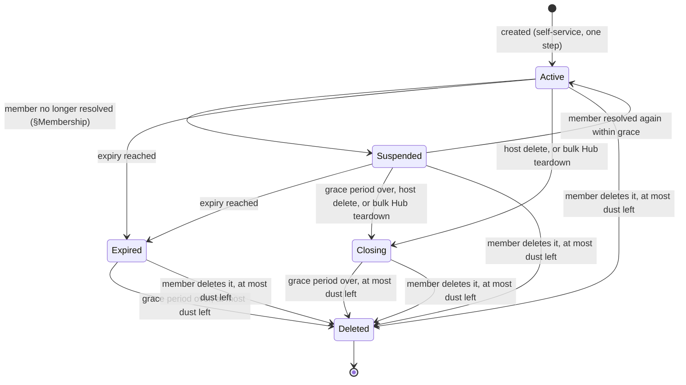

NIP-CW
======

Circle Wallet
-------------

`draft` `optional` `nwc`

**Depends on**: [NIP-44](https://github.com/nostr-protocol/nips/blob/master/44.md) (Encrypted Payloads), [NIP-47](https://github.com/nostr-protocol/nips/blob/master/47.md) (Nostr Wallet Connect), [NIP-51](https://github.com/nostr-protocol/nips/blob/master/51.md) (Lists), [NIP-CASH](./NIP-CASH.md) (Cash Hub)
**Related**: [NIP-IC](./NIP-IC.md) (Identity Connection)

## Abstract

A **circle** is a group of people who do not run their own node; a host extends their own node to all
of them. This document defines the **Circle Wallet**, the personal wallet a member gets, and the
**Circle Wallet Hub**, the host's connection that issues one on a member's self-service request.

Every member's wallet lives on the host's node, so a payment between two members settles as a fee-free
internal transfer. A payment to anyone outside the circle goes out over ordinary Lightning. Who counts
as a member is a host configuration choice.

## Non-Goals

This document does not define:

- pre-funded, owner-initiated payouts to named recipients who are not members;
- a "followers" policy, one that checks the *requester's own* published lists;
- circles denominated in anything other than sats.

## Terminology

This document uses MUST, MUST NOT, SHOULD, and MAY as defined in RFC 2119.

- **circle**: a group of people the host has decided to extend their own Lightning wallet
  infrastructure to. It has no protocol state of its own, existing only as the set of people who can
  successfully authenticate against a given Circle Wallet Hub.
- **Circle Wallet**: the personal, fully-functional wallet a circle member ends up with, one per
  member, starting at zero balance, able to send and receive like any other wallet in this system.
- **Circle Wallet Hub**: the host's own connection members send their `create_circle_wallet` request
  to. It issues Circle Wallets on its node, each holding only what its member receives.
- **Circle Identity**: a reusable record a Circle Wallet Hub references to decide who is currently a
  member, independent of any one Hub's lifetime and shareable across multiple Hubs. Its admission
  mechanism is defined in §Membership.

## Methods

| Method | Caller | Scope | Purpose |
|---|---|---|---|
| `create_circle_wallet` | a member, over the Circle Wallet Hub connection | `circle_wallet` | Self-service request for the caller's own Circle Wallet |
| `delete_circle_wallet` | a member, over their own Circle Wallet connection | none: every Circle Wallet connection | Delete the caller's own Circle Wallet once it holds at most dust |

The NIP-47 methods a Circle Wallet connection is granted, and which of them each state allows, are in
§What a Circle Wallet Connection Allows.

## Data Model

This section describes the information a Circle Wallet Hub MUST be able to represent. It is not a wire
format or a storage schema.

A Circle Identity MUST record which admission mechanism it uses, plus the data that
mechanism needs: the set of allowlisted pubkeys, or the follow set's address — its author (the provider
pubkey) and its `d` identifier. A Circle
Identity MAY be referenced by more than one Circle Wallet Hub at once. It MUST NOT be tied to any one
Hub's lifetime.

A Circle Wallet Hub MUST maintain, for itself:

- the Circle Identity governing who may request a wallet from it;
- a ceiling on the send cap (`max_amount`) and one on the receive cap (`max_receive`) a member may
  request for their own wallet;
- a floor on how tight a member's requested budget-renewal period may be;
- a ceiling on, and default value for, an issued wallet's lifetime, each in seconds with `0` meaning
  never. A Hub MUST NOT set a default above its ceiling, so a non-zero ceiling rules out a default of `0`;
- the grace period a member gets before their wallet is deleted, and a dust threshold: the largest
  balance it may keep from a wallet it deletes;
- a holdings ceiling: the most its Active wallets may hold together;
- a routing-fee reserve rule, the most routing fee a member's Lightning payment may pay;
- optionally, a ceiling on what its wallets together may send as external traffic in one period of its
  own;
- optionally, a rotation delay.

For each Circle Wallet it issues, a Hub records the member's `connection_pubkey` and authorizes
it as that wallet's client key. It never generates, receives or stores the matching secret.

For each member who currently holds an Active or Suspended Circle Wallet under a given Hub, an
implementation MUST be able to determine that fact. §Membership's one-wallet-per-member rule is checked
against it. That fact MUST stop being true once the member's wallet is neither Active nor Suspended,
freeing them to request a new one.

A Hub also keeps, for each Circle Wallet, a join record written in step 9's transaction: the Circle Hub
connection as its target, the join's `pubkey` as its authorizer, its `connection_pubkey`, its proof's
`created_at`, and the `encrypted_details` it returns.

An implementation MUST also maintain a single-use record of every identity-proof event ID it has already
consumed for `create_circle_wallet` or a member request.
It MUST keep a join proof's ID in that record at least until the proof's `created_at` plus 360 seconds,
past the last moment check 4 could still accept it, and a member request's ID as §Recovering a Lost
Connection says.

### Budget Renewal Floor

With renewal periods ranked tightest-to-loosest (daily, weekly, monthly,
yearly, never), a Hub MUST refuse a request with `LIMIT_EXCEEDED` when its requested renewal is tighter
than the Hub's floor. For example, a `monthly` floor allows `monthly`/`yearly`/`never` and rejects
`daily`/`weekly`.

A budget period starts when the wallet is created, in UTC. Daily and weekly periods start at the
creation instant plus k×86400 or k×604800 seconds. Monthly periods stay anchored to the creation day,
clamped to the month's last day; yearly periods likewise (Feb 29 → Feb 28). A monthly or yearly period
starts at the creation's UTC time of day on that date. Each start is counted from the creation day, never
from the previous period's start: a wallet created at 2024-01-31T10:00Z starts monthly periods at
2024-02-29, 2024-03-31 and 2024-04-30, each at 10:00Z, and one created on 2024-02-29 starts yearly periods
on 2025-02-28, 2026-02-28, 2027-02-28 and 2028-02-29. A period runs from its start, inclusive, to the next
period's start, exclusive. At the start of each period the wallet's send and receive caps are available
again in full. With `never`, the wallet's whole life is one period.

## Creating a Circle Wallet

### Request

```jsonc
{
  "pubkey": "<hex requester pubkey>",
  "connection_pubkey": "<hex pubkey of the connection keypair the member generated>",
  "max_amount": 100000,
  "max_receive": 200000,
  "expiry": 2592000,
  "budget_renewal": "monthly",
  "identity_event": "{...kind 23199 JSON...}"
}
```

- `pubkey` — REQUIRED, MUST be a 64-character lowercase-hex Nostr pubkey.
- `connection_pubkey` — REQUIRED, the public half of a keypair the member generated locally for this
  wallet's connection: a 64-character lowercase-hex x-only secp256k1 pubkey. It MUST differ from `pubkey`.
  The member keeps the secret and never sends it; the Hub authorizes this pubkey as the wallet's client key.
  A request without it MUST be rejected — there is no Hub-generated alternative. A member SHOULD generate a
  fresh keypair per request, so the connection key links to nothing else they use.
- `max_amount` — REQUIRED, a JSON integer, the send cap per budget period on the wallet's external traffic,
  in the chain's milli-unit (msats on Bitcoin, the same milli-unit for any other
  energy-backed coin), as in NIP-47. MUST NOT exceed the Hub's own per-wallet send ceiling.
- `max_receive` — REQUIRED, a JSON integer, the receive cap per budget period on the wallet's external
  traffic, in the same milli-unit. MUST NOT exceed the Hub's own per-wallet receive
  ceiling.
- `expiry` — OPTIONAL, a JSON integer, the wallet's lifetime in seconds; if omitted or zero, it MUST
  default to the Hub's own default lifetime, not its ceiling.
- `budget_renewal` — OPTIONAL, one of NIP-47's `daily` | `weekly` | `monthly` | `yearly` | `never`, with
  periods as §Budget Renewal Floor defines them; if omitted, it MUST default to `never`. Whether omitted
  or explicit, the resolved value MUST satisfy the Hub's own renewal floor.
- `identity_event` — REQUIRED, the JSON-encoded kind-23199 identity proof.

### Response

```jsonc
{
  "encrypted_details": "<NIP-44, encrypted to the requester's own pubkey>"
}
```

The plaintext inside `encrypted_details` is a JSON object carrying every term of the issued wallet:

```jsonc
{
  "wallet_pubkey": "<hex>",
  "connection_pubkey": "<hex, the connection_pubkey of the request>",
  "relays": ["wss://relay.example.com"],
  "max_amount": 100000,
  "max_receive": 200000,
  "expires_at": 1720000000,
  "fees_ppm": 0,
  "dust_threshold_millis": 1000,
  "rotation_delay_secs": 432000,
  "budget_renewal": "monthly"
}
```

It carries no secret and no connection string. The member builds its own connection string from
`wallet_pubkey`, `relays` and the secret it kept —
`nostr+walletconnect://<wallet_pubkey>?relay=<each relay>&secret=<its own secret>` — and a Hub MUST NOT
return a secret, a `pairing_uri`, or anything else derived from one. `relays` MUST carry at least one
non-empty relay URL, in failover order.

`connection_pubkey` repeats the request's. A client MUST reject details whose `connection_pubkey` is
missing or differs from the one in its request, so an old reply cannot pass as the answer to a new one.

`expires_at` is the wallet's expiry in unix seconds, or `0` when the wallet never expires.

`dust_threshold_millis` is the Hub's dust threshold when the wallet was created, fixed for the wallet's
life like `fees_ppm`. `rotation_delay_secs` is present only on a Hub that serves
§Recovering a Lost Connection: the wallet's rotation delay, likewise fixed when it was created.

`max_amount` and `max_receive` are the send and receive caps as the Hub resolved them, in the same
milli-unit as the request. A Hub that adjusts a requested value, for example by rounding it down to a unit
its node can represent, MUST NOT raise it, and reports what it actually applied.

**The response carries exactly one field.** `encrypted_details` MUST be encrypted (NIP-44) to
the requester's own pubkey, and every term describing the issued wallet MUST be inside it. A Hub MUST NOT
place any of them beside the ciphertext.

**It is encrypted from the Hub's connection key**, on either transport: the NIP-44 conversation key is the
one between the requester's `pubkey` and the Hub's own pubkey (the wallet pubkey of its connection string,
`circlehub1...` type `0`). A client MUST decrypt it with exactly that conversation key and MUST reject a
response whose `encrypted_details` does not decrypt under it.

### Processing Algorithm

On receiving `create_circle_wallet`, the Hub MUST, in order:

1. Validate the params: `pubkey` and `connection_pubkey` are well-formed 64-character lowercase-hex
   strings, `connection_pubkey` is a valid x-only secp256k1 pubkey, and the two differ; `max_amount`,
   `max_receive` and, when present, `expiry` are JSON integers from 0 to 2^63−1; `budget_renewal`, when
   present, is one of the values §Request lists; and `identity_event` is a string that parses to a JSON
   object. A request failing any of these is refused with `BAD_REQUEST`, and nothing is recorded: its
   proof is not consumed, since step 3 is never reached.
2. Verify the kind-23199 identity proof per §Identity Proof, checks 1–7: the kind is 23199, the event's
   own `id` matches its content, the signature verifies and the signer equals the requested `pubkey`,
   `created_at` is fresh, the `d` tag equals the Hub's pairing-URI pubkey, the `connection` tag equals the
   requested `connection_pubkey`, and the `terms` tag equals the requested `max_amount`, `max_receive`,
   `expiry` and `budget_renewal`.
3. Check the proof's event ID against the single-use replay guard (check 8). A Hub MUST
   refuse a previously-consumed event ID with `REQUEST_REUSED`, even if the proof is otherwise
   valid and still within its freshness window. The proof's ID is recorded as used here, before any later
   check.
4. Authorize the requester against the Hub's Circle Identity: an `allowlist`-policy Hub performs a
   direct lookup, while a `follow_set`-policy Hub resolves the current version of its follow set.
   A Hub that cannot resolve that list yet MUST NOT fall back to denying membership. It
   MUST instead answer `NOT_READY`, which the caller can retry.
5. Check the one-wallet-per-(Hub, identity) rule, rejecting with `WALLET_EXISTS`
   if the identity already holds an Active or Suspended Circle Wallet under this Hub.
6. Validate `max_amount` and `max_receive` against the Hub's own per-wallet ceilings, the resolved
   `budget_renewal` against the Hub's own renewal floor, and, if `expiry` was explicitly supplied
   (non-zero), that it does not exceed the Hub's own expiry ceiling, where a ceiling of `0`
   means no limit. A request over any of these limits is refused with `LIMIT_EXCEEDED`, whose
   message names the field.
7. Rate-limit per requester `pubkey`. A Hub SHOULD bound how often one member may ask, and MUST answer a
   throttled request with a distinct rate-limit error rather than a generic failure. That error is
   `RATE_LIMITED`. Quota SHOULD be spent only by requests that got this far.
8. Guard against concurrent requests against the same Hub. A Hub MUST NOT let two in-flight requests both
   pass step 9 against the same state; rejecting the second with `RATE_LIMITED` is
   sufficient.
9. Inside one transaction, verify that the circle's holdings are below its holdings
   ceiling. Then create the Circle Wallet connection, authorizing `connection_pubkey` as its client key,
   insert its membership row, and write its join record. The membership row's uniqueness
   constraint is the authoritative guard for step 5, so a conflict here, a `connection_pubkey` already
   authorized for another connection on this node or pending in any rotation on it, or a failing holdings check, MUST roll back the entire transaction, including the
   just-created connection and permission rows. A uniqueness conflict is refused with `WALLET_EXISTS`, a
   `connection_pubkey` in use or pending with `RESTRICTED`, and a failing holdings check with
   `INSUFFICIENT_CAPACITY`. The Hub MUST NOT commit the transaction once the proof is past its
   freshness window, checked at commit, and refuses such a join with
   `BAD_REQUEST`, since nothing was made and the outcome is final. On any rollback, the step-3 replay
   record is not rolled back.

   Step 8's guard is process-local. Each holdings check, here or when crediting a payment, and the change it guards need a database-level lock scoped to the Hub, so an
   implementation whose datastore cannot provide one MUST NOT be run as multiple concurrent processes
   against a shared database. A transaction-scoped advisory lock is sufficient where the datastore
   supports one.
10. After the transaction commits, never before, publish the new connection's relay subscription.
11. Return the `encrypted_details` recorded in step 9: a single ciphertext containing `wallet_pubkey`,
    `connection_pubkey`, `relays` and every resolved wallet parameter, and no secret. Nothing describing
    the wallet may travel outside it.

### Errors

A Hub MUST use these error codes for these refusals, on either transport, each in NIP-47's error object,
`{"code": "<code>", "message": "<text>"}`:

| code | meaning | retry? |
|---|---|---|
| `BAD_REQUEST` | a param is missing or malformed (step 1), or the proof passed its freshness window before the join could commit (step 9); nothing was made | yes, corrected, with a new proof |
| `UNAUTHORIZED` | the identity proof does not verify (step 2) | yes, with a new proof |
| `REQUEST_REUSED` | the identity proof was already used (step 3); a copy of this join may have been made | no; look the join up |
| `NOT_READY` | the Hub cannot decide membership yet (step 4) | yes, later |
| `RESTRICTED` | the requester is not a member of this circle (step 4), or its `connection_pubkey` is in use or pending in a rotation on this node (step 9) | no; for a key in use, yes with a new proof and a new `connection_pubkey` |
| `WALLET_EXISTS` | the requester already holds an Active or Suspended Circle Wallet under this Hub (step 5) | no, until it is neither |
| `LIMIT_EXCEEDED` | `max_amount`, `max_receive`, `budget_renewal` or `expiry` is over the Hub's limits; the message names the field (step 6) | yes, with other values |
| `RATE_LIMITED` | the requester has asked too often, or another request held the Hub (steps 7–8) | yes, later |
| `INSUFFICIENT_CAPACITY` | the circle's holdings have reached its holdings ceiling (step 9) | yes, later |

A wallet's own refusals, and a member request's, use these:

| code | meaning | retry? |
|---|---|---|
| `UNAUTHORIZED` | a member request fails a check, or is not signed by the join's `pubkey` | yes, with a new member request |
| `REQUEST_REUSED` | a member request's id was already used | no; it was already applied or refused |
| `NOT_FOUND` | a member request names a wallet the Hub does not hold, or one already Deleted | no |
| `NOT_IMPLEMENTED` | the Hub, or the named wallet, does not serve §Recovering a Lost Connection | no |
| `INSUFFICIENT_BALANCE` | the payment's full cost exceeds the wallet's balance | yes, for less |
| `QUOTA_EXCEEDED` | the payment or invoice would pass the wallet's send cap or receive room, or the circle's outbound ceiling | yes, in a later period or for less |
| `INSUFFICIENT_CAPACITY` | the invoice or payment would take the circle's holdings past its holdings ceiling | yes, later or for less |
| `RATE_LIMITED` | too many same-circle transfers, invoices, open invoices or pending payments | yes, later |
| `PAYMENT_FAILED` | the payment could not be routed, for example within the routing-fee reserve | yes, later or another way |
| `RESTRICTED` | a method the wallet's state does not allow, an invoice with no amount, an invoice for a wallet that is not Active, a deletion while the wallet holds more than dust or has a payment in flight, or a rotation to a key in use | no |
| `ROTATION_PENDING` | the wallet already has a pending rotation | no, until it completes or is cancelled |
| `FROZEN` | the wallet is frozen, so its current key is refused | no, until it is unfrozen or rotated |

A client MUST sign a new proof for a retry after any refusal. A proof refused at step 3 or later is
consumed, so resending it is refused with `REQUEST_REUSED`.

**`REQUEST_REUSED` is not a failure:** an earlier copy of the join may have made the wallet. A client
that receives it for a join it sent MUST NOT read it as a failure: it keeps the join pending and looks it
up. Only after the lookup answers `unknown` MAY it join again, with a newly signed
proof and a new `connection_pubkey`.

### Lost Join Reply

A member whose join reply never arrives recovers it with NIP-CASH's `cash_lookup` on the private
transport, with params
`{"connection_pubkey": "<hex>", "deadline": <unix>}` in place of `request_id`:

- **The item's `target` is the Circle Hub connection**, the original join's target, and it carries a bill
  proof signed with the Hub connection's secret, exactly as a join does.
- **It is authorized by the joiner's identity.** Its item proof MUST be signed by the `pubkey` of the
  request that named this `connection_pubkey`. The record is matched on (signer, `connection_pubkey`): a
  record held under another signer is no match, and a lookup with no match is answered by its `deadline`
  as below, not omitted. Only a lookup whose item proof or bill proof does not verify is omitted.
- **Its result is the original response**, the same `encrypted_details`, which the client checks as it
  would have checked the reply. A lookup naming the key a rotation moved the wallet to is
  answered as §Recovering a Lost Connection says.
- **`deadline` is the join's deadline, as the client sent it.** A join's deadline is its kind-23199
  proof's `created_at` plus the 5-minute freshness window, and the Hub MUST NOT create a
  wallet whose proof is past it, checked at commit (step 9). A `deadline` counts as at most 6 minutes
  from now (the 5-minute freshness window plus its 1-minute future allowance); a later one is treated as
  now plus 6 minutes. A lookup MUST NOT write state.
- **With no record, the Hub answers on its own clock**, with the same three statuses as NIP-CASH.
  `deadline` has passed when now > `deadline`.
  - `pending`, with `retry_after` = `deadline` + 1, while `deadline` has not passed;
  - `unknown` while now is at most `deadline` plus 6 minutes: the join was not made and never will be;
  - `expired` after that: the outcome can no longer be known. A client MUST NOT join again automatically
    with that `connection_pubkey`, and SHOULD show the join to the member.
- **The record outlives the lookup window.** The Hub keeps a join's record while now is no later than its
  `deadline` plus 6 minutes, even if the wallet is deleted sooner. It may drop the record only once the
  wallet is deleted and now is later than that; a later lookup then answers `expired`.

Every Circle Wallet Hub MUST serve this lookup, and so NIP-CASH's private transport for it, and lists `cash_lookup` in the Circle Hub connection's `get_info` `private_methods`.
It MUST keep each join's record, with its `encrypted_details`, while the
wallet exists and for at least the window above. This works whichever transport carried the join.

## Identity Proof (kind 23199)

Kind 23199 is defined by this document. It is neither NIP-CASH's kind 23198 nor NIP-IC's kind 35521.

```jsonc
{
  "kind": 23199,
  "pubkey": "<requester pubkey — MUST equal `pubkey` in the request>",
  "created_at": 1720000000, // freshness window: up to 5 minutes in the past, up to 1 minute in the future
  "tags": [
    ["d", "<Circle Wallet Hub's own pubkey>"], // binds proof to THIS Hub; no invoice to bind it to
                                              // — see below: this is the pubkey from the Hub's
                                              // PAIRING URI, not any key derived from its secret
    ["connection", "<connection_pubkey from the request>"], // binds proof to the key the wallet is issued to
    ["terms", "<max_amount>:<max_receive>:<expiry>:<budget_renewal>"] // binds proof to the requested terms
  ],
  "content": "",
  "sig": "<schnorr signature by `pubkey`>"
}
```

A Circle Wallet member is always a raw Nostr pubkey.

Verification MUST establish all of the following, and a failure of any one MUST be rejected. Every other
section that verifies a kind-23199 proof refers to this list.

1. **The event's `kind` is 23199, and it carries no `action` tag.** An `action` tag marks a member
   request about an existing wallet, never a join.
2. **The event's `id` matches its own content.** Recompute the id from the canonical serialization and
   compare; the single-use replay guard (check 8) is keyed on this id.
3. **The signature verifies** against `pubkey`, and `pubkey` equals the `pubkey` named in the request.
4. **`created_at` is inside the freshness window** given above: from now − 300 to now + 60 seconds on
   the Hub's clock, both bounds inclusive.
5. **The `d` tag equals the Hub's own pubkey** — specifically the pubkey a member reads from the Circle
   Wallet Hub's **pairing URI**. An implementation that maintains a second, internal keypair derived from
   the connection's secret MUST NOT bind against that one.
6. **The `connection` tag equals the request's `connection_pubkey`.** Exactly one such tag.
7. **The `terms` tag equals the request's terms.** Exactly one such tag, whose value is
   `<max_amount>:<max_receive>:<expiry>:<budget_renewal>` exactly as requested: `max_amount`,
   `max_receive` and `expiry` as unsigned decimal ASCII with no leading zeros (`0` for zero), an omitted
   `expiry` written as `0` and an omitted `budget_renewal` as `never`. A Hub MUST rebuild this string from
   the request's params and compare it byte for byte, and MUST reject a request whose tag differs. So
   `100000:200000:0:monthly` binds `max_amount` 100000, `max_receive` 200000, no `expiry` and `monthly`,
   while `0100000:200000:0:monthly` or `100000:200000:0:Monthly` matches no request.
8. **The `id` has not been used before**, against a single-use record. A previously-consumed
   id MUST be rejected even if everything above still holds.

For example, the join proof by the pubkey `79be667ef9dcbbac55a06295ce870b07029bfcdb2dce28d959f2815b16f81798`
(the private key 1), with `created_at` `1720000000`, `content` empty and the tags
`["d", "f9308a019258c31049344f85f89d5229b531c845836f99b08601f113bce036f9"]` (the Hub, the private key 3),
`["connection", "c6047f9441ed7d6d3045406e95c07cd85c778e4b8cef3ca7abac09b95c709ee5"]` (the private key 2)
and `["terms", "100000:200000:0:monthly"]` in that order, has the NIP-01 event id
`f796fb3c192db23c1ea2636c580408c6e574e290c6193e7694d170abedbc65b8`.

Checks 1–7 MUST run before the membership authorization check: an attacker who does not hold the
target's private key MUST NOT be able to reach the authorization check at all, so the response cannot be
used to probe list membership.

## Membership

A Circle Identity's admission mechanism supports two forms:

- **allowlist**: an explicit list of pubkeys the host maintains directly.
- **follow_set**: the pubkeys in one NIP-51 follow set (kind `30000`), named by its address: the
  provider pubkey that authors it and its `d` identifier. The provider can be any account the host
  controls; one account can run several circles, each Circle Identity naming a different `d`.

**Removing a member suspends their wallet.** Whichever form it uses, a Hub MUST, within its staleness
bound, suspend the Active Circle Wallet of any pubkey a successful resolution (below) no longer names as
a member. A Suspended wallet can only pay out its balance: it cannot receive and
stops counting toward the holdings ceiling, but still counts for the one-wallet-per-member rule (below).
If a later successful resolution names the member again before the wallet's grace period ends, the Hub MUST return it to Active: the same wallet, connection, balance, caps and periods,
with nothing for the member to redo. On an `allowlist` Hub each committed edit of the list is a
successful resolution, and the Hub applies it at once. A Hub SHOULD alert the host when one resolution
would suspend a large share of its wallets at once.

A `follow_set` Hub MUST apply these rules:

- **Which address.** A host SHOULD give the set a `d` identifier that is unguessable and used only for
  this circle (e.g. `circle-<random>`), and SHOULD use a provider key that ordinary social clients do not
  hold, since whoever can edit the set grants wallet access.
- **Which relays.** The Hub reads the set from its configured relays, and the host publishes it there.
- **Which event.** Only a kind-`30000` event whose signature verifies, whose author is the provider
  pubkey and whose `d` tag equals the configured identifier. Of those, the one with the highest
  `created_at` wins; on a tie, the lowest `id` (NIP-01's rule for addressable events). An event from
  any other author MUST be ignored, whatever it claims. A Hub MUST ignore a version whose `created_at` is
  more than 15 minutes in the future, and its relays SHOULD reject one.
- **Which members.** Exactly the pubkeys in that event's public `p` tags, plus any `hidden_p` entries
  the Hub can decrypt. NIP-51's private items in the encrypted `content` MUST NOT be
  counted.
- **Nothing else.** `title`, `description` and `image` (NIP-51) are display-only. A Hub MUST NOT read
  membership, terms or any other setting from a tag other than `d`, `p` and `hidden_p`; a Hub's terms
  live in the Hub.
- **Staleness.** "Current" means the Hub's most recent resolution of the set. An implementation MAY cache
  it and refresh it, and MUST bound that staleness.
- **Unresolved is not empty.** A Hub MUST act only on a successful resolution: a version of the set it
  has fetched and verified as above. A Hub MUST treat a set it has not found yet, and a refresh that
  fails or finds no version, as unresolved, not as empty (step 4); a failed
  refresh leaves the last successful resolution in force. A resolved set with no members is empty:
  nobody is a member, and every wallet issued under it is suspended (above).
- **Deletion is ignored.** A Hub MUST ignore a NIP-09 deletion of the set; only a newer version changes
  membership. To close a circle, a host publishes the set with no members.

An example set, one of several the same account can publish:

```jsonc
{
  "kind": 30000,
  "pubkey": "<provider pubkey>",
  "tags": [
    ["d", "circle-7k2m9q4x"],
    ["title", "Ada's Family Circle"],                 // display-only
    ["description", "Wallets for the family, on my node"], // display-only
    ["p", "<member pubkey>"],
    ["p", "<member pubkey>", "wss://relay.example.com"],   // a relay hint is ignored for membership
    ["hidden_p", "<NIP-44 v2 payload>"]                // §Hidden Members
  ],
  "content": "",
  ...
}
```

A Hub reading it is configured with the address `30000:<provider pubkey>:circle-7k2m9q4x`.

A host SHOULD give the set a `title`. When it does, a Hub SHOULD use that `title` as the default
`label` of its `circlehub1...` string, so the invite and the set
carry the same name.

### Hidden Members

A `p` tag publishes who is in the circle. A host MAY instead list a member as a `hidden_p` tag, whose
value only the provider and the Hub can read:

```jsonc
["hidden_p", "<NIP-44 v2 payload>"]
```

- **Encryption.** The payload is NIP-44 version 2, encrypting the member's pubkey as 64-character
  lowercase hex, under the conversation key between the provider and the Hub's **inbox** pubkey, the one
  in its kind-11190 announcement. It MUST NOT be encrypted to the
  Hub's connection pubkey. A Hub with hidden members SHOULD offer §Private Join.
- **Reading.** For each `hidden_p` tag, a Hub MUST attempt NIP-44 v2 decryption with its inbox key and
  the provider pubkey. An entry that fails to decrypt MUST be skipped without error. An entry that
  decrypts to anything but a well-formed 64-character lowercase-hex pubkey MUST be skipped too.
- **Several Hubs.** A Circle Identity serving several Hubs with different inbox keys needs one
  `hidden_p` entry per hidden member per inbox key.
- **Re-encrypt on every publish.** NIP-44 payloads are randomized, so a provider SHOULD encrypt every
  `hidden_p` entry afresh, and SHOULD shuffle their order, each time it publishes the set.
- **Inbox rotation.** A hidden entry is bound to the inbox key it was encrypted to. A Hub that rotates
  its inbox key MUST keep trying each retired key on `hidden_p` entries for as long as any wallet issued
  while that key was current is Active or Suspended.

A host's kind:3 contact list is not a membership source.

A "followers" mechanism — checking the *requester's own* published lists to see whether they
claim to follow the host — MUST NOT be offered.

Independent of which admission mechanism a Hub uses, a member MUST hold at most one Circle Wallet per Hub
at a time that is Active or Suspended: this is the one-wallet-per-member rule. It is checked at step 5 and
enforced authoritatively by the membership row's uniqueness constraint at step 9. The
membership row MUST be removed when its Circle Wallet is neither Active nor Suspended, and in any case MUST cascade-delete when the wallet's connection record is deleted, freeing the
identity to request a new wallet.

## Own Funds and Caps

A Circle Wallet spends only what it has received. Its balance is what it has been paid minus what it has
paid out, fees included, and `get_balance` reports exactly that. A Hub MUST NOT fund any part of a
member's payment from its own balance or from another member's wallet, and MUST refuse a payment whose
full cost exceeds the paying wallet's balance with `INSUFFICIENT_BALANCE`. A payment's full cost is its
amount plus, for a Lightning payment, its routing fee and its `fees_ppm` fee; until a Lightning
payment resolves, its full cost is the most it may cost (Routing-fee reserve, below).

**Routing-fee reserve.** Every Hub announces the routing fee it reserves for a Lightning payment as
`circle_wallet.fee_reserve` in `get_info`: `ppm` and `min_millis`, so
that a payment of amount A reserves the larger of `min_millis` and A times `ppm` divided by 1,000,000,
rounded down. The most a Lightning payment may cost is its amount plus its `fees_ppm` fee plus that
reserve, under the rule the Hub announces when the payment starts. While the payment is in flight the Hub
MUST hold that much back from the paying wallet's balance and count it against the caps below. The Hub
MUST NOT pay a routing fee above the reserve: a payment it cannot route within it fails with
`PAYMENT_FAILED`, and costs the member nothing.

**Four kinds of payment.** Every payment a Circle Wallet sends or receives is one of these, by where the
other side is:

1. **The same circle**: another wallet issued by the same Hub. Fee-free, and
   counted against neither member's caps.
2. **Another circle on the same node**: a Circle Wallet issued by another Circle Wallet Hub on the same
   node. Fee-free and counted against neither member's caps, but the receiving circle's holdings ceiling
   applies to it (below).
3. **Any other connection on the same node**: the host's own wallet, a Cash Hub or a cash bill, or any
   other application. Fee-free, but external traffic: a send counts against the sender's send cap and a
   receipt against the receiver's receive cap. A credit the Hub refuses from a
   NIP-CASH `cash_redeem` fails that redemption with `PAYMENT_FAILED`, and the slice stays claimable.
4. **Lightning**: anyone off the node. External traffic, and the only kind a routing fee and `fees_ppm`
   apply to.

**Caps.** Each wallet has two caps on its external traffic (kinds 3 and 4), both per budget period.
Payments of kinds 1 and 2 never count against them.

- **Send cap, `max_amount`.** A Hub MUST refuse, with `QUOTA_EXCEEDED`, a payment from an Active wallet
  whose full cost would take the wallet's external sends in the current period past `max_amount`. A
  payment counts in the period in which it starts. While it is in flight it counts at the most it may
  cost, its routing-fee reserve included; once it resolves, at what it cost, or not at all if it failed.
- **Receive cap, `max_receive`.** A wallet's receive room is `max_receive` less its external receipts in
  the current period and less the amounts of its open invoices, held payments the Hub has accepted
  included. Every open invoice counts, whoever pays it in the end, since the Hub cannot know the payer when it issues the invoice; an invoice another Circle Wallet on the
  node pays (kinds 1–2) is no receipt, so its room comes back once it is paid, as it does when an invoice
  expires or is cancelled. A Hub MUST
  refuse, with `QUOTA_EXCEEDED`, to issue an invoice for more than the wallet's receive room, and MUST
  fail, never credit, an incoming external payment that names none of the wallet's open invoices — a
  keysend, say — and is larger than that room. A payment of one of the wallet's own open invoices uses
  the room that invoice already holds. A held payment counts from the moment the Hub accepts it until it
  settles, and stops counting if it is cancelled.

A Hub MUST refuse, with `RESTRICTED`, to issue a Circle Wallet invoice with no amount or a zero amount.

**Holdings ceiling.** A Circle Wallet Hub's holdings are the balances of its Active wallets plus the
amounts of every open invoice they have issued, held payments the Hub has accepted included. An open
invoice counts whoever pays it in the end. A Hub
MUST NOT let a new invoice or a credit take its holdings past its holdings ceiling. It refuses such an
invoice, and such a payment from the same node, with `INSUFFICIENT_CAPACITY`, and fails such a payment
arriving over Lightning. A payment between two Active wallets of the circle only moves money inside its
holdings, and is never refused for this ceiling. A payment into an Active wallet from one of the circle's
wallets that is not Active does raise the holdings, so the Hub checks it against the ceiling like a
payment from another circle on the node. A wallet returning to
Active may leave the holdings above the ceiling, which then only refuses new invoices and
credits until the holdings fall below it.

**Circle outbound ceiling.** A Hub MAY also bound what all its wallets together send as external traffic
in one period of its own, `daily` to `yearly`, starting at the Hub's creation as §Budget Renewal Floor
starts a wallet's. It then refuses, with `QUOTA_EXCEEDED`, a payment that would take that total past the
bound, counting each payment as for a send cap.

**Only Active wallets receive.** A wallet in any other state can only pay out. A
Hub MUST refuse its `make_invoice` with `RESTRICTED`, MUST cancel its open invoices when it leaves Active,
and MUST fail every payment to it, same-circle ones included. Its payouts still count against the circle's
outbound ceiling, but not against its send cap.

**Rate limits.** A Hub MAY rate-limit a wallet's same-circle transfers, the invoices and hold invoices it
issues and the payments it has pending at once, and MAY cap how many open invoices one wallet holds at
once, refusing the excess with `RATE_LIMITED`. A Hub that sets a circle outbound ceiling SHOULD also
bound the external payments each wallet has in flight at once, refusing the excess with `RATE_LIMITED`.

### What a Circle Wallet Connection Allows

A Circle Wallet connection is granted these NIP-47 methods: `pay_invoice`, `pay_keysend`, `make_invoice`,
`lookup_invoice`, `list_transactions`, `get_balance`, `get_budget` and `get_info`, plus
`delete_circle_wallet`. It also receives the notifications of §Recovering a
Lost Connection. Which methods a Hub serves depends on the wallet's state:

| state | methods served |
|---|---|
| Active | every method above |
| Suspended, Expired, Closing | `get_info`, `get_balance`, `pay_invoice` and `pay_keysend` (payouts only), `lookup_invoice`, `list_transactions`, `delete_circle_wallet` |
| frozen, in any state | none: every request by the current key is refused with `FROZEN` |

A Hub MUST refuse a request by a frozen wallet's current key with `FROZEN`, and otherwise MUST refuse a
method outside this list, or one the wallet's state does not serve, with `RESTRICTED`.

`get_budget` reports the wallet's two caps for the current period, the send cap in NIP-47's own fields
and the receive cap beside them, all in the chain's milli-unit:

```jsonc
{
  "total_budget": 20000000,          // max_amount
  "used_budget": 15000000,           // external sends this period, those in flight at the most they may cost
  "renews_at": 1709200800,           // when the current period ends and the next begins; absent with never
  "renewal_period": "monthly",
  "total_receive_budget": 50000000,  // max_receive
  "used_receive_budget": 45000000    // receipts this period plus open invoices and held payments
}
```

The remaining send room is `total_budget` minus `used_budget`, and the remaining receive room
`total_receive_budget` minus `used_receive_budget`; a Hub MUST report them so that neither is below zero.
The circle outbound ceiling, which `get_budget` does not report, may still refuse a payment within the
send room.

## In-Circle Transfers

A payment is treated as an internal, fee-free transfer whenever the invoice being paid was created by
the *same underlying node* the payer's connection also runs on — regardless of which connection kind
issued either side. A payment to anyone outside the circle is an ordinary Lightning payment, subject to
normal routing and fees. Fee-free is not the same as uncounted: only a payment to another Circle Wallet
on the same node (kinds 1–2) counts against no cap.

## Fees

A Circle Wallet Hub MAY apply a forwarding-fee skim to a member's payments — `fees_ppm`
(parts-per-million), a Hub-level setting reported in `create_circle_wallet`'s own response.

- **When it applies.** Only to a payment that leaves the node over real Lightning routing (kind 4). An in-circle transfer, or any other payment settled between apps on the same
  underlying node, is always fee-free — `fees_ppm` never applies to it, even
  where the payment counts against a cap.
- **How much.** `fees_ppm` times the payment amount, divided by 1,000,000 and **rounded down**, so a
  small enough payment carries no fee at all.
- **Who pays.** The paying member, on top of the payment amount, out of their own wallet balance —
  never any other member's, and never the Hub's own underlying balance. With the routing fee it is part
  of the payment's full cost, which counts against the member's send cap.
- **Which rate.** The one reported in that member's own `create_circle_wallet` response, fixed for the
  life of the wallet. A Hub MAY change its rate, but the new rate applies only to wallets created after
  the change, and `get_info`'s `circle_wallet.fees_ppm` reports the rate
  a new member would get. A member's economics MUST NOT shift underneath them because the host changed a
  setting after they joined.

A Hub that charges no fee at all MUST still report `fees_ppm: 0`, not omit the field. Whatever rate a Hub
advertises, it MUST actually apply that exact rate to every qualifying payment.

## Pairing Connection

A Circle Wallet's connection keypair is generated by the member, on the member's own device, and only its
public half (`connection_pubkey`) is ever sent. The Hub authorizes that pubkey
and MUST NOT generate, request, receive or store the secret.

The host therefore cannot reconstruct a member's connection string or act as the member over it, and
there is no way to reveal a connection again. A member who loses the secret has lost the connection, and
nothing moves the wallet's balance without it. On a Hub that serves it, the
member moves the wallet to a new key. On any other Hub the balance can no
longer be reached: the host can still delete the wallet, which moves it to Closing and frees the member
to request a new one with a new keypair, but the old wallet keeps its balance, payout-only, for good. A
client joining a Hub whose `get_info` reports no `rotation_delay_secs` MUST warn the member, before the
join, that losing the connection secret makes the wallet's balance unreachable, and SHOULD offer to back
the secret up.

### Recovering a Lost Connection

A Hub MAY let a member move a wallet to a new connection key. A Hub that does reports
`circle_wallet.rotation_delay_secs` in `get_info`, and one that does
not MUST omit it. The delay is the Hub's choice; a Hub SHOULD use 432000 seconds (5 days) unless it has
reason to choose otherwise. Each wallet's delay is the one in force when it was created, reported in its
details and fixed for its life. A wallet whose details carry none cannot be rotated, and a
Hub refuses a member request naming it with `NOT_IMPLEMENTED`.

**The host submits, the member authorizes.** The request reaches the Hub through the host's own
administration of it, which this document does not define. The host's submission MUST carry a member
request, a kind-23199 event the member signed, and a Hub MUST NOT rotate, freeze or unfreeze a wallet on
the host's word alone:

```jsonc
{
  "kind": 23199,
  "pubkey": "<member pubkey — the pubkey of the join that created the wallet>",
  "created_at": 1720000000, // freshness window: up to 24 hours in the past, up to 1 minute in the future
  "tags": [
    ["d", "<Circle Wallet Hub's own pubkey>"],  // as for a join (§Identity Proof, check 5)
    ["action", "rotate"],                         // "rotate" | "freeze" | "unfreeze"
    ["wallet", "<wallet_pubkey>"],                // the wallet it acts on
    ["connection", "<new connection_pubkey>"]     // rotate only: the key the wallet moves to
  ],
  "content": "",
  "sig": "<schnorr signature by `pubkey`>"
}
```

A Hub MUST check a member request in this order, and refuse it at the first step it fails:

1. **Rotation served.** A Hub that does not serve rotation refuses every member request with
   `NOT_IMPLEMENTED`.
2. **The request itself.** It passes §Identity Proof's checks 2 and 5 unchanged; its `kind` is 23199; its
   signature verifies against its `pubkey`; its `created_at` is inside the window above, from now − 86,400
   to now + 60 seconds on the Hub's clock, both bounds inclusive; and it carries exactly one `action` tag,
   whose value is `rotate`, `freeze` or `unfreeze`, exactly one `wallet` tag, exactly one `connection` tag
   on a `rotate` and none otherwise, and no `terms` tag. A failure is refused with `UNAUTHORIZED`, and
   nothing is recorded.
3. **Single use.** Its id is checked against the single-use record (check 8), and one
   used before is refused with `REQUEST_REUSED`. Otherwise the Hub records the id here, and MUST keep it
   for at least 24 hours and 1 minute after its `created_at`; a request refused at a later step stays
   consumed.
4. **The wallet.** One the Hub does not hold, or one already Deleted, is refused with `NOT_FOUND`.
5. **The member.** A `pubkey` other than the `pubkey` of the join that created the wallet is refused with
   `UNAUTHORIZED`.
6. **The wallet's delay.** A wallet whose details carry no `rotation_delay_secs` is refused with
   `NOT_IMPLEMENTED`.
7. **The action.** A `rotate` is checked as below. A `freeze` of a wallet already frozen, and an
   `unfreeze` of one that is not, succeeds and changes nothing.

**Rotation.** A `rotate` request is allowed in every state but Deleted. A Hub MUST refuse it with
`ROTATION_PENDING` while the wallet already has a pending rotation, and otherwise with `RESTRICTED` unless
its `connection` names a valid x-only key that no connection on the node uses and no pending rotation
names, checked and accepted as one atomic step with any join's step 9. Once
accepted, the rotation is pending from `requested_at`, the moment the Hub accepted it on its own clock,
and completes at the first moment now is at or after `requested_at` plus the wallet's
`rotation_delay_secs`. Until then:

- the old key keeps working, and the Hub MUST notify it at once with a NIP-47 `rotation_pending`
  notification;
- any request validly signed by the old key, unless the wallet is frozen, cancels the rotation and is
  then served as usual, and the Hub MUST notify the old key with `rotation_cancelled`. A payment arriving
  at the wallet cancels nothing.

On completion the Hub authorizes the new key in place of the old one, which stops working, and MUST
notify the new key with `rotation_completed`. It is the same wallet: the same `wallet_pubkey`, balance,
caps, periods, fees, dust threshold and state. Should the new key nonetheless be in use on the node by
then, the Hub MUST cancel the rotation instead and notify the old key with `rotation_cancelled`. The
notifications carry:

```jsonc
{"notification_type": "rotation_pending", "notification": {"connection_pubkey": "<new>", "completes_at": 1720432000}}
{"notification_type": "rotation_cancelled", "notification": {"connection_pubkey": "<new>"}}
{"notification_type": "rotation_completed", "notification": {"connection_pubkey": "<new>"}}
{"notification_type": "wallet_frozen", "notification": {}}
```

`completes_at` is `requested_at` plus the delay, here 1720000000 plus 432000.

**Recovering the details after a rotation.** `rotation_completed` carries only the new key, so a member on
a new device recovers the wallet's details with the join lookup, signed by the same
`pubkey` and naming the new key as `connection_pubkey`. A Hub that serves rotation MUST answer that lookup
from the rotation that installed the wallet's current key: while it is pending, `pending` with
`retry_after` its `completes_at`; once it has completed, `done`, whose result is the join's
`encrypted_details` with `connection_pubkey` set to the new key, encrypted to the member exactly as at join.
With no such rotation, the lookup is answered by its `deadline`, as for a join. The Hub keeps
what this answer needs for as long as the wallet exists.

**Freezing.** A `freeze` request takes effect at once, and the Hub MUST notify the current key with
`wallet_frozen` as it does. While a wallet is frozen the Hub MUST refuse every request signed by its
current key with `FROZEN`, and such a request cancels nothing. An `unfreeze` request lifts it at once, and
a completed rotation ends it, since the frozen key is gone. Freezing changes nothing else: a frozen Active
wallet still receives, and a pending rotation stays pending.

## The Circle Wallet Hub Connection (`circlehub1...`)

A Circle Wallet Hub's own connection — the one members send `create_circle_wallet` to — is otherwise an
ordinary NWC pairing.

A Circle Wallet Hub MUST answer `get_info` with a `circle_wallet` block, and a connection that is
not a Hub MUST omit it — its presence is what identifies a Hub at all:

```jsonc
"circle_wallet": {
  "available_millis": 1000000, // what the circle can still take in: holdings ceiling minus holdings, at least 0
  "max_exp_secs": 2592000,     // the Hub's expiry ceiling; 0 means "never"
  "fees_ppm": 0,               // the skim a member's outgoing payments will carry (§Fees)
  "fee_reserve": {"ppm": 5000, "min_millis": 10000}, // the most routing fee a payment pays (§Own Funds and Caps)
  "dust_threshold_millis": 1000, // a balance at or below it is dust (§Lifecycle and Deletion)
  "circle_policy": "allowlist", // "allowlist" | "follow_set" (§Membership)
  "identity": "<hex x-only>",  // the Hub's node identity, which signs its announcement
  "rotation_delay_secs": 432000, // OPTIONAL: present iff the Hub serves §Recovering a Lost Connection
  "per_wallet_max_millis": 500000, // OPTIONAL: the Hub's per-wallet ceiling on max_amount (§Data Model)
  "per_wallet_max_receive_millis": 500000, // OPTIONAL: the Hub's per-wallet ceiling on max_receive
  "min_budget_renewal": "monthly"  // OPTIONAL: the Hub's renewal floor (§Budget Renewal Floor)
}
```

The first five are the Hub's **terms**. A Hub MUST report `available_millis` as 0, never as a negative
number, while its holdings are at or above its holdings ceiling. `fee_reserve`
carries `ppm` and `min_millis` as JSON integers, and every Hub MUST report it. `available_millis` is a
snapshot, not a reservation — it MAY be stale by the time a request or a payment lands, and the
holdings checks remain authoritative.

`per_wallet_max_millis` and `per_wallet_max_receive_millis` (the chain's milli-unit, like `max_amount`)
and `min_budget_renewal` (`daily` | `weekly` | `monthly` | `yearly` | `never`) are the other limits step 6
checks, so a client can validate a request before sending it. A Hub SHOULD report all three. They can
change after `get_info`, so a client MUST still handle a refusal.

`circle_policy` discloses the Hub's **admission mechanism**, not its terms.

`identity` is the pubkey that signs the Hub's kind-11190 announcement:
its node identity, the same key a cash bill's mint signature recovers to, so every Hub on one node shares
one announcement. Every Hub MUST report it, since every Hub serves the private transport for §Lost Join
Reply. A prospective member learns it only from this field, in a response signed by the Hub's own key.

`circlehub1...` packages the same pairing data as an ordinary `nostr+walletconnect://` string, wrapped in
a NIP-19-style bech32 identifier. Wire format: a human-readable prefix (`circlehub`), the digit `1`, then
TLV-encoded pairing data converted from 8-bit to 5-bit groups exactly as NIP-19 does for
`nprofile`/`nevent`/`naddr`. Each entry is `<type: 1 byte><length: 1 byte><value: length bytes>`:

| Type | Name | Value | Cardinality |
|---|---|---|---|
| `0` | wallet pubkey | 32 raw bytes — the Hub's own pubkey | exactly one, REQUIRED |
| `1` | relay | a relay URL, ASCII | one or more, order preserved; each MUST be non-empty. Several mean failover — NIP-CASH §Multiple Relay Hints |
| `2` | secret | 32 raw bytes — the NWC connection secret | exactly one, REQUIRED |
| `3` | label | a human-readable name, UTF-8 | zero or one, OPTIONAL |

A decoder MUST ignore any TLV entry of an unrecognized type rather than rejecting the string, so a future
field can be added without breaking older decoders. A decoder MUST reject a string missing either required
field (`0` or `2`), carrying a wrong-length value for a typed field, or repeating one.

For example, the Hub pubkey `f9308a019258c31049344f85f89d5229b531c845836f99b08601f113bce036f9`, the one
relay hint `wss://relay.example.com`, the secret `202122…3f` (the bytes `0x20`–`0x3f`) and the label
`Ada's Family Circle`, emitted in ascending type order, encode as one 199-character string, broken here
only to fit the page:

```
circlehub1qqs0jvy2qxf93scsfy6ylp0cn4fzndf3epzcxmuekzrqrugnhnsrd7gpzamhxue69uhhyetvv9ujuetcv9khqmr99e3k7mgz
yqszzg3rysjjvfeg9y4zktpd9chnqvfjxv6r2d3h8qun5weu85lr7qcng9jxzfmnyprxzmtfd3ujqsmfwf3kcegypvllm
```

This wire format is not a new authorization mechanism: decoding a `circlehub1...` string and dialing it
grants exactly the access `create_circle_wallet`'s own scope already carries — nothing more. A Circle
Wallet itself has no bech32 form; it is an ordinary wallet connection.

**Recommended presentation.** An implementation SHOULD present a Circle Wallet Hub connection to its host
as `circlehub1...` by default — including in any QR code offered for scanning — rather than the raw
`nostr+walletconnect://` string. For a tool that doesn't yet decode this format, the implementation SHOULD
offer an explicit way to reveal the equivalent `nostr+walletconnect://` URI instead, never silently, so
whoever copies whichever form is on screen at the time always knows which one they're sharing.

## Private Join

`create_circle_wallet` travels, by default, as an ordinary NIP-47 request to the Hub's own
pubkey, which shows a relay observer who joined and when.

A Hub MAY therefore accept `create_circle_wallet` over NIP-CASH's **private transport**, which is defined once there and reused here unchanged: same
kinds, same envelope, same item proofs, same announcement. Every Hub serves that transport for
§Lost Join Reply; one that also accepts joins there lists `create_circle_wallet` in its `get_info`
`private_methods`. This section states only what is specific to
joining.

A Hub that offers it MUST continue accepting the standard transport.

### Finding the Private Transport

A prospective member already calls `get_info` to read the Hub's terms. Its `circle_wallet.identity` is what reaches the private transport, for a join or for a
lookup:

1. If `private_methods` does not list `create_circle_wallet`, the Hub does not offer Private Join; the
   client joins over the standard transport, and needs the steps below only for a lookup.
2. Otherwise the client fetches the Hub's kind-11190 announcement and verifies it against `identity`,
   under NIP-CASH's rules unchanged: reject one signed by anyone else, adopt only the newest, never move
   backwards. A client MUST NOT take the identity from anywhere else
   — not a URI parameter, a QR caption or a profile — since whoever supplies it chooses the inbox the
   join is encrypted to.
3. A client SHOULD then join over the private transport, without asking the member to choose.
4. If no announcement can be found or verified, a client MAY fall back to the standard transport only
   after telling the member the join will not be private: a member who expected Private Join may not
   want their pubkey on the shared connection. A client that cannot tell the member at that moment MUST
   NOT fall back unless the member consented to it beforehand.

### What differs from a bill operation

- **The item's `target` is the Hub**, not a bill. The `d` tag of the item's kind-23192 proof
  carries the Hub's own pubkey, which is the same value §Identity Proof already requires the
  kind-23199 proof to bind to. NIP-CASH's `cash_lookup` for a lost join reply is the other item
  that targets the Hub.
- **The 23199 identity proof and the 23192 item proof travel together, and both are REQUIRED.**
  The kind-23199 identity proof is what authorizes the join, and is unchanged — every check in
  §Identity Proof still applies. The kind-23192 item proof authorizes the *item*, binding it to
  this envelope, this method and these params.
- **The item proof's signer MUST equal the request's `pubkey`** — the same key that signed the
  23199 proof. A Hub MUST treat a join whose item proof is signed by any other key as carrying an
  item proof that did not verify.
- **The bill proof is signed with the Hub connection's secret.** NIP-CASH requires a kind-23193
  bill proof on every item, and a join is no exception. With no bill
  to hold, it is signed with the `secret` of the Hub connection the member was given
  (`circlehub1...`, or the equivalent pairing URI), and its `d` tag carries the Hub's pubkey like
  the item proof's. It authorizes nothing by itself; it lets the Hub answer a refused join with
  an error rather than an omission.
- **A batch of joins is legitimate.** One envelope MAY carry several joins, and each is
  independently proven, so a Hub MUST evaluate them individually rather than accepting or
  rejecting the batch as a unit.
- **Rate limiting and the one-wallet-per-member rule are unchanged**, and are per requester
  `pubkey`, not per envelope. Batching MUST NOT be a way to bypass either: a Hub MUST apply
  both to each item as though it had arrived on its own.

### Responses

The response is a kind-23191 envelope like any other, and the join's own result — a single
`encrypted_details` ciphertext — travels inside its `result`. That ciphertext stays
encrypted to the requester's own pubkey exactly as on the standard transport, and likewise carries
no secret; `connection_pubkey` travels in the item's params, where the item proof binds it.

The reply is published where NIP-CASH publishes any private-transport reply: on the relay the
join request arrived on, and optionally on the Hub's other inbox relays. A prospective member MUST listen on the relay it sent the join to.

**An item the Hub will not serve is omitted, and a refused join is an error.** A join refused
because the requester is not a member, is rate-limited, or already holds a wallet MUST be answered
with the corresponding error. The codes are the same as on the standard transport.
Omission is reserved for an item the Hub structurally does not serve, or whose item proof did not
verify.

## Lifecycle and Deletion



A Circle Wallet is Active from creation, sending and receiving, until one of these
happens:

- **Suspended.** Its pubkey is no longer resolved as a member. It returns to Active, as the
  same wallet, if a resolution names the member again before its grace period ends, and becomes Closing
  when its grace period ends otherwise.
- **Expired.** Its `expires_at` has passed: now is later than `expires_at`, so the wallet is still Active
  at `expires_at` itself. The wallet can no longer receive, and the member may join again.
- **Closing.** The host has deleted it, on its own or by tearing down the whole Hub.

Nothing returns to Active from Expired or Closing, and there is no Expired → Closing or Closing → Expired
edge: a wallet already in its grace period stays in it, and its grace period is not restarted. A Suspended
wallet that reaches its expiry becomes Expired, and one the host deletes becomes Closing, each keeping the
grace period that began at its suspension.

A wallet in any state but Active can no longer receive, and can only pay out its balance. Only an Active wallet counts toward the holdings ceiling; an Active or Suspended one counts for the
one-wallet-per-member rule.

**Member balances are never swept.** A Hub MUST NOT delete a wallet that holds more than dust, or one
with a payment to or from it in flight, an accepted held payment included, whoever asks, and MUST NOT move
a member's money anywhere the member did not pay it. A balance is dust when it is
at most the wallet's `dust_threshold_millis`. A Suspended, Expired or Closing wallet that holds
more than dust is not deleted, and keeps paying out only for as long as it does; a Suspended one still
becomes Closing when its grace period ends (above).

**Grace period.** Before it deletes a wallet the member did not delete, the Hub MUST give the member a
grace period (e.g. 7 days) during which the wallet can only pay out. For a suspended wallet it starts at
its suspension; for an expired one, at expiry; for a closing one, when the host deletes it, unless it was
already in its grace period. It ends at its start plus its length, and the wallet is within it while now
is earlier than that. Once it has ended, and only while the wallet holds at most dust, the Hub MAY delete
the wallet and keep that dust.

**Hub teardown.** Tearing down a Hub moves each of its wallets to Closing, as a host delete does, and
teardown without that grace is forbidden. An implementation MUST NOT remove the Hub itself while any of
its wallets holds more than dust: the Hub goes only after its last wallet is deleted.

Deleting a wallet removes its connection record.

### Deleting a Circle Wallet

A member deletes their own wallet with `delete_circle_wallet`, a NIP-47 request sent over that wallet's
own connection and authorized by the connection key the Hub already checks. Its params and its result are
both `{}`. No other connection can send it for the member: not the Hub's, and not the host's.

A Hub MUST serve it on every Circle Wallet connection, in every state but Deleted and regardless of the
wallet's spend state, and MUST refuse it with `RESTRICTED` while the wallet holds more than dust, or while
a payment to or from it is in flight, an accepted held payment included.
Otherwise it cancels the wallet's open invoices and deletes the wallet at once, in one step, with no grace
period, and MAY keep any dust left in it. A payment of a cancelled invoice that arrives later fails.

Before sending it, a client MUST tell the member that any dust left goes to the host, and SHOULD pay out
what it can first.

## Security Considerations

- **Shared Hub connection.** Every prospective member holds the Hub's connection. The requester `pubkey`
  in a `create_circle_wallet` call MUST NOT be trusted bare. The identity proof prevents
  rate-limit denial of service against a real member, an allowlist-membership oracle, and claiming
  wallets as real members.
- **Single-use replay guard.** A Circle Wallet identity proof has no invoice to bind it to; without the
  guard (check 8) a captured proof could be resubmitted within its freshness window.
- **Every param is bound.** The `connection` and `terms` tags (checks 6–7) bind the
  connection key, `max_amount`, `max_receive`, `expiry` and `budget_renewal`. A co-member who reads a
  request on the standard transport before the Hub does can resubmit it first, but only unchanged: the
  wallet still goes to the requester's key, and the requester's own copy is refused with
  `REQUEST_REUSED`.
- **Private-transport inbox.** A client trusts the announcement only because `identity` came from a
  `get_info` response signed by the Hub's connection key. An inbox
  taken from anywhere else learns who joined; it cannot plant a wallet, since `encrypted_details`
  decrypts only under the Hub's own connection key.
- **No connection secret on the Hub**. A compromise of the Hub's storage, logs or
  retained traffic yields no member's connection. The host's node still holds and moves the funds.
- **Rotation rests on the member's Nostr key**. The host cannot sign a
  member request, so it alone can never move a wallet to a key of its choosing, and the delay lets the
  wallet key cancel a rotation it did not ask for. Someone holding the member's Nostr key, with the
  host's help, can freeze the wallet and then move it; a frozen wallet's key can pay nothing out. A
  member whose Nostr key is taken should pay out of every wallet on a Hub that serves rotation before a
  freeze lands, which `wallet_frozen` or `rotation_pending` announces to the wallet key. Once a wallet is frozen,
  its balance moves again only after an `unfreeze`, or with the key a completed rotation installs.
- **One wallet per (Hub, identity).** The step-5 pre-check alone is a race; the uniqueness constraint at
  step 9 is the authoritative guard.
- **Publish-after-commit ordering.** A new member's relay subscription MUST be published only after its
  creating transaction commits; publishing earlier can leave the wallet permanently unreachable over NWC.

## Privacy Considerations

- **The host sees everything.** Every Circle Wallet's payments settle through the host node, so the host
  can observe every payment any member makes or receives. A circle is opaque only to outsiders.
- **The standard transport publishes who joined, and when.** Every `create_circle_wallet` request is
  `p`-tagged with the Hub's one shared pubkey and carries the requester's own pubkey, so a relay observer
  learns the circle's join rate and, under a `follow_set` policy, often the joiners themselves.
  §Private Join removes that; a host who considers membership sensitive SHOULD offer it. Relay-level
  metadata, that some client reached this Hub at this moment, remains.
- **A `follow_set` is public.** Anyone watching it can learn who is eligible, and its `title` and
  `description` too. Hosts who need membership itself to stay private SHOULD use `hidden_p` entries
  or the `allowlist` mechanism instead; NIP-51's own private items do not help, since
  the Hub cannot count them.
- **What `hidden_p` hides.** It hides who a hidden member is from everyone except the provider and the
  Hub. It does not hide how many hidden entries a set has, nor when the set was republished. A hidden
  member who joins over the standard transport puts their pubkey in a request every co-member can read
  (above), so a hidden member SHOULD join over §Private Join. A leaked inbox key exposes every hidden
  member that key ever covered, in every past version of the set a relay still holds. And a generic
  NIP-51 client that republishes the set may drop tags it does not know, silently suspending every
  hidden member's wallet; a host SHOULD edit a circle's set only with a client that preserves
  `hidden_p`.
- **Reading the terms is anonymous, not private.** The `get_info` call that yields `identity` travels on
  the standard transport, so a relay observer learns that someone looked at the circle and when, but not
  who: it is authored by the shared client key.
- **Member requests, rotations and refusals.** The host sees every member request it submits.
  `rotation_pending` tells whoever holds the old key the new key and when it takes over. `FROZEN` and
  `wallet_frozen` tell whoever holds the current key that the wallet is frozen. A payer in another
  circle on the node refused `INSUFFICIENT_CAPACITY` learns the receiving circle is at its ceiling.
- **`identity` reveals the host's node**, and every other Hub on that node, to everyone who holds the
  connection string.
- **`circle_policy` reveals the admission mechanism** to anyone holding the shared connection string,
  not who the members are. A host who considers even the mechanism sensitive has no way to hide it while
  still answering `get_info`, and SHOULD treat the Hub's connection string as the access-controlled
  secret it effectively is.
- **`encrypted_details` hides `wallet_pubkey` and the terms** from co-members; `wallet_pubkey` is the
  address the wallet's traffic is subscribed under.
- **On the standard transport, `connection_pubkey` is readable by every co-member**, who can then
  recognize that member's wallet traffic on relays. §Private Join removes this — its request is
  encrypted to the Hub's inbox, not to the shared connection — and a member who wants their wallet
  traffic unlinkable from co-members SHOULD join that way.
- **Request history.** Whatever stores or logs the Hub's request history learns that a given requester
  `pubkey` asked for a wallet, and when; not the wallet's address or terms.
