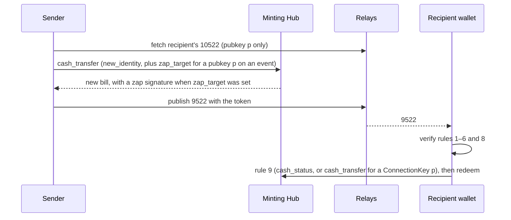

NIP-CZ
======

Cash Zaps
---------

`draft` `optional`

**Depends on**: [NIP-CASH](./NIP-CASH.md) (Cash Hub)
**Related**: [NIP-AZ](./NIP-AZ.md) (AltZap), [NIP-IC](./NIP-IC.md) (Identity Connection), [NIP-CP](./NIP-CP.md) (Cash Pocket)

## Abstract

A Cash Zap is a zap paid with a NIP-CASH cash token instead of a Lightning invoice.

- The sender transfers a bill they hold to the recipient's identity, their Nostr pubkey or, for someone with no Nostr keypair yet, a ConnectionKey ([NIP-IC](./NIP-IC.md)).
- The sender publishes the token in a kind `9522` event tagging the zapped note, if any.
- The recipient redeems it to any Lightning invoice, or on-chain.
- A recipient lists the chains, minters and relays they accept in a kind `10522` event.

## Terminology

- **Cash Zap**: a kind `9522` event carrying a cash token issued to its `p`.
- **cash token**: a NIP-CASH token, `satscash1...` for Bitcoin.
- **Minter**: the Lightning node that signed the token, the node the minting Hub runs on, as a 33-byte compressed pubkey written as 66 lowercase hex characters.
  - A verifier compares a Minter with any other key, whether another Minter such as a `10522` `mint` tag or a Hub's x-only key (the author of its announcement, or the `pubkey` its Cash Hub connection's `get_info` returns), by its x-only part only: the last 32 bytes, as 64 lowercase hex, never the prefix byte.
  - For example, the Minter `0279be667ef9dcbbac55a06295ce870b07029bfcdb2dce28d959f2815b16f81798` matches the x-only key `79be667ef9dcbbac55a06295ce870b07029bfcdb2dce28d959f2815b16f81798`.
- **Zap signature**: the signature over a `satscash-zap:v1` payload (TLV `8` = `2`) that a Hub puts on the bill it issues for a `cash_transfer` with `zap_target`.
- **ConnectionKey**: NIP-IC's identifier of a Web Identity, lowercase `hex(SHA256("<platform>:<platform-user-id>"))`, used in place of a Nostr pubkey only for someone with no Nostr keypair yet.
  - It is built from the platform user ID in its canonical form for a platform [NIP-IC](./NIP-IC.md) lists, and for any other platform taken from the recipient's `35522` attestation or `nconnection`.
  - A zap to it names the IA that vouches for it in its `ia` tag.
  - A client MUST NOT hash a Nostr identity into one.
- **Proxy Agent**: a bot or service that signs a Cash Zap on behalf of a platform user whose keys it does not hold.
- **Chain**: the coin behind the token, e.g. `bitcoin`, named by the token's prefix. Cash Zaps work the same for any energy-backed coin NIP-CASH supports; examples use Bitcoin.

## Specification

### Event Kinds

| Kind | Name | Signed by | Range |
|------|------|-----------|-------|
| `9522` | Cash Zap | Sender, or a Proxy Agent | regular |
| `10522` | Cash Zap Info | Recipient | replaceable |

### Chains

| Token prefix (HRP) | Chain | Signed-message prefix |
|---|---|---|
| `satscash` | `bitcoin` | `Lightning Signed Message:` |

For any other energy-backed coin, that coin's implementation defines its token prefix, chain name, signed-message prefix and milli-unit. A token whose prefix has no row the verifier knows carries no valid signature (rule 6).

### Identity Tags

`p` (recipient) and `P` (sender, a ConnectionKey only):

```
["p", "<hex-pubkey-or-ConnectionKey>", "<platform>"]
```

- `[1]` is 64 characters of lowercase hex, as in NIP-AZ; a reader rejects any other value, uppercase hex included, and never lowercases it (rule 2).
- If `[2]` is missing, empty or `nostr`, `[1]` is a Nostr pubkey.
- Otherwise `[2]` names a platform (`discord`, `email`, `x`, ...) and `[1]` is a ConnectionKey.

### Sending



1. If `p` is a pubkey, fetch the recipient's `10522`. If it lists `chain` tags, the sender MUST use one; if it lists `mint` tags for that chain, the sender SHOULD send a bill minted by one of them.
2. Call `cash_transfer` on an identity-bound bill the sender holds, with `amount_millis` equal to the zap amount and `new_identity`:
   - pubkey `p`: `{"identity_type": "pubkey", "identity_value": "<p>"}`
   - ConnectionKey `p`: `{"identity_type": "connection_key", "identity_value": "<p>", "ia_pubkey": "<ia>"}`, with `<ia>` an Identity Authority the minting Hub trusts, also put in the `ia` tag.

   **`zap_target`.** For a pubkey `p` and a zap on an event, the sender SHOULD set `zap_target` (required for the zap to be counted) to the target's `a` coordinate, or else its `e` id, from a bill bound to the pubkey that will sign the `9522`.

   | Zap | Tags on the `9522` | `zap_target` |
   |---|---|---|
   | pubkey `p`, on an event with an `a` coordinate | `a`, and optionally `e` naming the same event | the `a` tag's value, byte for byte |
   | pubkey `p`, on an event by `e` id | `e`, no `a` | the `e` tag's value |
   | pubkey `p`, on no event (e.g. on a profile) | neither `e` nor `a` | none; valid, but never counted |
   | ConnectionKey `p` | | none |

   - A Hub refuses `zap_target` on a bill not bound to a pubkey, so a sender holding a bill bound to a ConnectionKey first moves it to the pubkey that will sign the `9522`, with a full `cash_transfer`, and zaps from that bill.
   - If the `9522` carries an `a` tag, `zap_target` MUST equal that tag's value byte for byte; otherwise it MUST equal the `e` tag's value. A sender whose bill was signed over an `e` id MUST NOT add an `a` tag.
   - The Hub then issues a new bill with a zap signature, even for a full transfer; its `issued_at` and `expires_at` go in the `9522`.
   - A transfer reply without `issued_at` comes from a Hub that ignored `zap_target`; the bill carries no zap signature and the zap will not be counted.
   - `zap_target` requires a pubkey `p`: a ConnectionKey zap carries none.
   - A zap on no event (e.g. on a profile) carries neither `e` nor `a` and no `zap_target`; it is valid, but never counted.

   **ConnectionKey `p`.** For a ConnectionKey `p`, the sender MAY derive the key from a user ID it is given only for a platform with a canonical form in NIP-IC. For any other platform the sender:
   - MUST take the key from the recipient's `35522` attestation or `nconnection`, byte for byte;
   - MUST NOT derive it from typed input;
   - MUST name in `ia` the IA that attested it.

   **The call.**
   - As NIP-CASH requires, the call carries a kind-23198 claim proof (`identity_event`) signed by the pubkey the bill is bound to, with `["m", "cash_transfer"]`, and its kind-23192 item proof is signed by that same key.
   - A Hub owner zaps the same way: they mint a bill to themselves, then transfer it.
   - The sender MUST NOT set `new_identity` to `cash`: its secret is not in the token, so only the sender could redeem it.
   - The sender MUST send a `request_id`, as NIP-CASH requires on every call that creates a bill, and recovers a lost reply with `cash_lookup`.
   - A bill keeps its expiry when transferred, so the sender SHOULD pick one with a long remaining life, above all for a ConnectionKey `p`.
3. Publish to:
   - the recipient's `10522` relays (else their [NIP-65](https://github.com/nostr-protocol/nips/blob/master/65.md) read relays) and the sender's write relays;
   - for a ConnectionKey `p`, also its NIP-IC identity connection's relays if known; the sender MAY also notify the recipient on their platform, in fixed client text with no sender-supplied link (e.g. "open any Nostr wallet").

### Kind 9522 — Cash Zap

```json
{
  "kind": 9522,
  "content": "Great post!",
  "tags": [
    ["e", "<optional-target-event-id>"],
    ["k", "<optional-target-event-kind>"],
    ["p", "<recipient-pubkey>"],
    ["amount", "21000"],
    ["chain", "bitcoin"],
    ["cash", "satscash1..."],
    ["w", "<token-wallet-pubkey>"],
    ["issued_at", "1760000000"],
    ["expires_at", "1790000000"]
  ],
  "pubkey": "<sender-pubkey>",
  "created_at": "<unix-timestamp>",
  "id": "...",
  "sig": "..."
}
```

| Tag | Group | Cardinality | Value |
|---|---|---|---|
| `p` | **Required tags** | exactly one | |
| `amount` | | exactly one | a positive integer in the chain's milli-unit (`msats` for `bitcoin`) |
| `chain` | | exactly one | |
| `cash` | | exactly one | |
| `w` | | exactly one | the token's wallet pubkey (TLV `0`), so every copy of a token can be found with `#w` |
| `ia` | | exactly one if `p` is a ConnectionKey, else none | |
| `e`, `a`, `k` | **Optional tags** | at most one each | `e` and `a` MUST name the same event |
| `P` | | at most one | |
| `issued_at`, `expires_at` | | at most one each; exactly one each when the token's TLV `8` is `2`, equal to the values in the bill's zap signature | `expires_at` is `0` for a bill that never expires |

On a token without TLV `8` = `2`, or whose zap signature does not verify (rule 7), `issued_at` and `expires_at` are both informational: the sender chose them, so a wallet takes `expires_at` from `cash_status` instead.

A `9522` MUST NOT carry a NIP-40 `expiration` tag.

**Signer and `P`.**
- Without `P`, the signer is the sender.
- With `P`, the signer is a Proxy Agent acting for `P`, and `P` MUST be a ConnectionKey: a Nostr user signs their own zaps.
- The bill is transferred from the Proxy Agent's own key; `P` is display only, e.g. "via @bot for discord:carol".
- Nothing proves `P`, so a client SHOULD credit `P` only if it trusts the signer, and otherwise show the zap as sent via the signer.

```json
{
  "kind": 9522,
  "content": "Sent via Proxy Application",
  "tags": [
    ["p", "<recipient-ConnectionKey>", "discord"],
    ["P", "<sender-ConnectionKey>", "discord"],
    ["amount", "100000"],
    ["chain", "bitcoin"],
    ["cash", "satscash1..."],
    ["w", "<token-wallet-pubkey>"],
    ["ia", "<ia-pubkey>"],
    ["expires_at", "1790000000"]
  ],
  "pubkey": "<proxy-agent-pubkey>",
  "created_at": "<unix-timestamp>",
  "id": "...",
  "sig": "..."
}
```

### Kind 10522 — Cash Zap Info

```json
{
  "kind": 10522,
  "content": "",
  "tags": [
    ["chain", "bitcoin"],
    ["chain", "<other-chain>"],
    ["mint", "<bitcoin-minter-node-pubkey>", "bitcoin"],
    ["mint", "<bitcoin-backup-minter-node-pubkey>", "bitcoin"],
    ["mint", "<other-chain-minter-node-pubkey>", "<other-chain>"],
    ["relay", "wss://relay.example.com"]
  ],
  "pubkey": "<recipient-pubkey>",
  "created_at": "<unix-timestamp>",
  "id": "...",
  "sig": "..."
}
```

- `chain`: one per accepted chain; none means any chain.
- `mint`: `["mint", "<minter-node-pubkey>", "<chain>"]`, a minter the recipient trusts on that chain, written as in §Terminology (Minter): 66 lowercase hex characters.
  - Senders SHOULD send cash from a listed minter.
  - Cash from an unlisted minter is accepted as untrusted: the recipient's wallet does not contact that minter until the recipient approves it.
  - A `mint` for an unaccepted chain, or without a chain, is ignored.
- `relay`: where the recipient's wallet reads Cash Zaps, for all chains.

A recipient with no `10522`, including every ConnectionKey, accepts any chain and trusts no minter.

A wallet trusts a minter's key for one network only. Neither the token nor its signature names the network, so approving an unknown minter SHOULD warn that its network cannot be verified.

## Verification Algorithm

- **Client**: shows or counts a `9522`, using only the event, its target, the token and the recipient's `10522`.
- **Recipient wallet**: decides whether the cash is the recipient's.
- **Relay**: MAY skip validation; if it validates, it applies the Client column.

Signature verification MUST come before trusting any tag.

| # | Rule | Client | Recipient wallet |
|---|------|--------|------------------|
| 1 | `id`/`sig` verify against `pubkey`. | MUST | MUST |
| 2 | Tags meet the cardinality in §Kind 9522 — Cash Zap, `amount`, `issued_at` and `expires_at` are unsigned decimal ASCII with no leading zeros (`0` for zero), `p`, `P` and `w` are 64-character lowercase hex, and `w` equals the token's TLV `0`. | MUST | MUST |
| 3 | `cash` decodes per NIP-CASH §Wire Format. | MUST | MUST |
| 4 | The token's prefix matches `chain`. | MUST | MUST |
| 5 | The token's identity-required hint (TLV `3`), if present, is `1`. | MUST | MUST |
| 6 | The token's signature recovers a Minter over the payload of its signature scheme (TLV `8`; for TLV `8` = `2`, the payload rebuilt in rule 7), and its attested amount (TLV `6`) equals `amount`. | MUST; TLV `8` = `2` to count it | MUST; a token without TLV `8` verifies over the legacy payload |
| 7 | The event has an `e` or `a` tag, `issued_at` and `expires_at` are present, and the zap signature verifies over the payload rebuilt below; `p` is the target's author; when the target is the `e` id (no `a` tag), `issued_at` is not earlier than the target's `created_at`. | to count it | — |
| 8 | The Minter is trusted for `chain`: by the reader, or in the recipient's `10522` `mint` tags. | to count it | MUST, unless the recipient approves it |
| 9 | The recipient's slice is unclaimed and its `amount_millis` equals `amount`. For a pubkey `p`, `cash_status` with `scope: mine` returns it; for a ConnectionKey `p`, a full in-place `cash_transfer` to the recipient's pubkey, using the attestation from `ia`, succeeds first. | — | MUST |

For rules 6 and 7, a verifier rebuilds the `satscash-zap:v1` payload from the token and this event, and verifies the signature against it:

```
satscash-zap:v1:<hrp>:<wallet_pubkey_hex>:<amount>:<relay_hash>:pubkey/<p>:pubkey/<pubkey>:<sha256(target)>:<issued_at>:<expires_at>
```

| Field | From |
|---|---|
| `<hrp>`, `<wallet_pubkey_hex>` | the token |
| `<relay_hash>` | the token's relay hints and connection secret |
| `<amount>`, `<p>`, `<issued_at>`, `<expires_at>` | the tags |
| `<pubkey>` | the signer of the `9522` |
| `target` | the `a` coordinate if the event has an `a` tag, else the `e` id |

What the rules show:
- Rules 1–8 show that a trusted Hub issued the amount to `p`, from the signer, for this target, not that the bill is still there (it can be revoked, expire or be claimed).
- Only rule 9 proves the cash is the recipient's: a wallet's funding equals the sum of its slices, so a matching amount means nobody else shares it.
- TLV `3` is not signed, so rule 5 only catches mistakes.
- Clients MUST NOT present a `9522` as value received.

## Receiving

- Incoming: `{"kinds": [9522], "#p": ["<recipient-pubkey>", "<connection-key>", ...]}` on the `10522` relays, including every ConnectionKey linked through NIP-IC. When linking a ConnectionKey, also query its identity connection's relays.
- Sent: `{"kinds": [9522], "authors": ["<user-pubkey>"]}` and `{"kinds": [9522], "#P": ["<connection-key>", ...]}`, with every ConnectionKey linked to the user through NIP-IC, never a Nostr pubkey.
- A wallet MUST NOT contact a Minter missing from the recipient's `mint` tags without their approval.
- A wallet uses only copies of a token whose signature verifies (rule 6). With TLV `8`, the signature covers the relay hints and the connection secret through the relay hash, so a copy carrying other ones fails, and a wallet MUST NOT contact its relays. A token without TLV `8` has unsigned relay hints, so a wallet SHOULD prefer the relays in the minting Hub's announcement.
- A token's state comes from `cash_status` only. A timeout MUST NOT be reported as spent.
- A wallet SHOULD keep the tokens it holds in a [NIP-CP](./NIP-CP.md) Cash Pocket, and SHOULD keep a zap bill's `9522` with it (NIP-CP `source`) until it moves the bill: the bill's provenance, and so its minting Hub, can be recovered only with that `9522` (rules 6 and 7).
- A wallet SHOULD claim promptly, since the minting Hub's owner can revoke until then. An external redemption pays `net_redeemable_millis`, and an on-chain withdrawal its quote's `payout_millis`; a zap at or below the Hub's base fee can only be consolidated or redeemed same-node. Wallets MAY show such a zap as "below the withdrawal fee, combine with others".
- Clients SHOULD NOT publish when a Cash Zap was claimed.

## Counting

A client MAY total Cash Zaps per note, shown apart from Lightning zaps. It counts a Cash Zap only if:

- it passes rules 1–8, so its Minter is trusted by the reader or listed in the recipient's `10522`;
- its `expires_at` is `0` (never), or `expires_at − issued_at` is at least the reader's minimum life, measured from `issued_at`, a client setting (e.g. 30 days).

A count means "issued to the recipient by a trusted Hub", not "received". ConnectionKey zaps, zaps with neither `e` nor `a`, and zaps that fail these checks, including legacy zaps without TLV `8` = `2`, MAY be listed, never totalled.

A token counts once, however many copies share its `w`.

A client MAY mark a Cash Zap past `expires_at` as possibly expired. A sender's NIP-09 deletion stops it counting, but does not revoke the token.

## Security Considerations

- **Fake value**: any node, the sender's own included, can make a valid zap signature and revoke the bill before it is claimed; counting only Minters the reader or the recipient trusts (rule 8) limits this to trusted Hubs.
- **Revocation**: until claimed, the minting Hub's owner can delete the bill, remove the slice, or untrust a ConnectionKey's IA. A sender who transferred the bill has no power over it. A zap revoked after it was issued still counts.
- **Identity Authorities**: a ConnectionKey zap is claimable by whoever its IA attests. The IA is chosen and vouched for by the minting Hub, so trusting the Hub includes trusting its IAs. Claim screens SHOULD show the IA.
- **Copies**: a copied token cannot be redeemed. The zap signature commits to the recipient, sender and target, so a copy re-tagged to another note, recipient or sender fails rule 7, and a copy of a token with TLV `8` carrying other relay hints or another connection secret fails rule 6.
- **Split bills**: TLV `6` attests the whole wallet. A zap signature is made only for a new bill issued to the recipient alone, but a bill without one could give the recipient one sat and others the rest. Only rule 9 catches it.
- **Proxy trust**: anyone can sign a `P` naming any platform account. `P` is display only, never a Nostr pubkey, and never the signed sender.
- **Inflated totals**: a transfer costs no fee, so two colluding users can zap one bill back and forth, and every pass is a fresh zap bill that counts. A client SHOULD NOT present Cash Zap totals as an economic signal, and MAY collapse repeated zaps between the same sender and recipient.

## Privacy Considerations

A Cash Zap shows its amount, chain, recipient and Minter; for a self-hosted Hub, the Minter is the sender's own node. The minting Hub learns the zapped event from `zap_target`, which the `9522` makes public anyway.

Anyone holding the public token can poll `get_balance` and `cash_status` and learn when the value left, via the tombstone's `retained_until`, and how, via its `reason`: redeemed, transferred, consolidated, reclaimed or expired. A sender who wants this hidden SHOULD send the token privately instead.
