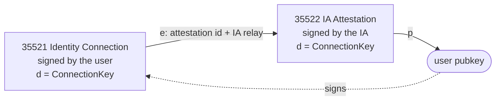
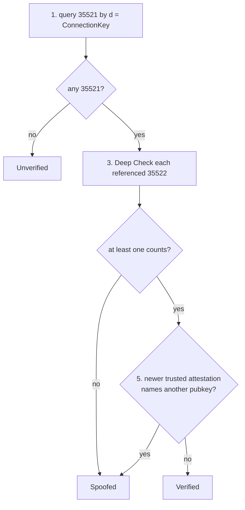

NIP-IC
======

Identity Connection: Web Identity Linking
-----------------------------------------

`draft` `optional`

**Depends on**: [NIP-09](https://github.com/nostr-protocol/nips/blob/master/09.md) (Event Deletion), [NIP-40](https://github.com/nostr-protocol/nips/blob/master/40.md) (Expiration Timestamp)
**Related**: [NIP-AZ](./NIP-AZ.md) (AltZap), [NIP-CZ](./NIP-CZ.md) (Cash Zaps)

## Abstract

Two event kinds bind a user's Nostr pubkey to an account on a non-Nostr platform (a **Web Identity**): Kind `35521` (Identity Connection), the user's own claim, and Kind `35522` (IA Attestation), signed by an **Identity Authority** (IA) that verified the account. A client resolves a ConnectionKey, the hash NIP-AZ, NIP-CZ and NIP-CASH use to address a recipient with no Nostr keypair yet, to a verified Nostr pubkey.

## Terminology

- **IA (Identity Authority)**: A service that verifies which Nostr pubkey controls a Web Identity and attests it in a Kind `35522` event. For a platform outside §Canonical Platform User IDs it also defines the platform's user-id format, and so the account's ConnectionKey. Anyone can run one, and each client chooses which IAs it trusts; there is no protocol-level allowlist.
- **Web Identity**: An account on a non-Nostr platform, e.g. a Discord, Telegram, X, GitHub, Instagram or Facebook account, a DNS domain, or an email address. Nostr itself is not a Web Identity. Any platform can be linked through an IA.
- **ConnectionKey**: An identifier of one Web Identity, used to address someone who has no Nostr keypair yet: `hex(SHA256("<platform>:<platform-user-id>"))`, in lowercase hex — the hash NIP-AZ, NIP-CZ and NIP-CASH use. The `d` tag of both event kinds in this NIP.
  - A client MUST build it from the canonical `<platform-user-id>` given in §Canonical Platform User IDs, or, for any other platform, take it from the IA's attestation as described there.
  - Such a key is defined by the IA that attested it, and wherever it addresses value it travels with that IA's pubkey (`ia_pubkey`).
  - A Nostr pubkey is never hashed into a ConnectionKey.
- **Deep Check**: Fetching the Kind `35522` attestation from its origin relay (rather than trusting an unverified reference) to confirm it is genuinely signed, unexpired, and unrevoked.
- **Challenge Token (`npv1`)**: A bech32-encoded, session-bound proof string a user publishes publicly on the Web Identity platform as evidence of control.

## Specification

### Canonical Platform User IDs

Every client hashing a ConnectionKey for the same account on a platform in the table below MUST get the same hash, so `<platform-user-id>` has one canonical form on each of these platforms. The table lists the only platforms whose canonical form a sender can compute from what a user types, and so the only ones for which a sender MAY derive a ConnectionKey from typed input:

| Platform | `<platform>` | `<platform-user-id>` |
|---|---|---|
| X | `x` | The numeric account ID, in decimal: 1 to 20 ASCII digits with no leading zero, sign or whitespace, below 2^64 (so `0` is not canonical). Not the handle. |
| Discord | `discord` | The numeric account ID, in decimal: 1 to 20 ASCII digits with no leading zero, sign or whitespace, below 2^64 (so `0` is not canonical). Not the username. |
| Email | `email` | The whole address, trimmed and lowercased, its domain part as IDNA A-labels without a trailing dot. |
| DNS domain | `dns` | The domain, trimmed, as IDNA A-labels, lowercased, without a trailing dot. |

Any other platform works through an IA, which defines that platform's user-id format and how it verifies an account:

- Its ConnectionKey is the hash of the exact `<platform>:<platform-user-id>` string the IA attests (the `35522`'s `platform` tag and `evidence.user_id`), byte for byte, with no normalization.
- A sender MUST NOT derive such a ConnectionKey from typed input: it MUST take the key from the recipient's `35522` attestation or `nconnection`.
- Wherever such a key addresses value, it travels with the pubkey of the IA that attested it (`ia_pubkey`), and trust in it rests on that IA alone: two IAs may define different user ids, and so different ConnectionKeys, for one account.

A `<platform>` name is one or more of the characters `a`–`z`, `0`–`9`, `.`, `_` and `-`, so it never contains `:`. An IA MUST NOT issue a `35522` whose `platform` is outside this format, and a client MUST NOT build or accept a ConnectionKey for one.

A domain, the `dns` value or the part of an `email` after its last `@`, is written as IDNA A-labels (punycode, e.g. `xn--bcher-kva.example`), never as Unicode. The steps a client applies:

- **Trimmed** means leading and trailing ASCII whitespace removed.
- **Lowercasing** is ASCII-only: only `A`–`Z` change.
- **A-label conversion** is the domain processing below.

| Platform | Trimming | ASCII lowercasing | A-label conversion |
|---|---|---|---|
| `email` | yes | yes | its domain part only |
| `dns` | yes | yes | yes |
| `x`, `discord` | no | no | no |

For `email` and `dns`, a client applies only trimming, ASCII lowercasing and the A-label conversion below; it applies nothing to an `x` or `discord` ID. A client MUST refuse a value that these steps do not bring to its canonical form, and never repairs one (e.g. by removing a leading zero, a leading `@` or a trailing dot); a refused value has no ConnectionKey.

A domain is processed in this order:

1. Trim and lowercase it (ASCII only).
2. After trimming and ASCII lowercasing, a client MUST refuse, never map, a domain that UTS #46 non-transitional mapping or NFC normalization would change (e.g. non-ASCII uppercase such as `Ü`, full-width forms, or a decomposed `ü`), and one that contains a deviation character (`ß`, `ς`, U+200C or U+200D), which UTS #46 processing modes convert differently.
3. It converts an accepted domain to A-labels with UTS #46 ToASCII, non-transitional, with CheckHyphens, CheckBidi, CheckJoiners, UseSTD3ASCIIRules and VerifyDnsLength set, and MUST refuse a domain ToASCII rejects.

The local part of an `email` gets no IDNA processing; a client MUST refuse one that NFC normalization would change.

Test vectors:

| Input | Result |
|---|---|
| `discord` account `80351110224678912` | ConnectionKey `22ced17fc7b3a6f7262d2dbe00b42d302948595468e025f4392b0a5022b8319d` (SHA256 of `discord:80351110224678912`) |
| `discord` account `080351110224678912` | refused (leading zero) |
| `dns` input `bücher.example` | `xn--bcher-kva.example` |
| `dns` input `BüCHER.example` | `xn--bcher-kva.example` (only ASCII letters are lowercased) |
| `dns` input `BÜCHER.example` | refused (non-ASCII uppercase) |
| `dns` input `faß.de` | refused (deviation character) |

No value carries a leading `@`.

### Event Kinds

| Kind | Name | Signed by | Replaceable |
|------|------|-----------|-------------|
| `35521` | Identity Connection | The end user | Yes (parameterized, per `d` tag) |
| `35522` | IA Attestation | The Identity Authority | Yes (parameterized, per `d` tag) |

Both are kind-30000-range parameterized replaceable events per NIP-01: a new event with the same `pubkey` + `d` tag replaces the prior one.

How the two events point at each other:



### Kind 35521 — Identity Connection

```json
{
  "kind": 35521,
  "pubkey": "<user-pubkey>",
  "created_at": "<unix-timestamp>",
  "tags": [
    ["d", "<connection-key>"],
    ["e", "<attestation-event-id>", "<ia-relay-url>"],
    ["platform", "<platform-name>"]
  ],
  "content": "<public-profile-json>",
  "id": "...",
  "sig": "..."
}
```

Published by the end user to claim a connection; on its own it is unverified.

**Required tags**: `d` (the bare ConnectionKey; it **MUST NOT** carry a platform prefix like `discord:`), `platform` (the Web Identity's platform name, for relay-side filtering), `e` (references the witnessing `35522`; see below).

**`e` tag**: `["e", "<attestation-event-id>", "<ia-relay-url>"]` — a **reference**, not an embed. The attestation is fetched from `<ia-relay-url>` on demand. A user MAY include multiple `e` tags, one per IA that has independently attested the same connection ("stacking") — a client only needs to trust one of them.

**`content`**: cleartext JSON profile metadata (`display_name`, `picture`, `user_id`, `username`) — copied from the IA's evidence for display, **not authoritative**: the authoritative `user_id`/`username` are in the referenced `35522`'s `evidence` tag.

### Kind 35522 — IA Attestation

```json
{
  "kind": 35522,
  "content": "",
  "tags": [
    ["d", "<connection-key>"],
    ["p", "<user-pubkey>"],
    ["platform", "<platform-name>"],
    ["evidence", "<verification-payload-json>"],
    ["expiration", "<unix-timestamp>"]
  ],
  "pubkey": "<ia-pubkey>",
  "created_at": "<unix-timestamp>",
  "id": "...",
  "sig": "..."
}
```

Signed by the IA on completing a successful verification. `content` is always empty. Its `created_at` is the time the IA signs it: an IA MUST NOT date a `35522` in the future.

**Required tags**:

| Tag | Value |
|---|---|
| `d` | same ConnectionKey as the `35521` it will be referenced by |
| `p` | the Nostr pubkey that proved ownership — a client MUST verify this equals the outer `35521`'s `pubkey` when cross-checking |
| `platform` | the Web Identity's platform name |
| `evidence` | see below |

`expiration` is a [NIP-40](https://github.com/nostr-protocol/nips/blob/master/40.md) timestamp; a default of 90 days is RECOMMENDED, and an IA MAY omit it for a non-expiring attestation.

#### The `evidence` Tag

A cleartext JSON (v1) string:

| Field | Type | Description |
|---|---|---|
| `version` | number | Always `1`. |
| `platform` | string | Web Identity platform name. |
| `auth_type` | string | How the IA verified control of the account. `"public_post"` is defined below; IAs MAY use other values (e.g. a one-time code sent to an email address). |
| `user_id` | string | The platform account identifier: its canonical form for a platform listed in §Canonical Platform User IDs, otherwise the form the IA defines. The IA MUST set `d` to the ConnectionKey of `platform` and this value. |
| `username` | string | The provider handle at verification time. |
| `verified_at` | number | Unix timestamp of successful verification. |
| `evidence_url` | string | `public_post` only: URL of the public post carrying the challenge. |
| `challenge` | string | `public_post` only: the `npv11...` challenge token published at `evidence_url`. |
| `pre_auth_code` | string | `public_post` only: the raw code the challenge was derived from — REQUIRED for cross-IA re-verification (see below). |

With `public_post`, any IA can re-verify the claim without user interaction: fetch `evidence_url` and confirm `challenge` is present. With any other `auth_type`, the attestation rests only on the IA's signature and cannot be re-verified by another IA.

#### The `npv1` Challenge Token

A bech32-encoded TLV binding a challenge to one user and session:

```
type=0x00 || length=0x20 || value=SHA256(pubkey_bytes || pre_auth_code_bytes)
```

`pubkey_bytes` is the 32-byte raw public key (the hex pubkey, decoded). `pre_auth_code_bytes` is the UTF-8 encoding of the `pre_auth_code` string exactly as it appears in `evidence`. The bech32 human-readable part is `npv1`, so encoded tokens start with `npv11`.

Test vector: pubkey `79be667ef9dcbbac55a06295ce870b07029bfcdb2dce28d959f2815b16f81798` and `pre_auth_code` `123456` give the session hash `b577731d8cea3eade64af38643bddd9c17d13718b1421dc7618ea3d74cdb629a` and the token `npv11qqst2amnrkxw504due908pjrhhwec973xuvtzssacascag7hfndk9xsn78h2f`.

A second IA performing cross-IA re-verification from existing evidence MUST:
1. Bech32-decode `challenge` to its 34-byte TLV payload.
2. Strip the 2-byte header (`0x00 0x20`) to recover the 32-byte session hash.
3. Recompute `SHA256(pubkey_bytes || pre_auth_code_bytes)` from the attestation's `p` tag and `evidence.pre_auth_code`.
4. Assert the two hashes are equal.

`public_post` evidence MUST include `pre_auth_code`, without which step 3 cannot be performed.

### The `nconnection` Bech32 Encoding

A string bundling a ConnectionKey with the relays where its `35521` events are published, and optionally its platform, as TLV in the pattern [NIP-19](https://github.com/nostr-protocol/nips/blob/master/19.md) uses for `nprofile`/`nevent`:

| Type | Name | Length | Description | Cardinality |
|---|---|---|---|---|
| `0` | Special | 32 bytes | The raw ConnectionKey bytes (hex-decoded). | exactly one, REQUIRED |
| `1` | Relay | variable | A relay URL, ASCII. | zero or more, order preserved |
| `2` | Platform | variable | The `<platform>` name, ASCII. | zero or one, OPTIONAL |

The encoding is NIP-19's: the TLV entries `<type: 1 byte><length: 1 byte><value>`, concatenated and bech32-encoded with the human-readable part `nconnection`, with no length limit on the string. A decoder MUST ignore a TLV of an unrecognized type. A decoder MUST reject an `nconnection` that has:

- no type `0`;
- more than one type `0` or type `2`;
- a type `0` whose length is not 32;
- or a TLV whose length runs past the end of the data.

An encoder MUST NOT produce any of these.

Test vector: the Discord ConnectionKey `22ced17fc7b3a6f7262d2dbe00b42d302948595468e025f4392b0a5022b8319d`, relay `wss://relay.example.com` and platform `discord`, in that order, are the TLV bytes `002022ced17fc7b3a6f7262d2dbe00b42d302948595468e025f4392b0a5022b8319d01177773733a2f2f72656c61792e6578616d706c652e636f6d0207646973636f7264`, which encode as:

```
nconnection1qqsz9nk30lrm8fhhyckjm0sqksknq22gt92x3cp97sujkzjsy2urr8gpzamhxue69uhhyetvv9ujuetcv9khqmr99e3k7mgzqajxjumrdaexg6u9jzw
```

`nconnection` is not a registered NIP-19 prefix.

## Verification Model

A client holding a 3-element identity tag (e.g. `["p", "<ConnectionKey>", "discord"]`, per NIP-AZ) resolves it to a Nostr identity as follows:

The IA is the authority, not the user's claim:

- An IA holds at most one current attestation per ConnectionKey: its latest `35522` for that `d` tag, which replaces any earlier one (see Event Lifecycle).
- The pubkey in that attestation's `p` tag is the only pubkey the IA links to the account.
- A `35521` that points to any other attestation is not verified, even if the attestation it points to is validly signed.

A client MUST NOT show a connection as **Verified** unless every check in step 3 passes. Steps 4 and 5 are MUST for a client that displays a state at all; how it renders each state is a SHOULD (see the table).

1. Query `{"kinds": [35521], "#d": ["<ConnectionKey>"]}`.
2. If no event is returned, the connection is **Unverified**: fall back to the Web Identity's own profile.
3. For each returned `35521` and each of its `e` tags, fetch the referenced `35522` from the relay hint (a Deep Check). The attestation counts only if all of the following hold:
   - it is a validly signed kind `35522` whose `pubkey` is an IA the client trusts;
   - its `d` and `platform` tags equal the `35521`'s `d` and `platform` tags;
   - its `p` tag equals the `35521`'s `pubkey`;
   - it is unexpired (NIP-40) and not deleted (NIP-09) on the IA's relays;
   - its `created_at` is no more than 15 minutes ahead of the verifier's clock;
   - it is the IA's current attestation: querying the IA's relays for `{"kinds": [35522], "authors": ["<ia-pubkey>"], "#d": ["<ConnectionKey>"]}` returns this same event ID.

   The IA's relays are the write relays of the IA's NIP-65 relay list. The relay hint is chosen by the claimant, so a verifier MUST NOT make these last two checks against the hint alone; when it cannot reach any of the IA's relays, the attestation does not count.
4. A `35521` with at least one attestation that counts is **Verified**. A `35521` without one is **Spoofed**: someone published a claim that does not check out, which is distinct from *Unverified*.
5. If trusted IAs' current attestations name different pubkeys for the same ConnectionKey, the attestation with the latest `created_at` wins; claims from every other pubkey are **Spoofed**. Only attestations that pass step 3 take part, so a verifier MUST ignore one dated more than 900 seconds ahead of its clock here too: a future-dated attestation cannot outrank every later re-verification.

| State | Condition | Recommended UI |
|---|---|---|
| **Verified** | `35521` found; it points to a trusted IA's current attestation for its own pubkey | ✅ native Nostr profile |
| **Unverified** | No `35521` found | ⏳ fallback Web Identity profile |
| **Spoofed** | `35521` found, but no attestation it points to passes step 3, or a newer attestation names another pubkey | ⚠️ flag as suspicious |

The same steps as a flow:



## Event Lifecycle

1. **Creation**: the user completes a verification flow with an IA; the IA signs `35522`.
2. **Publishing**: the IA publishes `35522` to its own relay(s).
3. **Linking**: the IA hands the `35522` event to the user's client, which builds the `e` tag from its event ID and the IA relay URL and publishes `35521`. The attestation itself is never embedded.
4. **Re-issue and transfer**: when the IA verifies the same account again, for the same pubkey or a new one, it publishes a new `35522` with the same `d` tag, which replaces the earlier one. Claims pointing to the replaced attestation stop verifying; the current owner publishes a new `35521` pointing to the new attestation.
5. **Revocation**: to revoke, the IA publishes a [Kind 5](https://github.com/nostr-protocol/nips/blob/master/09.md) deletion targeting the `35522` ID. This immediately fails any subsequent Deep Check.

## Security Considerations

- **Content-field spoofing**: `35521`'s `content` is user-controlled and unverified. An LNURL server MUST route payments strictly by the cryptographic `d`-tag hash, never by `content`. A verifying client MUST cross-check `content` claims against the fetched `35522`'s `evidence` and flag a mismatch as spoofed, rather than rendering `content` at face value.
- **Self-attestation**: a verifier MUST confirm the attesting `pubkey` is a key it (or its trust set) recognizes as an IA, not the user's own key.
- **Cross-session replay**: without the `npv1` binding check, a challenge published for one session could justify another.
- **`p`-tag confusion**: a verifying client MUST check that the attestation's `p` tag equals the outer `35521` event's own `pubkey`, however the attestation was referenced.
- **`d`-tag substitution**: the `p` check alone passes when a user points a `35521` for someone else's ConnectionKey at their own attestation for another account. A verifying client MUST check that the attestation's `d` and `platform` equal the `35521`'s.
- **Stale attestations**: a replaced or transferred `35522` can still be served by relays other than the IA's. A verifying client MUST confirm the referenced attestation is the IA's current one for that ConnectionKey (Verification Model, step 3), not just that it exists somewhere.
- **No private mode**: `evidence.user_id`/`evidence.username` are always cleartext and public once a `35522` is published.
- **Attestation expiry**: an IA SHOULD default to a bounded `expiration` (90 days is RECOMMENDED) rather than an unexpiring attestation.
