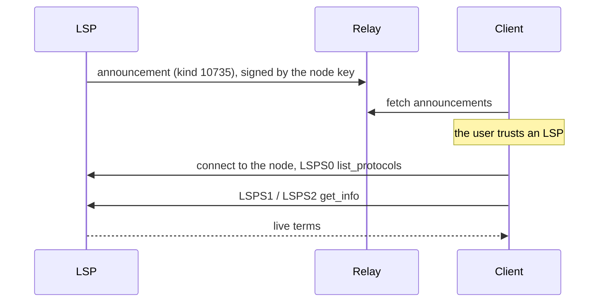

NIP-LSP
=======

Lightning Service Provider Announcement
---------------------------------------

`draft` `optional`

**Depends on**: [NIP-40](https://github.com/nostr-protocol/nips/blob/master/40.md) (Expiration Timestamp), [bLIP-50](https://github.com/lightning/blips/blob/master/blip-0050.md) (LSPS0), [bLIP-51](https://github.com/lightning/blips/blob/master/blip-0051.md) (LSPS1), [bLIP-52](https://github.com/lightning/blips/blob/master/blip-0052.md) (LSPS2), [bLIP-55](https://github.com/lightning/blips/blob/master/blip-0055.md) (LSPS5)
**Related**: [NIP-32](https://github.com/nostr-protocol/nips/blob/master/32.md) (Labeling), [NIP-31](https://github.com/nostr-protocol/nips/blob/master/31.md) (Unknown Events), [NIP-CASH](./NIP-CASH.md) (Cash Hub)

## Abstract

A Lightning Service Provider (LSP) announces the services it sells, with their parameters, in one replaceable
event signed by its Lightning node key. A client reads these events from relays to show its user which LSPs
exist and what they offer, without a central list. The user decides which LSPs to trust.

The announcement only advertises. Before using an LSP, a client connects to the node and asks it over LSPS;
the live answers always decide.



## Terminology

- **LSP**: a Lightning node that sells services defined by the LSPS specifications.
- **node key**: the key of the LSP's Lightning node, the one its node id is made of.
- **LSPS step data**: what an LSP returns in LSPS0 `list_protocols`, LSPS1 `get_info`, LSPS2 `get_info` and
  LSPS5 `set_webhook`.
- **base units** and **millis**: amounts in the chain's smallest unit (satoshis for Bitcoin), and in
  thousandths of it. LSPS names them `_sat` and `_msat`.

## The Announcement (kind 10735)

```jsonc
{
  "kind": 10735,
  "pubkey": "79be667ef9dcbbac55a06295ce870b07029bfcdb2dce28d959f2815b16f81798",
  "created_at": 1792713600,
  "content": "Inbound channels and just-in-time channels.",
  "tags": [
    ["addr", "vww6ybal4bd7szmgncyruucpgfkqahzddi37ktceo3ah7ngmcopnpyyd.onion:9735"],
    ["addr", "203.0.113.7:9735"],
    ["n", "bitcoin"],
    ["network", "mainnet"],
    ["status", "open"],
    ["expiration", "1795305600"],
    ["protocol", "1"],
    ["protocol", "2"],
    ["protocol", "5"],
    ["lsps1", "min_required_channel_confirmations", "0"],
    ["lsps1", "min_funding_confirms_within_blocks", "6"],
    ["lsps1", "supports_zero_channel_reserve", "false"],
    ["lsps1", "max_channel_expiry_blocks", "12960"],
    ["lsps1", "min_initial_client_balance", "0"],
    ["lsps1", "max_initial_client_balance", "1000000"],
    ["lsps1", "min_initial_lsp_balance", "0"],
    ["lsps1", "max_initial_lsp_balance", "10000000"],
    ["lsps1", "min_channel_balance", "100000"],
    ["lsps1", "max_channel_balance", "10000000"],
    ["lsps2_fee", "2000000", "4000", "4320", "2016", "10000000", "4000000000"],
    ["lsps5", "max_webhooks", "10"],
    ["title", "Alice's Liquidity"],
    ["website", "https://lsp.example.com"],
    ["p", "c6047f9441ed7d6d3045406e95c07cd85c778e4b8cef3ca7abac09b95c709ee5", "wss://relay.example.com"],
    ["L", "ISO-639-1"],
    ["l", "en", "ISO-639-1"],
    ["alt", "Lightning service provider: Alice's Liquidity"],
    ["r", "wss://relay.example.com"]
  ],
  "id": "d87841c795e01ba75208a603bc0bdfe7f2015ab3876860501e2f09d0c257a45b",
  "sig": "<signature by the node key>"
}
```

The event is replaceable: relays keep the newest one per node, and a filter
`{"kinds":[10735],"authors":["<node key>"]}` returns it.

- `pubkey` is the node key in its 32-byte x-only form. The node id is that key with the prefix `02` or `03`.
- The event MUST be signed by the node key.
- `content` is a short description of the LSP, at most 280 characters, or empty.

| tag | count | value |
|---|---|---|
| `addr` | 1 or more | where the node accepts connections: `host:port`, the host an IPv4 address, a bracketed IPv6 address or an onion address |
| `n` | 1 | the chain's name, e.g. `bitcoin`, as NIP-CASH §Network and Chain names it |
| `network` | 1 | `mainnet`, `testnet`, `signet` or `regtest` |
| `status` | 1 | `open`, `paused` or `closed` |
| `expiration` | 1 | NIP-40, at most 30 days after `created_at` |
| `protocol` | 1 or more | an LSPS number the LSP lists in LSPS0 `list_protocols`, e.g. `1`, `2`, `5` |
| `lsps1` | 1 per option | an LSPS1 `get_info` option, then its value |
| `lsps2_fee` | 1 or more | one row of the LSPS2 `opening_fee_params_menu` |
| `lsps5` | 1 per field | an LSPS5 field, then its value |
| `title` | 0 or 1 | the LSP's name, plain text |
| `website` | 0 or 1 | an `https` URL |
| `image` | 0 or 1 | an `https` URL of a logo |
| `p` | 0 or 1 | the operator's Nostr pubkey, then a relay hint |
| `L`, `l` | 0 or more | NIP-32 language labels, ISO-639-1 |
| `alt` | 0 or 1 | NIP-31 |
| `r` | 0 or more | relays where the LSP publishes this announcement |

- Numbers are unsigned decimal with no leading zeros. Booleans are `true` or `false`.
- `paused` means the LSP takes no new orders for now; `closed` means it has stopped selling.

### LSPS Step Data

Every `lsps1`, `lsps2_fee` and `lsps5` value copies what the LSP returns over LSPS, so a client can compare
the two.

- An `lsps1` tag names an option of LSPS1 `get_info` without its unit suffix. An amount ending in `_sat` in
  LSPS is in base units here.
- An `lsps2_fee` tag holds one row of LSPS2 `get_info`'s `opening_fee_params_menu`, in this order:

  | position | LSPS2 field | unit |
  |---|---|---|
  | 1 | `min_fee_msat` | millis |
  | 2 | `proportional` | parts per million |
  | 3 | `min_lifetime` | blocks |
  | 4 | `max_client_to_self_delay` | blocks |
  | 5 | `min_payment_size_msat` | millis |
  | 6 | `max_payment_size_msat` | millis |

- An `lsps5` tag names a field of LSPS5 `set_webhook`'s response: `max_webhooks`.
- `lsps1` tags are present only with `protocol` `1`, `lsps2_fee` tags only with `protocol` `2`, and `lsps5`
  tags only with `protocol` `5`.
- An LSP announcing `protocol` `1` SHOULD give every LSPS1 `get_info` option; one announcing `protocol` `2`
  MUST give at least one `lsps2_fee` row.

A row's `valid_until` and `promise` are never announced: they belong to one live answer. Nor is anything that
LSPS gives only during a purchase, such as an LSPS1 order's fee or LSPS2 `buy`'s results.

## Publishing

- An LSP SHOULD build the announcement from its own current LSPS answers.
- It MUST publish a new announcement whenever an announced value changes.
- It SHOULD republish at least every 7 days, each time with a new `expiration`.
- It SHOULD give an onion `addr`.
- Before it stops selling, it SHOULD publish `status` `closed`.
- It SHOULD publish to its `r` relays and to the write relays of its NIP-65 list.

## Client Behavior

A client checks an announcement in this order and ignores it at the first failure:

1. The signature verifies against `pubkey`, and the kind is 10735.
2. Every tag with a count of exactly 1 is present once, `addr` and `protocol` are present, and an
   announcement with `protocol` `2` has an `lsps2_fee` tag.
3. Every value has the form its table gives, and no `lsps1` option or `lsps5` field appears twice.
4. `expiration` has not passed and is at most 30 days after `created_at`.
5. `n` and `network` are a chain and network the client uses.

Then:

- A client ignores a tag this NIP does not define, an `lsps1` option or `lsps5` field it does not know, and an
  `lsps1`, `lsps2_fee` or `lsps5` tag whose `protocol` is missing.
- It keeps only the newest announcement of each node and remembers the newest it has seen. It MUST NOT fall
  back to an older announcement when the newest one fails a check.
- It does not show a `closed` announcement and offers nothing new through a `paused` one.
- It MUST NOT show `title`, `content` or `website` as verified facts: they are the LSP's claims. It SHOULD strip
  control and zero-width characters from them, cap `title` at 40 characters on one line and `content` at
  280, and never render links in them.
- It SHOULD load `image` only after the user asks to.

**Trust.** The user, not the announcement, decides which LSPs to use, and a client keeps that choice per node
key.

**Connecting.** The node id is `02` or `03` followed by `pubkey`. A client takes the one its own view of the
Lightning network knows, or else tries both: a connection to the wrong one fails, and a connection to either
reaches only the node that holds the key.

**Live check.** When the user trusts an LSP, and before each purchase, a client:

1. Connects to the node through one of its `addr` values.
2. Asks LSPS0 `list_protocols`. When an announced `protocol` is not listed, the client does not use the LSP.
3. Asks LSPS1 or LSPS2 `get_info` for the service it is about to use.

The live answers decide. When they are worse for the user than the announced ones, the client SHOULD show
both and ask again before buying.

## Security Considerations

- **Spam.** Anyone can make a node key and announce. A client SHOULD bound how many announcements it reads and
  SHOULD show facts it knows itself, such as whether the node has public channels, apart from the LSP's claims.
- **Copied names.** A `title` proves nothing. A client SHOULD show the node id next to it, and SHOULD mark two
  announcements with the same `title`.
- **Bait terms.** An LSP may announce better terms than it sells. The live check exposes the difference before
  the user pays.
- **Old versions.** A relay may serve an older announcement. Remembering the newest one seen, and its
  `expiration`, limits the damage.
- **The node key.** The node key signs this event as well as its Lightning messages. A signer SHOULD sign only
  this kind of Nostr event with it.

## Privacy Considerations

- An announcement makes the node public. An LSP that does not want its address known SHOULD give only an onion
  `addr`.
- A client that connects to every announced node reveals its own address to each. A client SHOULD connect only
  to LSPs its user chose.
