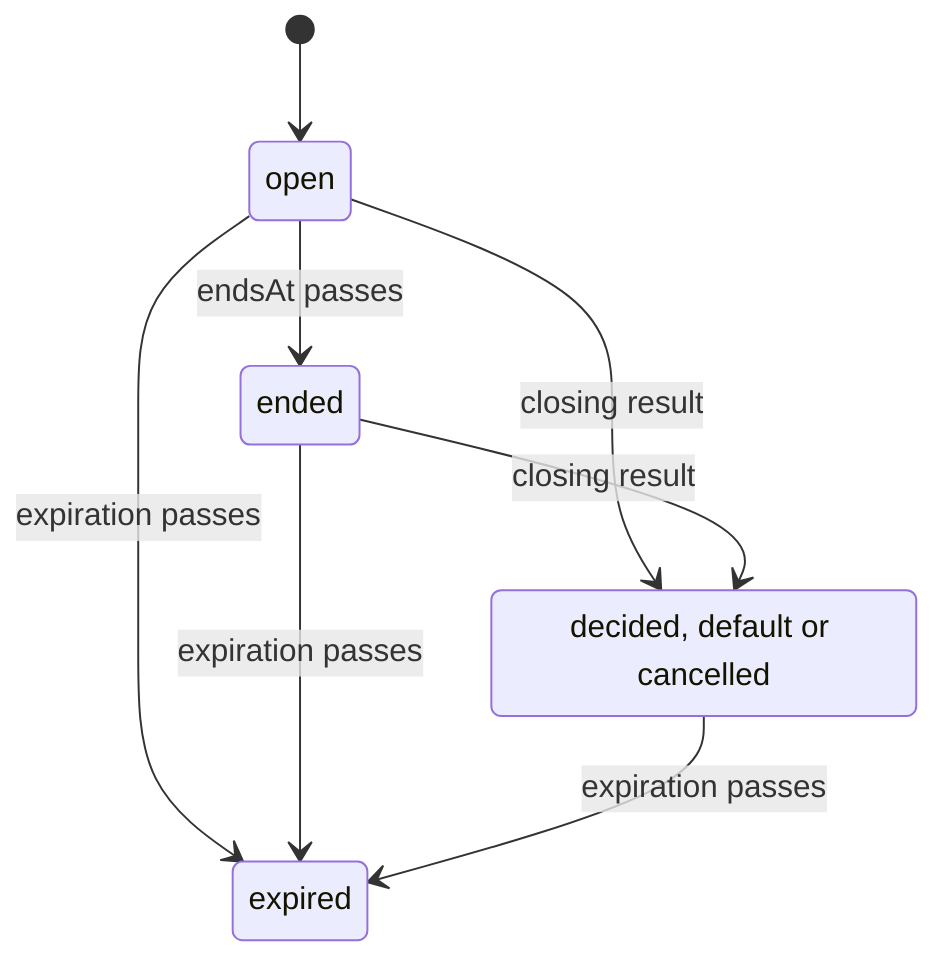

NIP-PF
======

Poll Forms
----------

`draft` `optional`

**Depends on**: [NIP-59](https://github.com/nostr-protocol/nips/blob/master/59.md) (Gift Wrap), [NIP-40](https://github.com/nostr-protocol/nips/blob/master/40.md) (Expiration Timestamp)
**Related**: [NIP-88](https://github.com/nostr-protocol/nips/blob/master/88.md) (Polls), [NIP-29](https://github.com/nostr-protocol/nips/blob/master/29.md) (Relay-based Groups), [NIP-31](https://github.com/nostr-protocol/nips/blob/master/31.md) (Unknown Events), [NIP-09](https://github.com/nostr-protocol/nips/blob/master/09.md) (Event Deletion Request), [NIP-65](https://github.com/nostr-protocol/nips/blob/master/65.md) (Relay List Metadata)

## Abstract

A form (`kind:1069`) asks one or more questions answered in one response (`kind:1019`). It can recommend
options with a reason, give context, name its subject, set defaults, require a quorum, limit who may
respond, and expire. Any answer can carry a note. The author records the outcome in a result
(`kind:1070`), which closes the form.

[NIP-88](https://github.com/nostr-protocol/nips/blob/master/88.md) polls (`kind:1068`) may carry the same
recommendations and notes, and be closed by a result, without changing how NIP-88 counts votes.

Tags are read at fixed positions, in any order.

## Shared rules

### Recommendations and required notes

| tag | meaning |
|---|---|
| `["rec", <option id>]` | the author recommends this option; repeatable |
| `["noteRequired", <option id>]` | choosing this option requires a note; repeatable |

A `rec` or `noteRequired` tag naming no option of the event is ignored.

### Notes

Any answer MAY carry a note: at position 2 of a `response` tag, at position 3 of an `answer` tag.

```
["response", <option id>, <note>]
["answer", <index>, <value>, <note>]
```

A note that is empty after trimming whitespace is no note.

### Text

Titles, questions, labels, context, notes and answers are plain text. A client shows them without markup
and loads no media from them. A client SHOULD keep each note and answer under 1000 characters.

### Expiration

Any event of this NIP MAY carry an `expiration` tag (NIP-40):

- the responses, votes and result of a form or poll SHOULD carry its `expiration`;
- a gift wrap of such an event SHOULD carry it too, on the wrap;
- after `expiration`, a client stops showing these events and SHOULD delete its copies.

Private forms SHOULD carry an `expiration`.

## Polls (`kind:1068`)

Use a poll when NIP-88 clients should count it, a form otherwise. A poll MAY carry `rec`, `noteRequired`,
`expiration` and one `why` tag:

```
["why", <one sentence>]
```

`why` is the reason for the `rec` options. A `singlechoice` poll SHOULD have at most one `rec` option.

A client MUST select and count votes as NIP-88 does; these tags and notes never invalidate a vote NIP-88
accepts. Notes are read only from the `response` tags NIP-88 counts and are not counted.

A result MAY close a poll. It names existing option ids, one for a `singlechoice` poll, and its status is
`decided` or `cancelled`. A client then shows the poll as closed with that outcome; counting stays
NIP-88's.

## Form (`kind:1069`)

A form received as a rumor in a gift wrap is private; a signed, published form is public. `content` is
the title.

| tag | meaning |
|---|---|
| `["question", <index>, <text>, <type>, <why>]` | a question |
| `["option", <id>, <label>, <index>]` | an option of question `<index>` |
| `["optional", <index>]` | question `<index>` may be left unanswered |
| `["min", <index>, <value>]`, `["max", <index>, <value>]` | bounds of a `number`, `date` or `time` question |
| `["default", <index>, <value>]` | applied if no outcome is reached; repeatable for `multiplechoice` |
| `["rec", <id>]`, `["noteRequired", <id>]` | see Shared rules |
| `["context", <text>]` | background for the responder |
| `["e", <event id>]`, `["a", <coordinate>]` | the form's subject; repeatable |
| `["p", <pubkey>, <relay>, <role>]` | an addressed pubkey; `<role>` is `responder` (default) or `observer`; repeatable |
| `["quorum", <n>]` | an outcome needs at least `n` valid responses |
| `["priority", "high"]` | notify promptly; any other value is ignored |
| `["endsAt", <unix seconds>]` | responses created after it are ignored |
| `["expiration", <unix seconds>]` | see Shared rules |
| `["relay", <url>]` | where responses and the result are expected; repeatable |
| `["results", "all"]` | private forms: see Delivery; any other value is ignored |
| `["alt", <text>]` | REQUIRED on public and group forms (NIP-31) |

### Questions

`index` is a decimal string without leading zeros; indexes run `"0"`, `"1"`, … without gaps and set the
display order. `why`, optional, is one sentence giving the reason for the question's `rec` options.

| type | answered with | value |
|---|---|---|
| `singlechoice` | one `response` | option id |
| `multiplechoice` | one or more `response` | option ids |
| `text` | one `answer` | non-empty text |
| `number` | one `answer` | `-?(0\|[1-9][0-9]*)(\.[0-9]+)?`, at most 18 significant digits, compared numerically |
| `date` | one `answer` | a valid calendar date, `YYYY-MM-DD` |
| `time` | one `answer` | unix seconds, `0\|[1-9][0-9]*` |

Digits are ASCII. `min`, `max` and `default` use the answer's format; for a choice question, `default` is
an option of that question.

### Options

`id` is ASCII letters, digits, `-` and `_`, unique in the form, case-sensitive.

### Responders

- With `responder` pubkeys, only they may respond.
- Without them, a public or group form accepts any pubkey; a private form accepts only the author.
- `observer` pubkeys receive the form, and its responses if `results` is `all`, but may not respond.
- An unknown role counts as `observer`; a pubkey listed with both roles is a `responder`.

A client notifies the `p` pubkeys of a public or group form, honours `priority` only from authors the
person follows or has allowed, and shows each question's `default`.

### Validity

A form is valid when:

- it has at least one `question`, with unique indexes without gaps;
- every option names an existing choice question; each choice question has an option and no other
  question has one; option ids are unique;
- every index named by `optional`, `min`, `max` or `default` exists;
- `min`, `max` and `default` match their question's type, and `min` ≤ `max`;
- a question other than `multiplechoice` has at most one `default`;
- `quorum` is a positive integer, at most the number of `responder` pubkeys if there are any;
- `expiration` is not earlier than `endsAt`;
- a private form has at least one `p` tag;
- `context`, `quorum`, `priority`, `endsAt`, `expiration`, `results` and `alt` appear at most once.

A client does not show an invalid form. A missing `alt` does not make a form invalid. A question type not
listed here makes a form read-only, not invalid; every rule of this NIP that depends on a question's type
skips such questions. A client answers a form only if it supports every question type and every `option`,
`optional`, `min`, `max` and `noteRequired` tag the form uses; otherwise it shows the form read-only. A
`singlechoice` question SHOULD have at most one `rec` option. A form cannot be edited; a follow-up
question is a new form whose `e` tag names the earlier form or its result.

## Response (`kind:1019`)

```
["e", <form id>]
["p", <form author>]
["response", <option id>, <note>]
["answer", <index>, <value>, <note>]
```

`content` is empty. A response SHOULD carry `p` with the form's author. A response with one `e` tag and no
`response` or `answer` tag is a **withdrawal**. A client MUST NOT publish a response that is invalid for
the form.

A response other than a withdrawal is valid when:

- it has exactly one `e` tag;
- every option id exists in the form and appears once;
- each `singlechoice` question has exactly one response, at most one if `optional`;
- each `multiplechoice` question has at least one, any number if `optional`;
- each other question has exactly one `answer`, at most one if `optional`, with a valid value within
  `min` and `max`; every `answer` names such a question;
- every response to a `noteRequired` option has a note.

## Result (`kind:1070`)

```
["e", <form or poll id>]
["p", <responder>]
["status", <status>]
["response", <option id>]
["answer", <index>, <value>]
```

| status | outcome |
|---|---|
| `decided` | from the responses, valid by the response rules; quorum met if any, as the author's claim, not checked |
| `default` | exactly the form's defaults, questions without one unanswered; only for a form with a `default` tag |
| `cancelled` | none; the form is withdrawn |

A result is valid when it has exactly one `e` tag, one `status` from the table, and an outcome matching
that status; an invalid result is ignored. A result carries a `p` tag per `responder`, and its notes are
optional. `content` MAY say what the author did. The author decides how responses lead to a `decided`
outcome; a result records the outcome but does not prove it. A result closing a poll follows Polls.

When `endsAt` passes without a result, the author SHOULD publish one with status `default` or
`cancelled`. A `cancelled` result withdraws a form; a deletion request (NIP-09) MAY follow.

## Lifecycle

| state | when |
|---|---|
| `open` | no closing result, `endsAt` absent or not passed |
| `ended` | `endsAt` passed, no closing result |
| `decided`, `default`, `cancelled` | the closing result's status |
| `expired` | `expiration` passed; overrides the others |



The **closing result** is the earliest valid result by the form's or poll's author.

**Selection (forms).** For each pubkey allowed by Responders, take its valid responses and withdrawals
not later than `endsAt` and the closing result's `created_at`, and keep the one with the largest
`created_at`. If it is a withdrawal, the pubkey has no response. Invalid responses are ignored.

Ties on `created_at`, for the closing result and for selection, go to the lowest event id.

**Tally.** Per question: selected responses per option, notes per option, and answers.

A client shows an `ended` or closed form as closed, with its outcome.

## Delivery

**Public.** A form goes to its `relay` tags, or to the author's write relays (NIP-65); responses and the
result go to the same relays.

| to find | filter |
|---|---|
| forms addressed to me | `{"kinds":[1069], "#p":[<me>]}` |
| forms about an event | `{"kinds":[1069], "#e":[<event id>]}` |
| responses to a form | `{"kinds":[1019], "#e":[<form id>]}` |
| responses to my forms | `{"kinds":[1019], "#p":[<me>]}` |
| the result | `{"kinds":[1070], "#e":[<form id>]}` |

**Private answer.** A response or NIP-88 vote MAY be sealed and gift-wrapped (NIP-59) to the author only.

**Group.** A form, its responses and its result carry the group's `h` tag (NIP-29); `relay` tags SHOULD
name the group's relay. The same holds for polls.

**Private form.** The same rumor is sealed and gift-wrapped to each `p` pubkey, so all recipients share
its id. A response is wrapped to the author, and to every `p` pubkey if `results` is `all`, which suits
small groups; large ones use a NIP-29 group. The result is wrapped to every `p` pubkey of the form. `e`
tags hold rumor ids.

A wrap goes to the receiver's `kind:10050` relays, and the sender SHOULD wrap a copy to itself. A wrapped
event counts only if the rumor's `pubkey` equals the seal's signer.

## Relays

Relays need no new behaviour, except that a group relay hosting forms accepts these kinds. A relay SHOULD
honour `expiration`. A group relay MAY reject responses and results from non-members, and responses
created after the closing result.

## Trust

`created_at` is set by the signer; timing rules take it as claimed.

Responses are signed: a private answer is hidden from other responders, not from the author. This NIP
offers no anonymity.

Any pubkey can respond to a public form outside a group and without `responder` pubkeys, so its counts can
be inflated with new pubkeys. A client SHOULD say so, and MAY count only pubkeys the viewer trusts.

## Compatibility

A poll using this NIP is a NIP-88 poll: NIP-88 clients count it the same and ignore the rest, but cannot
see wrapped votes. Clients without this NIP show a form's `alt`.

## Examples

### Private approval with a quorum

```json
{
  "kind": 1069,
  "content": "Restart the payment service?",
  "tags": [
    ["context", "Memory use grew from 2 GB to 7 GB in 6 hours; a restart takes about 40 seconds and drops in-flight requests."],
    ["e", "<alert event id>"],
    ["p", "<operator 1>"], ["p", "<operator 2>"], ["p", "<operator 3>"],
    ["p", "<observer>", "", "observer"],
    ["quorum", "2"],
    ["priority", "high"],
    ["endsAt", "1793430000"],
    ["expiration", "1794034800"],
    ["question", "0", "Restart now?", "singlechoice", "Memory will run out in about an hour at this rate."],
    ["option", "restart", "Restart now", "0"],
    ["option", "wait", "Wait", "0"],
    ["option", "other", "Something else", "0"],
    ["rec", "restart"],
    ["noteRequired", "other"],
    ["default", "0", "wait"],
    ["question", "1", "Restart no later than", "time"],
    ["optional", "1"],
    ["max", "1", "1793430000"]
  ]
}
```

Response:

```json
{
  "kind": 1019,
  "content": "",
  "tags": [
    ["e", "<form id>"],
    ["p", "<author>"],
    ["expiration", "1794034800"],
    ["response", "restart", "Fine, traffic is low now"]
  ]
}
```

Result:

```json
{
  "kind": 1070,
  "content": "Restarted at 14:02; memory back to 2 GB.",
  "tags": [
    ["e", "<form id>"],
    ["p", "<operator 1>"], ["p", "<operator 2>"], ["p", "<operator 3>"],
    ["expiration", "1794034800"],
    ["status", "decided"],
    ["response", "restart"]
  ]
}
```

### Public form

```json
{
  "kind": 1069,
  "content": "Planning the next meetup",
  "tags": [
    ["alt", "Form: Planning the next meetup"],
    ["endsAt", "1793430000"],
    ["relay", "wss://relay.example.com"],
    ["question", "0", "Where?", "singlechoice", "The library has a free room with a projector."],
    ["question", "1", "Which days work for you?", "multiplechoice"],
    ["question", "2", "How many people will you bring?", "number"],
    ["question", "3", "Anything we should know?", "text"],
    ["optional", "3"],
    ["min", "2", "0"],
    ["max", "2", "5"],
    ["option", "library", "Library", "0"],
    ["option", "cafe", "Café", "0"],
    ["option", "other", "Other", "0"],
    ["option", "sat", "Saturday", "1"],
    ["option", "sun", "Sunday", "1"],
    ["rec", "library"],
    ["noteRequired", "other"]
  ]
}
```

```json
{
  "kind": 1019,
  "content": "",
  "tags": [
    ["e", "<form id>"],
    ["p", "<author>"],
    ["response", "other", "The park, if it is sunny"],
    ["response", "sat", "Only after 14:00"],
    ["answer", "2", "1"]
  ]
}
```

### Closing a poll

```json
{
  "kind": 1070,
  "content": "The library is booked.",
  "tags": [
    ["e", "<poll id>"],
    ["status", "decided"],
    ["response", "a"]
  ]
}
```
