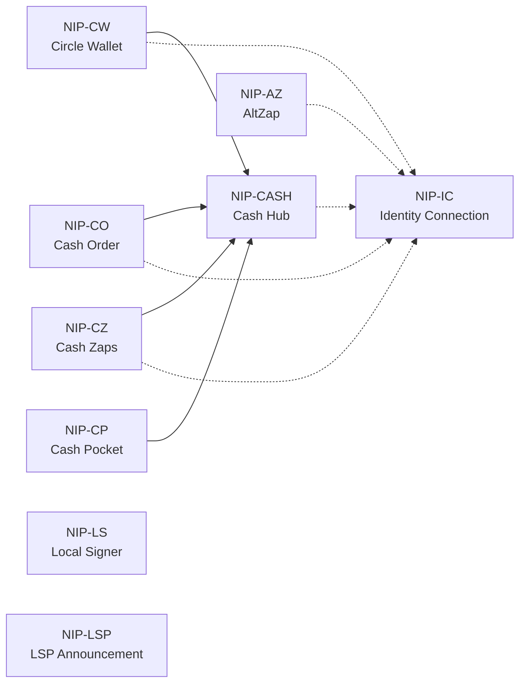

# nips

Nostr Improvement Proposals (NIPs) published by ohstr. Each NIP lists in its header the NIPs it depends on, in this repository or upstream; implementing it needs those too.

## NIPs in this repository

| NIP | Title | Kinds | Status |
|-----|-------|-------|--------|
| [NIP-AZ](./NIP-AZ.md) | AltZap: Cross-Chain Lightning Zaps | `9520`, `9521`, `9523` | `draft` |
| [NIP-CASH](./NIP-CASH.md) | Cash Hub | `11190`, `11191`, `23187`, `23188`, `23190`–`23193`, `23198`, `31190`, `31191` | `draft` |
| [NIP-CO](./NIP-CO.md) | Cash Order | `23189` | `draft` |
| [NIP-CP](./NIP-CP.md) | Cash Pocket | `9525` | `draft` |
| [NIP-CW](./NIP-CW.md) | Circle Wallet | `23199` | `draft` |
| [NIP-CZ](./NIP-CZ.md) | Cash Zaps | `9522`, `10522` | `draft` |
| [NIP-IC](./NIP-IC.md) | Identity Connection: Web Identity Linking | `35521`, `35522` | `draft` |
| [NIP-LS](./NIP-LS.md) | Local Signer: NIP-46 over a Unix Socket | — | `draft` |
| [NIP-LSP](./NIP-LSP.md) | Lightning Service Provider Announcement | `10735` | `draft` |

## How they fit together

A solid arrow means "depends on". A dotted arrow points to NIP-IC, which defines the Web Identities these
NIPs can name. Upstream NIPs and other "Related" links are left out.

Suggested reading order for the cash NIPs: NIP-CASH, then NIP-CP (holding bills), then NIP-CZ, NIP-CW and
NIP-CO, which each add one use of a Cash Hub. NIP-IC explains the Web Identities that bills, zaps and
orders can name.
